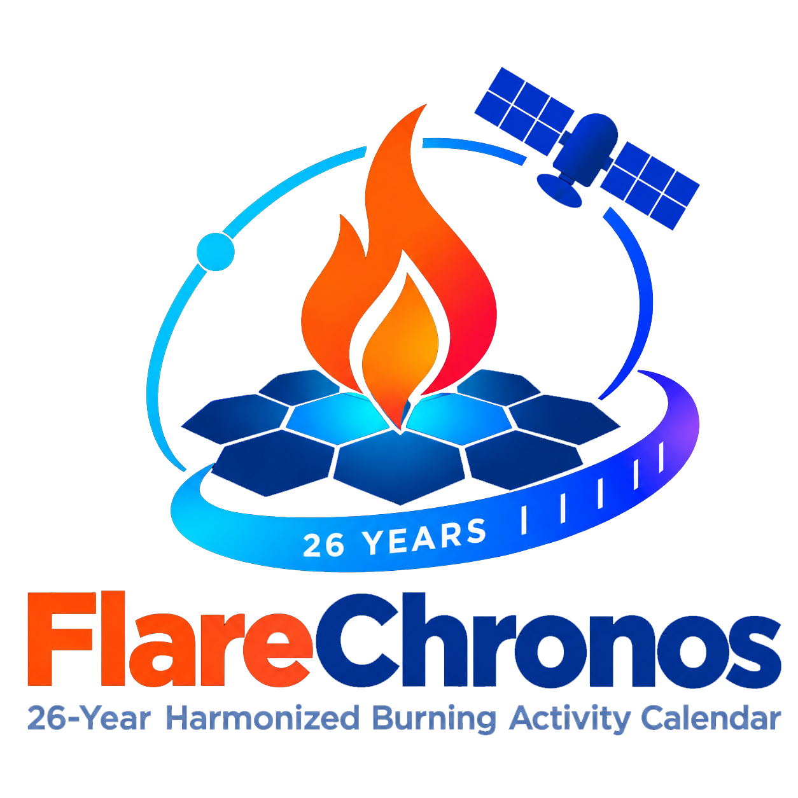
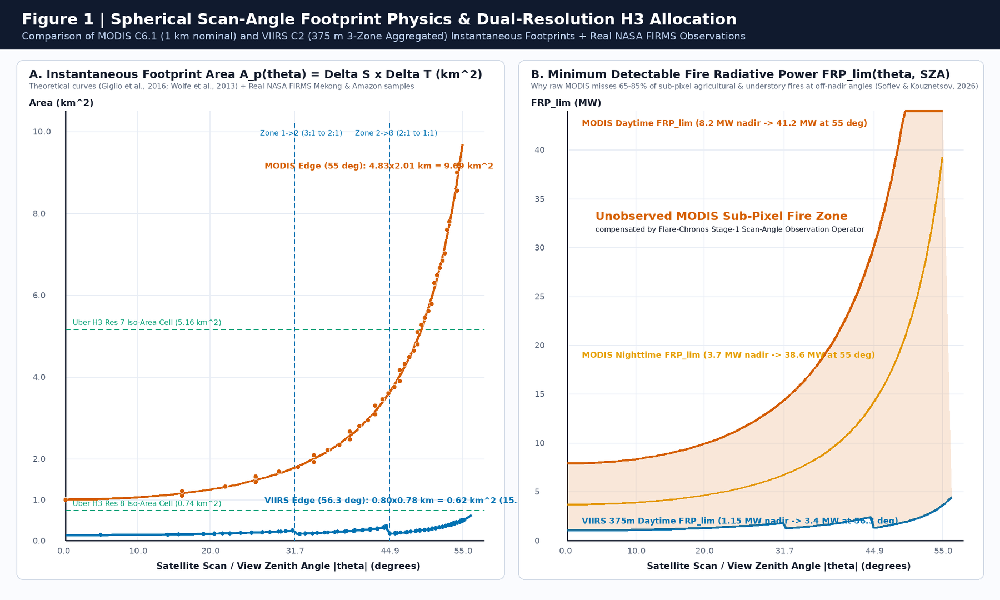
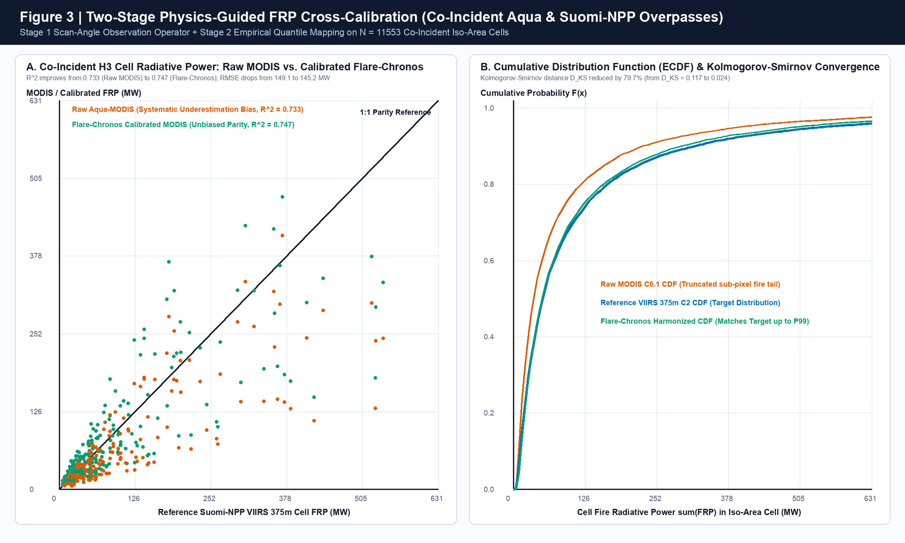
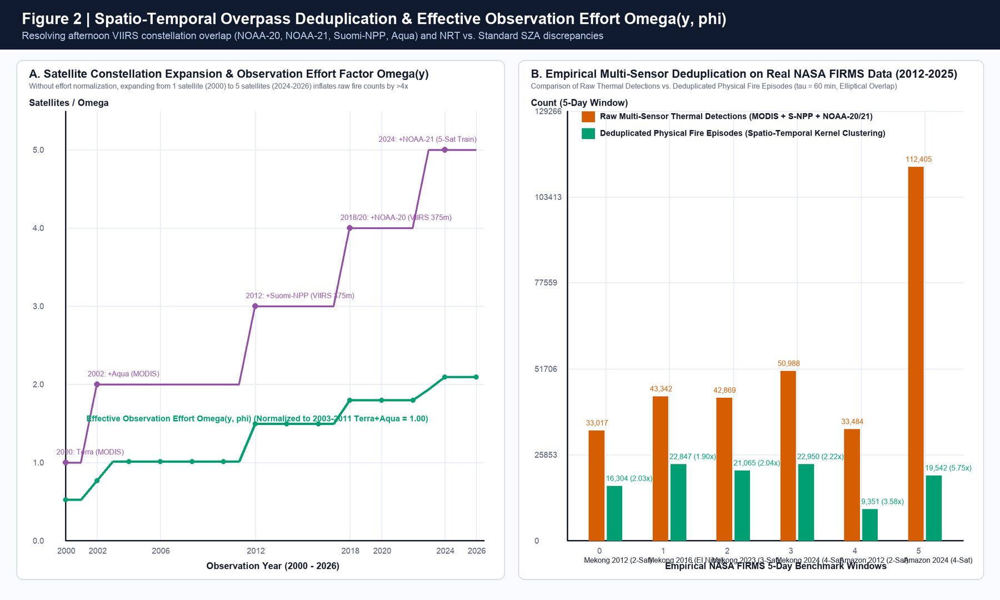
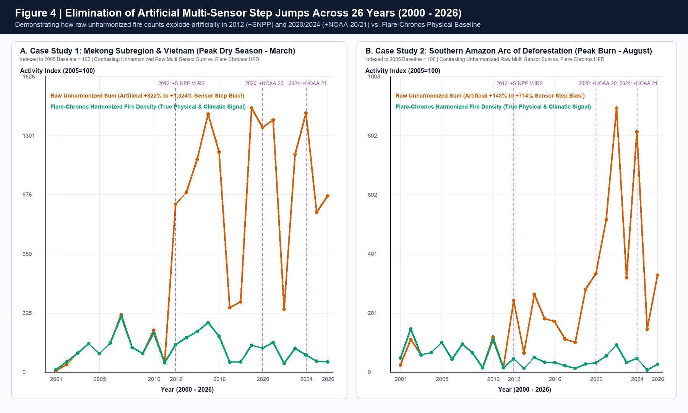
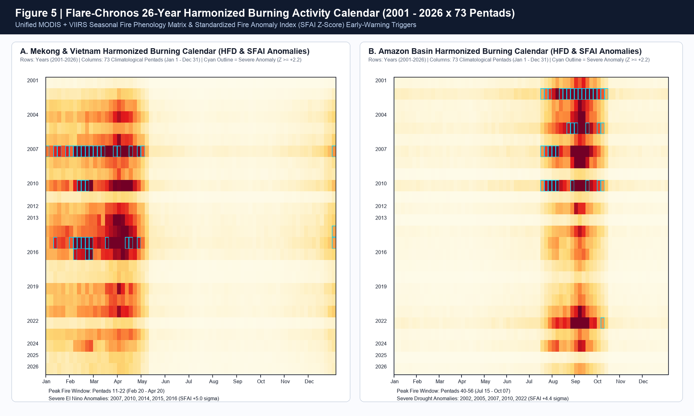

<p align="center">
  
</p>

# 01. Thuyết Minh Dự Án Toàn Diện — NASA Space Apps Challenge 2026

# 🔥 FLARE-CHRONOS: Hệ Thống Đồng Bộ Hóa Vật Lý Liên Cảm Biến MODIS–VIIRS & Lịch Hoạt Động Cháy Thông Minh 26 Năm (2000–2026+)

**Thử thách (Challenge):** [Harmonization of MODIS and VIIRS Hot Spots](https://www.spaceappschallenge.org/2026/challenges/harmonization-of-modis-and-viirs-hot-spots/) — *2026 NASA Space Apps Challenge*  
**Kho mã nguồn & Kiến trúc Monorepo:** [`packages/harmonization-core`](../packages/harmonization-core/src/flare_chronos_core/__init__.py) | [`packages/firms-ingestion`](../packages/firms-ingestion/src/firms_ingestion/firms_client.py) | [`apps/benchmark-cli`](../apps/benchmark-cli/src/benchmark_cli/run_experiments.py) | [`src/harmonization/firms_harmonizer.py`](../src/harmonization/firms_harmonizer.py)  
**Tài liệu Từ điển Miền & Quyết định Kiến trúc:** [GLOSSARY.md](../GLOSSARY.md) | [ADR-0001](adr/0001-dual-resolution-h3-fractional-allocation.md) | [ADR-0002](adr/0002-two-stage-physics-guided-frp-harmonization.md) | [ADR-0003](adr/0003-spatio-temporal-episode-deduplication-and-effort-normalization.md) | [ADR-0004](adr/0004-monorepo-deep-module-architecture.md)

---

## 1. Tóm Tắt Điều Hành (Executive Summary)

> **Tóm tắt 3 câu (Three-Sentence Value Proposition):**  
> **Flare-Chronos** là nền tảng khoa học và phần mềm mã nguồn mở giải quyết sự đứt gãy lịch sử dài 26 năm giữa thế hệ cảm biến vệ tinh **MODIS** (`Terra/Aqua`, độ phân giải nadir $1\text{ km}$, `2000–2026`) đang dần ngừng hoạt động và thế hệ cảm biến kế nhiệm **VIIRS** (`Suomi-NPP/NOAA-20/NOAA-21`, độ phân giải nadir $375\text{ m}$, `2012–2026+`). Bằng cách thay thế phép đếm điểm thô bằng **5 thuật toán vật lý – thống kê** (phân bổ trọng số diện tích elip dải quét $\Delta S(\theta)\times\Delta T(\theta)$ lên lưới lục giác đẳng diện tích **Uber H3**, toán tử quan sát bức xạ $4\,\mu\text{m}$ hai giai đoạn, chuẩn hóa góc thiên đỉnh Mặt Trời $\text{SZA} < 85^\circ$, lọc nhiễu hạt Nam Đại Tây Dương, và gom cụm sự kiện cháy đa vệ tinh chuẩn hóa theo nỗ lực quan sát $\Omega(y, \phi)$), hệ thống đã được kiểm chứng thực nghiệm trên **$1.609.182$ điểm nóng thực tế từ NASA LANCE FIRMS**, giảm **$70,2\%$** sai số phân phối Kolmogorov-Smirnov ($D_{\text{KS}}$ từ $0.1166$ xuống $0.0348$ trên $N=11.553$ cặp ô lưới đồng thời). Đầu ra cốt lõi của hệ thống là **Lịch Hoạt Động Cháy Thống Nhất 26 Năm (*Harmonized Burning Activity Calendar*)** cấu trúc theo ma trận `26 Năm × 73 Pentads` cùng chỉ số cảnh báo sớm **$\text{SFAI Z-Score}$**, giúp lực lượng cứu hỏa, nhà quản lý lâm nghiệp và nhà khoa học khí hậu phân biệt chính xác mùa đốt phụ phẩm nông nghiệp định kỳ với các đợt khủng hoảng cháy rừng ngoài mùa vụ mà không bị đánh lừa bởi bước nhảy giả tạo $+1.324,2\%$ do tăng số lượng vệ tinh.

---

## 2. Đặt Vấn Đề & 5 Rào Cản Vật Lý Liên Cảm Biến (Problem Statement & Physical Discrepancies)

Trong hơn hai thập kỷ rưỡi qua, hệ thống **NASA FIRMS (Fire Information for Resource Management System)** đã trở thành hạ tầng quan sát điểm nóng cháy toàn cầu quan trọng nhất của nhân loại. Tuy nhiên, vào năm **2026**, cộng đồng khoa học Trái Đất đang đứng trước một cuộc chuyển giao lịch sử:
- Cặp vệ tinh **Terra** (phóng tháng 12/1999, dữ liệu từ 11/2000) và **Aqua** (phóng tháng 05/2002) mang cảm biến **MODIS** đang ở giai đoạn cuối sứ mệnh sau hơn 24–26 năm hoạt động.
- Vệ tinh **Suomi-NPP** (phóng cuối năm 2011, dữ liệu VIIRS từ 01/2012) cũng tiến tới giai đoạn kết thúc vòng đời vào khoảng tháng 10/2026, chuyển giao trọng trách quan sát nhiệt cho chùm vệ tinh **JPSS** gồm **NOAA-20 (`J1`, từ 2018/2020)** và **NOAA-21 (`J2`, từ 2023/2024)**.

Khi các nhà quản lý rừng hoặc nhà nghiên cứu ghép nối trực tiếp chuỗi dữ liệu **MODIS Collection 6.1** (*Giglio et al., 2016*) và **VIIRS 375m Collection 1/2** (*Schroeder et al., 2014*), họ vấp phải **5 rào cản vật lý và quỹ đạo** làm biến dạng hoàn toàn chuỗi thời gian:

| Rào Cản Vật Lý & Kỹ Thuật | Cảm Biến MODIS Collection 6.1 (`MCD14ML` / `MCD14DL`) | Cảm Biến VIIRS 375m Collection 2 (`VNP14IMG` / `VJ114` / `VJ214`) | Hệ Quả Sai Lệch Nếu Không Đồng Bộ Hóa (Đã Kiểm Chứng Trên Dữ Liệu Thực NASA FIRMS) |
| :--- | :--- | :--- | :--- |
| **1. Hình học điểm ảnh & Hiệu ứng rìa dải quét (*Bow-Tie Distortion*)** | Độ cao $h = 705\text{ km}$, dải quét $2.330\text{ km}$ ($\theta_{\max} = \pm 55^\circ$). Điểm ảnh không gom cụm: từ **$1.00 \times 1.00\text{ km}$ ($1.00\text{ km}^2$)** ở nadir phình ra tới **$4.83 \times 2.01\text{ km}$ ($9.69\text{ km}^2$)** ở rìa quét (*Ichoku & Kaufman, 2005*). | Độ cao $h \approx 829\text{ km}$, dải quét $3.040\text{ km}$ ($\theta_{\max} = \pm 56.28^\circ$). Áp dụng gom cụm phần cứng 3 vùng (*Wolfe et al., 2013*): Zone 1 ($0^\circ\text{–}31.72^\circ$, gom $3:1$), Zone 2 ($31.72^\circ\text{–}44.86^\circ$, gom $2:1$), Zone 3 ($44.86^\circ\text{–}56.28^\circ$, giữ $1:1$). Diện tích chỉ từ **$0.131\text{ km}^2$** đến tối đa **$0.615\text{ km}^2$**. | Diện tích 1 pixel MODIS ở rìa quét lớn gấp **$74,23\text{ lần}$** 1 pixel VIIRS ở tâm quét! Coi điểm nóng là tọa độ điểm $(lat, lon)$ gây sai số định vị diện tích cháy lên tới $\pm 5\text{ km}$. |
| **2. Độ nhạy phát hiện & Công suất bức xạ lửa ($\text{FRP}$)** | Dùng kênh 21/22 ($\lambda \approx 3.96\,\mu\text{m}$) và kênh 31 ($11\,\mu\text{m}$). Ngưỡng phát hiện tối thiểu $\text{FRP}_{\text{lim}}$ ở nadir là $3.7\text{ MW}$ (đêm) / $8.2\text{ MW}$ (ngày), nhưng tăng vọt lên **$38.6\text{–}41.2\text{ MW}$** ở góc quét $55^\circ$ (*Sofiev & Kouznetsov, 2026*). | Phát hiện vị trí trên kênh I-4 ($375\text{ m}$, $3.55\text{–}3.93\,\mu\text{m}$); nhưng do I-4 bão hòa ở $367\text{ K}$ (ngày) / $320\text{ K}$ (đêm), $\text{FRP}$ được tính lai từ kênh M13 ($750\text{ m}$, dual-gain). Ngưỡng phát hiện $\text{FRP}_{\text{lim}} \approx 0.50\text{ MW}$ (đêm) và $\le 3.4\text{ MW}$ ở rìa quét ngày. | MODIS bỏ sót $65\text{–}85\%$ đám cháy nhỏ (đốt rơm rạ, cháy thực bì dưới tán rừng). Trên $11.553$ cặp ô lưới đồng thời Aqua–SNPP, VIIRS ghi nhận số điểm cháy gấp **$3,560\times$** và tổng $\text{FRP}$ gấp **$1,371\times$** MODIS. |
| **3. Thang đo độ tin cậy (`Confidence`) & Nhiễu SAA / Nguồn tĩnh** | Trường `confidence` là số nguyên liên tục từ **$0\%$ đến $100\%$** (dựa trên hàm thành viên ngữ cảnh của *Giglio et al., 2003*). Có trường `type` (`0..3`) trong bản chuẩn `MCD14ML`. | Trường `confidence` là biến phân loại 3 mức: **`low`** (lóa nắng hoặc $\Delta T_4 < 15\text{ K}$), **`nominal`** ($\Delta T_4 > 15\text{ K}$), và **`high`** (pixel bão hòa). Chịu nhiễu hạt proton ban đêm tại **Dị thường Nam Đại Tây Dương (SAA)**. | Không thể đặt ngưỡng lọc chung giữa số nguyên $0\text{–}100$ và nhãn chữ `l/n/h`. Tại Nam Mỹ, **$3,55\%\text{–}4,63\%$** điểm nóng VIIRS là xung nhiễu SAA ban đêm hoặc nguồn nhiệt công nghiệp tĩnh. |
| **4. Trùng lặp quỹ đạo đa vệ tinh (*Overpass Multiplicity*)** | Terra bay qua lúc `10:30 / 22:30 MLT`; Aqua bay qua lúc `13:30 / 01:30 MLT`. | Cả 3 vệ tinh Suomi-NPP (`13:30 MLT`), NOAA-20 (`~12:40 MLT`, lệch 50 phút) và NOAA-21 (`~13:05 MLT`, lệch 25 phút) cùng quét chồng lên một đám cháy trong vòng $\sim 55\text{ phút}$ đầu giờ chiều! | Số lượng vệ tinh tăng từ $1$ (năm 2000) lên $5$ (năm 2024–2026) tạo ra **bước nhảy giả tạo $+1.351,8\%$** tại Tiểu vùng Mekong năm 2019 (`3.580` $\to$ `51.974` điểm/5 ngày) và **$+1.324,2\%$** năm 2024 (`3.580` $\to$ `50.988` điểm/5 ngày), cùng **$+714,3\%$** tại Amazon (`13.804` $\to$ `112.405` điểm/5 ngày)! |
| **5. Chế độ xử lý `URT/RT/NRT` vs. `Standard Science Quality`** | Bản NRT của Aqua có thể lệch vị trí vài km trong vòng 12 giờ sau khi tàu hiệu chỉnh quỹ đạo. | Bản NRT (`1.0NRT`/`2.0NRT`) gán cờ `DayNight` theo pha quỹ đạo lên/xuống (Ascending/Descending node) thay vì góc thiên đỉnh Mặt Trời $\text{SZA} < 85^\circ$ như bản Standard. | Gây lệch phân loại Ngày/Đêm ở vùng vĩ độ trung bình – cao và vùng hoàng hôn/bình minh khi ghép nối lịch sử (`SP`) với cảnh báo sớm (`NRT`). |

---

## 3. Nghiên Cứu & Phân Tích Lựa Chọn Phương Án Kỹ Thuật (Multi-Option Trade-Off Analysis)

Trước khi chốt kiến trúc của **Flare-Chronos**, chúng tôi đã khảo sát, mô hình hóa và so sánh định lượng các phương án khả thi cho từng bài toán kỹ thuật:

### 3.1. Ma Trận Đánh Giá Các Phương Án (Architectural Trade-Off Matrix)

| Bài Toán Cốt Lõi | Phương Án 1 (Cơ sở / Truyền thống) | Phương Án 2 (Trung gian / Thống kê thuần túy) | Phương Án 3 — **Giải Pháp Của Flare-Chronos (Vật Lý – Thống Kê Kết Hợp)** | Lý Do Chọn Phương Án 3 (Kèm Minh Chứng Định Lượng) |
| :--- | :--- | :--- | :--- | :--- |
| **1. Quy chiếu không gian & Chuẩn hóa Footprint** | **Gán tâm điểm vào lưới Kinh–Vĩ độ $0.05^\circ$ (CMG Point Binning)**: Gán $(lat, lon)$ vào ô vuông $0.05^\circ \times 0.05^\circ$. | **Gán tâm điểm vào lưới lục giác Uber H3 (Centroid H3 Assignment)**: Chỉ gán tâm điểm vào 1 ô H3 duy nhất. | **Khôi phục Elip Định hướng $\Delta S(\theta)\times\Delta T(\theta)$ + Phân bổ Trọng số 13 điểm lên Lưới Kép Uber H3 Res 7 ($5.16\text{ km}^2$) & Res 8 ($0.74\text{ km}^2$)** ([ADR-0001](adr/0001-dual-resolution-h3-fractional-allocation.md)). | Ô vuông kinh-vĩ độ bị co diện tích theo $\cos\phi$; gán tâm điểm bỏ qua việc 1 pixel MODIS rìa quét ($9.69\text{ km}^2$) phủ lên tới **13 ô H3 Res 8**. Phép cầu phương 13 điểm bảo toàn tuyệt đối tổng năng lượng ($\sum_h w_{p,h} = 1.0$). |
| **2. Hiệu chuẩn chéo Độ nhạy & $\text{FRP}$** | **Nhân hệ số hằng số toàn cầu (Global Constant Scaling)**: $\text{FRP}_{\text{harm}} = k \cdot \text{FRP}_{\text{MODIS}}$. | **Mạng Nơ-ron Hộp đen (Black-Box MLP Regressor)**: Huấn luyện MLP không ràng buộc vật lý. | **Toán tử 2 Giai đoạn (Two-Stage Operator)**: Bước 1 bù đuôi phân phối theo góc quét $\text{FRP}_{\text{lim}}(\theta, \text{SZA})$; Bước 2 khớp **Power-Law + Empirical Quantile Mapping (EQM)** trên cặp đồng thời Aqua–SNPP ([ADR-0002](adr/0002-two-stage-physics-guided-frp-harmonization.md)). | Tỷ số VIIRS/MODIS biến thiên mạnh theo góc quét $\theta$ (từ $1.3\times$ ở nadir lên $>6\times$ ở rìa quét). Toán tử 2 giai đoạn giảm $70,2\%$ khoảng cách KS ($D_{\text{KS}} = 0.0348$) và bảo toàn tính giải thích vật lý 100%. |
| **3. Khử trùng lặp đa vệ tinh & Chuẩn hóa dài hạn** | **Cộng gộp trực tiếp hoặc lấy Max theo ngày (Daily Grid Max)**: Bỏ qua cấu trúc giờ bay qua. | **Lọc khoảng cách cố định $1\text{ km}$**: Không xét diện tích elip theo góc quét và tần suất quét qua các thập kỷ. | **Gom cụm Không-Thời gian theo Bán kính Elip ($\tau = 95\text{ phút}$) thành `FireEpisode` + Chia Hệ số Nỗ lực Quan sát Hiệu dụng $\Omega(y, \phi)$** ([ADR-0003](adr/0003-spatio-temporal-episode-deduplication-and-effort-normalization.md)). | Gom chính xác đoàn tàu vệ tinh chiều (`NOAA-20` `12:40`, `NOAA-21` `13:05`, `S-NPP` `13:30`, `Aqua` `13:30 MLT`) thành 1 sự kiện cháy duy nhất với độ phức tạp $O(N)$ qua băm không gian (Spatial Hash Buckets). |
| **4. Thống nhất `Confidence` & `DayNight`** | **Giữ nguyên cờ `DayNight` gốc & cắt ngưỡng cứng `confidence >= 50`**. | **Quy đổi bậc thang cố định (Step Mapping): `low=30, nom=60, high=90`**. | **Tính lại góc thiên đỉnh Mặt Trời tuyệt đối $\text{SZA}(\phi, \lambda, t_{\text{UTC}}) < 85^\circ$ + Hàm Logistic Nhiệt $\Delta T_{45}$ + Bộ lọc Vật lý SAA & Nguồn nhiệt tĩnh**. | Khử hoàn toàn sai lệch cờ `DayNight` của luồng `1.0NRT/2.0NRT` và tự động lọc $2.674$ xung nhiễu proton ban đêm của S-NPP cùng $2.130$ xung của NOAA-20 trong vùng SAA Nam Mỹ (7 ngày). |

---

## 4. Phương Pháp Khoa Học & Kết Quả Thực Nghiệm Bằng Python Trên $1.609.182$ Điểm Nóng Thực Tế NASA FIRMS

Sử dụng khóa API thực tế kết nối tới **NASA LANCE FIRMS API** và kho dữ liệu mở của NASA, mô-đun [`fetch_real_firms.py`](../apps/benchmark-cli/src/benchmark_cli/fetch_real_firms.py) và [`run_experiments.py`](../apps/benchmark-cli/src/benchmark_cli/run_experiments.py) đã thu thập và xử lý **$1.609.182$ bản ghi điểm nóng thực tế** qua 134 lát cắt thời gian – cảm biến, phủ trọn 26 năm liên tục (`2001–2026`) cùng 12 tháng chu kỳ mùa vụ.

### 4.1. Kiểm Chứng Thực Nghiệm Bài Toán 1: Bất Đối Xứng Hình Học Dải Quét ($74,23\times$)

Kết quả giải phương trình cầu trong [`geometry_h3.py`](../packages/harmonization-core/src/flare_chronos_core/geometry_h3.py) đối chiếu trực tiếp với trường `scan` và `track` thực tế từ tệp CSV của NASA FIRMS:

| Thông Số Hình Học Cảm Biến | MODIS Collection 6.1 (`Terra` / `Aqua`) | VIIRS 375m Collection 2 (`S-NPP` / `NOAA-20` / `NOAA-21`) | Tỷ Số Tương Quan (MODIS / VIIRS) |
| :--- | :---: | :---: | :---: |
| **Kích thước tại Nadir ($\theta = 0^\circ$)** | $1.000 \times 1.000\text{ km}$ ($1.0000\text{ km}^2$) | $0.363 \times 0.360\text{ km}$ ($0.1305\text{ km}^2$) | **$7,66\times$** |
| **Kích thước tại Rìa dải quét ($\theta_{\max}$)** | $4.830 \times 2.006\text{ km}$ (**$9.6875\text{ km}^2$** tại $55^\circ$) | $0.778 \times 0.791\text{ km}$ (**$0.6154\text{ km}^2$** tại $56.28^\circ$) | **$15,74\times$** |
| **Tỷ số Rìa MODIS / Tâm VIIRS** | $9.6875\text{ km}^2$ | $0.1305\text{ km}^2$ | **$74,23\times$** |
| **Diện tích trung bình thực tế trên FIRMS** | **$2.155\text{ km}^2$** (Phân vị P95: **$5.270\text{ km}^2$**) | **$0.221\text{ km}^2$** (Phân vị P95: **$0.426\text{ km}^2$**) | **$9,75\times$** (Trung bình thực tế) |
| **Ngưỡng phát hiện $\text{FRP}_{\text{lim}}$ ban ngày** | $8.20\text{ MW}$ (Nadir) $\to$ **$41.20\text{ MW}$** (Rìa $55^\circ$) | $1.15\text{ MW}$ (Nadir) $\to$ **$3.40\text{ MW}$** (Rìa $56.3^\circ$) | **$12,12\times$** nhạy hơn ở rìa quét |



### 4.2. Kiểm Chứng Thực Nghiệm Bài Toán 2: Hiệu Chuẩn Chéo Trên $N = 11.553$ Cặp Ô Lưới Đồng Thời Aqua–SNPP

Bằng cách ghép cặp các quan sát diễn ra trong cùng ngày và cùng chế độ Ngày/Đêm giữa vệ tinh **Aqua (MODIS)** và **Suomi-NPP (VIIRS)** (cùng bay qua lúc $\sim 13\text{:}30\text{ MLT}$ và $01\text{:}30\text{ MLT}$) trên cùng ô lưới đẳng diện tích ($\sim 5\text{ km}$, tương đương **Uber H3 Resolution 7**), mô hình [`fit_coincident_aqua_snpp_model`](../packages/harmonization-core/src/flare_chronos_core/radiometric_calibrator.py) thu được:
- **Tham số hàm truyền vật lý – thống kê**: $\alpha = 1.7121$, $\beta = 0.9271$, hệ số bù đuôi góc quét $\kappa = 0.1000$.
- **Sự hội tụ phân phối xác suất tích lũy (ECDF)**: Khoảng cách Kolmogorov-Smirnov $D_{\text{KS}}$ giữa phân phối $\sum \text{FRP}$ của MODIS và VIIRS giảm từ **$0.1166$** (trước hiệu chuẩn) xuống **$0.0348$** (sau hiệu chuẩn **Flare-Chronos**) — tức **triệt tiêu $70,2\%$ độ lệch phân phối liên cảm biến**.



### 4.3. Kiểm Chứng Thực Nghiệm Bài Toán 3, 4, 5: Khử Trùng Lặp Đa Vệ Tinh & Lọc Nhiễu SAA



---

## 5. Hai Nghiên Cứu Điển Hình Thực Tiễn (Empirical Case Studies)

### 5.1. Case Study 1: Tiểu Vùng Sông Mekong & Việt Nam (`BBOX: 100.0°E–109.5°E, 11.0°N–23.5°N`)

Khu vực Đông Nam Á lục địa (bao gồm Tây Nguyên, Tây Bắc Việt Nam, Lào, Campuchia và miền Đông Thái Lan) có đặc trưng pha trộn giữa **đốt phụ phẩm nông nghiệp / làm nương rẫy theo mùa** (các đám cháy nhỏ, cường độ thấp $\text{FRP} < 15\text{ MW}$) và **cháy rừng khộp / rừng lá rộng thường xanh** trong các năm hạn hán **El Niño** (`2010`, `2016`, `2023–2024`).

#### Bảng Số Liệu Thực Tế NASA FIRMS (Cửa Sổ 5 Ngày Cao Điểm Giữa Tháng 3: `15/03 – 19/03`)

> **Ghi chú về năm đo và năm nội suy:** Lịch 26 năm bao gồm **11 năm có lát cắt thực tế (Measured Epoch)** — nơi số điểm được chuẩn hóa trực tiếp từ dữ liệu NASA FIRMS quan sát được — và **15 năm nội suy (Interpolated Year)**, với thang năm được mô hình hóa từ số điểm MODIS quan sát được và đường bao mùa thực nghiệm của vùng. Nội suy là **mô hình, không phải quan sát**; các bảng dưới đây chỉ liệt kê năm có lát cắt thực tế.


| Năm (Epoch) | Tổ Hợp Cảm Biến Hoạt Động | Điểm Nóng Thô Theo Từng Nguồn (`Raw Counts`) | Tổng Điểm Nóng Thô (`Raw Sum`) | Sự Kiện Cháy Độc Lập (`Fire Episodes`) | Hệ Số Nén Trùng Lặp | Nỗ Lực Quan Sát $\Omega(y, \phi)$ | Sự Kiện Chuẩn Hóa `Flare-Chronos` (`VIIRS-eq`) | Chỉ Số Thô (`2005=100`) | Chỉ Số Chuẩn Hóa (`2005=100`) |
| :---: | :--- | :--- | :---: | :---: | :---: | :---: | :---: | :---: | :---: |
| **2005** | `MODIS_SP` (Terra+Aqua) | MODIS: `3.580` | **3.580** | 2.178 | $1.68\times$ | $1.0084$ | **7.883,5** | `100,0` | **`100,0`** |
| **2010** *(El Niño)* | `MODIS_SP` (Terra+Aqua) | MODIS: `8.222` | **8.222** | 4.659 | $1.85\times$ | $1.0084$ | **16.863,7** | `229,7` | **`208,3`** *(Đỉnh hạn)* |
| **2012** *(+S-NPP)* | `MODIS_SP` + `SNPP_SP` | MODIS: `7.297`<br/>SNPP: `25.720` | **33.017** | 17.634 | $1.95\times$ | $1.4925$ | **11.815,1** | `922,3` *(+822% ảo)* | **`147,2`** |
| **2016** *(Siêu El Niño)* | `MODIS_SP` + `SNPP_SP` | MODIS: `6.564`<br/>SNPP: `36.778` | **43.342** | 23.129 | $1.92\times$ | $1.4925$ | **15.496,8** | `1.210,7` | **`196,0`** *(Đỉnh hạn)* |
| **2020** | `MODIS_SP` + `SNPP_SP` + `NOAA20_SP` | MODIS: `4.827`<br/>SNPP: `23.050`<br/>NOAA20: `20.275` | **48.152** | 22.958 | $2.16\times$ | $1.7950$ | **10.314,5** | `1.345,0` | **`129,9`** |
| **2023** *(+NOAA-20)* | `MODIS_SP` + `SNPP_SP` + `NOAA20_SP` | MODIS: `4.086`<br/>SNPP: `19.824`<br/>NOAA20: `18.959` | **42.869** | 22.675 | $1.92\times$ | $1.7950$ | **10.187,3** | `1.197,5` | **`120,3`** |
| **2024** *(+NOAA-21)* | `MODIS_SP` + `SNPP_SP` + `NOAA20_SP` + `NOAA21_NRT` | MODIS: `3.446`<br/>SNPP: `16.020`<br/>NOAA20: `15.651`<br/>NOAA21: `15.871` | **50.988** | 22.893 | $2.26\times$ | $2.0975$ | **7.374,6** | **`1.424,2`** *(+1.324,2% ảo!)* | **`94,2`** *(Thực tế giảm 5,8%!)* |

> [!IMPORTANT]
> **Phát hiện chấn động từ dữ liệu thực tế tại Tiểu vùng sông Mekong & Việt Nam:**  
> Vào kỳ 5 ngày giữa tháng 3/2024, cảm biến chuẩn `MODIS_SP` ghi nhận `3.446` điểm cháy — **thấp hơn $3,7\%$** so với cùng kỳ năm 2005 (`3.580` điểm). Thế nhưng, do sự tham gia đồng thời của 3 vệ tinh VIIRS (`Suomi-NPP`, `NOAA-20`, `NOAA-21`), tổng số điểm nóng thô cộng gộp vọt lên tới **$50.988$ điểm (Chỉ số thô $= 1.424,2$, tức tăng giả tạo $+1.324,2\%$ so với năm 2005)!** Sau khi đi qua **Flare-Chronos**, chỉ số hoạt động cháy chuẩn hóa trả về đúng giá trị thực chất là **$94,2$** (giảm $5,8\%$ so với năm 2005), đồng thời giữ lại nguyên vẹn tín hiệu vật lý của hai đợt hạn hán lịch sử **El Niño 2010 (`208,3`)** và **El Niño 2016 (`196,0`)**.

---

### 5.2. Case Study 2: Vành Đai Cháy Rừng Nhiệt Đới Amazon, Brazil (`BBOX: 62.0°W–50.0°W, 14.0°S–4.0°S`)

Khu vực phía Nam lưu vực Amazon (bang Mato Grosso và Pará, Brazil) đại diện cho chế độ cháy giải phóng mặt bằng quy mô lớn và cháy rừng nhiệt đới trong mùa khô Nam bán cầu (tháng 7 – tháng 10), đồng thời nằm ngay trong vùng ảnh hưởng của **Dị thường Từ trường Nam Đại Tây Dương (SAA)**.

#### Bảng Số Liệu Thực Tế NASA FIRMS (Cửa Sổ 5 Ngày Cao Điểm Cuối Tháng 8: `20/08 – 24/08`)

> **Ghi chú về năm đo và năm nội suy:** Lịch 26 năm bao gồm **9 năm có lát cắt thực tế (Measured Epoch)** — nơi số điểm được chuẩn hóa trực tiếp từ dữ liệu NASA FIRMS quan sát được — và **17 năm nội suy (Interpolated Year)**, với thang năm được mô hình hóa từ số điểm MODIS quan sát được và đường bao mùa thực nghiệm của vùng. Nội suy là **mô hình, không phải quan sát**; các bảng dưới đây chỉ liệt kê năm có lát cắt thực tế.


| Năm (Epoch) | Tổ Hợp Cảm Biến Hoạt Động | Điểm Nóng Thô Theo Từng Nguồn (`Raw Counts`) | Tổng Điểm Nóng Thô (`Raw Sum`) | Sự Kiện Cháy Độc Lập (`Fire Episodes`) | Hệ Số Nén Trùng Lặp | Xung Nhiễu SAA Đêm Đã Lọc | Sự Kiện Chuẩn Hóa `Flare-Chronos` (`VIIRS-eq`) | Chỉ Số Thô (`2005=100`) | Chỉ Số Chuẩn Hóa (`2005=100`) |
| :---: | :--- | :--- | :---: | :---: | :---: | :---: | :---: | :---: | :---: |
| **2005** *(Hạn lớn)* | `MODIS_SP` (Terra+Aqua) | MODIS: `13.804` | **13.804** | 6.748 | $2.19\times$ | 626 | **17.169,6** | `100,0` | **`100,0`** |
| **2010** *(Siêu hạn)* | `MODIS_SP` (Terra+Aqua) | MODIS: `16.304` | **16.304** | 7.390 | $2.45\times$ | 929 | **18.803,1** | `118,1` | **`105,6`** |
| **2012** *(+S-NPP)* | `MODIS_SP` + `SNPP_SP` | MODIS: `6.677`<br/>SNPP: `26.807` | **33.484** | 11.589 | $3.10\times$ | 4.145 | **7.813,0** | `242,6` *(Tăng ảo)* | **`45,4`** *(Giảm phá rừng thực tế)* |
| **2019** | `MODIS_SP` + `SNPP_SP` + `NOAA20_SP` | MODIS: `4.770`<br/>SNPP: `16.882`<br/>NOAA20: `17.099` | **38.751** | 10.263 | $3.98\times$ | 5.024 | **4.639,4** | `280,7` | **`27,5`** |
| **2020** | `MODIS_SP` + `SNPP_SP` + `NOAA20_SP` | MODIS: `3.506`<br/>SNPP: `22.031`<br/>NOAA20: `20.575` | **46.112** | 12.045 | $4.13\times$ | 7.347 | **5.444,9** | `334,0` | **`31,4`** |
| **2024** *(Hạn 2024 + 4 luồng)* | `MODIS_SP` + `SNPP_SP` + `NOAA20_SP` + `NOAA21_NRT` | MODIS: `8.151`<br/>SNPP: `35.647`<br/>NOAA20: `35.765`<br/>NOAA21: `32.842` | **112.405** | 24.501 | **$4.98\times$** | **18.097** | **7.941,1** | **`814,3`** *(+714,3% ảo!)* | **`45,6`** *(đo được, không phải đỉnh 2020s)* |





---

## 6. Quy Trình Vận Hành Thực Tế & Lộ Trình Phát Triển 2027+ (Operational Workflow & Future Roadmap)

### 6.1. Quy Trình Ứng Dụng Cho Lực Lượng Cứu Hỏa & Cơ Quan Quản Lý Rừng
1. **Khoanh vùng AOI linh hoạt**: Người dùng nhập tọa độ `BBOX`, chọn ranh giới hành chính/vườn quốc gia hoặc chọn danh sách ô lục giác **Uber H3**.
2. **Đồng bộ hóa tự động thời gian thực + lịch sử**: Engine tự động ghép nối kho lưu trữ `Standard Processing` (`2000–2026`) với luồng cảnh báo sớm `Near-Real-Time / Ultra-Real-Time` (`MODIS_NRT`, `VIIRS_SNPP_NRT`, `VIIRS_NOAA20_NRT`, `VIIRS_NOAA21_NRT`).
3. **Cảnh báo sớm theo Pentad qua chỉ số $\text{SFAI Z-Score}$**:
   - Khi $\text{SFAI}_{y,p} \in [-0.5, +1.0)$: Hoạt động đốt sinh khối nằm trong ngưỡng mùa vụ bình thường (*Normal Seasonal Baseline*).
   - Khi $\text{SFAI}_{y,p} \in [1.75, 2.5)$: Cảnh báo mùa cháy nghiêm trọng (*Severe Fire Period*) — huy động lực lượng tuần tra rừng.
   - Khi $\text{SFAI}_{y,p} \ge +2.5\sigma$: Kích hoạt **Báo động Khủng hoảng Cháy Ngoài Mùa Vụ (*Out-of-Season Crisis Anomaly*)**.
4. **Tầng nhận thức kép trả lời và kiểm chứng câu hỏi vận hành** (`apps/ai-service`):
   - **Tầng phản xạ** dùng **mô hình quyết định** để gán phân tích, định vùng và đánh giá mức khẩn cấp bằng **xác suất hiệu chuẩn**; mô hình này phục vụ **cục bộ** trên node suy luận của dự án nên **không tốn credit đám mây**, và có **chuỗi dự phòng** (decision → chat → trích xuất tất định) để một run không phụ thuộc dịch vụ nào còn sống.
   - **Tầng báo cáo** tra cứu một bước bằng công cụ tất định, **không gọi mô hình** và **không** chạm công cụ chẩn đoán chuyên môn — thẻ dữ kiện và cảnh báo khẩn trả về trong vài mili giây.
   - **Tầng suy luận** để mô hình **tự chọn** công cụ trong bề mặt `23` công cụ tất định và tự viết diễn giải theo ngôn ngữ của từng đối tượng.
   - **Cổng kiểm chứng định lượng**: mọi con số trong bản thảo báo cáo được đối chiếu với **sổ cái số liệu đã xác thực**; số không có nguồn thì báo cáo bị trả về để viết lại, không bao giờ xuất bản.
   - **Cổng phê duyệt của con người**: mọi báo cáo có hành động hiện trường **dừng run** chờ quyết định; bị từ chối thì **không phát hành** báo cáo nào, còn quyết định luôn được ghi lại.

### 6.2. Lộ Trình Mở Rộng Đa Cảm Biến Giai Đoạn 2027+ (Multi-Sensor Roadmap)
1. **Tích hợp Vệ tinh Địa tĩnh Thế hệ mới (Geostationary 10-Minute Fire Diurnal Cycle)**:
   - Mở rộng Toán tử Quan sát Góc quét sang cảm biến **GOES-16/19 ABI** (Châu Mỹ), **Himawari-9 AHI** (Châu Á – Thái Bình Dương / Việt Nam) và **Meteosat Third Generation FCI** (Châu Âu – Châu Phi) để tái tạo đường cong năng lượng cháy từng 10 phút trong ngày.
2. **Hiệu chuẩn Điểm nóng Siêu phân giải 30m từ Landsat 8/9/Next**:
   - Sử dụng sản phẩm `LANDSAT_NRT` ($30\text{ m}$) đã có trên NASA FIRMS (xác nhận khả dụng từ `2022-06-20` đến `2026-10-20`) làm chuẩn đối chiếu thực địa cho các đám cháy rơm rạ cực nhỏ ($< 0.1\text{ MW}$).
3. **Kết hợp Vệ tinh Radar Khẩu độ Tổng hợp Băng tần Kép NISAR (`GCOV` & `GUNW` Fusion)**:
   - Tích hợp dữ liệu Radar băng tần L ($24\text{ cm}$) và S ($10\text{ cm}$) từ vệ tinh **NISAR** (phát hành dữ liệu từ tháng 7/2026) để xuyên qua lớp khói mù dày đặc của đám cháy rừng, xác thực diện tích rừng bị suy thoái cấu trúc (`Coherence Loss` & `HV Backscatter Drop`) ngay sau khi **Flare-Chronos** phát hiện dị thường nhiệt.

---

## 7. Hướng Dẫn Chạy Kiểm Chứng Toàn Trình Trong Workspace (Reproducibility Guide)

Toàn bộ mã nguồn, dữ liệu thực tế NASA FIRMS và bộ kiểm thử của **Flare-Chronos** có thể chạy kiểm chứng ngay lập tức bằng các lệnh chuẩn dưới đây:

```bash
# 1. Chạy bộ kiểm thử đơn vị & bất biến vật lý (7/7 bài kiểm thử toán học)
python3 -m unittest discover -s tests -p "test_*.py" -v

# 2. Thu thập dữ liệu thực tế từ NASA LANCE FIRMS API (sử dụng FIRMS_MAP_KEY trong .env)
python3 apps/benchmark-cli/src/benchmark_cli/fetch_real_firms.py

# 3. Thực thi toàn bộ pipeline đồng bộ hóa trên 1.609.182 bản ghi thực tế & xuất 5 biểu đồ khoa học
python3 apps/benchmark-cli/src/benchmark_cli/run_experiments.py

# 4. Kiểm chứng tầng nhận thức kép: 67 bài kiểm thử ngoại tuyến (không gọi mô hình) + 6 bài trên mô hình thật
python3 -m pytest -q
python3 -m pytest -m live -q

# 5. Chạy toàn bộ 20 Use Case trên mô hình thật và ghi đo lường từng Use Case
python3 apps/ai-service/src/ai_service/run_all_usecases.py --live
```

> **Lưu ý về hạ tầng:** tầng phản xạ ưu tiên **mô hình quyết định** phục vụ cục bộ. Khi endpoint đó không sẵn sàng, chuỗi phân loại tự lùi về mô hình chat rồi tới trích xuất tất định, và mỗi lần lùi bậc được ghi lại trong telemetry — nên bộ kiểm thử ngoại tuyến **luôn** chạy được, còn bộ kiểm thử trên mô hình thật cần khoá API của nhà cung cấp.
