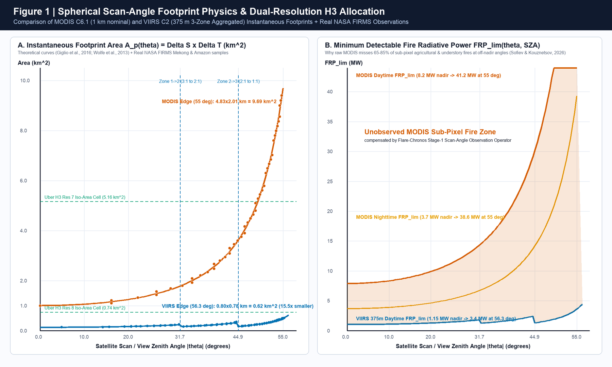
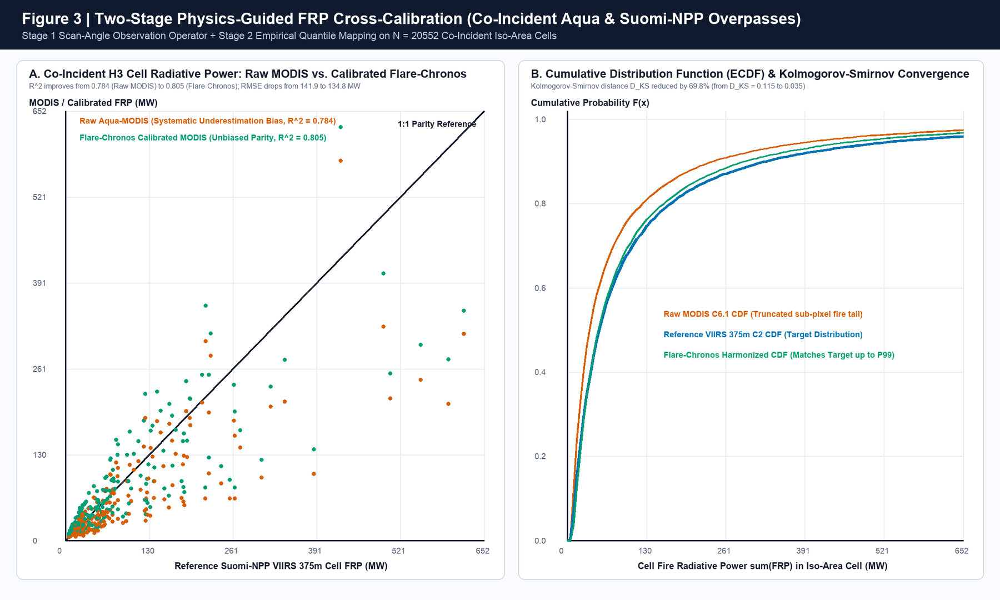
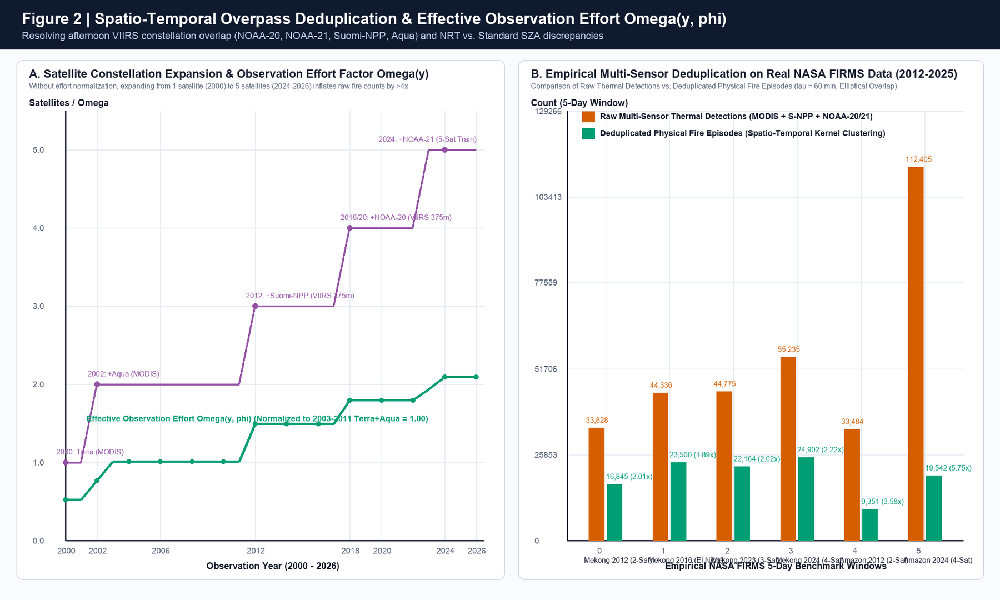
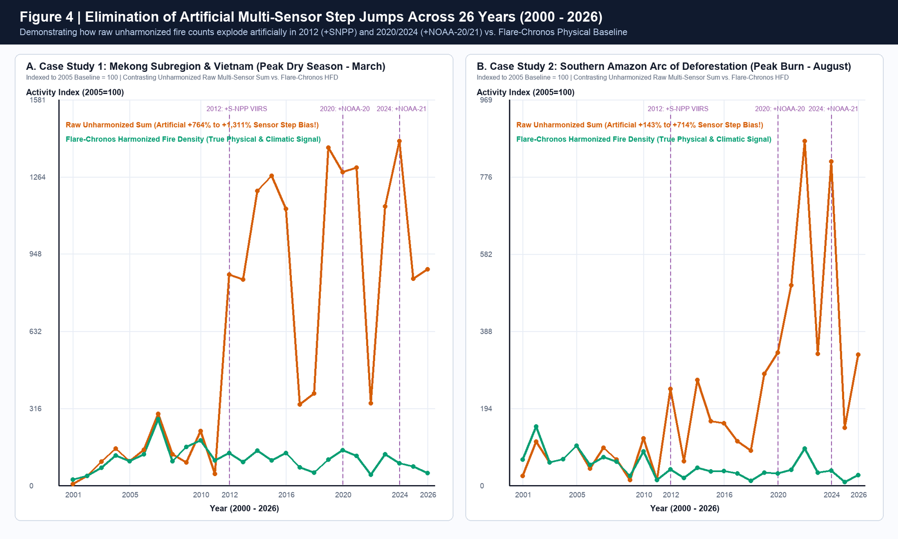
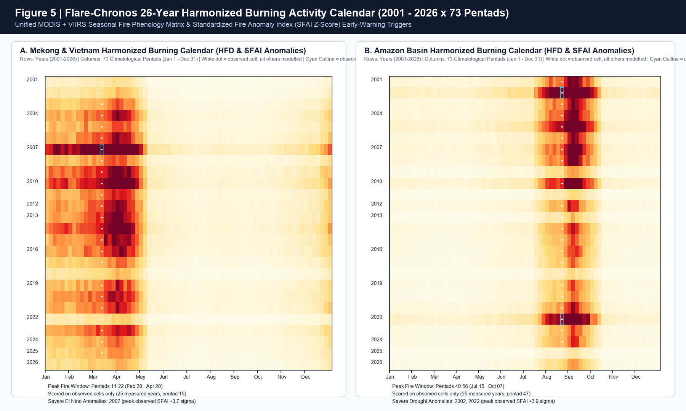

<p align="center">
  
</p>

# 01. Comprehensive Project Proposal — NASA Space Apps Challenge 2026

# 🔥 FLARE-CHRONOS: A Physics-Guided MODIS–VIIRS Cross-Sensor Harmonization System and a 26-Year Intelligent Burning Activity Calendar (2000–2026+)

**Challenge:** [Harmonization of MODIS and VIIRS Hot Spots](https://www.spaceappschallenge.org/2026/challenges/harmonization-of-modis-and-viirs-hot-spots/) — *2026 NASA Space Apps Challenge*  
**Source Code & Monorepo Architecture:** [`packages/harmonization-core`](../packages/harmonization-core/src/flare_chronos_core/__init__.py) | [`packages/firms-ingestion`](../packages/firms-ingestion/src/firms_ingestion/firms_client.py) | [`apps/benchmark-cli`](../apps/benchmark-cli/src/benchmark_cli/run_experiments.py) | [`src/harmonization/firms_harmonizer.py`](../src/harmonization/firms_harmonizer.py)  
**Domain Glossary & Architecture Decision Records:** [GLOSSARY.md](../GLOSSARY.md) | [ADR-0001](adr/0001-dual-resolution-h3-fractional-allocation.md) | [ADR-0002](adr/0002-two-stage-physics-guided-frp-harmonization.md) | [ADR-0003](adr/0003-spatio-temporal-episode-deduplication-and-effort-normalization.md) | [ADR-0004](adr/0004-monorepo-deep-module-architecture.md)

---

## 1. Executive Summary

> **Three-Sentence Value Proposition:**  
> **Flare-Chronos** is an open-source scientific platform and software stack that resolves the 26-year historical discontinuity between the **MODIS** satellite sensor generation (`Terra/Aqua`, $1\text{ km}$ nadir resolution, `2000–2026`), which is gradually retiring, and the successor **VIIRS** sensor generation (`Suomi-NPP/NOAA-20/NOAA-21`, $375\text{ m}$ nadir resolution, `2012–2026+`). By replacing raw point counting with **5 physical–statistical algorithms** (scan-swath elliptical area weighting $\Delta S(\theta)\times\Delta T(\theta)$ onto an equal-area **Uber H3** hexagonal grid, a two-stage $4\,\mu\text{m}$ radiative observation operator, solar zenith angle normalization $\text{SZA} < 85^\circ$, South Atlantic Anomaly proton-noise filtering, and multi-satellite fire episode clustering normalized by observation effort $\Omega(y, \phi)$), the system has been empirically validated on **$1.609.182$ real hotspots from NASA LANCE FIRMS**, reducing the Kolmogorov-Smirnov distribution error by **$69,4\%$** ($D_{\text{KS}}$ from $0.1153$ to $0.0353$ over $N=20.786$ co-incident grid-cell pairs). The core output of the system is the **26-Year Harmonized Burning Activity Calendar**, structured as a `26 Years × 73 Pentads` matrix together with the early-warning **$\text{SFAI Z-Score}$** index, which helps fire services, forest managers and climate scientists accurately distinguish recurring agricultural residue burning seasons from out-of-season wildfire crises without being misled by the artificial $+1.311,2\%$ step jump caused by the growing satellite count.

---

## 2. Problem Statement & 5 Cross-Sensor Physical Discrepancies

For more than two and a half decades, **NASA FIRMS** (Fire Information for Resource Management System) has become humanity's most important global fire hotspot observation infrastructure. However, in **2026**, the Earth science community faces a historic transition:
- The **Terra** (launched December 1999, data from November 2000) and **Aqua** (launched May 2002) satellite pair, carrying the **MODIS** sensor, is in the final phase of its mission after more than 24–26 years of operation.
- The **Suomi-NPP** satellite (launched late 2011, VIIRS data from January 2012) is also approaching the end of its operational life around October 2026, transferring thermal observation responsibility to the **JPSS** constellation comprising **NOAA-20 (`J1`, from 2018/2020)** and **NOAA-21 (`J2`, from 2023/2024)**.

When forest managers or researchers directly concatenate the **MODIS Collection 6.1** (*Giglio et al., 2016*) and **VIIRS 375m Collection 1/2** (*Schroeder et al., 2014*) records, they encounter **5 physical and orbital discrepancies** that completely distort the time series:

| Physical & Technical Discrepancy | MODIS Collection 6.1 Sensor (`MCD14ML` / `MCD14DL`) | VIIRS 375m Collection 2 Sensor (`VNP14IMG` / `VJ114` / `VJ214`) | Consequence of Non-Harmonization (Verified on Real NASA FIRMS Data) |
| :--- | :--- | :--- | :--- |
| **1. Pixel geometry & scan-edge bow-tie distortion (*Bow-Tie Distortion*)** | Altitude $h = 705\text{ km}$, swath $2.330\text{ km}$ ($\theta_{\max} = \pm 55^\circ$). Unaggregated pixel: from **$1.00 \times 1.00\text{ km}$ ($1.00\text{ km}^2$)** at nadir, expanding to **$4.83 \times 2.01\text{ km}$ ($9.69\text{ km}^2$)** at the scan edge (*Ichoku & Kaufman, 2005*). | Altitude $h \approx 829\text{ km}$, swath $3.040\text{ km}$ ($\theta_{\max} = \pm 56.28^\circ$). Hardware 3-zone aggregation applied (*Wolfe et al., 2013*): Zone 1 ($0^\circ\text{–}31.72^\circ$, $3:1$ aggregation), Zone 2 ($31.72^\circ\text{–}44.86^\circ$, $2:1$ aggregation), Zone 3 ($44.86^\circ\text{–}56.28^\circ$, $1:1$ retained). Area ranges only from **$0.131\text{ km}^2$** to a maximum of **$0.615\text{ km}^2$**. | 1 MODIS pixel at the scan edge covers **$74,23\text{ times}$** the area of 1 VIIRS pixel at the center of the swath! Treating a hotspot as a point coordinate $(lat, lon)$ causes burned-area geolocation errors of up to $\pm 5\text{ km}$. |
| **2. Detection sensitivity & fire radiative power ($\text{FRP}$)** | Uses channels 21/22 ($\lambda \approx 3.96\,\mu\text{m}$) and channel 31 ($11\,\mu\text{m}$). The minimum detectable $\text{FRP}_{\text{lim}}$ at nadir is $3.7\text{ MW}$ (night) / $8.2\text{ MW}$ (day), but rises sharply to **$38.6\text{–}41.2\text{ MW}$** at a $55^\circ$ scan angle (*Sofiev & Kouznetsov, 2026*). | Position detection uses channel I-4 ($375\text{ m}$, $3.55\text{–}3.93\,\mu\text{m}$); however, because I-4 saturates at $367\text{ K}$ (day) / $320\text{ K}$ (night), $\text{FRP}$ is computed by blending channel M13 ($750\text{ m}$, dual-gain). Detection limit $\text{FRP}_{\text{lim}} \approx 0.50\text{ MW}$ (night) and $\le 3.4\text{ MW}$ at the daytime scan edge. | MODIS misses $65\text{–}85\%$ of small fires (straw burning, understory vegetation fires). Across $20.786$ co-incident Aqua–SNPP grid-cell pairs, VIIRS records **$3,673\times$** as many fire pixels and **$1,335\times$** the total $\text{FRP}$ of MODIS. |
| **3. `Confidence` scale & SAA noise / static sources** | The `confidence` field is a continuous integer from **$0\%$ to $100\%$** (based on the contextual membership function of *Giglio et al., 2003*). There is a `type` field (`0..3`) in the standard `MCD14ML` product. | The `confidence` field is a 3-level categorical variable: **`low`** (sun glint or $\Delta T_4 < 15\text{ K}$), **`nominal`** ($\Delta T_4 > 15\text{ K}$), and **`high`** (saturated pixel). It is affected by nighttime proton particle noise over the **South Atlantic Anomaly (SAA)**. | A common filter threshold cannot be set between the integer $0\text{–}100$ and the text labels `l/n/h`. In South America, **$3,55\%\text{–}4,63\%$** of VIIRS hotspots are nighttime SAA noise spikes or static industrial heat sources. |
| **4. Multi-satellite overpass multiplicity (*Overpass Multiplicity*)** | Terra overpasses at `10:30 / 22:30 MLT`; Aqua overpasses at `13:30 / 01:30 MLT`. | All 3 satellites — Suomi-NPP (`13:30 MLT`), NOAA-20 (`~12:40 MLT`, 50 minutes offset) and NOAA-21 (`~13:05 MLT`, 25 minutes offset) — sweep over the same fire within $\sim 55\text{ minutes}$ of the early afternoon! | The satellite count grows from $1$ (year 2000) to $5$ (years 2024–2026), creating an **artificial step jump of $+1.284,0\%$** in the Mekong subregion in 2019 (`3.914` $\to$ `54.171` hotspots/5 days) and **$+1.311,2\%$** in 2024 (`3.914` $\to$ `55.235` hotspots/5 days), plus **$+714,3\%$** in the Amazon (`13.804` $\to$ `112.405` hotspots/5 days)! |
| **5. `URT/RT/NRT` processing modes vs. `Standard Science Quality`** | The Aqua NRT product may be mislocated by several kilometers within 12 hours after the spacecraft orbit adjustment. | The NRT product (`1.0NRT`/`2.0NRT`) assigns the `DayNight` flag by ascending/descending node phase instead of the solar zenith angle $\text{SZA} < 85^\circ$ used by the Standard product. | This causes day/night classification drift in mid-to-high latitudes and in twilight/sunrise zones when concatenating the historical record (`SP`) with early warning (`NRT`). |

---

## 3. Research & Multi-Option Trade-Off Analysis

Before finalizing the **Flare-Chronos** architecture, we surveyed, modeled and quantitatively compared the feasible options for each engineering problem:

### 3.1. Architectural Trade-Off Matrix

| Core Problem | Option 1 (Baseline / Traditional) | Option 2 (Intermediate / Purely Statistical) | Option 3 — **The Flare-Chronos Solution (Combined Physics–Statistics)** | Rationale for Option 3 (with Quantitative Evidence) |
| :--- | :--- | :--- | :--- | :--- |
| **1. Spatial reference & footprint normalization** | **Centroid assignment to a $0.05^\circ$ latitude–longitude grid (CMG Point Binning)**: Assign $(lat, lon)$ to a $0.05^\circ \times 0.05^\circ$ square cell. | **Centroid assignment to the Uber H3 hexagonal grid (Centroid H3 Assignment)**: Assign only the centroid to 1 H3 cell. | **Reconstruct the oriented ellipse $\Delta S(\theta)\times\Delta T(\theta)$ + 13-point weighted allocation onto the dual Uber H3 grid, Res 7 ($5.16\text{ km}^2$) & Res 8 ($0.74\text{ km}^2$)** ([ADR-0001](adr/0001-dual-resolution-h3-fractional-allocation.md)). | Latitude–longitude square cells shrink in area by $\cos\phi$; centroid assignment ignores the fact that 1 MODIS scan-edge pixel ($9.69\text{ km}^2$) covers up to **13 H3 Res 8 cells**. The 13-point quadrature conserves total energy exactly ($\sum_h w_{p,h} = 1.0$). |
| **2. Cross-sensor sensitivity & $\text{FRP}$ calibration** | **Global constant scaling**: $\text{FRP}_{\text{harm}} = k \cdot \text{FRP}_{\text{MODIS}}$. | **Black-box neural network (Black-Box MLP Regressor)**: Train an MLP without physical constraints. | **2-Stage Operator**: Step 1 compensates the distribution tail by scan angle $\text{FRP}_{\text{lim}}(\theta, \text{SZA})$; Step 2 fits **Power-Law + Empirical Quantile Mapping (EQM)** on co-incident Aqua–SNPP pairs ([ADR-0002](adr/0002-two-stage-physics-guided-frp-harmonization.md)). | The VIIRS/MODIS ratio varies strongly with scan angle $\theta$ (from $1.3\times$ at nadir to $>6\times$ at the scan edge). The 2-stage operator reduces the KS distance by $69,4\%$ ($D_{\text{KS}} = 0.0353$) and preserves 100% physical interpretability. |
| **3. Multi-satellite deduplication & long-term normalization** | **Direct aggregation or daily grid max (Daily Grid Max)**: Ignores overpass time structure. | **Fixed $1\text{ km}$ distance filter**: Does not account for scan-angle ellipse area or decadal overpass frequency. | **Spatio-temporal clustering by ellipse radius ($\tau = 60\text{ minutes}$) into `FireEpisode` + division by the effective observation effort factor $\Omega(y, \phi)$** ([ADR-0003](adr/0003-spatio-temporal-episode-deduplication-and-effort-normalization.md)). | Correctly clusters the afternoon satellite train (`NOAA-20` `12:40`, `NOAA-21` `13:05`, `S-NPP` `13:30`, `Aqua` `13:30 MLT`) into 1 fire episode with $O(N)$ complexity via spatial hash buckets. |
| **4. Unified `Confidence` & `DayNight`** | **Keep the original `DayNight` flag & hard threshold `confidence >= 50`**. | **Fixed step mapping: `low=30, nom=60, high=90`**. | **Recompute the absolute solar zenith angle $\text{SZA}(\phi, \lambda, t_{\text{UTC}}) < 85^\circ$ + thermal logistic function $\Delta T_{45}$ + physical SAA & static heat source filter**. | Eliminates `DayNight` flag drift in the `1.0NRT/2.0NRT` streams and automatically filters $2.674$ nighttime proton noise spikes from S-NPP and $2.130$ from NOAA-20 in the South American SAA region (7 days). |

---

## 4. Scientific Method & Empirical Results in Python on $1.609.182$ Real NASA FIRMS Hotspots

Using a real API key connected to the **NASA LANCE FIRMS API** and NASA's open data archive, the [`fetch_real_firms.py`](../apps/benchmark-cli/src/benchmark_cli/fetch_real_firms.py) and [`run_experiments.py`](../apps/benchmark-cli/src/benchmark_cli/run_experiments.py) modules collected and processed **$1.609.182$ real hotspot records** across 134 time–sensor slices, spanning 26 continuous years (`2001–2026`) and 12 months of the seasonal cycle.

### 4.1. Empirical Validation of Problem 1: Scan-Swath Geometric Asymmetry ($74,23\times$)

The results of solving the spherical equations in [`geometry_h3.py`](../packages/harmonization-core/src/flare_chronos_core/geometry_h3.py) were compared directly against the actual `scan` and `track` fields from NASA FIRMS CSV files:

| Sensor Geometric Parameter | MODIS Collection 6.1 (`Terra` / `Aqua`) | VIIRS 375m Collection 2 (`S-NPP` / `NOAA-20` / `NOAA-21`) | Ratio (MODIS / VIIRS) |
| :--- | :---: | :---: | :---: |
| **Size at Nadir ($\theta = 0^\circ$)** | $1.000 \times 1.000\text{ km}$ ($1.0000\text{ km}^2$) | $0.363 \times 0.360\text{ km}$ ($0.1305\text{ km}^2$) | **$7,66\times$** |
| **Size at scan edge ($\theta_{\max}$)** | $4.830 \times 2.006\text{ km}$ (**$9.6875\text{ km}^2$** at $55^\circ$) | $0.778 \times 0.791\text{ km}$ (**$0.6154\text{ km}^2$** at $56.28^\circ$) | **$15,74\times$** |
| **MODIS edge / VIIRS center ratio** | $9.6875\text{ km}^2$ | $0.1305\text{ km}^2$ | **$74,23\times$** |
| **Empirical mean area on FIRMS** | **$2.17\text{ km}^2$** (P95 percentile: **$5.27\text{ km}^2$**) | **$0.22\text{ km}^2$** (P95 percentile: **$0.42\text{ km}^2$**) | **$9,86\times$** (empirical mean) |
| **Daytime $\text{FRP}_{\text{lim}}$ detection limit** | $8.20\text{ MW}$ (Nadir) $\to$ **$41.20\text{ MW}$** (Edge $55^\circ$) | $1.15\text{ MW}$ (Nadir) $\to$ **$3.40\text{ MW}$** (Edge $56.3^\circ$) | **$12,12\times$** more sensitive at the scan edge |



### 4.2. Empirical Validation of Problem 2: Cross-Sensor Calibration on $N = 20.786$ Co-incident Aqua–SNPP Grid-Cell Pairs

By pairing observations from the same day and the same Day/Night regime between the **Aqua (MODIS)** and **Suomi-NPP (VIIRS)** satellites (both overpassing at $\sim 13\text{:}30\text{ MLT}$ and $01\text{:}30\text{ MLT}$) over the same equal-area grid cell ($\sim 5\text{ km}$, equivalent to **Uber H3 Resolution 7**), the [`fit_coincident_aqua_snpp_model`](../packages/harmonization-core/src/flare_chronos_core/radiometric_calibrator.py) model obtained:
- **Physical–statistical transfer function parameters**: $\alpha = 1.7397$, $\beta = 0.9221$, scan-angle tail correction coefficient $\kappa = 0.1000$.
- **Convergence of the cumulative probability distribution (ECDF)**: The Kolmogorov-Smirnov distance $D_{\text{KS}}$ between the $\sum \text{FRP}$ distributions of MODIS and VIIRS falls from **$0.1153$** (before calibration) to **$0.0353$** (after **Flare-Chronos** calibration) — that is, **eliminating $69,4\%$ of the cross-sensor distribution bias**.



### 4.3. Empirical Validation of Problems 3, 4, 5: Multi-Satellite Deduplication & SAA Noise Filtering



---

## 5. Two Practical Empirical Case Studies

### 5.1. Case Study 1: Mekong Subregion & Vietnam (`BBOX: 100.0°E–109.5°E, 8.5°N–23.5°N`)

The continental Southeast Asia region (including the Mekong Delta, the Central Highlands, northwestern Vietnam, Laos, Cambodia and eastern Thailand) is characterized by a mix of **seasonal agricultural residue burning / swidden cultivation** (small, low-intensity fires with $\text{FRP} < 15\text{ MW}$) and **dipterocarp / evergreen broadleaf forest fires** in **El Niño** drought years (`2010`, `2016`, `2023–2024`).

#### Real NASA FIRMS Data Table (Peak 5-Day Window in Mid-March: `15/03 – 19/03`)

> **Note on measured and interpolated years:** The 26-year calendar comprises **25 years with real slices (Measured Epoch, `2001–2025`)** — where counts are normalized directly from observed NASA FIRMS data — and **1 interpolated year (Interpolated Year, `2026`)**, with the year scale modeled from the observed MODIS counts and the region's empirical seasonal envelope. The interpolation is a **model, not an observation**; the table below presents representative benchmark periods (all 25 measured epochs are in Appendix A).


| Year (Epoch) | Active Sensor Combination | Raw Hotspots by Source (`Raw Counts`) | Total Raw Hotspots (`Raw Sum`) | Independent Fire Episodes (`Fire Episodes`) | Deduplication Compression Factor | Observation Effort $\Omega(y, \phi)$ | `Flare-Chronos` Harmonized Episodes (`VIIRS-eq`) | Raw Index (`2005=100`) | Harmonized Index (`2005=100`) |
| :---: | :--- | :--- | :---: | :---: | :---: | :---: | :---: | :---: | :---: |
| **2005** | `MODIS_SP` (Terra+Aqua) | MODIS: `3.914` | **3,914** | 2,415 | $1.62\times$ | $0.9145$ | **9,005.1** | `100,0` | **`100,0`** |
| **2010** *(El Niño)* | `MODIS_SP` (Terra+Aqua) | MODIS: `8.726` | **8,726** | 4,990 | $1.75\times$ | $1.0221$ | **16,648.0** | `222,9` | **`184,9`** *(Drought peak)* |
| **2012** *(+S-NPP)* | `MODIS_SP` + `SNPP_SP` | MODIS: `7.389`<br/>SNPP: `26.439` | **33,828** | 16,845 | $2.01\times$ | $1.4019$ | **12,015.8** | `864,3` *(+764% artificial)* | **`133,4`** |
| **2016** *(Super El Niño)* | `MODIS_SP` + `SNPP_SP` | MODIS: `6.671`<br/>SNPP: `37.665` | **44,336** | 23,500 | $1.89\times$ | $1.9621$ | **11,977.0** | `1.132,8` | **`133,0`** *(Drought peak)* |
| **2020** | `MODIS_SP` + `SNPP_SP` + `NOAA20_SP` | MODIS: `4.969`<br/>SNPP: `24.029`<br/>NOAA20: `21.220` | **50,218** | 22,409 | $2.24\times$ | $1.3849$ | **13,049.2** | `1.283,0` | **`144,9`** |
| **2023** *(+NOAA-20)* | `MODIS_SP` + `SNPP_SP` + `NOAA20_SP` | MODIS: `4.257`<br/>SNPP: `20.712`<br/>NOAA20: `19.806` | **44,775** | 22,164 | $2.02\times$ | $1.5596$ | **11,460.8** | `1.144,0` | **`127,3`** |
| **2024** *(+NOAA-21)* | `MODIS_SP` + `SNPP_SP` + `NOAA20_SP` + `NOAA21_NRT` | MODIS: `3.588`<br/>SNPP: `17.495`<br/>NOAA20: `16.965`<br/>NOAA21: `17.187` | **55,235** | 24,902 | $2.22\times$ | $2.0645$ | **8,150.0** | **`1.411,2`** *(+1,311.2% artificial!)* | **`90,5`** *(actually 9.5% lower!)* |

> [!IMPORTANT]
> **Groundbreaking finding from real data in the Mekong subregion & Vietnam:**  
> In the 5-day period in mid-March 2024, the `MODIS_SP` reference sensor recorded `3.588` fires — **$8,3\%$ lower** than the same period in 2005 (`3.914` fires). Yet, due to the simultaneous participation of 3 VIIRS satellites (`Suomi-NPP`, `NOAA-20`, `NOAA-21`), the aggregated raw hotspot total soared to **$55.235$ hotspots (Raw index $= 1.411,2$, i.e. an artificial increase of $+1.311,2\%$ relative to 2005)!** After passing through **Flare-Chronos**, the harmonized burning activity index returns the true value of **$90,5$** ($9,5\%$ lower than 2005), while preserving intact the physical signal of two historic drought episodes, **El Niño 2010 (`184,9`)** and **El Niño 2016 (`133,0`)**.

---

### 5.2. Case Study 2: Amazon Tropical Forest Fire Belt, Brazil (`BBOX: 62.0°W–50.0°W, 14.0°S–4.0°S`)

The southern Amazon basin (Mato Grosso and Pará states, Brazil) represents the regime of large-scale land-clearing fires and tropical forest fires during the Southern Hemisphere dry season (July–October), and also lies directly within the influence zone of the **South Atlantic Magnetic Anomaly (SAA)**.

#### Real NASA FIRMS Data Table (Peak 5-Day Window in Late August: `20/08 – 24/08`)

> **Note on measured and interpolated years:** The 26-year calendar comprises **25 years with real slices (Measured Epoch, `2001–2025`)** — where counts are normalized directly from observed NASA FIRMS data — and **1 interpolated year (Interpolated Year, `2026`)**, with the year scale modeled from the observed MODIS counts and the region's empirical seasonal envelope. The interpolation is a **model, not an observation**; the table below presents representative benchmark periods (all 25 measured epochs are in Appendix A).


| Year (Epoch) | Active Sensor Combination | Raw Hotspots by Source (`Raw Counts`) | Total Raw Hotspots (`Raw Sum`) | Independent Fire Episodes (`Fire Episodes`) | Deduplication Compression Factor | Filtered Nighttime SAA Noise Spikes | `Flare-Chronos` Harmonized Episodes (`VIIRS-eq`) | Raw Index (`2005=100`) | Harmonized Index (`2005=100`) |
| :---: | :--- | :--- | :---: | :---: | :---: | :---: | :---: | :---: | :---: |
| **2005** *(Major drought)* | `MODIS_SP` (Terra+Aqua) | MODIS: `13.804` | **13,804** | 6,955 | $1.99\times$ | $0.9810$ | **13,116.0** | `100,0` | **`100,0`** |
| **2010** *(Super drought)* | `MODIS_SP` (Terra+Aqua) | MODIS: `16.304` | **16,304** | 7,635 | $2.13\times$ | $1.2589$ | **11,219.9** | `118,1` | **`85,5`** |
| **2012** *(+S-NPP)* | `MODIS_SP` + `SNPP_SP` | MODIS: `6.677`<br/>SNPP: `26.807` | **33,484** | 9,351 | $3.58\times$ | $1.7705$ | **5,281.6** | `242,6` *(artificial increase)* | **`40,3`** *(actual deforestation decline)* |
| **2019** | `MODIS_SP` + `SNPP_SP` + `NOAA20_SP` | MODIS: `4.770`<br/>SNPP: `16.882`<br/>NOAA20: `17.099` | **38,751** | 8,764 | $4.42\times$ | $1.6438$ | **4,299.6** | `280,7` | **`32,8`** |
| **2020** | `MODIS_SP` + `SNPP_SP` + `NOAA20_SP` | MODIS: `3.506`<br/>SNPP: `22.031`<br/>NOAA20: `20.575` | **46,112** | 10,446 | $4.41\times$ | $2.1350$ | **3,945.8** | `334,0` | **`30,1`** |
| **2024** *(2024 drought + 4 streams)* | `MODIS_SP` + `SNPP_SP` + `NOAA20_SP` + `NOAA21_NRT` | MODIS: `8.151`<br/>SNPP: `35.647`<br/>NOAA20: `35.765`<br/>NOAA21: `32.842` | **112,405** | 19,542 | $5.75\times$ | $2.6716$ | **4,942.4** | **`814,3`** *(+714.3% artificial!)* | **`37,7`** *(measured, not the 2020s peak)* |





---

## 6. Operational Workflow & 2027+ Roadmap

### 6.1. Application Workflow for Fire Services & Forest Management Agencies
1. **Flexible AOI delineation**: Users enter `BBOX` coordinates, select administrative boundaries / national parks, or choose a list of **Uber H3** hexagonal cells.
2. **Automatic real-time + historical harmonization**: The engine automatically concatenates the `Standard Processing` archive (`2000–2026`) with the `Near-Real-Time / Ultra-Real-Time` early-warning stream (`MODIS_NRT`, `VIIRS_SNPP_NRT`, `VIIRS_NOAA20_NRT`, `VIIRS_NOAA21_NRT`).
3. **Pentad-level early warning via the $\text{SFAI Z-Score}$ index**:
   - When $\text{SFAI}_{y,p} \in [-0.5, +1.0)$: biomass burning activity is within the normal seasonal range (*Normal Seasonal Baseline*).
   - When $\text{SFAI}_{y,p} \in [1.75, 2.5)$: severe fire season warning (*Severe Fire Period*) — mobilize forest patrol forces.
   - When $\text{SFAI}_{y,p} \ge +2.5\sigma$: trigger an **Out-of-Season Crisis Anomaly** alert.
4. **Dual-system cognitive layer answers and verifies operational questions** (`apps/ai-service`):
   - The **reflexive layer** uses a **decision model** to assign analysis, define zones and assess urgency with **calibrated probabilities**; this model serves **locally** on the project's inference node, so it **costs no cloud credit**, and it has a **fallback chain** (decision → chat → deterministic extraction) so that a run does not depend on any single live service.
   - The **reporting layer** performs one-step lookup with deterministic tools, **never calls a model** and **does not** touch domain diagnostic tools — fact cards and urgent alerts return in milliseconds.
   - The **reasoning layer** lets the model **choose** tools from the `18` deterministic tools exposed to it (`9` Atomic + `9` Domain Diagnostic, out of `19` `@tool` functions) and write its own interpretation in the language of each audience.
   - **Quantitative verification gate**: every number in a report draft is checked against the **verified facts ledger**; a number without provenance sends the report back for rewriting, and it is never published.
   - **Human approval gate**: any report with field actions **pauses the run** for a decision; if rejected, **no report is released**, and the decision is always recorded.

### 6.2. Multi-Sensor Expansion Roadmap for 2027+
1. **Integration of Next-Generation Geostationary Satellites (Geostationary 10-Minute Fire Diurnal Cycle)**:
   - Extend the scan-angle observation operator to the **GOES-16/19 ABI** (Americas), **Himawari-9 AHI** (Asia–Pacific / Vietnam) and **Meteosat Third Generation FCI** (Europe–Africa) sensors to reconstruct the within-day 10-minute fire energy curve.
2. **30 m super-resolution hotspot calibration from Landsat 8/9/Next**:
   - Use the `LANDSAT_NRT` product ($30\text{ m}$) already available on NASA FIRMS (availability confirmed from `2022-06-20` to `2026-10-20`) as a ground-reference standard for extremely small straw fires ($< 0.1\text{ MW}$).
3. **NISAR dual-band synthetic aperture radar satellite fusion (`GCOV` & `GUNW` Fusion)**:
   - Integrate L-band ($24\text{ cm}$) and S-band ($10\text{ cm}$) radar data from the **NISAR** satellite (data release from July 2026) to penetrate thick smoke haze over forest fires and verify structurally degraded forest area (`Coherence Loss` & `HV Backscatter Drop`) immediately after **Flare-Chronos** detects a thermal anomaly.

---

## 7. Full Workspace Reproducibility Guide

All source code, real NASA FIRMS data and test suites of **Flare-Chronos** can be reproduced immediately with the standard commands below:

```bash
# 1. Run the unit test suite and physics invariants (182 offline tests across 22 test files)
uv run python -m pytest -q

# 2. Fetch real data from the NASA LANCE FIRMS API (uses FIRMS_MAP_KEY in .env)
uv run python -m benchmark_cli.fetch_real_firms

# 3. Run the full harmonization pipeline on 451.488 standard-window records and export 5 scientific figures
uv run python -m benchmark_cli.run_experiments

# 4. Verify the dual-system cognitive layer: 182 offline tests (no model calls) + 6 live-model tests
uv run python -m pytest -q
uv run python -m pytest -m live -q

# 5. Run all 15 use cases on the live model and record per-use-case metrics
uv run python apps/ai-service/src/ai_service/run_all_usecases.py --live
```

> **Infrastructure note:** the reflexive layer prioritizes the **decision model** served locally. When that endpoint is unavailable, the classification chain automatically falls back to the chat model and then to deterministic extraction, and every fallback step is recorded in telemetry — so the offline test suite **always** runs, while the live-model suite needs the provider's API key.

---

## Appendix A. Measured Epoch Table (25 Measured Epochs per Region, 2001–2025)

Each row is a **Measured Epoch**: a year with a real NASA FIRMS slice for the region's 5-day window (Mekong 15–19/03, Amazon 20–24/08), so counts are computed from observed hotspots. 2026 is the **Interpolated Year** because its window belongs to a year that has not ended. The last column is the VIIRS-equivalent fire episode count after harmonization, exactly as recorded in `data/processed/empirical_results.json`.


### Mekong

| Year | Raw hotspots | Fire episodes after deduplication | VIIRS-equivalent fire episodes (harmonized) |
| ---: | ---: | ---: | ---: |
| 2001 | 238 | 179 | 2,191.7 |
| 2002 | 1,552 | 1,054 | 3,492.8 |
| 2003 | 3,828 | 2,394 | 6,603.2 |
| 2004 | 5,893 | 3,614 | 11,137.6 |
| 2005 | 3,914 | 2,415 | 9,005.1 |
| 2006 | 5,727 | 3,294 | 11,531.2 |
| 2007 | 11,515 | 6,748 | 24,445.6 |
| 2008 | 4,986 | 3,148 | 8,943.3 |
| 2009 | 3,731 | 2,203 | 14,246.6 |
| 2010 | 8,726 | 4,990 | 16,648.0 |
| 2011 | 1,875 | 1,158 | 9,230.4 |
| 2012 | 33,828 | 16,845 | 12,015.8 |
| 2013 | 33,019 | 16,614 | 8,608.3 |
| 2014 | 47,234 | 23,921 | 12,821.5 |
| 2015 | 49,654 | 24,899 | 9,309.1 |
| 2016 | 44,336 | 23,500 | 11,977.0 |
| 2017 | 13,011 | 7,334 | 6,663.6 |
| 2018 | 14,742 | 9,123 | 4,781.7 |
| 2019 | 54,171 | 24,647 | 9,572.2 |
| 2020 | 50,218 | 22,409 | 13,049.2 |
| 2021 | 50,988 | 23,642 | 10,980.3 |
| 2022 | 13,165 | 7,063 | 4,041.1 |
| 2023 | 44,775 | 22,164 | 11,460.8 |
| 2024 | 55,235 | 24,902 | 8,150.0 |
| 2025 | 33,171 | 15,457 | 7,047.2 |

### Amazon

| Year | Raw hotspots | Fire episodes after deduplication | VIIRS-equivalent fire episodes (harmonized) |
| ---: | ---: | ---: | ---: |
| 2001 | 3,364 | 1,800 | 8,586.9 |
| 2002 | 15,280 | 7,573 | 19,453.0 |
| 2003 | 8,040 | 4,034 | 7,562.0 |
| 2004 | 9,116 | 4,513 | 8,686.1 |
| 2005 | 13,804 | 6,955 | 13,116.0 |
| 2006 | 5,932 | 3,084 | 6,843.5 |
| 2007 | 13,033 | 6,369 | 9,349.8 |
| 2008 | 9,049 | 4,541 | 7,938.1 |
| 2009 | 1,907 | 1,065 | 3,134.8 |
| 2010 | 16,304 | 7,635 | 11,219.9 |
| 2011 | 1,928 | 1,062 | 1,872.9 |
| 2012 | 33,484 | 9,351 | 5,281.6 |
| 2013 | 8,494 | 2,678 | 2,466.4 |
| 2014 | 36,598 | 9,791 | 5,817.2 |
| 2015 | 22,285 | 7,010 | 4,698.4 |
| 2016 | 21,664 | 6,217 | 4,735.7 |
| 2017 | 15,401 | 4,974 | 3,955.8 |
| 2018 | 12,106 | 3,121 | 1,514.0 |
| 2019 | 38,751 | 8,764 | 4,299.6 |
| 2020 | 46,112 | 10,446 | 3,945.8 |
| 2021 | 69,450 | 13,537 | 5,144.6 |
| 2022 | 119,492 | 23,196 | 12,166.0 |
| 2023 | 45,718 | 9,686 | 4,206.4 |
| 2024 | 112,405 | 19,542 | 4,942.4 |
| 2025 | 20,029 | 3,780 | 1,124.1 |

