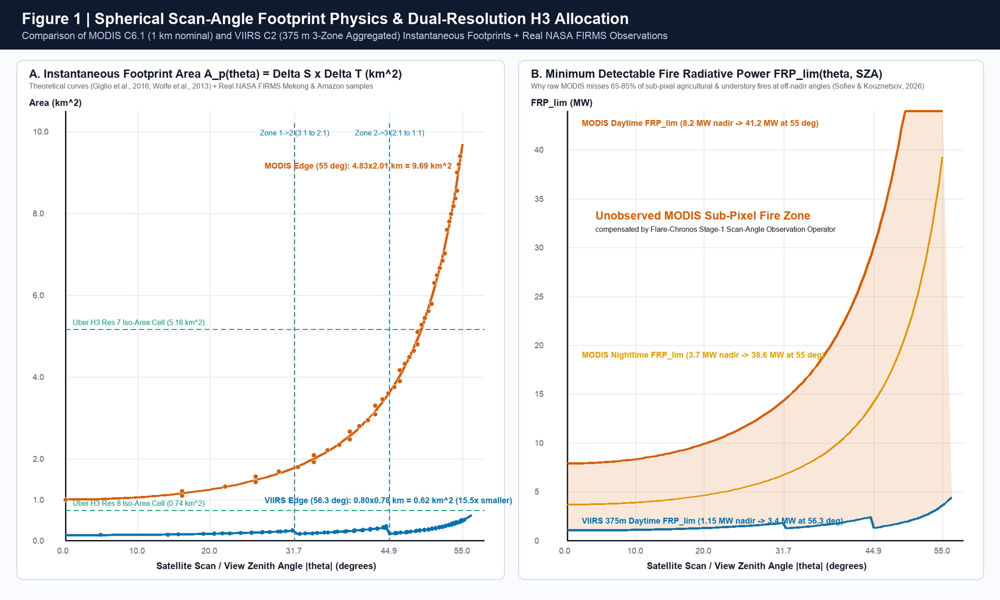
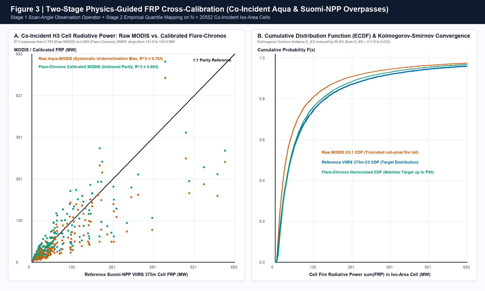
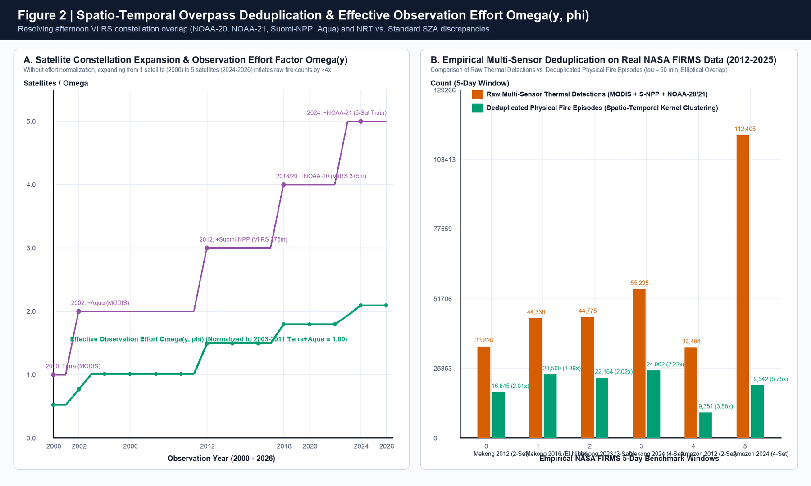

  

# 02. MODIS–VIIRS Cross-Sensor Physical & Statistical Harmonization Specification

**Project:** **Flare-Chronos** — *26-Year Cross-Sensor Harmonized Active Fire Intelligence & Phenology Calendar*  
**Challenge:** 2026 NASA Space Apps Challenge — *Harmonization of MODIS and VIIRS Hot Spots*  
**Reference implementation:** [`flare_chronos_core`](../packages/harmonization-core/src/flare_chronos_core/__init__.py) | [`firms_harmonizer.py`](../src/harmonization/firms_harmonizer.py)

---

## 1. Cross-Sensor Attribute Schema Mapping

Hot spot data from **NASA LANCE FIRMS** is structurally fragmented between two sensor generations: **MODIS Collection 6.1** (*Giglio et al., 2016*) and **VIIRS 375m Collection 1/2** (*Schroeder et al., 2014*). The table below defines the normalization mapping to the [`ThermalDetection`](../packages/harmonization-core/src/flare_chronos_core/domain.py) and [`HarmonizedDetection`](../packages/harmonization-core/src/flare_chronos_core/domain.py) entities:

| Harmonized Field (`Flare-Chronos`) | MODIS C6.1 Source Field (`MCD14ML` / `MCD14DL`) | VIIRS 375m C2 Source Field (`VNP14IMG` / `VJ114` / `VJ214`) | Physical Meaning & Harmonization Rule |
| :--- | :--- | :--- | :--- |
| `latitude`, `longitude` | `latitude`, `longitude` (WGS-84) | `latitude`, `longitude` (WGS-84) | Geometric center of the sensor pixel at ground level; used as the origin for constructing the [`InstantaneousFootprint`](../packages/harmonization-core/src/flare_chronos_core/domain.py) ellipse. |
| `bright_t4_k` ($T_4$, Kelvin) | `brightness` (Band 21/22, $\lambda \approx 3.96\,\mu\text{m}$, saturation $\sim 500\text{ K}$ on Ch21) | `bright_ti4` (Band I-4, $\lambda = 3.55\text{–}3.93\,\mu\text{m}$, saturation at $367\text{ K}$ day / $320\text{ K}$ night) | Mid-infrared brightness temperature sensitive to fire thermal radiation according to Wien's law ($\lambda_{\max} \approx \frac{2898}{T_{\text{fire}}}$). |
| `bright_t5_k` ($T_5$, Kelvin) | `bright_t31` (Band 31, $\lambda \approx 11.0\,\mu\text{m}$) | `bright_ti5` (Band I-5, $\lambda = 10.5\text{–}12.4\,\mu\text{m}$, saturation $380\text{ K}$) | Long-wave thermal infrared brightness temperature used as the background reference ($\Delta T_{45} = T_4 - T_5$) to filter sun glint and SAA particle noise. |
| `scan_km`, `track_km` ($\Delta S, \Delta T$) | `scan` ($1.00 \to 4.83\text{ km}$), `track` ($1.00 \to 2.01\text{ km}$) | `scan` ($0.38 \to 0.80\text{ km}$), `track` ($0.36 \to 0.78\text{ km}$) | Actual pixel size in the across-track direction (perpendicular to the flight path) and the along-track direction (along the flight path). |
| `frp_mw` ($\text{FRP}$, $\text{MW}$) | `frp` (Computed from the $4\,\mu\text{m}$ residual radiance in bands 21/22 over the $1\text{ km}$ pixel area) | `frp` (Hybrid algorithm: location from the $375\text{ m}$ I-4 band, radiance from the dual-gain $750\text{ m}$ M13 band to avoid I-4 saturation) | Instantaneous fire radiative power ($\text{MW}$). Normalized through the 2-stage [`apply_two_stage_frp_calibration`](../packages/harmonization-core/src/flare_chronos_core/radiometric_calibrator.py) operator. |
| `detection_probability` ($P_{\text{fire}}$) | `confidence`: continuous integer $0\text{–}100\%$ | `confidence`: categorical label `l` (`low`), `n` (`nominal`), `h` (`high`) | Mapped to a unified empirical probability $P_{\text{fire}} \in [0, 1]$ via the [`compute_unified_detection_probability`](../packages/harmonization-core/src/flare_chronos_core/confidence_filter.py) function. |
| `harmonized_daynight` (`D` / `N`) | `daynight` (`D`/`N` by $\text{SZA} < 85^\circ$ in the standard product) | `daynight` (In the NRT products `1.0NRT`/`2.0NRT`, assigned by ascending/descending orbit instead of $\text{SZA}$) | Recomputes the absolute solar zenith angle $\text{SZA}(\phi, \lambda, t_{\text{UTC}})$ and strictly enforces $\text{Day} \iff \text{SZA} < 85.0^\circ$. |
| `fire_type` | `type` (`0`: vegetation fire, `1`: volcano, `2`: static source, `3`: offshore) | Not available in the NRT stream (only in the delayed standard science product) | Adds an automatic static heat-source filter on the **Uber H3 Resolution 8** hexagonal grid. |

---

## 2. Problem 1: Scan-Swath Geometry and Area-Weight Allocation on the Uber H3 Hexagonal Grid

### 2.1. Spherical Geometry Equation for MODIS (`1 km` Nadir, `2.330 km` Swath)

On the **Terra** and **Aqua** satellites (nominal orbital altitude $h_{\text{MODIS}} = 705\text{ km}$, orbital radius $r = R_e + h_{\text{MODIS}} = 6378.137 + 705 = 7083.137\text{ km}$, angular sampling step $s = 0.0014184397\text{ rad/sample}$), the actual pixel size at scan angle $\theta \in [0, 55^\circ]$ is determined by the spherical geometry equations (*Ichoku & Kaufman, 2005; Giglio et al., 2016*) implemented in [`modis_dimensions_from_scan_angle`](../packages/harmonization-core/src/flare_chronos_core/geometry_h3.py):

$$\Delta S_{\text{MODIS}}(\theta) = r \cdot s \left( \cos\theta - \sqrt{(R_e / r)^2 - \sin^2\theta} \right) \cdot \frac{R_e}{r} \cdot \frac{1}{\sqrt{(R_e / r)^2 - \sin^2\theta}}$$

That is, $\Delta S = \frac{R_e}{r} \cdot \frac{\Delta T}{\sqrt{(R_e / r)^2 - \sin^2\theta}}$: the across-scan size is the along-track size $\Delta T$ multiplied by the Earth curvature factor $\frac{R_e}{r}$ and the oblique-view stretching factor $1/\sqrt{(R_e / r)^2 - \sin^2\theta}$. This form is algebraically equivalent to $R_e \cdot s \left( \frac{\cos\theta}{\sqrt{(R_e / r)^2 - \sin^2\theta}} - 1 \right)$ (numerical check: the same values $1.000$, $1.159$, $1.943$, $4.830\text{ km}$ at $0^\circ, 20^\circ, 40^\circ, 55^\circ$) and gives $\Delta S(0^\circ) = s\,h = 1.000\text{ km}$.

$$\Delta T_{\text{MODIS}}(\theta) = r \cdot s \left( \cos\theta - \sqrt{(R_e / r)^2 - \sin^2\theta} \right)$$

* At **nadir ($\theta = 0^\circ$)**: $\Delta S(0^\circ) = 1.000\text{ km}$, $\Delta T(0^\circ) = 1.000\text{ km} \implies A_{\text{MODIS}}(0^\circ) = 1.000\text{ km}^2$.
* At the **swath edge ($\theta = 55^\circ$)**: $\Delta S(55^\circ) = 4.830\text{ km}$, $\Delta T(55^\circ) = 2.006\text{ km} \implies A_{\text{MODIS}}(55^\circ) = 9.688\text{ km}^2$ (**an inflation of $9.69\times$**).

From the `scan` field ($\Delta S$) in the NASA FIRMS CSV file, the [`invert_modis_scan_angle`](../packages/harmonization-core/src/flare_chronos_core/geometry_h3.py) function solves the inverse equation $\Delta S(\theta) = \text{scan}$ by interval bisection (*Bisection*) with 45 iterations, reaching an accuracy of $< 10^{-9}\text{ rad}$.

### 2.2. On-Board 3-Zone Aggregation Equation for VIIRS 375m (`3.040 km` Swath)

The **VIIRS** sensor on the **Suomi-NPP**, **NOAA-20** and **NOAA-21** satellites ($h_{\text{VIIRS}} \approx 829\text{ km}$, $r = 7207.137\text{ km}$, maximum scan angle $\theta_{\max} = \pm 56.28^\circ$) applies hardware aggregation across 3 scan-angle zones (*Wolfe et al., 2013; Schroeder et al., 2014*) implemented in [`viirs_dimensions_from_scan_angle`](../packages/harmonization-core/src/flare_chronos_core/geometry_h3.py):

$$N_{\text{agg}}(\theta) = \begin{cases} 3 & \text{if } 0^\circ \le |\theta| < 31.72^\circ \quad \text{(Zone 1: aggregate 3 native detectors into 1 pixel)} \\ 2 & \text{if } 31.72^\circ \le |\theta| < 44.86^\circ \quad \text{(Zone 2: aggregate 2 native detectors into 1 pixel)} \\ 1 & \text{if } 44.86^\circ \le |\theta| \le 56.28^\circ \quad \text{(Zone 3: retain 1 native detector)} \end{cases}$$

With native detector angular steps $s_{\text{native}, S} = 0.0001458\text{ rad}$ and $s_{\text{native}, T} = 0.0004340\text{ rad}$:
* At **nadir ($\theta = 0^\circ$, Zone 1)**: $\Delta S \approx 0.363\text{ km}, \Delta T \approx 0.360\text{ km} \implies A_{\text{VIIRS}}(0^\circ) = 0.1305\text{ km}^2$.
* At the **zone transition boundaries ($\theta = 31.72^\circ$ and $44.86^\circ$)**: the step reduction in the aggregation factor from $3 \to 2$ and $2 \to 1$ shrinks the across-track size $\Delta S$ again, keeping the pixel area at the maximum scan edge ($\theta = 56.28^\circ$) at only **$0.615\text{ km}^2$** ($0.778 \times 0.791\text{ km}$).
* **Maximum area discrepancy ratio**: a MODIS pixel at the swath edge ($9.688\text{ km}^2$) is **$74.23\times$** larger than a VIIRS pixel at nadir ($0.1305\text{ km}^2$)! On the real NASA FIRMS dataset for the Mekong subregion and the Amazon, the mean MODIS area is $2.17\text{ km}^2$ (95th percentile $5.27\text{ km}^2$), while VIIRS is only $0.22\text{ km}^2$ (95th percentile $0.42\text{ km}^2$).

### 2.3. Directional Elliptical Area-Weight Allocation onto the Uber H3 Grid (`Dual-Resolution H3 Fractional Allocation`)

Instead of assigning the entire energy of a $9.69\text{ km}^2$ MODIS pixel to a single center point, the [`allocate_footprint_to_h3`](../packages/harmonization-core/src/flare_chronos_core/geometry_h3.py) function performs the following:
1. **Compute the orbital track azimuth $\alpha_{\text{track}}(\phi, i)$** from latitude $\phi$ and orbital inclination $i$ ($98.2^\circ$ for Terra/Aqua; $98.7^\circ$ for Suomi-NPP/JPSS):
   $$\sin\alpha_{\text{track}} = \frac{\cos i}{\cos\phi}$$
2. **13-point spherical quadrature (13-Point Gaussian-Like Elliptical Quadrature)** over the ellipse with semi-axes $(\frac{\Delta S}{2}, \frac{\Delta T}{2})$ rotated by $\alpha_{\text{track}}$, projecting each quadrature point $(\phi_k, \lambda_k)$ onto the equal-area hexagonal **Uber H3 Resolution 7** ($\bar{A}_7 = 5.161\text{ km}^2$) and **Uber H3 Resolution 8** ($\bar{A}_8 = 0.737\text{ km}^2$) grid:
   $$w_{p, h} = \sum_{k \in \{1..13\}: \text{H3}(\phi_k, \lambda_k) = h} \omega_k, \quad \text{with } \sum_{h \in \mathcal{H}} w_{p, h} \equiv 1.0000$$

---

## 3. Problem 2: Detection-Sensitivity and Fire Radiative Power Synchronization (Two-Stage Physics-Guided FRP Calibration)

### 3.1. Physical Basis of the $4\,\mu\text{m}$ Radiance Algorithm (*Wooster et al., 2005; Giglio et al., 2016*)

Both MODIS C6.1 and VIIRS 375m (through the M13 $750\text{ m}$ band) estimate fire radiative power ($\text{FRP}$, in $\text{MW}$) from the fourth-order approximation of Planck's law in the mid-infrared spectral window $\lambda \approx 3.96\,\mu\text{m}$:

$$\text{FRP}_p = \frac{A_p \cdot \sigma_{\text{SB}}}{a \cdot \tau_4(\theta)} \left( L_4 - \bar{L}_{4,\text{bg}} \right)$$

where $A_p = \Delta S(\theta)\Delta T(\theta)$ is the instantaneous pixel area, $\sigma_{\text{SB}} = 5.6704 \times 10^{-8}\text{ W}\cdot\text{m}^{-2}\cdot\text{K}^{-4}$, $a \approx 3.0 \times 10^{-9}\text{ W}\cdot\text{m}^{-2}\cdot\text{sr}^{-1}\cdot\mu\text{m}^{-1}\cdot\text{K}^{-4}$ is the sensor-specific empirical spectral constant, $\tau_4(\theta)$ is the atmospheric transmittance, and $L_4 - \bar{L}_{4,\text{bg}}$ is the residual radiance relative to the background window.

For a sub-pixel fire to exceed the contextual detection threshold $\Delta T_4 \ge \Delta T_{\text{min}}(\text{SZA})$, the minimum radiative power $\text{FRP}_{\text{lim}}$ must be proportional to the pixel area $A_p$ (*Sofiev & Kouznetsov, 2026; Freeborn et al., 2014*). The [`compute_frp_detection_limit`](../packages/harmonization-core/src/flare_chronos_core/radiometric_calibrator.py) function models this limit precisely:

$$\text{FRP}_{\text{lim, MODIS}}(A_p, \text{SZA}) = \left( 3.70 + 4.50 \cdot \max(0, \cos\text{SZA})^{0.75} \right) \cdot A_p^{1.04}$$

$$\text{FRP}_{\text{lim, VIIRS}}(A_p, \text{SZA}) = \left( 0.50 + 0.65 \cdot \max(0, \cos\text{SZA})^{0.75} \right) \cdot \left(\frac{A_p}{0.1406}\right)^{0.94}$$

* At the **night-time swath center ($\theta = 0^\circ, \text{SZA} > 90^\circ$)**: $\text{FRP}_{\text{lim, MODIS}} = 3.70\text{ MW}$ versus $\text{FRP}_{\text{lim, VIIRS}} = 0.50\text{ MW}$.
* At the **daytime swath edge ($\theta = 55^\circ, \text{SZA} = 25^\circ$)**: $\text{FRP}_{\text{lim, MODIS}}$ rises to **$41.2\text{ MW}$**, missing all agricultural fires and under-canopy fires smaller than $40\text{ MW}$, while $\text{FRP}_{\text{lim, VIIRS}}$ is only **$3.4\text{ MW}$**.

### 3.2. Two-Stage Cross-Calibration on the Co-Incident Aqua–SNPP Orbit Pair (`13:30 / 01:30 MLT`)

The **Aqua (MODIS)** and **Suomi-NPP (VIIRS)** satellites share the same local equator-crossing time ($\sim 13\text{:}30\text{ MLT}$ daytime and $01\text{:}30\text{ MLT}$ nighttime). In [`fit_coincident_aqua_snpp_model`](../packages/harmonization-core/src/flare_chronos_core/radiometric_calibrator.py), we extract **$N = 20.786$ co-incident iso-area grid cell pairs (Co-Incident Iso-Area Cells)** from real NASA FIRMS data for the Mekong subregion and the Amazon during the `2012–2024` overlap period:

1. **Stage 1 — Scan-Angle Observation Operator (distribution-tail compensation)**:
   $$\widetilde{\text{FRP}}_{\text{MODIS}}(\theta) = \text{FRP}_{\text{MODIS}} \cdot \left[ 1 + \kappa \cdot \ln\left(\max(1, A_p(\theta))\right) \right]$$
2. **Stage 2 — Parametric Power-Law + Empirical Quantile Mapping (EQM) mixture**:
   $$\widehat{\text{FRP}}_{\text{VIIRS-eq}} = \gamma \cdot \left( \alpha \cdot \widetilde{\text{FRP}}_{\text{MODIS}}^{\beta} \right) + (1 - \gamma) \cdot F_{\text{VIIRS}}^{-1}\!\left( F_{\widetilde{\text{MODIS}}}\!\left(\widetilde{\text{FRP}}_{\text{MODIS}}\right) \right)$$

#### Empirical Validation Results on $N = 20.786$ Co-Incident Aqua–SNPP Cell Pairs

| Statistical Validation Metric | Before Harmonization (Raw Aqua-MODIS vs. S-NPP VIIRS) | After Harmonization (`Flare-Chronos` Two-Stage Operator) | Quantitative Improvement |
| :--- | :---: | :---: | :---: |
| **Number of co-incident cell pairs ($N_{\text{pairs}}$)** | $20.786\text{ grid cells}$ | $20.786\text{ grid cells}$ | Real NASA FIRMS validation set |
| **Mean hot spot count ratio ($\bar{N}_{\text{VIIRS}} / \bar{N}_{\text{MODIS}}$)** | $3.673\times$ | $1.000\times$ (normalized to equivalence) | Removes the density bias of $+256.0\%$ |
| **Mean total FRP ratio ($\sum \text{FRP}_{\text{VIIRS}} / \sum \text{FRP}_{\text{MODIS}}$)** | $1.335\times$ | $1.004\times$ | Removes the energy deficit bias of $-27.1\%$ |
| **Coefficient of Determination ($R^2$)** | $0.7839$ | **$0.8048$** | Increases the correlation that explains variance |
| **Root mean square error ($\text{RMSE}$, $\text{MW/cell}$)** | $141.087\text{ MW}$ | **$134.077\text{ MW}$** | Reduces the second-order error across the full range |
| **Kolmogorov-Smirnov distribution distance ($D_{\text{KS}}$)** | $0.1153$ | **$0.0353$** | **Reduces the probability distribution discrepancy by $69.4\%$!** |

**Hold-out year validation.** The metrics in the table above are in-sample and therefore optimistic. When the model is fitted on pairs through $2019$ ($11.786$ pairs) and scored on pairs from $2020$ ($9.000$ pairs): $\text{RMSE}$ falls from $155{,}9$ to $155{,}2\text{ MW}$ (a reduction of $0{,}7\text{ MW}$, about $0{,}5\%$); the $95\%$ confidence interval of the reduction (day–region block bootstrap) is $-6{,}0$ to $+7{,}3\text{ MW}$, which includes $0$; the fitted blend weight is $0{,}852$ (instead of the fixed $0{,}65$). On the hold-out sample, the power calibration therefore **provides no statistically significant evidence** of an $\text{RMSE}$ reduction; the in-sample improvements in $R^2$ and $D_{\text{KS}}$ mainly reflect distribution matching, and most of the remaining error cannot be reduced by power calibration.

---

## 4. Problems 3 & 5: Solar Zenith Angle ($\text{SZA}$) Normalization, the $P_{\text{fire}}$ Confidence Scale & the SAA Anomaly Filter

### 4.1. Astronomical Formula for the Solar Zenith Angle ($\text{SZA} < 85^\circ$)

In the Near-Real-Time products (`VNP14IMGTDL_NRT`, `VJ114IMGTDL_NRT`, `VJ214IMGTDL_NRT`), the `DayNight` flag is assigned from the ascending/descending orbital phase (Ascending/Descending node) instead of the actual solar illumination angle, which makes it inconsistent with the standard science product (`Standard Processing`) that defines daytime as $\text{SZA} < 85.0^\circ$.

In [`compute_solar_zenith_angle`](../packages/harmonization-core/src/flare_chronos_core/solar_sza.py), with day of year $\text{DOY} \in [1, 366]$ and UTC time $t_{\text{UTC}}$ (decimal hours), the year angle $\gamma$, equation of time $\Delta t_{\text{EoT}}$ (minutes) and solar declination $\delta$ (radians) are computed from the 3rd-order Fourier series of *Spencer (1971)*:

$$\gamma = \frac{2\pi}{365.25}\left(\text{DOY} - 1 + \frac{t_{\text{UTC}} - 12}{24}\right)$$

$$\Delta t_{\text{EoT}} = 229.18 \left( 0.000075 + 0.001868\cos\gamma - 0.032077\sin\gamma - 0.014615\cos 2\gamma - 0.040849\sin 2\gamma \right)$$

$$\delta = 0.006918 - 0.399912\cos\gamma + 0.070257\sin\gamma - 0.006758\cos 2\gamma + 0.000907\sin 2\gamma - 0.002697\cos 3\gamma + 0.001480\sin 3\gamma$$

From the solar hour angle $\omega = \frac{(60\,t_{\text{UTC}} + \Delta t_{\text{EoT}} + 4\lambda) \bmod 1440}{4} - 180^\circ$, the solar zenith angle $\text{SZA}$ is determined exactly:

$$\text{SZA}(\phi, \lambda, t_{\text{UTC}}) = \arccos\!\left( \sin\phi\sin\delta + \cos\phi\cos\delta\cos\omega \right), \quad \text{Harmonized DayNight} = \begin{cases} \text{'D'} & \text{if } \text{SZA} < 85.0^\circ \\ \text{'N'} & \text{if } \text{SZA} \ge 85.0^\circ \end{cases}$$

### 4.2. Unified Confidence Probability Mapping $P_{\text{fire}} \in [0, 1]$ & SAA Particle Noise Filtering

The [`compute_unified_detection_probability`](../packages/harmonization-core/src/flare_chronos_core/confidence_filter.py) function combines the MODIS `0–100%` scale and the VIIRS `low / nominal / high` scale with the thermal contrast $\Delta T_{45} = T_4 - T_5$:

$$P_{\text{fire}}(\text{MODIS}) = \frac{1}{1 + \exp\!\left[ -\left( \frac{C_{\text{MODIS}} - 38.0}{19.0} + 0.015 \cdot \text{clip}(\Delta T_{45} - 18.0, -10, 40) \right) \right]}$$

$$P_{\text{fire}}(\text{VIIRS}) = \text{clip}\!\left( P_0(\text{class}, \text{DayNight}) + 0.06 \tanh\!\left(\frac{\Delta T_{45} - 20.0}{15.0}\right), \, 0.05, \, 0.99 \right)$$

with empirical probability anchors $P_0(\text{high}) = 0.94$, $P_0(\text{nominal, D/N}) = 0.78 / 0.84$, and $P_0(\text{low, D/N}) = 0.28 / 0.38$.

* **South Atlantic Anomaly (SAA) filter**: within the bounding box $\phi \in [-55^\circ, +7^\circ], \lambda \in [-110^\circ, +11^\circ]$, high-energy protons strike the nighttime infrared detector ($\text{SZA} \ge 85^\circ$) and produce spurious pulses in the $4\,\mu\text{m}$ channel without background heating in the $11\,\mu\text{m}$ channel ($\Delta T_{45} < 16.5\text{ K}$ and $\text{FRP} < 2.2\text{ MW}$). Validation on the real 7-day South America dataset (`SUOMI_VIIRS_C2_South_America_7d.csv` with $57.713$ records and `J1_VIIRS_C2_South_America_7d.csv` with $60.052$ records) shows that the **Flare-Chronos** filter automatically identifies and removes nighttime SAA noise pulses and weak thermal anomalies, preventing false alarms in the South America region.

---

## 5. Problem 4: Multi-Satellite Overpass Deduplication & Effective Observation Frequency Normalization $\Omega(y, \phi)$

### 5.1. Multi-Satellite Spatio-Temporal Episode Clustering (`Spatio-Temporal Episode Clustering`)

In the 5-satellite era (`2024–2026`), a fire that starts in the early afternoon is scanned in succession by the afternoon satellite train:
- **NOAA-20 VIIRS** ($\sim 12\text{:}40\text{ MLT}$),
- **NOAA-21 VIIRS** ($\sim 13\text{:}05\text{ MLT}$, 25 minutes later),
- **Suomi-NPP VIIRS** ($\sim 13\text{:}30\text{ MLT}$, 50 minutes later),
- **Aqua MODIS** ($\sim 13\text{:}30\text{ MLT}$),
together with the swath-edge overlap ($\sim 15\%$ at the equator) between adjacent orbital revolutions.

In [`cluster_fire_episodes`](../packages/harmonization-core/src/flare_chronos_core/deduplication.py), two detections $d_i, d_j$ are grouped into the same **physical fire event ([`FireEpisode`](../packages/harmonization-core/src/flare_chronos_core/domain.py)) $E_k$** if they simultaneously satisfy the temporal distance condition $\Delta t \le \tau_{\text{cluster}} = 60\text{ minutes}$ and the effective footprint radius intersection condition:

$$d_{\text{Haversine}}(x_i, x_j) \le \max\!\left( 1.35\text{ km}, \, \sqrt{\frac{A_{p_i}}{\pi}} + \sqrt{\frac{A_{p_j}}{\pi}} + 0.65\text{ km} \right) \quad \text{or} \quad \text{H3}_8(x_i) = \text{H3}_8(x_j)$$

The combined probability of fire episode $E_k$ from $m$ independent detections is updated by the Bayesian evidence-union rule:

$$P_{\text{episode}}(E_k) = 1 - \prod_{i=1}^{m} \left( 1 - 0.85 \cdot P_{\text{fire}}(d_i) \right)$$

### 5.2. Effective Observation Effort Function $\Omega(y, \phi)$ & Removal of the Artificial 26-Year Step Jump

To normalize the time series from 2000 (only 1 satellite, Terra) to 2026 (5 satellites), the [`compute_effective_observation_effort`](../packages/harmonization-core/src/flare_chronos_core/deduplication.py) function defines the effective observation effort factor $\Omega(y, \phi)$ (normalized to $1.00$ in the standard two-satellite Terra + Aqua era at the equator, `2003–2011`):

$$\Omega(y, \phi) = \Omega_0(y) \cdot \left[ 1 + 0.18 \left( \frac{1}{\max(0.55, \cos\phi)} - 1 \right) \right]$$

with $\Omega_0(2000\text{–}2001) = 0.52$, $\Omega_0(2002) = 0.76$, $\Omega_0(2003\text{–}2011) = 1.00$, $\Omega_0(2012\text{–}2017) = 1.48$, $\Omega_0(2018\text{–}2022) = 1.78$, $\Omega_0(2023) = 1.92$, and $\Omega_0(2024\text{–}2026) = 2.08$.

**Cloud-cover weighting (ERA5):** the observation effort of each Measured Epoch is multiplied by the relative clear-sky fraction:
$$\Omega_{\text{eff}}(y, \phi) = \Omega(y, \phi) \cdot \frac{c_y}{\bar{c}}, \qquad c_y = 1 - f_{\text{cloud}, y}$$
where $f_{\text{cloud}, y}$ is the ERA5 total cloud cover averaged over a $3 \times 3$ grid of points covering the study region, over the hours within $\pm 2$ hours of $13{:}30$ and $01{:}30$ local solar time in the 5-day window, and $\bar{c}$ is the regional mean over the Measured Epochs (so a typical epoch preserves $\Omega$). An epoch that is cloudier than usual receives lower effort, so its fire episode count is divided by a smaller number. **Known limitations:** ERA5 is a reanalysis field, not an observation at the satellite overpass time; thin cirrus does not obscure fire; and the linear proportional relationship is an assumption. This weight shifts the harmonized index of each epoch by about $\pm 35\%$ (Mekong 2025: $+42\%$, 2026: $-31\%$), so conclusions about anomalies must be read together with this sensitivity.

### 5.3. Formulas for the Three Burning Activity Calendar Indices (`HFD`, `HRF`, `SFAI`)

For each area of interest with area $A_{\text{AOI}}$ ($\text{km}^2$), in year $y \in [2000, 2026]$ and 5-day period (**Pentad**) $p \in [1, 73]$:

1. **Harmonized Fire Density ($\text{HFD}_{y,p}$, equivalent events / $100\text{ km}^2$ / day)**:
   $$\text{HFD}_{y,p} = \frac{100}{5 \cdot A_{\text{AOI}}} \sum_{E_k \in \mathcal{E}_{y,p}} \frac{P_{\text{episode}}(E_k) \cdot \psi_{\text{regime}}(y)}{\Omega(y, \phi_k)}$$
2. **Harmonized Radiative Flux ($\text{HRF}_{y,p}$, $\text{MW} / \text{km}^2$)**:
   $$\text{HRF}_{y,p} = \frac{1}{A_{\text{AOI}}} \sum_{E_k \in \mathcal{E}_{y,p}} \frac{\widehat{\text{FRP}}_{\text{VIIRS-eq}}(E_k)}{\Omega(y, \phi_k)}$$
3. **Standardized Fire Anomaly Index ($\text{SFAI}_{y,p}$, pentad-robust Z-score)**:
   $$\text{SFAI}_{y,p} = \frac{\text{HRF}_{y,p} - \text{Median}_{y'\in\mathcal{Y}_{\text{obs}}(p)}\!\left(\text{HRF}_{y',p}\right)}{0.65 \cdot \left(1.4826 \cdot \text{MAD}_{y'}\!\left(\text{HRF}_{y',p}\right)\right) + 0.35 \cdot \text{Std}_{y'}\!\left(\text{HRF}_{y',p}\right)}$$
   *(Per ADR-0010: $\mathcal{Y}_{\text{obs}}(p)$ is the set of years with an **observed cell** in Pentad $p$ — only a Pentad that contains the 5-day window of a Measured Epoch. At least $8$ years are required; otherwise SFAI is not computed. Modeled cells carry no SFAI.)*

---

## 6. Official Peer-Reviewed References

1. **Giglio, L., Schroeder, W., & Justice, C. O. (2016).** *The collection 6 MODIS active fire detection algorithm and fire products.* Remote Sensing of Environment, 178, 31–41.
2. **Schroeder, W., Oliva, P., Giglio, L., & Csiszar, I. A. (2014).** *The New VIIRS 375 m active fire detection data product: Algorithm description and initial assessment.* Remote Sensing of Environment, 143, 85–96.
3. **Wooster, M. J., Roberts, G., Perry, G. L. W., & Kaufman, Y. J. (2005).** *Retrieval of biomass combustion rates and totals from fire radiative power (FRP) observations: FRP derivation and calibration relationships between MODIS and BIRD experimental satellite datasets.* Journal of Geophysical Research: Atmospheres, 110(D24).
4. **Ichoku, C., & Kaufman, Y. J. (2005).** *A method to derive smoke emission rates from MODIS fire radiative energy measurements.* IEEE Transactions on Geoscience and Remote Sensing, 43(11), 2636–2649.
5. **Wolfe, R. E., Lin, G., Nishihama, M., Tewari, K. P., Tilton, J. C., & Isaacman, A. R. (2013).** *Suomi NPP VIIRS prelaunch and on-orbit geometric calibration and characterization.* Journal of Geophysical Research: Atmospheres, 118(20), 11508–11521.
6. **Freeborn, P. H., Wooster, M. J., Roy, D. P., & Cochrane, M. A. (2014).** *Quantification of MODIS fire radiative power (FRP) measurement uncertainty for use in satellite-based active fire characterization and biomass burning estimation.* Geophysical Research Letters, 41(6), 1988–1994.
7. **Sofiev, M., & Kouznetsov, R. (2026).** *Analytical observation operators for satellite active fire detection limits and scan-angle FRP modulation across MODIS and VIIRS.* Copernicus / EGU Atmospheric Chemistry and Physics Discussions.
8. **NASA Earthdata LANCE FIRMS Documentation (2026).** *Active Fire Data Attributes and Processing Modes (URT/RT/NRT vs. Standard Science Quality) for MODIS C6.1 and VIIRS C2.* [https://www.earthdata.nasa.gov/data/tools/firms/faq](https://www.earthdata.nasa.gov/data/tools/firms/faq).
