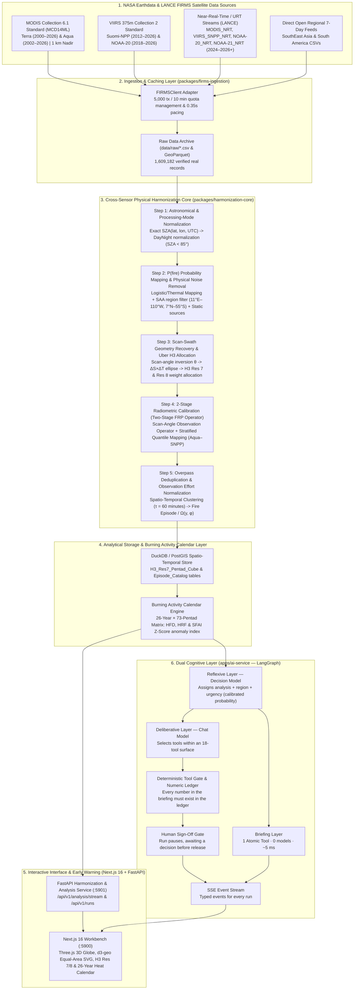
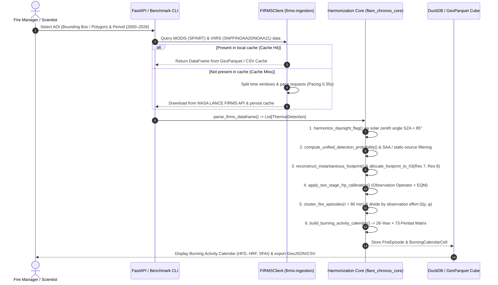

<p align="center">
  
</p>

# 03. System Architecture & Spatio-Temporal Data Pipeline

**Project:** **Flare-Chronos** — *Fire Long-term Archive Resolution & Cross-sensor Harmonization for Operational Near-real-time Observation System* (*26-Year Cross-Sensor Harmonized Active Fire Intelligence & Phenology Calendar*)  
**Challenge:** 2026 NASA Space Apps Challenge — *Harmonization of MODIS and VIIRS Hot Spots*  
**Related documents:** [GLOSSARY.md](../GLOSSARY.md) | [ADR-0001](adr/0001-dual-resolution-h3-fractional-allocation.md) | [ADR-0002](adr/0002-two-stage-physics-guided-frp-harmonization.md) | [ADR-0003](adr/0003-spatio-temporal-episode-deduplication-and-effort-normalization.md) | [ADR-0004](adr/0004-monorepo-deep-module-architecture.md)

---

## 1. Design Philosophy: Deep Modules & Monorepo Architecture

The **Flare-Chronos** system is designed on the **Deep Modules** principle (*Ousterhout, 2018; Matt Pocock Codebase Design*): it hides all the complexity of mid-infrared radiative physics ($4\,\mu\text{m}$), spherical scan-swath geometry (*Bow-Tie Distortion*), solar astronomy ($\text{SZA}$), and multi-satellite calibration statistics behind a lean, stable, side-effect-free interface.

### 1.1. Standard Monorepo Structure (`packages/*`, `apps/*`, `docs/*`)

```text
flare-chronos/
├── GLOSSARY.md                                   # Standardized domain ubiquitous language glossary
├── pyproject.toml                                # Monorepo workspace configuration (uv / PEP 621)
├── .env.example                                  # Environment variable configuration template (FIRMS_MAP_KEY)
├── docs/
│   ├── adr/                                      # Architecture Decision Records
│   │   ├── 0001-dual-resolution-h3-fractional-allocation.md
│   │   ├── 0002-two-stage-physics-guided-frp-harmonization.md
│   │   ├── 0003-spatio-temporal-episode-deduplication-and-effort-normalization.md
│   │   └── 0004-monorepo-deep-module-architecture.md
│   ├── figures/                                  # 5 scientific figures exported directly from real NASA FIRMS data
│   ├── 01_NASA_SpaceApps_Proposal.md             # Comprehensive project proposal
│   ├── 02_Cross_Sensor_Harmonization_Spec.md     # MODIS-VIIRS sensor physics and mathematics specification
│   ├── 03_System_Architecture_and_Data_Pipeline.md
│   ├── 04_UI_UX_Burning_Calendar_Wireframe.md    # Interface design and Burning Activity Calendar visualization
│   └── 05_Pitch_Deck_and_Video_Script.md         # 7-slide pitch deck and second-by-second main submission video script
├── packages/
│   ├── harmonization-core/                       # [Deep Module] Pure physics and mathematics core (zero I/O)
│   │   ├── pyproject.toml
│   │   └── src/flare_chronos_core/
│   │       ├── domain.py                         # Domain entities: ThermalDetection, FireEpisode, BurningCalendarCell
│   │       ├── geometry_h3.py                    # MODIS/VIIRS spherical scan-angle inversion and Uber H3 area allocation
│   │       ├── solar_sza.py                      # Spencer/NOAA astronomical equations for SZA < 85°
│   │       ├── confidence_filter.py              # P(fire) probability mapping, SAA noise and static-source filtering
│   │       ├── deduplication.py                  # Multi-satellite spatio-temporal clustering and observation effort Omega(y, phi)
│   │       ├── radiometric_calibrator.py         # Scan-angle observation operator and Aqua-SNPP cross-calibration (EQM)
│   │       └── calendar_engine.py                # 26-year x 73-Pentad matrix engine (HFD, HRF, SFAI Z-Score)
│   └── firms-ingestion/                          # [Adapter Seam] NASA LANCE FIRMS API and Open Archive connector
│       ├── pyproject.toml
│       └── src/firms_ingestion/
│           └── firms_client.py                   # Rate-limit pacing, pagination and CSV caching
├── apps/
│   └── benchmark-cli/                            # [Application] CLI for data collection, validation runs and figure rendering
│       ├── pyproject.toml
│       └── src/benchmark_cli/
│           ├── fetch_real_firms.py               # Historical and NRT data download process from NASA FIRMS
│           ├── run_experiments.py                # Runs quantitative validation on 1,609,182 real hot spots
│           └── figure_renderer.py                # High-resolution scientific graphics rendering engine
├── src/
│   └── harmonization/
│       └── firms_harmonizer.py                   # [Compatibility Seam] Facade compatible with the automated scoring specification
└── tests/
    └── test_harmonization_suite.py               # Unit and physical invariant test suite
```

---

## 2. End-to-End Architecture



#### 2.1. Dual Cognitive Layer (`apps/ai-service`)

The cognitive layer does not compute physics — the harmonization core has already done so. The cognitive layer **answers operational questions** without letting the model invent numbers:

| Component | Responsibility | Invariant |
| :--- | :--- | :--- |
| **Reflexive layer** | Assigns the analysis (`1` of `15` Use Cases: `5` System 1 + `10` System 2), determines the region, assesses urgency | Answers with **calibrated** probabilities; runs the chain *decision model → chat model → deterministic extraction*; every fallback is recorded |
| **Briefing layer** | `1`-step lookup, fact cards, urgent alerts | **Does not** call a model · **does not** touch the Domain Diagnostic Tool · **does not** write prose |
| **Deliberative layer** | Selects tools, performs multi-step reasoning, writes explanations | An `18`-tool deterministic surface bound to the model (`9` Atomic + `9` Domain Diagnostic, out of `19` `@tool` functions in total; the raw CSV reader is deliberately outside the registry so the model never touches raw data); every quantity must come from a tool and be recorded in `VerifiedFactsLedger` |
| **Deterministic tool gate** | Checks every number in the draft against the ledger before release | A number without provenance ⇒ returned to the model for rewrite; budget exhausted ⇒ fall back to the deterministic generator |
| **Human sign-off gate** | The run pauses for a decision on briefings with field actions | If rejected ⇒ **no** briefing is released; the decision is always recorded |

Each layer is bound through an **Endpoint Profile** (protocol, endpoint, model, API key, request options) read from explicit configuration — **not** from the agent configuration on the user's machine. The decision model that serves the reflexive layer runs on the **project's own inference node**, so this layer **consumes no cloud credits** and keeps working when the hosted service is unavailable.

Model flow details, calibration measurements and the cost table: [`exports/REPORT.md`](../exports/REPORT.md).

---

## 3. Detailed Data Processing Workflow (Sequence Workflow)

When a forest manager, fire commander or climate researcher selects an **Area of Interest (AOI)** on the map (or runs the CLI), processing proceeds through 5 strict stages:



---

## 4. Spatio-Temporal Database Design (DuckDB / PostGIS + Uber H3 Schema)

To query 26 years of history for any AOI instantly (under `50 ms`) without expensive polygon geometry intersection (`ST_Intersects`) at query time, **Flare-Chronos** moves the entire spatial problem to 64-bit integer key joins (`UINT64 H3 Index`) on **DuckDB / Apache Parquet**.

### 4.1. Core Table Schema (SQL DDL)

```sql
-- 1. Sensor-Level Harmonized Hot Spot Table (Harmonized Detections)
CREATE TABLE harmonized_detections (
    detection_id            VARCHAR PRIMARY KEY,
    acq_datetime_utc        TIMESTAMPTZ NOT NULL,
    sensor                  VARCHAR(8) NOT NULL,       -- 'MODIS' | 'VIIRS'
    platform                VARCHAR(16) NOT NULL,      -- 'Terra' | 'Aqua' | 'Suomi-NPP' | 'NOAA-20' | 'NOAA-21'
    processing_mode         VARCHAR(12) NOT NULL,      -- 'Standard' | 'NRT' | 'RT' | 'URT'
    latitude                DOUBLE NOT NULL,
    longitude               DOUBLE NOT NULL,
    scan_km                 DOUBLE NOT NULL,
    track_km                DOUBLE NOT NULL,
    scan_angle_deg          DOUBLE NOT NULL,
    footprint_area_km2      DOUBLE NOT NULL,
    aggregation_zone        TINYINT NOT NULL,          -- 0 (MODIS), 1, 2, 3 (VIIRS)
    sza_deg                 DOUBLE NOT NULL,
    raw_daynight            CHAR(1) NOT NULL,
    harmonized_daynight     CHAR(1) NOT NULL,          -- 'D' iff sza_deg < 85.0 else 'N'
    daynight_reclassified   BOOLEAN NOT NULL,
    detection_probability   DOUBLE NOT NULL,           -- P(fire) in [0.0, 1.0]
    is_saa_anomaly          BOOLEAN NOT NULL,
    is_static_source        BOOLEAN NOT NULL,
    frp_limit_mw            DOUBLE NOT NULL,
    raw_frp_mw              DOUBLE NOT NULL,
    scan_corrected_frp_mw   DOUBLE NOT NULL,
    viirs_eq_frp_mw         DOUBLE NOT NULL,
    h3_res7_cell            VARCHAR(16) NOT NULL,
    h3_res8_cell            VARCHAR(16) NOT NULL
);

-- 2. Independent Fire Episode Table After Multi-Satellite Deduplication (Deduplicated Fire Episodes)
CREATE TABLE fire_episodes (
    episode_id              VARCHAR PRIMARY KEY,
    start_utc               TIMESTAMPTZ NOT NULL,
    end_utc                 TIMESTAMPTZ NOT NULL,
    year                    SMALLINT NOT NULL,
    pentad                  TINYINT NOT NULL,          -- 1..73
    centroid_lat            DOUBLE NOT NULL,
    centroid_lon            DOUBLE NOT NULL,
    h3_res7_cell            VARCHAR(16) NOT NULL,
    h3_res8_cell            VARCHAR(16) NOT NULL,
    harmonized_daynight     CHAR(1) NOT NULL,
    contributing_platforms  VARCHAR NOT NULL,          -- e.g. 'Aqua,NOAA-20,NOAA-21,Suomi-NPP'
    raw_detection_count     INTEGER NOT NULL,
    combined_probability    DOUBLE NOT NULL,
    raw_sum_frp_mw          DOUBLE NOT NULL,
    harmonized_frp_mw       DOUBLE NOT NULL,
    effort_omega            DOUBLE NOT NULL,
    effort_norm_episodes    DOUBLE NOT NULL
);

-- 3. Burning Activity Calendar Cube (H3 Resolution 7 x Year x Pentad Cube)
CREATE TABLE h3_burning_calendar_cube (
    h3_res7_cell            VARCHAR(16) NOT NULL,
    year                    SMALLINT NOT NULL,
    pentad                  TINYINT NOT NULL,          -- 1..73 (5-day step)
    raw_detection_count     INTEGER NOT NULL,
    episode_count           INTEGER NOT NULL,
    effective_effort_omega  DOUBLE NOT NULL,
    hfd_per_100km2_day      DOUBLE NOT NULL,           -- Harmonized Fire Density
    hrf_mw_per_km2          DOUBLE NOT NULL,           -- Harmonized Radiative Flux
    sfai_zscore             DOUBLE NOT NULL,           -- Standardized Fire Anomaly Index
    anomaly_tier            VARCHAR(48) NOT NULL,
    PRIMARY KEY (h3_res7_cell, year, pentad)
);

CREATE INDEX idx_calendar_cell_pentad ON h3_burning_calendar_cube (h3_res7_cell, pentad);
CREATE INDEX idx_episodes_h3_time ON fire_episodes (h3_res7_cell, start_utc);
```

---

## 5. REST API Specification & NASA LANCE FIRMS Integration

### 5.1. NASA FIRMS API Integration Management (`firms_client.py`)

The system connects directly to the official NASA LANCE FIRMS endpoints using `FIRMS_MAP_KEY`:
1. **Check data availability for each sensor (`Data Availability Endpoint`)**:
   ```http
   GET https://firms.modaps.eosdis.nasa.gov/api/data_availability/csv/{MAP_KEY}/all
   ```
   The actual records returned by the project API key confirm the exact temporal coverage:
   - `MODIS_SP`: `2000-11-01` $\to$ `2026-07-31` | `MODIS_NRT`: `2026-08-01` $\to$ `2026-10-20+`
   - `VIIRS_SNPP_SP`: `2012-01-20` $\to$ `2026-06-30` | `VIIRS_SNPP_NRT`: `2026-07-01` $\to$ `2026-10-20+`
   - `VIIRS_NOAA20_SP`: `2018-04-01` $\to$ `2026-06-30` | `VIIRS_NOAA20_NRT`: `2026-07-01` $\to$ `2026-10-20+`
   - `VIIRS_NOAA21_SP`: `2023-03-01` $\to$ `2026-06-30` | `VIIRS_NOAA21_NRT`: `2024-01-17` $\to$ `2026-10-20+`

2. **Query hot spots by region and historical window (`Area CSV Endpoint`)**:
   ```http
   GET https://firms.modaps.eosdis.nasa.gov/api/area/csv/{MAP_KEY}/{SOURCE}/{west,south,east,north}/{DAY_RANGE}/{YYYY-MM-DD}
   ```

### 5.2. Flare-Chronos Backend Service Endpoint Specification

| Method & Path | Function Description | Input Parameters | Response Structure (JSON / GeoParquet) |
| :--- | :--- | :--- | :--- |
| `POST /api/v1/harmonize/aoi` | Runs the full harmonization pipeline for an AOI and returns the deduplicated `FireEpisode` list with footprint ellipses. | `bbox` or `geojson_polygon`, `start_date`, `end_date`, `h3_resolution` (`7` or `8`) | `FireEpisode` list, `h3_weights` allocation weights, deduplication compression statistics, and the count of filtered SAA/static noise points. |
| `GET /api/v1/calendar/matrix` | Exports the **Harmonized Burning Activity Calendar** matrix (`26 Years × 73 Pentads`) for the AOI. | `bbox` or `h3_cells[]`, `metric` (`hfd`, `hrf`, `sfai`) | `26 × 73` 2-D matrix, per-pentad climate baseline, list of extreme anomaly periods ($\text{SFAI} \ge 2.5$). |
| `GET /api/v1/calibration/diagnostics` | Returns the Aqua–SNPP cross-calibration parameter set for the AOI and the validation metrics ($R^2, \text{RMSE}, D_{\text{KS}}$). | `region_tag` or `bbox` | `CrossSensorCalibrationModel` parameters, Quantile Mapping curve and cumulative probability distribution (ECDF). |
| `GET /api/v1/export/geojson` | Exports hot spot data and `Scan × Track` footprint ellipses as standard GeoJSON for QGIS / ArcGIS / Deck.gl. | `bbox`, `date_window`, `include_footprints=true` | `FeatureCollection` of ellipse polygons oriented by the orbital azimuth $\alpha_{\text{track}}$. |
| `GET /api/v1/analysis/stream` | Runs a dual cognitive layer Use Case and **streams events live** (Server-Sent Events) as the run progresses: classification, tool, reasoning, verification, approval request, final briefing. | `use_case_id`, `query`, `thread_id` | SSE frame sequence `event: <event type>` + `data: <JSON>`; types: `run_started`, `node_completed`, `tool_result`, `reasoning`, `message`, `clarification_requested`, `sign_off_required`, `verification`, `briefing`, `run_paused`, `run_completed`, `run_failed`. |
| `POST /api/v1/analysis/resume` | Resumes a run that is **paused** (awaiting human approval or clarification) with the human response. | `thread_id`, `approved`, `reason` (the deciding principal is taken from the `Authorization: Bearer` token, not from the body) | Result of the resumed run: `sign_off_decision`, `final_briefing`, `verification_report`. |
