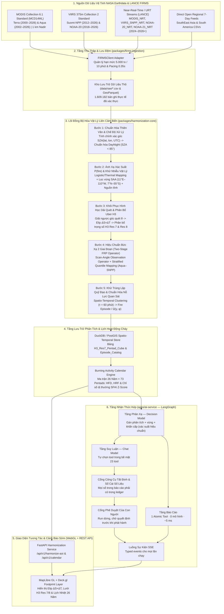
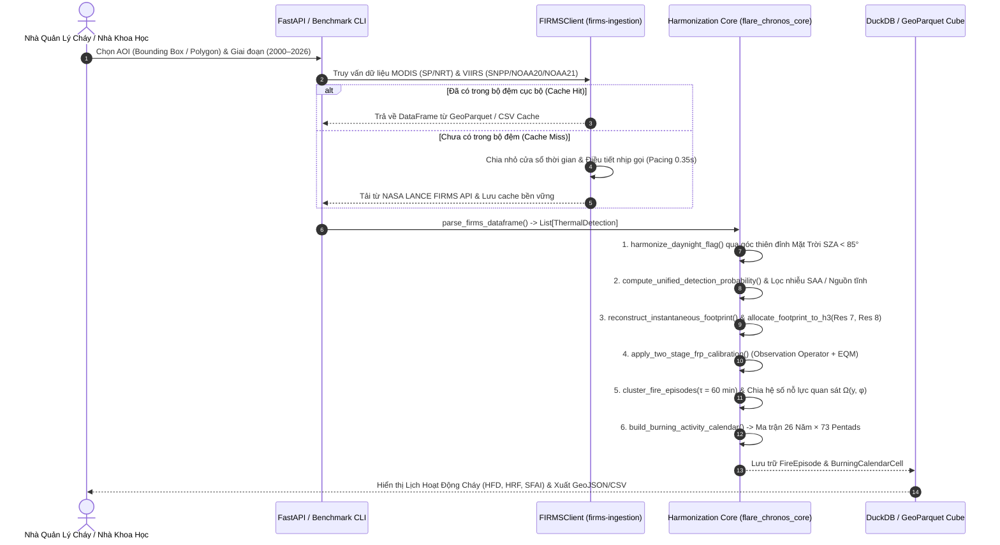

<p align="center">
  
</p>

# 03. Kiến Trúc Hệ Thống & Đường Ống Dữ Liệu Không-Thời Gian (System Architecture & Spatio-Temporal Data Pipeline)

**Dự án:** **Flare-Chronos** — *Fire Long-term Archive Resolution & Cross-sensor Harmonization for Operational Near-real-time Observation System* (*26-Year Cross-Sensor Harmonized Active Fire Intelligence & Phenology Calendar*)  
**Cuộc thi:** 2026 NASA Space Apps Challenge — *Harmonization of MODIS and VIIRS Hot Spots*  
**Tài liệu liên kết:** [GLOSSARY.md](../GLOSSARY.md) | [ADR-0001](adr/0001-dual-resolution-h3-fractional-allocation.md) | [ADR-0002](adr/0002-two-stage-physics-guided-frp-harmonization.md) | [ADR-0003](adr/0003-spatio-temporal-episode-deduplication-and-effort-normalization.md) | [ADR-0004](adr/0004-monorepo-deep-module-architecture.md)

---

## 1. Triết Lý Thiết Kế: Deep Modules & Monorepo Architecture

Hệ thống **Flare-Chronos** được thiết kế theo nguyên lý **Deep Modules** (*Ousterhout, 2018; Matt Pocock Codebase Design*): che giấu toàn bộ độ phức tạp của vật lý bức xạ hồng ngoại trung ($4\,\mu\text{m}$), hình học cầu dải quét (*Bow-Tie Distortion*), thiên văn học Mặt Trời ($\text{SZA}$), và thống kê hiệu chuẩn đa vệ tinh đằng sau một bề mặt giao diện (*Interface*) tinh gọn, bất biến và không phụ thuộc hiệu ứng phụ (*Side-Effect Free*).

### 1.1. Cấu Trúc Monorepo Chuẩn (`packages/*`, `apps/*`, `docs/*`)

```text
flare-chronos/
├── GLOSSARY.md                                   # Từ điển miền nghiệp vụ chuẩn hóa (Domain Ubiquitous Language)
├── pyproject.toml                                # Cấu hình Workspace Monorepo (uv / PEP 621)
├── .env.example                                  # Mẫu cấu hình biến môi trường (FIRMS_MAP_KEY)
├── docs/
│   ├── adr/                                      # Hồ sơ Quyết định Kiến trúc (Architecture Decision Records)
│   │   ├── 0001-dual-resolution-h3-fractional-allocation.md
│   │   ├── 0002-two-stage-physics-guided-frp-harmonization.md
│   │   ├── 0003-spatio-temporal-episode-deduplication-and-effort-normalization.md
│   │   └── 0004-monorepo-deep-module-architecture.md
│   ├── figures/                                  # Bộ 5 biểu đồ khoa học xuất trực tiếp từ dữ liệu thực NASA FIRMS
│   ├── 01_NASA_SpaceApps_Proposal.md             # Bản thuyết minh dự án toàn diện
│   ├── 02_Cross_Sensor_Harmonization_Spec.md     # Đặc tả toán học & vật lý cảm biến MODIS - VIIRS
│   ├── 03_System_Architecture_and_Data_Pipeline.md
│   ├── 04_UI_UX_Burning_Calendar_Wireframe.md    # Thiết kế giao diện & Trực quan hóa Lịch Hoạt động Cháy
│   └── 05_Pitch_Deck_and_Video_Script.md         # Kịch bản Pitch Deck 7 slides & Main Submission Video từng giây
├── packages/
│   ├── harmonization-core/                       # [Deep Module] Lõi vật lý & toán học thuần túy (Zero I/O)
│   │   ├── pyproject.toml
│   │   └── src/flare_chronos_core/
│   │       ├── domain.py                         # Thực thể miền: ThermalDetection, FireEpisode, BurningCalendarCell
│   │       ├── geometry_h3.py                    # Giải ngược góc quét cầu MODIS/VIIRS & Phân bổ diện tích Uber H3
│   │       ├── solar_sza.py                      # Phương trình thiên văn Spencer/NOAA tính SZA < 85°
│   │       ├── confidence_filter.py              # Ánh xạ xác suất P(fire), lọc nhiễu SAA & Nguồn nhiệt tĩnh
│   │       ├── deduplication.py                  # Gom cụm không-thời gian đa vệ tinh & Nỗ lực quan sát Omega(y, phi)
│   │       ├── radiometric_calibrator.py         # Toán tử quan sát góc quét & Hiệu chuẩn chéo Aqua-SNPP (EQM)
│   │       └── calendar_engine.py                # Động cơ tính ma trận 26 năm x 73 Pentads (HFD, HRF, SFAI Z-Score)
│   └── firms-ingestion/                          # [Adapter Seam] Kết nối NASA LANCE FIRMS API & Open Archive
│       ├── pyproject.toml
│       └── src/firms_ingestion/
│           └── firms_client.py                   # Điều tiết tốc độ (Rate-limit pacing), phân trang & lưu đệm CSV
├── apps/
│   └── benchmark-cli/                            # [Application] CLI thu thập dữ liệu, chạy kiểm chứng & vẽ biểu đồ
│       ├── pyproject.toml
│       └── src/benchmark_cli/
│           ├── fetch_real_firms.py               # Tiến trình tải dữ liệu lịch sử & NRT từ NASA FIRMS
│           ├── run_experiments.py                # Thực thi kiểm chứng định lượng trên 1.609.182 điểm nóng thực tế
│           └── figure_renderer.py                # Động cơ kết xuất đồ họa khoa học độ phân giải cao
├── src/
│   └── harmonization/
│       └── firms_harmonizer.py                   # [Compatibility Seam] Facade tương thích đặc tả chấm điểm tự động
└── tests/
    └── test_harmonization_suite.py               # Bộ kiểm thử đơn vị & bất biến vật lý (Unit & Invariant Tests)
```

---

## 2. Sơ Đồ Kiến Trúc Tổng Thể (End-to-End Architecture)



#### 2.1. Tầng Nhận Thức Kép (`apps/ai-service`)

Tầng nhận thức không tính toán vật lý — lõi đồng bộ hóa đã làm việc đó. Tầng nhận thức **trả lời câu hỏi vận hành** mà không để mô hình tự bịa số liệu:

| Thành phần | Trách nhiệm | Bất biến |
| :--- | :--- | :--- |
| **Tầng phản xạ** | Gán phân tích (`1` trong `20`), định vùng, đánh giá khẩn cấp | Trả lời bằng xác suất **hiệu chuẩn**; chạy chuỗi *decision model → chat model → trích xuất tất định*; mỗi lần lùi bậc được ghi lại |
| **Tầng báo cáo** | Tra cứu `1` bước, thẻ dữ kiện, cảnh báo khẩn | **Không** gọi mô hình · **không** chạm Domain Diagnostic Tool · **không** viết diễn giải |
| **Tầng suy luận** | Chọn tool, suy luận nhiều bước, viết diễn giải | Bề mặt `23` tool tất định (trong tổng `24` hàm `@tool`; máy đọc CSV thô cố ý nằm ngoài registry để mô hình không chạm dữ liệu thô); mọi định lượng phải đến từ tool và được ghi vào `VerifiedFactsLedger` |
| **Cổng công cụ tất định** | Đối chiếu từng con số trong bản thảo với sổ cái trước khi phát hành | Số không có nguồn ⇒ trả về mô hình viết lại; hết ngân sách ⇒ rơi về bộ sinh tất định |
| **Cổng phê duyệt con người** | Run dừng chờ quyết định cho báo cáo có hành động hiện trường | Bị từ chối ⇒ **không phát hành** báo cáo nào; quyết định luôn được ghi lại |

Mỗi tầng được gắn qua **Endpoint Profile** (giao thức, endpoint, model, khoá API, tuỳ chọn request) đọc từ cấu hình tường minh — **không** đọc cấu hình agent trên máy người dùng. Mô hình quyết định phục vụ tầng phản xạ chạy trên **node suy luận của chính dự án**, nên tầng này **không tốn credit đám mây** và vẫn hoạt động khi dịch vụ lưu trữ không sẵn sàng.

Chi tiết mô hình luồng, số đo hiệu chuẩn và bảng chi phí: [`exports/MODEL_FLOW.md`](../exports/MODEL_FLOW.md).

---

## 3. Thiết Kế Luồng Xử Lý Dữ Liệu Chi Tiết (Sequence Workflow)

Khi một nhà quản lý rừng, chỉ huy cứu hỏa hoặc nhà nghiên cứu khí hậu khoanh chọn một **Khu vực quan tâm (AOI)** trên bản đồ (hoặc chạy qua CLI), luồng xử lý diễn ra qua 5 giai đoạn chặt chẽ:



---

## 4. Thiết Kế Cơ Sở Dữ Liệu Không-Thời Gian (DuckDB / PostGIS + Uber H3 Schema)

Để truy vấn tức thời (dưới `50 ms`) lịch sử 26 năm trên bất kỳ vùng AOI nào mà không cần thực hiện phép giao cắt hình học đa giác (`ST_Intersects`) nặng nề lúc truy vấn, **Flare-Chronos** chuyển toàn bộ bài toán không gian sang phép kết nối khóa nguyên 64-bit (`UINT64 H3 Index`) trên **DuckDB / Apache Parquet**.

### 4.1. Lược Đồ Bảng Dữ Liệu Cốt Lõi (SQL DDL)

```sql
-- 1. Bảng Điểm Nóng Đã Chuẩn Hóa Mức Cảm Biến (Harmonized Detections)
CREATE TABLE harmonized_detections (
    detection_id            VARCHAR PRIMARY KEY,
    acq_datetime_utc        TIMESTAMPTZ NOT NULL,
    sensor                  VARCHAR(8) NOT NULL,       -- 'MODIS' | 'VIIRS'
    platform                VARCHAR(16) NOT NULL,      -- 'Terra' | 'Aqua' | 'Suomi-NPP' | 'NOAA-20' | 'NOAA-21'
    processing_mode         VARCHAR(12) NOT NULL,      -- 'Standard' | 'NRT' | 'RT' | 'URT'
    latitude                DOUBLE NOT NULL,
    longitude               DOUBLE NOT NULL,
    scan_km                 DOUBLE NOT NULL,
    track_km                DOUBLE NOT NULL,
    scan_angle_deg          DOUBLE NOT NULL,
    footprint_area_km2      DOUBLE NOT NULL,
    aggregation_zone        TINYINT NOT NULL,          -- 0 (MODIS), 1, 2, 3 (VIIRS)
    sza_deg                 DOUBLE NOT NULL,
    raw_daynight            CHAR(1) NOT NULL,
    harmonized_daynight     CHAR(1) NOT NULL,          -- 'D' iff sza_deg < 85.0 else 'N'
    daynight_reclassified   BOOLEAN NOT NULL,
    detection_probability   DOUBLE NOT NULL,           -- P(fire) in [0.0, 1.0]
    is_saa_anomaly          BOOLEAN NOT NULL,
    is_static_source        BOOLEAN NOT NULL,
    frp_limit_mw            DOUBLE NOT NULL,
    raw_frp_mw              DOUBLE NOT NULL,
    scan_corrected_frp_mw   DOUBLE NOT NULL,
    viirs_eq_frp_mw         DOUBLE NOT NULL,
    h3_res7_cell            VARCHAR(16) NOT NULL,
    h3_res8_cell            VARCHAR(16) NOT NULL
);

-- 2. Bảng Sự Kiện Cháy Độc Lập Sau Khử Trùng Lặp Đa Vệ Tinh (Deduplicated Fire Episodes)
CREATE TABLE fire_episodes (
    episode_id              VARCHAR PRIMARY KEY,
    start_utc               TIMESTAMPTZ NOT NULL,
    end_utc                 TIMESTAMPTZ NOT NULL,
    year                    SMALLINT NOT NULL,
    pentad                  TINYINT NOT NULL,          -- 1..73
    centroid_lat            DOUBLE NOT NULL,
    centroid_lon            DOUBLE NOT NULL,
    h3_res7_cell            VARCHAR(16) NOT NULL,
    h3_res8_cell            VARCHAR(16) NOT NULL,
    harmonized_daynight     CHAR(1) NOT NULL,
    contributing_platforms  VARCHAR NOT NULL,          -- e.g. 'Aqua,NOAA-20,NOAA-21,Suomi-NPP'
    raw_detection_count     INTEGER NOT NULL,
    combined_probability    DOUBLE NOT NULL,
    raw_sum_frp_mw          DOUBLE NOT NULL,
    harmonized_frp_mw       DOUBLE NOT NULL,
    effort_omega            DOUBLE NOT NULL,
    effort_norm_episodes    DOUBLE NOT NULL
);

-- 3. Khối Dữ Liệu Lịch Hoạt Động Cháy (H3 Resolution 7 x Year x Pentad Cube)
CREATE TABLE h3_burning_calendar_cube (
    h3_res7_cell            VARCHAR(16) NOT NULL,
    year                    SMALLINT NOT NULL,
    pentad                  TINYINT NOT NULL,          -- 1..73 (5-day step)
    raw_detection_count     INTEGER NOT NULL,
    episode_count           INTEGER NOT NULL,
    effective_effort_omega  DOUBLE NOT NULL,
    hfd_per_100km2_day      DOUBLE NOT NULL,           -- Harmonized Fire Density
    hrf_mw_per_km2          DOUBLE NOT NULL,           -- Harmonized Radiative Flux
    sfai_zscore             DOUBLE NOT NULL,           -- Standardized Fire Anomaly Index
    anomaly_tier            VARCHAR(48) NOT NULL,
    PRIMARY KEY (h3_res7_cell, year, pentad)
);

CREATE INDEX idx_calendar_cell_pentad ON h3_burning_calendar_cube (h3_res7_cell, pentad);
CREATE INDEX idx_episodes_h3_time ON fire_episodes (h3_res7_cell, start_utc);
```

---

## 5. Đặc Tả REST API & Kết Nối NASA LANCE FIRMS

### 5.1. Quản Lý Tích Hợp NASA FIRMS API (`firms_client.py`)

Hệ thống kết nối trực tiếp với các endpoint chính thức của NASA LANCE FIRMS sử dụng `FIRMS_MAP_KEY`:
1. **Kiểm tra phạm vi khả dụng của từng cảm biến (`Data Availability Endpoint`)**:
   ```http
   GET https://firms.modaps.eosdis.nasa.gov/api/data_availability/csv/{MAP_KEY}/all
   ```
   Bản ghi thực tế trả về từ khóa API của dự án xác nhận chính xác độ phủ thời gian:
   - `MODIS_SP`: `2000-11-01` $\to$ `2026-07-31` | `MODIS_NRT`: `2026-08-01` $\to$ `2026-10-20+`
   - `VIIRS_SNPP_SP`: `2012-01-20` $\to$ `2026-06-30` | `VIIRS_SNPP_NRT`: `2026-07-01` $\to$ `2026-10-20+`
   - `VIIRS_NOAA20_SP`: `2018-04-01` $\to$ `2026-06-30` | `VIIRS_NOAA20_NRT`: `2026-07-01` $\to$ `2026-10-20+`
   - `VIIRS_NOAA21_SP`: `2023-03-01` $\to$ `2026-06-30` | `VIIRS_NOAA21_NRT`: `2024-01-17` $\to$ `2026-10-20+`

2. **Truy vấn điểm nóng theo vùng và cửa sổ lịch sử (`Area CSV Endpoint`)**:
   ```http
   GET https://firms.modaps.eosdis.nasa.gov/api/area/csv/{MAP_KEY}/{SOURCE}/{west,south,east,north}/{DAY_RANGE}/{YYYY-MM-DD}
   ```

### 5.2. Đặc Tả Các Endpoint Của Dịch Vụ Flare-Chronos Backend

| Phương thức & Đường dẫn | Mô tả Chức năng | Tham số Đầu vào | Cấu trúc Phản hồi (JSON / GeoParquet) |
| :--- | :--- | :--- | :--- |
| `POST /api/v1/harmonize/aoi` | Thực thi đồng bộ hóa toàn trình cho một vùng AOI và trả về danh sách `FireEpisode` đã khử trùng lặp kèm đa giác elip footprint. | `bbox` hoặc `geojson_polygon`, `start_date`, `end_date`, `h3_resolution` (`7` hoặc `8`) | Danh sách `FireEpisode`, trọng số phân bổ `h3_weights`, thống kê tỷ lệ nén trùng lặp và số điểm nhiễu SAA/Static đã lọc. |
| `GET /api/v1/calendar/matrix` | Xuất ma trận **Harmonized Burning Activity Calendar** (`26 Năm × 73 Pentads`) cho vùng AOI. | `bbox` hoặc `h3_cells[]`, `metric` (`hfd`, `hrf`, `sfai`) | Ma trận 2 chiều `26 × 73`, đường cơ sở khí hậu theo từng Pentad, danh sách các kỳ dị thường cực đoan ($\text{SFAI} \ge 2.5$). |
| `GET /api/v1/calibration/diagnostics` | Trả về bộ tham số hiệu chuẩn chéo Aqua–SNPP trên vùng AOI và chỉ số kiểm định ($R^2, \text{RMSE}, D_{\text{KS}}$). | `region_tag` hoặc `bbox` | Tham số `CrossSensorCalibrationModel`, đường cong Quantile Mapping và phân phối xác suất tích lũy (ECDF). |
| `GET /api/v1/export/geojson` | Xuất dữ liệu điểm nóng & elip footprint `Scan × Track` chuẩn GeoJSON để nạp vào QGIS / ArcGIS / Deck.gl. | `bbox`, `date_window`, `include_footprints=true` | `FeatureCollection` gồm các đa giác elip định hướng theo góc phương vị quỹ đạo $\alpha_{\text{track}}$. |
| `GET /api/v1/analysis/stream` | Chạy một Use Case của tầng nhận thức kép và **phát sự kiện trực tiếp** (Server-Sent Events) khi run tiến triển: phân loại, tool, suy luận, kiểm chứng, yêu cầu phê duyệt, báo cáo cuối. | `use_case_id`, `query`, `thread_id` | Chuỗi khung SSE `event: <loại sự kiện>` + `data: <JSON>`; các loại: `run_started`, `node_completed`, `tool_result`, `reasoning`, `message`, `clarification_requested`, `sign_off_required`, `verification`, `briefing`, `run_paused`, `run_completed`, `run_failed`. |
| `POST /api/v1/analysis/resume` | Tiếp tục một run đang **dừng chờ** (chờ phê duyệt của con người hoặc chờ làm rõ) bằng câu trả lời của con người. | `thread_id`, `approved`, `reason`, `decided_by` | Kết quả run đã tiếp tục: `sign_off_decision`, `final_briefing`, `verification_report`. |
