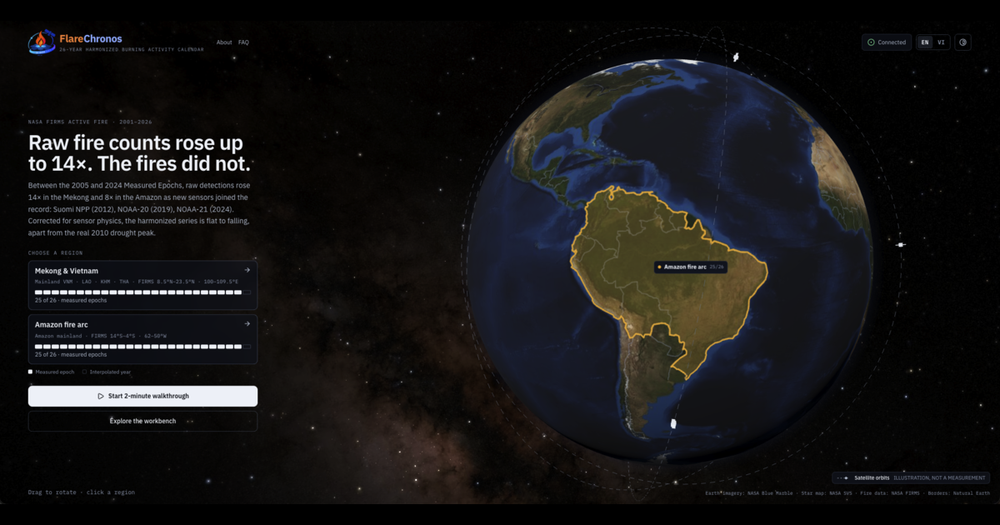
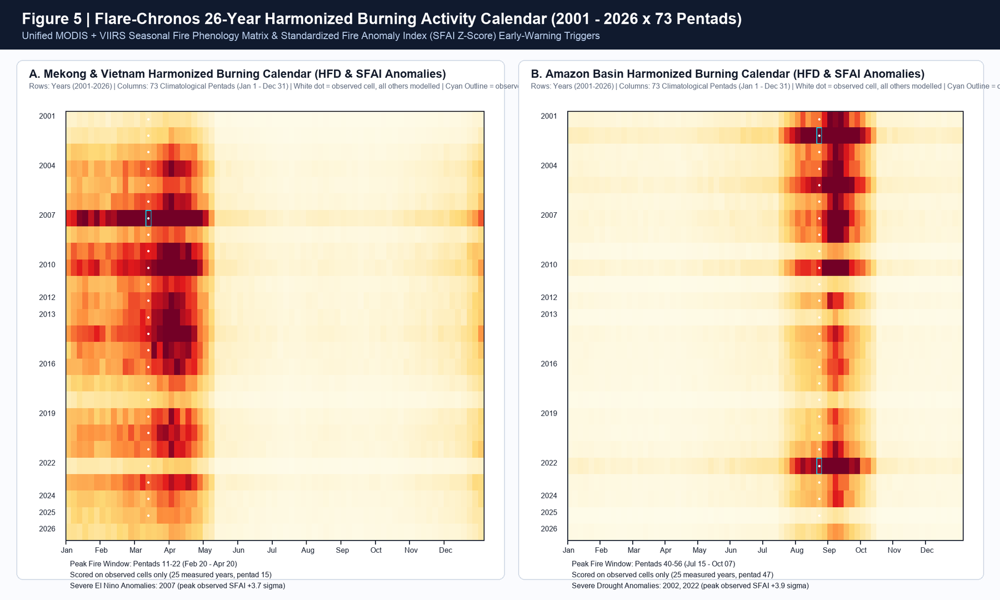
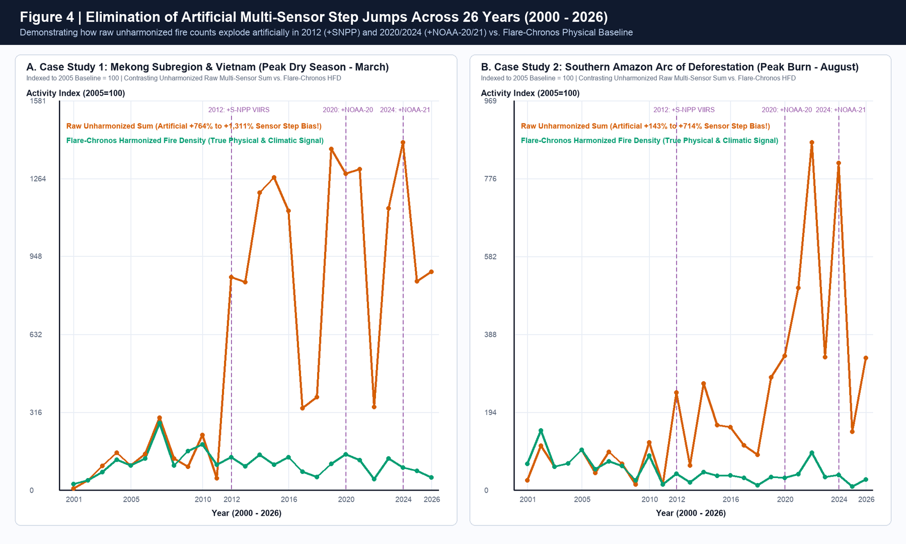

<p align="center">
  
</p>

# 04. UI/UX & Burning Activity Calendar Wireframe Specification

**Project:** **Flare-Chronos** — *26-Year Cross-Sensor Harmonized Active Fire Intelligence & Phenology Calendar*  
**Challenge:** 2026 NASA Space Apps Challenge — *Harmonization of MODIS and VIIRS Hot Spots*  
**Related documents:** [GLOSSARY.md](../GLOSSARY.md) | [02_Cross_Sensor_Harmonization_Spec.md](02_Cross_Sensor_Harmonization_Spec.md) | [03_System_Architecture_and_Data_Pipeline.md](03_System_Architecture_and_Data_Pipeline.md)

---

## 1. UX Objectives

Wildfire managers, emergency responders and ecologists face two major visualization barriers when they use conventional hotspot maps:
1. **Point-Buffer Illusion**: Conventional map portals draw every hotspot as a fixed-size circular dot. This hides the physical fact that a MODIS pixel at the edge of the scan swath ($\theta = 55^\circ$) has a ground elliptical footprint of up to **$9.69\text{ km}^2$** ($4.83 \times 2.01\text{ km}$), which is **$\sim 70\text{ times}$** the area of a VIIRS pixel at the swath center ($0.138\text{ km}^2$).
2. **Constellation Step-Jump Illusion**: In a raw time series from 2000 to 2026, adding Suomi-NPP in 2012, NOAA-20 in 2018/2020 and NOAA-21 in 2024 makes the fire count jump by $4\text{–}14\text{ times}$. The user cannot tell a truly extreme fire season (such as the 2016 or 2024 El Niño drought) from a sensor-density effect.

The **Flare-Chronos Workbench** resolves both illusions through a **Synchronized Four-Pane Analytical Workspace**.

---

## 2. Implemented Workbench & Full-Screen Wireframe

### 2.1. Live Interface Screenshot (`apps/workbench`) & Empirical Harmonization Charts



| 26-Year Burning Activity Calendar Matrix (`26 Years × 73 Pentads`) | Elimination of the Artificial Multi-Sensor Step Jump (`2001–2026`) |
| :---: | :---: |
|  |  |

### 2.2. Four-Pane Analytical Wireframe

```text
+----------------------------------------------------------------------------------------------------------------------+
| [🔥 FLARE-CHRONOS]  AOI: [ Mekong Subregion & Vietnam v ]   Period: [2000 - 2026]   Grid: [H3 Res 7 (5km)]            |
| Physical Filters: [x] SZA < 85° Normalization  [x] Night SAA Noise Filter  [x] Static Heat Source Split  [x] Dedup (60m) |
+-------------------------------------------------------+--------------------------------------------------------------+
|                                                       |  [BEFORE / AFTER HARMONIZATION CONTROL PANEL]                |
|   [MULTI-LAYER SPATIAL MAP VIEW - DECK.GL/MAPLIBRE]   |  +-------------------+----------------+----------------+        |
|                                                       |  | Raw Detections    | Fire Episodes  | SFAI Z-Score   |        |
|      _.-""""-._      (MODIS Edge Ellipse: 4.8x2.0km)  |  |  44,336 (Raw)     |  23,500 (Harm.)|  +0.02 sigma   |        |
|    .'          '.     o o (VIIRS 375m Cluster Inside) |  | (+1,110.7% artif.)| (Deduplicated) |  [BASELINE]    |        |
|   /   o  o  o    \                                    |  +-------------------+----------------+----------------+        |
|  |       o        |   / \ / \ / \ (Hexagonal Grid     |                                                              |
|   \              /   | H3| H3| H3|  Equal-Area)       |  [POLAR PHENOLOGY CLOCK (365 DAYS)]                          |
|    '._        _.'     \ / \ / \ /                     |              Pentad 1 (01/01)                                |
|       `""""""`                                        |                 . - ~ ~ - .                                  |
|                                                       |             . '    _..._    ' .   * Peak fire season:        |
|   Map Layer Legend:                                   |           /      .'     '.      \   Pentad 11 - 22           |
|   [x] True Footprint Ellipse (Scan x Track, alpha)    |          |      |  2016   |      |  (20/02 - 20/04)          |
|   [x] H3 Res 7/8 Grid (Color by HRF MW/km^2)          |           \      '. ___ .'      / * Out-of-season early warning: |
|   [x] Independent Fire Episode Center                 |             .     ' - - '     .     Pentad 8 (Mid-February)  |
|   [x] Detached Static Heat Source (Plants/Assoc. Gas) |               ' - . _ _ . - '                                |
|                                                       |              Pentad 37 (02/07)                               |
+-------------------------------------------------------+--------------------------------------------------------------+
| [26-YEAR HARMONIZED BURNING ACTIVITY CALENDAR MATRIX (26 YEARS x 73 PENTADS)]                                        |
| Metrics shown: (•) HFD (Events/100km2/day)   ( ) HRF (MW/km2)   ( ) SFAI Anomaly Z-Score   [x] Cyan Severe Anomaly   |
|                                                                                                                      |
| Year  | Jan (P01-06) | Feb (P07-12) | Mar (P13-18) | Apr (P19-24) | May-Jul (P25-42) | Aug-Oct (P43-60) | Nov-Dec    |
| ------+--------------+--------------+--------------+--------------+------------------+------------------+----------- |
| 2001  | ░░░░░░░░░░░░ | ░░▒▒▓▓▓▓▒▒░░ | ▓▓████████▓▓ | ▒▒▓▓▒▒░░░░░░ | ░░░░░░░░░░░░░░░░ | ░░░░░░░░░░░░░░░░ | ░░░░░░░░░░ |
| 2005  | ░░░░░░░░░░░░ | ░░▒▒▓▓▓▓▓▓░░ | ▓▓████████▓▓ | ▒▒▓▓▒▒░░░░░░ | ░░░░░░░░░░░░░░░░ | ░░░░░░░░░░░░░░░░ | ░░░░░░░░░░ |
| 2010* | ░░░░░░░░░░░░ | ▒▒▓▓██████▓▓ | ████████████ | ▓▓████▒▒░░░░ | ░░░░░░░░░░░░░░░░ | ░░░░░░░░░░░░░░░░ | ░░░░░░░░░░ |
| 2012  | ░░░░░░░░░░░░ | ░░▒▒▓▓▓▓▒▒░░ | ▓▓████████▓▓ | ▒▒▓▓▒▒░░░░░░ | ░░░░░░░░░░░░░░░░ | ░░░░░░░░░░░░░░░░ | ░░░░░░░░░░ |
| 2016* | ░░░░░░▒▒▓▓░░ | ▓▓██████████ | ████████████ | ▓▓██████▒▒░░ | ░░▒▒░░░░░░░░░░░░ | ░░░░░░░░░░░░░░░░ | ░░░░░░░░░░ |
| 2020  | ░░░░░░░░░░░░ | ░░▒▒▓▓▓▓▒▒░░ | ▓▓████████▓▓ | ▒▒▓▓▒▒░░░░░░ | ░░░░░░░░░░░░░░░░ | ░░░░░░░░░░░░░░░░ | ░░░░░░░░░░ |
| 2024* | ░░░░░░░░░░░░ | ▒▒▓▓██████▓▓ | ████████████ | ▓▓████▒▒░░░░ | ░░░░░░░░░░░░░░░░ | ░░░░░░░░░░░░░░░░ | ░░░░░░░░░░ |
| 2026  | ░░░░░░░░░░░░ | ░░▒▒▓▓██████ | ▓▓████████▓▓ | ▒▒▓▓▒▒░░░░░░ | ░░░░░░░░░░░░░░░░ | ░░░░░░░░░░░░░░░░ | [NRT LIVE] |
+----------------------------------------------------------------------------------------------------------------------+
| [2000-2026 TIME-SERIES COMPARISON: RAW UNHARMONIZED SUM (Brick-Red Line - Artificial Step) vs. FLARE-CHRONOS (Leaf Green)] |
|   Index ^                                                                           .--- Raw Unharmonized (+1311.2%) |
|   1200  |                                                                   .--------'                               |
|    400  |                                         .------------------------'                                         |
|    100  |================*================*=======*========*========*========*========*=== Flare-Chronos Physical    |
|         +--------+-------+--------+-------+-------+--------+--------+--------+--------+---> Year                     |
|        2000    2005    2010     2012    2016    2020     2022     2024     2025     2026                             |
+----------------------------------------------------------------------------------------------------------------------+
```

---

## 3. Detailed Specification of the 4 Interactive Interface Components (`apps/workbench`)

### 3.1. Multi-Resolution Spatial Map (`Three.js 3D Globe + d3-geo Equal-Area SVG + H3 Hex Map`)
* **Instantaneous Footprint Layer**:
  - Instead of drawing scalar points, each `ThermalDetection` is rendered as an oriented ellipse with major axis $\Delta S(\theta)$, minor axis $\Delta T(\theta)$, rotated by the orbital track azimuth $\alpha_{\text{track}}(\phi, i)$.
  - Users observe directly how one MODIS ellipse at the swath edge ($\Delta S = 4.83\text{ km}, \Delta T = 2.01\text{ km}$) covers $6\text{–}12$ VIIRS hotspots at `375 m` inside the same forest fire at the same overpass time `13:30 MLT`.
* **Dual-Resolution H3 Layer**:
  - At regional zoom (`5–9`), the map shows the **Uber H3 Resolution 7** grid ($\bar{A}_7 = 5.161\text{ km}^2$).
  - When zooming into the fire scene (`10–15`), the map transitions smoothly to **Uber H3 Resolution 8** ($\bar{A}_8 = 0.737\text{ km}^2$), with radiative energy weight $w_{p,h}$ allocated exactly from the intersecting ellipses.
* **Filtered Noise & Static Source Overlay**:
  - Industrial heat sources (cement plants, steel plants, oil and gas flaring stations, volcanoes) and nighttime particle-radiation noise points in the **South Atlantic Anomaly (SAA)** are drawn with distinct icons (purple/gray) and are removed automatically from the biomass burning calendar computation.

### 3.2. 26-Year Harmonized Burning Activity Calendar Matrix
* **Axis Structure**:
  - **Rows**: $26\text{ years}$ in a continuous series from `2001` to `2026` (with a 25-year climatological mean row at the top).
  - **Columns**: $73\text{ Pentads}$ (each pentad exactly $5\text{ days}$ by climatological convention, from Pentad 1: `01/01–05/01` to Pentad 73: `27/12–31/12`), which removes the month-length bias (28 vs. 31 days).
* **3 Instant-Switch Index Modes**:
  1. **$\text{HFD}$ (*Harmonized Fire Density*)**: normalized fire events per $100\text{ km}^2$/day.
  2. **$\text{HRF}$ (*Harmonized Radiative Flux*)**: normalized fire radiative power density ($\text{MW}/\text{km}^2$).
  3. **$\text{SFAI}$ (*Standardized Fire Anomaly Index*)**: a non-parametric Z-score that measures the deviation of the current pentad from its own 25-year baseline:
     $$\text{SFAI}_{y,p} = \frac{\text{HRF}_{y,p} - \text{Median}_y(\text{HRF}_{\cdot, p})}{\sigma_{\text{robust}}(\text{HRF}_{\cdot, p})}$$
* **Automatic Detection of "Peak Season" and "Out-of-Season Anomaly"**:
  - Cells with $\text{SFAI}_{y,p} \ge +2.2\sigma$ receive a glowing cyan outline (*Severe Anomaly Outline*), so fire commanders immediately see fire outbreaks that start earlier than the seasonal pattern (such as early February 2016 in the Central Highlands and the Mekong subregion). This threshold is a **display threshold** (consistent with the Figure 5 caption) and is lower than the **crisis alert** threshold of $\text{SFAI} \ge +2.5\sigma$ (see `docs/01` §6.1) — that is, the calendar highlights severe anomalies *before* the alert is triggered.

### 3.3. Polar Phenology Clock
* Represents the annual cycle of $365\text{ days}$ ($73\text{ Pentads}$) on the polar coordinate system $\psi_p = \frac{2\pi(p - 0.5)}{73}$:
  - The light gray band shows the 25-year climatological interquartile range ($\text{IQR}: P_{25}\text{–}P_{75}$).
  - The orange dashed line shows a historical El Niño year (`2010` or `2016`).
  - The solid teal line shows the current year (`2026`), which allows a visual comparison of the phenological phase shift (*Phenological Phase Shift* — how many pentads early the fire season starts or how late it ends).

### 3.4. Before/After Harmonization Comparator
* Shows side by side in one chart frame:
  - **Orange-Red Line (Raw Unharmonized Sum)**: the raw hotspot total when MODIS + S-NPP + NOAA-20 + NOAA-21 are summed (with artificial step jumps in 2012, 2020 and 2024).
  - **Teal Line (Flare-Chronos Harmonized Series)**: the physical trend after the H3 geometric calibrator, the scan-angle observation operator, 60-minute overpass deduplication and observation effort normalization $\Omega(y, \phi)$.

### 3.5. Grounded Briefing & Human Sign-off Panel
* The briefing panel is the **fifth component** and connects directly to the cognitive tier event stream (`GET /api/v1/analysis/stream`). The panel has **three states**, not one completed timeline:
  - **Run state**: the progress rail shows each event in order — *triage* (region + urgency level with **calibrated probability**) → *tool call* → *reasoning* → *verification* → *approval* → *briefing*. Each item is **expandable**: the tool item shows parameters and returned values; the reasoning item shows the full text; the verification item opens the **Verification Table**. The user watches the briefing **being verified**, not pre-written prose.
  - **Waiting state**: the timeline **stops** at *Approval — Waiting* and never shows *Approval — Done* before a decision exists. The **Decision Card** sits above the briefing draft and contains: the authorization question (`Authorize the operational action proposed by UC-S1.4?`), the signed-in **Sign-off Principal** with role, a **required reason** field, and two buttons, **Approve / Reject**. Directly above the two buttons, the **Decision Basis** strip states what the reviewer is checking: the proposed action, the region and time range, verified numbers N/N, unresolved citations (must be 0), unverified numbers (must be 0), self-correction count, synthesis mode, classifier confidence provenance (calibrated or self-reported) and degradation level. A rejection carries **structured reasons** (stale NRT data, duplicate alert, conflicting evidence, action outside authority, degraded service) plus free text; the reason is written to the audit record. The briefing draft — the exact text that will be released — is shown read-only directly below the card, with a one-click Verification Table, so the reviewer **approves the actual content**, not a summary.
  - **Result state**: after the decision (or for a run that needs no approval), the timeline collapses into a **Result Summary** with the primary button **View full briefing**. The button opens a **full-screen dialog** (or a right-side sheet on desktop) containing:
    - the full briefing text, an audience switch (**rangers / forestry leaders / climate scientists**) and a header (stakeholder tier, cognitive path, System 1 / System 2 model, synthesis mode);
    - **Verification Table**: one row per number — value, unit, source tool, source field, status (`Verified` / `Rewritten` / `No source`) and check result. Each row opens **Citation Detail** with: the sentence containing the number, displayed value, fact key, source tool, raw value returned by the tool, unit, provenance tag and verifier conclusion;
    - **Sign-off Decision record**: decision, principal, UTC timestamp, reason and release status;
    - the run **event log** and **audit id**.
  - **Effect of the decision**: **Approve** ⇒ the briefing is released and the decision is stamped (`Published`). **Reject** ⇒ **no briefing is released** (`Withheld`), no briefing text is shown, but the decision record remains and states that "the decision was recorded". The run does not need to be re-run. For a run that needs no approval ⇒ `Published`, with no decision record.
  - The result dialog **must reopen** after the run ends and after a page reload; no briefing is shown as published before every number is verified or before an approval decision exists.
* **Visible degradation state**: if any component of the cognitive tier is unavailable, the interface shows the exact degradation level in use and does **not** present everything as normal.
* The fuller reviewer screens (queue, run review, citation detail, approval log) are specified in [`docs/design/workbench-reviewer-ui-prompt.md`](./design/workbench-reviewer-ui-prompt.md).

---

## 4. Visual Evidence Rendered by the Python Engine

The figure below is rendered directly from `apps/benchmark-cli/src/benchmark_cli/run_experiments.py` on real NASA FIRMS data for the **Mekong Subregion & Vietnam** and the **Amazon Rainforest**:


