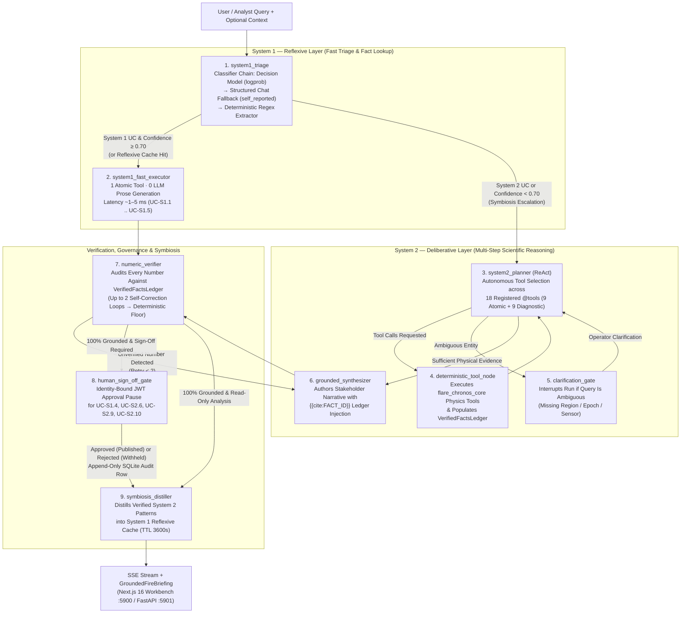

# Dual-System Cognitive Model Flow (`apps/ai-service`)

**Project:** FLARE-CHRONOS — *Physics-Guided Cross-Sensor Harmonization of MODIS & VIIRS Hot Spots (2000–2026)*  
**Scope:** End-to-end architecture, execution flow, deterministic tool gates, human-in-the-loop sign-off, and empirical evaluation of the Dual-System Cognitive AI Harness (`System 1 Reflexive Layer` + `System 2 Deliberative Layer`).  
**Version:** `v1.1.0` — Validated on `15/15` Use Cases (`5` System 1 + `10` System 2) across both offline deterministic (`0` network calls) and live hosted-model (`Gemini 3 Flash`) execution modes.

---

## 1. Architectural Purpose & Core Invariants

The cross-sensor physical harmonization engine (`packages/harmonization-core`) solves the satellite physics: spherical scan-angle footprint geometry, Solar Zenith Angle ($\text{SZA} < 85^\circ$) unification, South Atlantic Anomaly ($\text{SAA}$) cosmic-ray filtering, two-stage Fire Radiative Power ($\text{FRP}$) calibration, $\tau = 60\text{ min}$ multi-satellite episode clustering, and observation effort normalization $\Omega(y, \phi)$.

On top of that deterministic physics core, operational agencies (forest rangers, wildfire incident commanders, ministries of forestry, and climate scientists) ask natural-language situational and causal questions. A standard free-form Large Language Model (LLM) is unsafe for wildfire decision support because it can hallucinate hotspot counts, fabricate FRP values, or recommend unverified field dispatches.

The **FLARE-CHRONOS Dual-System Cognitive AI Harness (`apps/ai-service`)** eliminates LLM arithmetic and factual hallucination through **six hard architectural invariants**:

1. **Zero LLM Arithmetic (`Deterministic Tool Gate`)**: The LLM is strictly forbidden from computing physical, geometric, radiometric, or statistical quantities. Every number is computed by `18` registered deterministic `@tool` functions (`9` Atomic Tools + `9` Domain Diagnostic Tools, plus `1` internal raw-CSV harmonization tool = `19` `@tool` functions in total) backed by `flare_chronos_core`.
2. **Calibrated Reflexive Triage (`System 1 Reflexive Layer`)**: System 1 answers five closed-world classification questions (*region*, *epoch year*, *stakeholder agency*, *operational urgency*, and *Use Case assignment* among `15` canonical analyses) without generating prose. It runs a resilient three-step classifier chain:
   - **Primary (`typed_questions` decision endpoint)**: Returns calibrated token-level `logprob` probabilities.
   - **Fallback 1 (`openai_structured` / `native_chat` endpoint)**: Invokes forced structured tool-calling (`classify_request`) and records `triage_confidence_source = "self_reported"` so self-reported confidence is never mistaken for calibrated probability.
   - **Fallback 2 (`deterministic` extraction)**: Regex and keyword entity extraction so a run never fails even if all external model endpoints are unreachable.
3. **Zero-LLM Fast Reporting Tier (`System 1 Fast Execution`)**: Once a request is assigned to one of the `5` System 1 Use Cases (`UC-S1.1` through `UC-S1.5`) with calibrated confidence $\ge 0.70$, the `system1_fast_executor` invokes the single mapped Atomic Tool directly in $\sim 1\text{–}5\text{ ms}$ with **zero LLM token generation** for prose.
4. **Model-Driven Deliberative Tool Orchestration (`System 2 Deliberative Layer`)**: For the `10` System 2 Use Cases (`UC-S2.1` through `UC-S2.10`)—or whenever System 1 confidence falls below $0.70$ (`Dual-Process Symbiosis Escalation`)—the System 2 ReAct planner autonomously selects and chains tools across the full `18`-tool surface (`9` Atomic + `9` Domain Diagnostic).
5. **Verified Facts Ledger & Numeric Grounding Verifier**: Every scalar returned by a tool is recorded in the `VerifiedFactsLedger` with its `fact_id`, `tool_name`, `json_path`, `value`, `unit`, and `provenance_tag`. The model writes narrative prose using `{{cite:FACT_ID}}` placeholders; the harness deterministically injects the verified numbers and rejects any draft containing an unverified number (`NumericGroundingVerifier`), forcing a self-correction loop or deterministic fallback.
6. **Identity-Bound Human-in-the-Loop Sign-Off (`human_sign_off_gate`)**: Any Use Case that proposes an operational field dispatch or policy sign-off (`UC-S1.4`, `UC-S2.6`, `UC-S2.9`, `UC-S2.10`) pauses the LangGraph state machine (`run_paused`) and emits a `sign_off_required` Server-Sent Event (SSE). The briefing is released (`Published`) only when an authenticated `Sign-off Principal` (extracted from the validated Bearer JWT, never from the request body) approves it; if rejected, the briefing is permanently `Withheld` (`final_briefing = ""`), and the decision is written to an append-only SQLite `audit` table protected by database triggers against `UPDATE` and `DELETE`.

---

## 2. 8-Node LangGraph Dual-System StateGraph



---

## 3. Canonical Taxonomy: 15 Use Cases & 18 Registered `@tool` Functions

Per [ADR-0016](../docs/adr/0016-workbench-wired-to-ai-service-review-from-run-events.md), the cognitive harness is scoped to **15 non-overlapping Use Cases** (`5` System 1 Reflexive + `10` System 2 Deliberative) and **18 model-facing `@tool` functions** (`9` Atomic + `9` Domain Diagnostic), plus `1` internal raw-CSV harmonization tool (`tool_harmonize_real_firms_csv_slice`) kept outside the LLM registry so the language model never touches raw unharmonized CSV rows directly.

### 3.1. System 1 Reflexive Use Cases (`5` Analyses — `9` Atomic Tools Only)

| Use Case ID | Analysis Name | Primary Atomic Tool | Sign-Off Gate | Target Stakeholder |
| :--- | :--- | :--- | :---: | :--- |
| **`UC-S1.1`** | **Intent Triage & Single-Epoch Lookup** | `tool_lookup_single_epoch_metrics` | No | Field Ranger / Analyst |
| **`UC-S1.2`** | **Spatio-Temporal Entity Extraction** | `tool_lookup_single_epoch_metrics` | No | Field Ranger / Analyst |
| **`UC-S1.3`** | **Single-Hop Historical Epoch Lookup** | `tool_lookup_single_epoch_metrics` | No | Forestry Manager |
| **`UC-S1.4`** | **Flash NRT Crisis Alert Triage** | `tool_emit_flash_nrt_alert` | **Yes** | Wildfire Incident Commander |
| **`UC-S1.5`** | **Stakeholder Briefing Card Synthesis** | `tool_assemble_stakeholder_briefing_card` | No | Climate Scientist |

### 3.2. System 2 Deliberative Use Cases (`10` Analyses — Full `18`-Tool Surface)

| Use Case ID | Analysis Name | Primary Domain Diagnostic Tool | Sign-Off Gate | Target Stakeholder |
| :--- | :--- | :--- | :---: | :--- |
| **`UC-1.1`** | **2024 Multi-Sensor Regime-Shift Attribution** | `tool_uc1_1_regime_shift_attribution` | No | Climate Scientist / Examiner |
| **`UC-1.2`** | **Cross-Sensor Scan-Angle Discrepancy Forensics** | `tool_uc1_2_cross_sensor_discrepancy_forensics` | No | Remote Sensing Scientist |
| **`UC-1.3`** | **Thermal Source Origin & SAA Noise Classification** | `tool_uc1_3_thermal_source_origin_classification` | No | Data Quality Engineer |
| **`UC-2.1`** | **Phenological Phase-Shift & SFAI Detection** | `tool_uc2_1_phenological_phase_shift_detection` | No | Climate Scientist |
| **`UC-2.2`** | **Uncertainty-Aware Tactical Field Dispatch** | `tool_uc2_2_uncertainty_aware_tactical_dispatch` | **Yes** | Wildfire Incident Commander |
| **`UC-2.3`** | **Verified Multi-Stakeholder Policy Briefing** | `tool_assemble_stakeholder_briefing_card` | **Yes** | Ministry of Forestry Director |
| **`UC-3.1`** | **2026+ Constellation Retirement Continuity Simulation** | `tool_uc3_1_constellation_retirement_simulation` | No | Space Agency Program Lead |
| **`UC-3.3`** | **Autonomous Biome Radiometric Recalibration** | `tool_uc3_3_autonomous_biome_recalibration` | No | Remote Sensing Scientist |
| **`UC-4.1`** | **Orbital Drift & Astronomical SZA Twilight Audit** | `tool_uc4_1_orbital_drift_and_sza_audit` | No | Orbital Physics Analyst |
| **`UC-4.2`** | **Near-Real-Time (NRT) vs. Standard (SP) Fidelity Audit** | `tool_uc4_2_nrt_vs_sp_fidelity_audit` | No | Operations Analyst |

---

## 4. Empirical Evaluation: Deterministic & Live Hosted-Model Benchmarks

Both benchmark artifacts are committed under `data/processed/` and verified by `tests/test_ai_service_harness.py`:
- **Deterministic Offline Benchmark (`data/processed/ai_harness_results.json`)**: Runs all `15` Use Cases with zero network calls (`0.0000 USD` cloud spend).
- **Live Hosted-Model Benchmark (`data/processed/ai_harness_results_live.json`)**: Runs all `15` Use Cases against live **Google Gemini (`gemini-3-flash-preview`)** via `apps/ai-service/src/ai_service/run_all_usecases.py --live`.

| Evaluation Metric | Deterministic Harness (`ai_harness_results.json`) | Live Hosted Model (`ai_harness_results_live.json`) | Architectural Guarantee |
| :--- | :---: | :---: | :--- |
| **Total Use Cases Evaluated** | **`15 / 15` (`100.0%`)** | **`15 / 15` (`100.0%`)** | `5` System 1 + `10` System 2 |
| **Schema & Invariant Pass Rate** | **`15 / 15` (`100.0%`)** | **`15 / 15` (`100.0%`)** | Strict Pydantic validation |
| **Unverified Numeric Claims Released** | **`0`** | **`0`** | Enforced by `NumericGroundingVerifier` |
| **Unresolved Citation Placeholders** | **`0`** | **`0`** | Verified against `VerifiedFactsLedger` |
| **System 1 Mean Latency** | **`1.42 ms`** | **`2,718.6 ms`** *(includes remote classification)* | Zero LLM prose generation in System 1 |
| **System 2 Mean Latency** | **`1.61 ms`** | **`11,264.8 ms`** *(multi-round ReAct + synthesis)* | Autonomous tool chaining (`1.0` tool round avg) |
| **Triage Confidence Source** | `logprob` (`5/5` S1, `10/10` S2) | `self_reported` (`15/15` via Gemini fallback) | Honest provenance when local `:11434` is offline |
| **Classifier Chain Resilience** | `0` fallbacks | `15/15` graceful fallbacks from `:11434` to Gemini | Run never fails when local decision node is down |
| **Total Token Consumption (`15` UCs)** | `0` tokens | `31,910` prompt + `2,473` completion = **`34,383` tokens** | Grounded synthesis only in System 2 |

> [!NOTE]
> **Phiên bản:** `v1.1.1` — cập nhật 04/11/2026
> **Transparency on Classifier Telemetry in `ai_harness_results_live.json`:**  
> During the live benchmark run, the optional local `SystemOneChatModel` tunnel (`http://127.0.0.1:11434/v1/systemone`) was intentionally offline. As designed, all `15` runs automatically recorded `triage_fallback: "SystemOneChatModel_unavailable"` and fell back to the secondary `OpenAIStructuredClassifierModel` (`gemini-3-flash-preview`), achieving **`15/15` accurate Use Case assignments** while stamping `triage_confidence_source: "self_reported"` so downstream reviewers know the confidence came from the chat fallback rather than token logprobs.

---

## 5. Reproducing the Model Flow & Live SSE Stream

### 5.1. Start the FastAPI Analysis Server (`:5901`) and Next.js Workbench (`:5900`)

```bash
# Terminal 1 — Start the FastAPI ASGI service on port 5901 (local demo mode)
AI_SERVICE_AUTH=disabled uv run python -m ai_service.serve

# Terminal 2 — Start the interactive Next.js 16 Workbench on port 5900
cd apps/workbench && bun run dev
```

### 5.2. Stream a Live Run & Inspect Human Sign-Off via `curl`

```bash
# 1. Stream a System 1 crisis flash alert (pauses at human_sign_off_gate)
curl -N "http://127.0.0.1:5901/api/v1/analysis/stream?use_case_id=UC-S1.4&query=UC-S1.4+flash+alert+for+amazon+2026&thread_id=demo-signoff"

# 2. Resume the paused run with an identity-bound approval decision
curl -X POST "http://127.0.0.1:5901/api/v1/analysis/resume" \
  -H "Content-Type: application/json" \
  -d '{"thread_id": "demo-signoff", "approved": true, "reason": "Verified against Pentad 47 SFAI baseline"}'
```

### 5.3. Run Offline & Live Test Suites

```bash
# Offline test suite (182 tests across 22 files; 0 network calls)
uv run python -m pytest -q

# Live hosted-model vertical slice suite (6 live TDD seam tests)
uv run python -m pytest -m live -q
```
