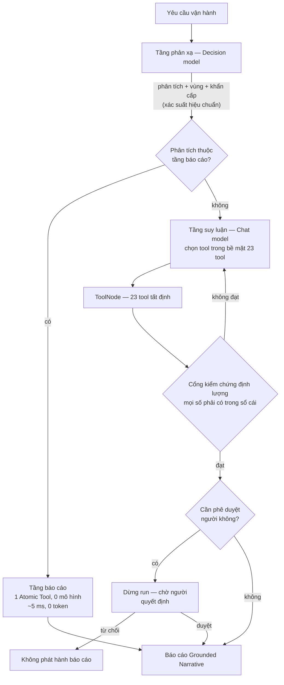

# Mô Hình Luồng Hai Thế Hệ — FLARE-CHRONOS Dual-System Harness

**Tài liệu này** mô tả *mô hình luồng* đã thiết kế cho bộ điều phối nhận thức kép: hai thế hệ mô hình làm hai việc khác nhau, một chuỗi phân loại có dự phòng, và một cổng kiểm chứng định lượng đứng trước mọi báo cáo. Mọi con số trong tài liệu là **kết quả đo trên chính dữ liệu và yêu cầu của dự án**, không phải đặc tính được công bố của nhà cung cấp.

> Báo cáo tổng thể của dự án: [`REPORT.md`](./REPORT.md). Quyết định kiến trúc: [`ADR-0005`](../docs/adr/0005-dual-system-langgraph-harness-and-deterministic-tool-gate.md), [`ADR-0006`](../docs/adr/0006-explicit-endpoint-profiles-and-grounded-narrative-assembly.md), [`ADR-0008`](../docs/adr/0008-model-driven-tool-selection-sign-off-and-event-stream.md).

---

## 1. Vì sao hai thế hệ, và mỗi thế hệ làm gì

Hai tầng không phải hai bản sao của cùng một mô hình. Chúng có **hai nhiệm vụ không giao nhau**, và mỗi nhiệm vụ cần một loại mô hình khác nhau.

| | **Thế hệ 1 — Tầng phản xạ** | **Thế hệ 2 — Tầng suy luận** |
| --- | --- | --- |
| Việc | Gán phân tích, định vùng, đánh giá khẩn cấp | Chọn tool, suy luận nhiều bước, viết diễn giải |
| Mô hình | **Decision model** (`clef-flash`, giao thức typed-questions) | **Chat model** (`beam`, giao thức native chat) |
| Câu trả lời | Xác suất **hiệu chuẩn** theo từng lựa chọn | Tool call + diễn giải có trích dẫn |
| Bề mặt tool | **Không** — tầng này không chạm tool | `23` tool tất định + `ask_user_question` |
| Số lượt gọi mỗi run | `1` (chỉ khi chưa biết phân tích) | `2` (gọi tool, rồi viết) |
| Token | `976` vào / `0` ra | `3.051` vào / `463` ra mỗi lượt |
| Nơi chạy | Node suy luận của dự án (GPU cục bộ) | Dịch vụ chat |
| Chi phí credit | **0** (chạy cục bộ) | Có, theo token |

**Tầng báo cáo (fast tier)** không gọi mô hình lần nào: nó chạy đúng một Atomic Tool và định dạng kết quả thành thẻ dữ kiện. Một yêu cầu tra cứu đơn giản vì vậy **không tốn token, không tốn credit, và không phụ thuộc nhà cung cấp nào còn sống**.

### 1.1. Vì sao không gộp làm một

Gộp hai tầng làm một mô hình suy luận sẽ hỏng ở đúng chỗ quan trọng nhất: **cảnh báo khẩn cho lính rừng**. Cảnh báo phải trả lời trong mili giây, không được đọc 23 schema tool và không được chờ một mô hình suy luận. Ràng buộc đó là lý do tồn tại của tầng báo cáo, và nó là ràng buộc **kiến trúc** (một lượt gọi mô hình hay không), không phải ràng buộc **tốc độ** (một provider nhanh hay chậm).

---

## 2. Luồng



### 2.1. Chuỗi phân loại (tầng phản xạ)

Tầng phản xạ hỏi theo thứ tự, và **ghi lại mỗi lần lùi bậc**:

```
Decision model (typed-questions, xác suất hiệu chuẩn)
        ↓ nếu endpoint không sẵn sàng
Chat model (native chat, tool classify_request)
        ↓ nếu endpoint không sẵn sàng
Trích xuất tất định theo văn bản  ← sàn, không bao giờ thấp hơn
```

Nhánh cuối tồn tại vì trích xuất theo văn bản **sai ở hai chỗ**: nó không nhận ra địa danh nêu gián tiếp, và nó đóng dấu một phân tích cố định. Chuỗi cho phép hệ thống dùng mô hình tốt nhất khi có, và vẫn chạy được khi không có.

### 2.2. Quy tắc ưu tiên câu trả lời

| Trường | Nguồn chính | Dự phòng | Lý do |
| --- | --- | --- | --- |
| Vùng | Phân loại (xác suất) | Trích xuất văn bản | Trích xuất đúng `3/8` khi địa danh nêu gián tiếp; phân loại đúng `8/8` |
| Phân tích | Phân loại | Trích xuất văn bản | Mã do người dùng ghi **luôn thắng** (xem 3.2) |
| Tầng | **Phân tích đã gán** | Xác suất `is_deliberative` | Xác suất tầng không phân tách được hai lớp (xem 3.3) |
| Khẩn cấp | Phân loại (xác suất) | Trích xuất văn bản | Ngưỡng nằm giữa khe hở đo được |
| Khoảng thời gian | Trích xuất văn bản | — | Yêu cầu có thể là **khoảng** (2005→2024); phân loại chỉ cho một năm |

### 2.3. Mã use case do người dùng ghi luôn thắng

Khi yêu cầu chứa mã use case (như `UC-1.1`), mã đó là chỉ định trực tiếp của người vận hành và giữ nguyên. Decision model đồng ý với mã đó ở `18/20` yêu cầu; hai trường hợp lệch (`UC-S1.1` → `UC-S1.3`, `UC-S1.5` → `UC-2.3`) cho thấy phân tích tự động là **ý kiến của mô hình**, không phải chỉ định. Do đó:

- Yêu cầu **có** mã ⇒ dùng mã.
- Yêu cầu **không** có mã ⇒ dùng phân tích mô hình gán (`20/20` đúng trên bộ truy vấn tự nhiên).

---

## 3. Số đo đo trên dự án

### 3.1. Bộ truy vấn tự nhiên (20 yêu cầu, không mã use case)

| Phép đo | Decision model (`clef-flash`) | Chat model (`gemma4:31b`) |
| --- | --- | --- |
| Vùng đúng | **20 / 20** | **20 / 20** |
| Gán đúng phân tích | **20 / 20** | **20 / 20** |
| Vùng nêu gián tiếp (8 yêu cầu) | **8 / 8** | **8 / 8** |
| Tầng đúng (ngưỡng tối ưu) | 18 / 20 | 20 / 20 |
| Khẩn cấp đúng | **20 / 20** | 20 / 20 |
| Độ trễ nóng (p50) | **0,66 s** | 2,05 s |
| Token vào mỗi lượt | 976 | ~430 |

### 3.2. Đồng thuận với mã use case do người dùng ghi

| Mã trong yêu cầu | Phân tích mô hình gán | P(mô hình) | P(mã) |
| --- | --- | --- | --- |
| `UC-S1.1` | `UC-S1.3` | 0,804 | 0,021 |
| `UC-S1.5` | `UC-2.3` | 0,554 | 0,167 |
| 18 yêu cầu còn lại | trùng mã | — | — |

### 3.3. Hiệu chuẩn và ngưỡng

Xác suất `is_deliberative` của decision model **không tách được hai lớp**:

| Nhóm | Khoảng xác suất |
| --- | --- |
| Yêu cầu một bước (10) | 0,060 – 0,332 |
| Yêu cầu suy luận (10) | 0,224 – 0,848 |

⇒ Không có ngưỡng nào đạt `20/20`. Ngưỡng `0,29` là tối ưu theo đo (`18/20`) và **chỉ dùng làm dự phòng** khi phân tích chưa được gán.

Xác suất `urgency` **tách được**:

| Nhóm | Khoảng xác suất |
| --- | --- |
| Không khẩn cấp (17) | 0,004 – 0,099 |
| Khẩn cấp (3) | 0,467 – 0,961 |

⇒ Ngưỡng đặt ở **giữa khe hở** (`0,25`) để biên đệm lớn nhất trước trôi hiệu chuẩn ⇒ `20/20`.

---

## 4. Chi phí và hiệu quả

| Tầng | Lượt gọi mô hình | Token vào | Token ra | Credit | Độ trễ |
| --- | --- | --- | --- | --- | --- |
| Báo cáo (không gọi mô hình) | 0 | 0 | 0 | 0 | ~5 ms |
| Phản xạ (decision, cục bộ) | 1 | 976 | 0 | **0** | 0,66 s |
| Suy luận (chat) | 2 | 3.051/lượt | 463/lượt | có | ~6 s/lượt |

**Điểm quan trọng về độ trễ:** số giây đo được là thuộc tính của **nhà cung cấp và hạ tầng phục vụ tại thời điểm đo**, không phải thuộc tính của mô hình. Cùng một lượt gọi đo được p50 `1,81 s` và p95 `7,76 s`. Vì vậy độ trễ **không dùng làm tiêu chí chọn mô hình**; tiêu chí là độ đúng trên yêu cầu của dự án, số token, và mức độ tuân thủ gọi tool.

**Điểm quan trọng về kiến trúc:** chỗ mà thiết kế kiểm soát được là *có gọi mô hình hay không* — số token, số credit, biến động giữa các lần chạy, và việc tầng báo cáo có chạy được khi nhà cung cấp đang sập.

---

## 5. Bất biến của tầng

1. **Chỉ tool tất định sinh ra số.** Mọi định lượng trong báo cáo đến từ `ToolNode` và được ghi vào `VerifiedFactsLedger`. Mô hình viết diễn giải, harness chèn số.
2. **Cổng kiểm chứng đứng trước khi phát hành.** Bản thảo chứa số không có nguồn, hoặc còn placeholder chưa resolve ⇒ trả về mô hình để viết lại; hết ngân sách sửa ⇒ rơi về bộ sinh tất định.
3. **Tầng báo cáo không suy diễn.** Nó không chạm Domain Diagnostic Tool, không viết diễn giải, không gọi mô hình.
4. **Tầng suy luận không quyết định hành động.** Báo cáo có phê duyệt người thì dừng run, chờ quyết định; bị từ chối ⇒ không phát hành gì.
5. **Không đọc cấu hình agent của máy người dùng.** Mỗi tầng gắn qua *Endpoint Profile* (giao thức, endpoint, model, khoá API, tuỳ chọn request) đọc từ cấu hình tường minh, với thứ tự ưu tiên: biến môi trường → `.env` → YAML.

---

## 6. Khi một thành phần hỏng

| Hỏng ở đâu | Hệ quả | Cơ chế bảo vệ |
| --- | --- | --- |
| Decision endpoint không sẵn sàng (node tắt, tunnel SSH rớt, credit hết) | Tầng phản xạ dùng chat model; độ tin cậy chuyển từ `calibrated` sang `self_reported` | Chuỗi phân loại; ghi `triage_fallback` và `triage_confidence_source`; run vẫn hoàn tất |
| Cả hai classifier không sẵn sàng | Dùng trích xuất tất định | Sàn của chuỗi; ghi lý do; chạy vẫn hoàn tất |
| Mô hình suy luận dừng im lặng | Mất một lượt | Adapter hỏi lại không kèm suy luận |
| Endpoint từ chối mức suy luận | Mất suy luận, không mất run | Hỏi lại không kèm suy luận; telemetry báo `thinking_level_supported = false` |
| Báo cáo chứa số không kiểm chứng được | Bị từ chối | Cổng kiểm chứng + vòng sửa lỗi; rơi về bộ sinh tất định |
| Người dùng từ chối phê duyệt | Không phát hành báo cáo | Cổng phê duyệt dừng run; quyết định được ghi lại |

---

## 7. Cách chạy lại các số đo

```bash
# Đường nối tới node suy luận (decision model chạy cục bộ, cổng 11434)
ssh -f -N -L 11434:<decision-node>:11434 <alias>

# Toàn bộ benchmark trên mô hình thật, ghi đo lường từng use case
uv run python apps/ai-service/src/ai_service/run_all_usecases.py --live

# Bộ kiểm thử ngoại tuyến (không gọi mô hình) và bộ kiểm thử trên mô hình thật
uv run pytest -q
uv run pytest -m live -q
```

Kết quả benchmark đầy đủ nằm ở [`data/processed/ai_harness_results_live.json`](../data/processed/ai_harness_results_live.json): trạng thái kiểm chứng, số vòng tool, số lần tự sửa, câu hỏi làm rõ, lần lùi bậc phân loại, nguồn độ tin cậy, và token theo từng use case.
