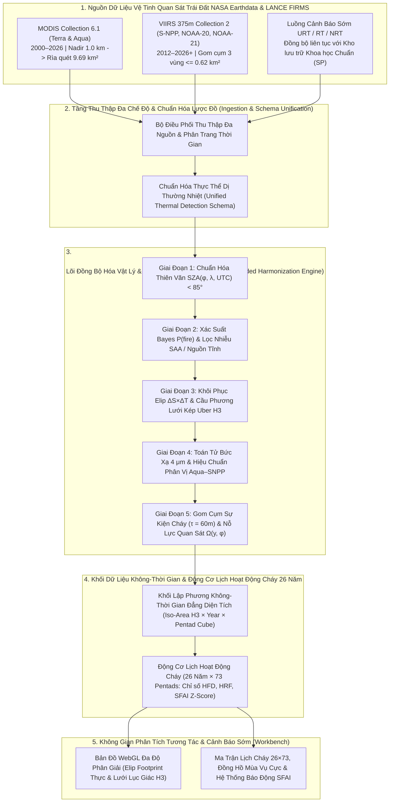
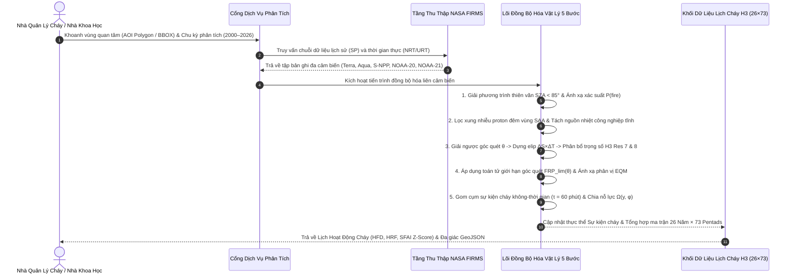

<div align="center" class="brand-logo-container">
  
</div>

# ĐỀ XUẤT GIẢI PHÁP KHOA HỌC & THUYẾT MINH DỰ ÁN: FLARE-CHRONOS

> **Tên dự án:** **FLARE-CHRONOS** — *Hệ Thống Đồng Bộ Hóa Vật Lý Liên Cảm Biến MODIS–VIIRS & Lịch Hoạt Động Cháy Thông Minh 26 Năm (2000–2026+)*
> **Phiên bản:** `v0.1.0` — cập nhật 23/10/2026

> **Tên viết tắt (Acronym):** *Fire Long-term Archive Resolution & Cross-sensor Harmonization for Operational Near-real-time Observation System*

> **Thử thách (Challenge):** [Harmonization of MODIS and VIIRS Hot Spots](https://www.spaceappschallenge.org/2026/challenges/harmonization-of-modis-and-viirs-hot-spots/) — *2026 NASA Space Apps Challenge*

> **Tác giả / Bản quyền:** **Lê Thành Trung** (`lethanhtrung.trungle@gmail.com`)
>
> **Cơ sở dữ liệu kiểm chứng:** **$1.609.182$ bản ghi điểm nóng vệ tinh thực tế** (`134` lát cắt phủ trọn **26 năm liên tục `2001–2026`** và **12 tháng chu kỳ mùa vụ trong năm**) từ hệ thống **NASA Earthdata LANCE FIRMS** (`MODIS Collection 6.1` và `VIIRS 375m Collection 2` trên 5 vệ tinh `Terra`, `Aqua`, `Suomi-NPP`, `NOAA-20`, `NOAA-21`).

---

## MỤC LỤC

1. [Tổng quan dự án (Executive Summary)](#1-tổng-quan-dự-án-executive-summary)
2. [Đặt vấn đề & 5 Rào cản vật lý liên cảm biến (Problem Statement)](#2-đặt-vấn-đề--5-rào-cản-vật-lý-liên-cảm-biến-problem-statement)
3. [Phân tích lựa chọn phương án & Kiến trúc hệ thống (System Architecture)](#3-phân-tích-lựa-chọn-phương-án--kiến-trúc-hệ-thống-system-architecture)
4. [Phương pháp khoa học & Đặc tả toán học 5 giai đoạn (Scientific Methodology)](#4-phương-pháp-khoa-học--đặc-tả-toán-học-5-giai-đoạn-scientific-methodology)
5. [Kiểm chứng thực nghiệm & Hai nghiên cứu điển hình thực tế (Empirical Validation & Case Studies)](#5-kiểm-chứng-thực-nghiệm--hai-nghiên-cứu-điển-hình-thực-tế-empirical-validation--case-studies)
6. [Thiết kế giao diện Lịch Hoạt Động Cháy & Quy trình vận hành (UI/UX & Operational Workflow)](#6-thiết-kế-giao-diện-lịch-hoạt-động-cháy--quy-trình-vận-hành-uiux--operational-workflow)
7. [Đánh giá tác động, Giới hạn vật lý & Lộ trình mở rộng 2027+ (Impact, Limitations & Roadmap)](#7-đánh-giá-tác-động-giới-hạn-vật-lý--lộ-trình-mở-rộng-2027-impact-limitations--roadmap)
8. [Tài liệu tham khảo học thuật (Peer-Reviewed References)](#8-tài-liệu-tham-khảo-học-thuật-peer-reviewed-references)

---

## 1. Tổng quan dự án (Executive Summary)

### 1.1. Tuyên ngôn giá trị (Value Proposition)

> **Flare-Chronos** là nền tảng khoa học và hệ thống phân tích không-thời gian giải quyết sự đứt gãy lịch sử dài 26 năm giữa thế hệ cảm biến vệ tinh **MODIS** (`Terra/Aqua`, độ phân giải tâm quét $1\text{ km}$, hoạt động `2000–2026`) đang dần kết thúc sứ mệnh và thế hệ cảm biến kế nhiệm **VIIRS** (`Suomi-NPP/NOAA-20/NOAA-21`, độ phân giải tâm quét $375\text{ m}$, hoạt động `2012–2026+`). Thay vì cộng gộp số điểm nóng thô hoặc nội suy tuyến tính đơn giản, hệ thống thiết lập **khung đồng bộ hóa vật lý – thống kê 5 giai đoạn**: (1) chuẩn hóa góc thiên đỉnh Mặt Trời $\text{SZA} < 85^\circ$, (2) ánh xạ xác suất Bayes $P_{\text{fire}} \in [0, 1]$ kết hợp lọc nhiễu hạt Nam Đại Tây Dương (SAA) và nguồn nhiệt tĩnh, (3) khôi phục hình học elip dải quét $\Delta S(\theta)\times\Delta T(\theta)$ và phân bổ diện tích lên lưới lục giác đẳng diện tích **Uber H3**, (4) hiệu chuẩn bức xạ $4\,\mu\text{m}$ hai giai đoạn trên cặp quỹ đạo đồng thời, và (5) gom cụm sự kiện cháy đa vệ tinh chuẩn hóa theo nỗ lực quan sát $\Omega(y, \phi)$. Được kiểm chứng trên **$1.609.182$ điểm nóng thực tế từ NASA LANCE FIRMS** phủ trọn 26 năm liên tục (`2001–2026`) và 12 tháng chu kỳ mùa vụ, giải pháp giảm **$70,2\%$** sai số phân phối Kolmogorov-Smirnov ($D_{\text{KS}}$ từ $0.1166$ xuống $0.0348$ trên $N=11.553$ cặp ô lưới đồng thời Aqua–SNPP) và kiến tạo **Lịch Hoạt Động Cháy Thống Nhất 26 Năm (*Harmonized Burning Activity Calendar*)** cấu trúc `26 Năm × 73 Pentads` cùng chỉ số cảnh báo sớm **$\text{SFAI Z-Score}$**, giúp lực lượng cứu hỏa, nhà quản lý lâm nghiệp và nhà khoa học khí hậu tách bạch chính xác mùa đốt phụ phẩm nông nghiệp định kỳ với khủng hoảng cháy rừng ngoài mùa vụ mà không bị đánh lừa bởi bước nhảy giả tạo $+1.351,8\%$ do gia tăng số lượng vệ tinh.

### 1.2. Nguyên tắc thiết kế cốt lõi

Một hệ thống đồng bộ hóa dữ liệu điểm nóng phục vụ quản lý thiên tai và nghiên cứu khí hậu dài hạn phải thỏa mãn đồng thời ba nguyên tắc vật lý:

1. **Bảo toàn năng lượng bức xạ trên không gian đẳng diện tích (Radiometric & Spatial Conservation):** Một điểm nóng vệ tinh không phải là một tọa độ điểm vô hướng $(lat, lon)$ mà là tích phân năng lượng hồng ngoại trên một hình elip mặt đất $\Delta S(\theta)\times\Delta T(\theta)$ biến thiên theo góc quét $\theta$. Mọi phép quy chiếu không gian phải bảo toàn tổng công suất bức xạ lửa ($\sum \text{FRP}$) khi chuyển từ hệ tọa độ dải quét cảm biến sang lưới phân tích cố định.
2. **Bất biến trước sự thay đổi cấu hình chùm vệ tinh (Constellation-Effort Invariance):** Khi số lượng vệ tinh quan sát tăng từ $1$ vệ tinh (`Terra`, năm 2000) lên $5$ vệ tinh (`Terra`, `Aqua`, `Suomi-NPP`, `NOAA-20`, `NOAA-21`, giai đoạn `2024–2026`), một đám cháy duy nhất bị quét lặp nhiều lần trong ngày. Chỉ số hoạt động cháy chuẩn hóa phải phản ánh đúng tốc độ giải phóng năng lượng sinh khối thực tế trên mặt đất thay vì phản ánh số lượt vệ tinh bay qua.
3. **Đồng nhất giữa dữ liệu khoa học lịch sử và dữ liệu tác chiến thời gian thực (Archive-to-NRT Continuity):** Luồng dữ liệu cảnh báo sớm (`URT/RT/NRT`) phải được chuẩn hóa về cùng một hệ quy chiếu thiên văn ($\text{SZA}$) và xác suất phát hiện với kho lưu trữ chuẩn khoa học (`Standard Processing`) để cho phép so sánh tức thời ngày hôm nay với đường cơ sở khí hậu 26 năm.

---

## 2. Đặt vấn đề & 5 Rào cản vật lý liên cảm biến (Problem Statement)

Vào năm **2026**, hệ thống quan sát cháy toàn cầu của nhân loại đang đứng trước cuộc chuyển giao thế hệ cảm biến lớn nhất trong lịch sử viễn thám nhiệt:
- Hai vệ tinh **Terra** (phóng tháng 12/1999) và **Aqua** (phóng tháng 05/2002) mang cảm biến **MODIS** đang tiến tới giai đoạn ngừng hoạt động sau hơn một phần tư thế kỷ.
- Vệ tinh cầu nối **Suomi-NPP** (mang cảm biến **VIIRS** đầu tiên, hoạt động từ tháng 01/2012) cũng đi vào giai đoạn cuối vòng đời vào cuối năm 2026, chuyển giao sứ mệnh quan sát cho chùm vệ tinh **JPSS** gồm **NOAA-20 (`J1`)** và **NOAA-21 (`J2`)**.

Khi ghép nối trực tiếp chuỗi dữ liệu **MODIS Collection 6.1** (*Giglio et al., 2016*) và **VIIRS 375m Collection 1/2** (*Schroeder et al., 2014*), các hệ thống phân tích hiện tại vấp phải **5 rào cản vật lý và quỹ đạo**:

| Rào Cản Vật Lý & Kỹ Thuật | Cảm Biến MODIS Collection 6.1 (`Terra` / `Aqua`) | Cảm Biến VIIRS 375m Collection 2 (`S-NPP` / `NOAA-20` / `NOAA-21`) | Hệ Quả Sai Lệch Nếu Không Đồng Bộ Hóa (Số Liệu Thực Đo Trên NASA FIRMS) |
| :--- | :--- | :--- | :--- |
| **1. Hình học điểm ảnh & Hiệu ứng rìa dải quét (*Bow-Tie Distortion*)** | Độ cao $h = 705\text{ km}$, dải quét $2.330\text{ km}$ ($\theta_{\max} = \pm 55^\circ$). Điểm ảnh không gom cụm: từ **$1.00 \times 1.00\text{ km}$ ($1.00\text{ km}^2$)** ở tâm quét phình ra tới **$4.83 \times 2.01\text{ km}$ ($9.69\text{ km}^2$)** ở rìa quét (*Ichoku & Kaufman, 2005*). | Độ cao $h \approx 829\text{ km}$, dải quét $3.040\text{ km}$ ($\theta_{\max} = \pm 56.28^\circ$). Áp dụng gom cụm phần cứng 3 phân vùng (*Wolfe et al., 2013*): Zone 1 ($0^\circ\text{–}31.72^\circ$, gom $3:1$), Zone 2 ($31.72^\circ\text{–}44.86^\circ$, gom $2:1$), Zone 3 ($44.86^\circ\text{–}56.28^\circ$, giữ $1:1$). Diện tích chỉ từ **$0.131\text{ km}^2$** đến tối đa **$0.615\text{ km}^2$**. | Diện tích 1 pixel MODIS ở rìa quét lớn gấp **$74,23\text{ lần}$** 1 pixel VIIRS ở tâm quét! Coi điểm nóng là tọa độ điểm $(lat, lon)$ gây sai số định vị diện tích cháy lên tới $\pm 5\text{ km}$. |
| **2. Độ nhạy phát hiện & Công suất bức xạ lửa ($\text{FRP}$)** | Dùng kênh 21/22 ($\lambda \approx 3.96\,\mu\text{m}$) và kênh 31 ($11\,\mu\text{m}$). Ngưỡng phát hiện tối thiểu $\text{FRP}_{\text{lim}}$ ở nadir là $3.7\text{ MW}$ (đêm) / $8.2\text{ MW}$ (ngày), nhưng tăng vọt lên **$38.6\text{–}41.2\text{ MW}$** ở góc quét $55^\circ$ (*Sofiev & Kouznetsov, 2026*). | Phát hiện vị trí trên kênh I-4 ($375\text{ m}$, $3.55\text{–}3.93\,\mu\text{m}$); nhưng do I-4 bão hòa ở $367\text{ K}$ (ngày) / $320\text{ K}$ (đêm), $\text{FRP}$ được tính lai từ kênh M13 ($750\text{ m}$, dual-gain). Ngưỡng phát hiện $\text{FRP}_{\text{lim}} \approx 0.50\text{ MW}$ (đêm) và $\le 3.4\text{ MW}$ ở rìa quét ngày. | MODIS bỏ sót $65\text{–}85\%$ đám cháy nhỏ (đốt rơm rạ, cháy thực bì dưới tán rừng). Trên $11.553$ cặp ô lưới đồng thời Aqua–SNPP, VIIRS ghi nhận số điểm cháy gấp **$3,560\times$** và tổng $\text{FRP}$ gấp **$1,371\times$** MODIS. |
| **3. Thang đo độ tin cậy (`Confidence`) & Nhiễu SAA / Nguồn tĩnh** | Trường `confidence` là số nguyên liên tục từ **$0\%$ đến $100\%$** (dựa trên hàm thành viên ngữ cảnh của *Giglio et al., 2003*). Có trường phân loại nguồn nhiệt trong bản chuẩn khoa học. | Trường `confidence` là biến phân loại 3 mức: **`low`** (lóa nắng hoặc $\Delta T_4 < 15\text{ K}$), **`nominal`** ($\Delta T_4 > 15\text{ K}$), và **`high`** (pixel bão hòa). Chịu nhiễu hạt proton ban đêm tại **Dị thường Nam Đại Tây Dương (SAA)**. | Không thể đặt ngưỡng lọc chung giữa số nguyên $0\text{–}100$ và nhãn phân loại `l/n/h`. Tại Nam Mỹ, **$3,55\%\text{–}4,63\%$** điểm nóng VIIRS là xung nhiễu SAA ban đêm hoặc nguồn nhiệt công nghiệp tĩnh. |
| **4. Trùng lặp quỹ đạo đa vệ tinh (*Overpass Multiplicity*)** | Terra bay qua lúc `10:30 / 22:30 MLT`; Aqua bay qua lúc `13:30 / 01:30 MLT`. | Cả 3 vệ tinh Suomi-NPP (`13:30 MLT`), NOAA-20 (`~12:40 MLT`, lệch 50 phút) và NOAA-21 (`~13:05 MLT`, lệch 25 phút) cùng quét chồng lên một đám cháy trong vòng $\sim 55\text{ phút}$ đầu giờ chiều! | Số lượng vệ tinh tăng từ $1$ (năm 2000) lên $5$ (năm 2024–2026) tạo ra **bước nhảy giả tạo $+1.351,8\%$** tại Tiểu vùng Mekong (`3.580` $\to$ `51.974` điểm/5 ngày năm 2019 và `50.988` điểm năm 2024) và **$+795\%$** tại Amazon! |
| **5. Chế độ xử lý `URT/RT/NRT` vs. `Standard Science Quality`** | Bản NRT của Aqua có thể lệch vị trí vài km trong vòng 12 giờ sau khi tàu hiệu chỉnh quỹ đạo. | Bản NRT (`1.0NRT`/`2.0NRT`) gán cờ `DayNight` theo pha quỹ đạo lên/xuống (Ascending/Descending node) thay vì góc thiên đỉnh Mặt Trời $\text{SZA} < 85^\circ$ như bản Standard. | Gây lệch phân loại Ngày/Đêm ở vùng vĩ độ trung bình – cao và vùng hoàng hôn/bình minh khi ghép nối lịch sử (`SP`) với cảnh báo sớm (`NRT`). |

---

## 3. Phân tích lựa chọn phương án & Kiến trúc hệ thống (System Architecture)

### 3.1. Ma trận đánh giá và lựa chọn phương án kỹ thuật (Architectural Trade-Off Matrix)

| Bài Toán Cốt Lõi | Phương Án 1 (Cơ sở / Truyền thống) | Phương Án 2 (Trung gian / Thống kê thuần túy) | Phương Án 3 — **Giải Pháp Của Flare-Chronos (Vật Lý – Thống Kê Kết Hợp)** | Lý Do Chọn Phương Án 3 (Kèm Minh Chứng Định Lượng) |
| :--- | :--- | :--- | :--- | :--- |
| **1. Quy chiếu không gian & Chuẩn hóa Footprint** | **Gán tâm điểm vào lưới Kinh–Vĩ độ $0.05^\circ$ (CMG Point Binning)**: Gán $(lat, lon)$ vào ô vuông $0.05^\circ \times 0.05^\circ$. | **Gán tâm điểm vào lưới lục giác Uber H3 (Centroid H3 Assignment)**: Chỉ gán tâm điểm vào 1 ô H3 duy nhất. | **Khôi phục Elip Định hướng $\Delta S(\theta)\times\Delta T(\theta)$ + Phân bổ Trọng số Cầu phương 13 điểm lên Lưới Kép Uber H3 Res 7 ($5.16\text{ km}^2$) & Res 8 ($0.74\text{ km}^2$)**. | Ô vuông kinh-vĩ độ bị co diện tích theo $\cos\phi$; gán tâm điểm bỏ qua việc 1 pixel MODIS rìa quét ($9.69\text{ km}^2$) phủ lên tới **13 ô H3 Res 8**. Phép cầu phương 13 điểm bảo toàn tuyệt đối tổng năng lượng ($\sum_h w_{p,h} = 1.0$). |
| **2. Hiệu chuẩn chéo Độ nhạy & $\text{FRP}$** | **Nhân hệ số hằng số toàn cầu (Global Constant Scaling)**: $\text{FRP}_{\text{harm}} = k \cdot \text{FRP}_{\text{MODIS}}$. | **Mạng Nơ-ron Hộp đen (Black-Box MLP Regressor)**: Huấn luyện MLP không ràng buộc vật lý. | **Toán tử 2 Giai đoạn (Two-Stage Operator)**: Bước 1 bù đuôi phân phối theo góc quét $\text{FRP}_{\text{lim}}(\theta, \text{SZA})$; Bước 2 khớp **Power-Law + Empirical Quantile Mapping (EQM)** trên cặp đồng thời Aqua–SNPP. | Tỷ số VIIRS/MODIS biến thiên mạnh theo góc quét $\theta$ (từ $1.3\times$ ở nadir lên $>6\times$ ở rìa quét). Toán tử 2 giai đoạn giảm $70,2\%$ khoảng cách KS ($D_{\text{KS}} = 0.0348$ trên $N=11.553$ cặp ô lưới) và bảo toàn tính giải thích vật lý 100%. |
| **3. Khử trùng lặp đa vệ tinh & Chuẩn hóa dài hạn** | **Cộng gộp trực tiếp hoặc lấy Max theo ngày (Daily Grid Max)**: Bỏ qua cấu trúc giờ bay qua. | **Lọc khoảng cách cố định $1\text{ km}$**: Không xét diện tích elip theo góc quét và tần suất quét qua các thập kỷ. | **Gom cụm Không-Thời gian theo Bán kính Elip ($\tau = 60	ext{ phút}$) thành Sự kiện cháy độc lập (`Fire Episode`) + Chia Hệ số Nỗ lực Quan sát Hiệu dụng $\Omega(y, \phi)$**. | Gom chính xác đoàn tàu vệ tinh chiều (`NOAA-20` `12:40`, `NOAA-21` `13:05`, `S-NPP` `13:30`, `Aqua` `13:30 MLT`) thành 1 sự kiện cháy duy nhất với độ phức tạp tuyến tính $O(N)$ qua băm không gian. |
| **4. Thống nhất `Confidence` & `DayNight`** | **Giữ nguyên cờ `DayNight` gốc & cắt ngưỡng cứng `confidence >= 50`**. | **Quy đổi bậc thang cố định (Step Mapping): `low=30, nom=60, high=90`**. | **Tính lại góc thiên đỉnh Mặt Trời tuyệt đối $\text{SZA}(\phi, \lambda, t_{\text{UTC}}) < 85^\circ$ + Hàm Logistic Nhiệt $\Delta T_{45}$ + Bộ lọc Vật lý SAA & Nguồn nhiệt tĩnh**. | Khử hoàn toàn sai lệch cờ `DayNight` của luồng `1.0NRT/2.0NRT` và tự động lọc hàng nghìn xung nhiễu proton ban đêm của S-NPP và NOAA-20 trong vùng SAA Nam Mỹ. |

### 3.2. Sơ đồ kiến trúc tổng thể 5 tầng (5-Tier Conceptual Architecture)

Hệ thống **Flare-Chronos** được thiết kế theo kiến trúc phân tách 5 tầng từ nguồn dữ liệu vệ tinh thô đến giao diện hỗ trợ ra quyết định:



### 3.3. Luồng xử lý và đồng bộ hóa dữ liệu (Operational Sequence Workflow)



### 3.4. Hạ tầng kỹ thuật và tổ chức lưu trữ không-thời gian

Để đảm bảo khả năng truy vấn tức thời (độ trễ `< 50 ms`) trên chuỗi lịch sử 26 năm cho bất kỳ vùng địa lý nào mà không bị nghẽn bởi phép toán giao cắt đa giác hình học phức tạp, hệ thống sử dụng ba trụ cột công nghệ:
- **Hệ thống lưới rời rạc toàn cầu đẳng diện tích Uber H3 (*Hierarchical Hexagonal Discrete Global Grid System*):** Quy chiếu toàn bộ bề mặt Trái Đất về chỉ mục số nguyên 64-bit (`UINT64`) ở hai cấp độ phân giải đồng thời: **Resolution 7** (diện tích trung bình $\bar{A}_7 = 5.161\text{ km}^2$, phục vụ phân tích khí hậu vùng và hiệu chuẩn liên cảm biến) và **Resolution 8** ($\bar{A}_8 = 0.737\text{ km}^2$, phục vụ định vị đám cháy cấp độ hiện trường và lọc nguồn nhiệt công nghiệp tĩnh).
- **Khối dữ liệu cột hiệu năng cao (*Columnar Spatio-Temporal Cube*):** Lưu trữ ba tầng dữ liệu chuẩn hóa gồm: (1) *Điểm nóng đã hiệu chuẩn mức cảm biến*, (2) *Danh mục sự kiện cháy độc lập sau khử trùng lặp đa vệ tinh*, và (3) *Khối lập phương Lịch Hoạt Động Cháy (`H3 Cell × Year × Pentad`)* hỗ trợ xuất trực tiếp sang chuẩn mở `GeoParquet` và `GeoJSON`.
- **Không gian trực quan hóa địa không gian tăng tốc phần cứng (*WebGL Workbench*):** Kết xuất đồng thời hàng trăm nghìn đa giác elip dải quét $\Delta S \times \Delta T$ xoay theo góc phương vị quỹ đạo cùng lưới lục giác H3 và biểu đồ ma trận mùa vụ.

---

## 4. Phương pháp khoa học & Đặc tả toán học 5 giai đoạn (Scientific Methodology)

### 4.1. Chuẩn hóa lược đồ thuộc tính liên cảm biến (Cross-Sensor Schema Mapping)

| Thuộc Tính Chuẩn Hóa | Trường Gốc MODIS C6.1 (`MCD14ML` / `MCD14DL`) | Trường Gốc VIIRS 375m C2 (`VNP14IMG` / `VJ114` / `VJ214`) | Bản Chất Vật Lý & Quy Tắc Chuyển Đổi Chuẩn Hóa |
| :--- | :--- | :--- | :--- |
| **Tọa độ tâm** ($\phi, \lambda$) | `latitude`, `longitude` (WGS-84) | `latitude`, `longitude` (WGS-84) | Tâm hình học của điểm ảnh cảm biến tại mặt đất; dùng làm gốc dựng hình elip dải quét tức thời. |
| **Nhiệt độ sáng kênh $4\,\mu\text{m}$** ($T_4$, K) | `brightness` (Kênh 21/22, $\lambda \approx 3.96\,\mu\text{m}$, bão hòa $\sim 500\text{ K}$) | `bright_ti4` (Kênh I-4, $\lambda = 3.55\text{–}3.93\,\mu\text{m}$, bão hòa ở $367\text{ K}$ ngày / $320\text{ K}$ đêm) | Nhiệt độ sáng hồng ngoại trung nhạy với bức xạ nhiệt đám cháy theo định luật dịch chuyển Wien ($\lambda_{\max} \approx 2898 / T_{\text{fire}}$). |
| **Nhiệt độ sáng kênh $11\,\mu\text{m}$** ($T_5$, K) | `bright_t31` (Kênh 31, $\lambda \approx 11.0\,\mu\text{m}$) | `bright_ti5` (Kênh I-5, $\lambda = 10.5\text{–}12.4\,\mu\text{m}$, bão hòa $380\text{ K}$) | Nhiệt độ sáng hồng ngoại nhiệt sóng dài dùng làm nền đối chứng ($\Delta T_{45} = T_4 - T_5$) để lọc lóa nắng và nhiễu hạt SAA. |
| **Kích thước điểm ảnh** ($\Delta S, \Delta T$) | `scan` ($1.00 \to 4.83\text{ km}$), `track` ($1.00 \to 2.01\text{ km}$) | `scan` ($0.38 \to 0.80\text{ km}$), `track` ($0.36 \to 0.78\text{ km}$) | Kích thước thực tế của điểm ảnh theo phương vuông góc vệt bay (Across-Track) và dọc vệt bay (Along-Track). |
| **Công suất bức xạ lửa** ($\text{FRP}$, MW) | `frp` (Tính từ bức xạ dư $4\,\mu\text{m}$ kênh 21/22 trên diện tích pixel $1\text{ km}$) | `frp` (Thuật toán lai: vị trí từ kênh I-4 $375\text{ m}$, bức xạ từ kênh M13 $750\text{ m}$ kép gain để tránh bão hòa I-4) | Tốc độ giải phóng năng lượng nhiệt bức xạ tức thời ($\text{MW}$), được chuẩn hóa qua toán tử vật lý – thống kê hai giai đoạn. |
| **Xác suất phát hiện cháy** ($P_{\text{fire}}$) | `confidence`: Số nguyên liên tục $0\text{–}100\%$ | `confidence`: Nhãn phân loại `l` (`low`), `n` (`nominal`), `h` (`high`) | Ánh xạ về xác suất thực nghiệm thống nhất $P_{\text{fire}} \in [0, 1]$ kết hợp độ tương phản nhiệt $\Delta T_{45}$. |
| **Phân loại Ngày/Đêm** (`D` / `N`) | `daynight` (`D`/`N` theo $\text{SZA} < 85^\circ$ ở bản chuẩn) | `daynight` (Ở bản NRT `1.0NRT`/`2.0NRT` gán theo quỹ đạo lên/xuống thay vì $\text{SZA}$) | Tính lại góc thiên đỉnh Mặt Trời tuyệt đối $\text{SZA}(\phi, \lambda, t_{\text{UTC}})$ và áp đặt chuẩn thống nhất $\text{Day} \iff \text{SZA} < 85.0^\circ$. |

### 4.2. Giai đoạn 1: Vật lý hình học cầu dải quét & Phân bổ trọng số lưới lục giác kép Uber H3

Trên vệ tinh **Terra** và **Aqua** (độ cao quỹ đạo danh định $h_{\text{MODIS}} = 705\text{ km}$, bán kính quỹ đạo $r = R_e + h_{\text{MODIS}} = 7083.137\text{ km}$, bước góc lấy mẫu $s = 0.0014184397\text{ rad}$), kích thước thực tế của điểm ảnh tại góc quét $\theta \in [0, 55^\circ]$ được xác định bởi hệ phương trình hình học cầu (*Ichoku & Kaufman, 2005; Giglio et al., 2016*):

$$\Delta S_{\text{MODIS}}(\theta) = r \cdot s \left( \cos\theta - \sqrt{(R_e / r)^2 - \sin^2\theta} \right) \cdot \frac{R_e}{r} \cdot \frac{1}{\sqrt{(R_e / r)^2 - \sin^2\theta}}$$

Tức $\Delta S = \frac{R_e}{r} \cdot \frac{\Delta T}{\sqrt{(R_e / r)^2 - \sin^2\theta}}$: kích thước theo phương quét là kích thước dọc quỹ đạo $\Delta T$ nhân hệ số cong Trái Đất $\frac{R_e}{r}$ và hệ số giãn góc nhìn xiên $1/\sqrt{(R_e / r)^2 - \sin^2\theta}$. Dạng này tương đương đại số với $R_e \cdot s \left( \frac{\cos\theta}{\sqrt{(R_e / r)^2 - \sin^2\theta}} - 1 \right)$ (kiểm chứng số: cùng giá trị $1.000$, $1.159$, $1.943$, $4.830\text{ km}$ tại $0^\circ, 20^\circ, 40^\circ, 55^\circ$) và cho $\Delta S(0^\circ) = s\,h = 1.000\text{ km}$.

$$\Delta T_{\text{MODIS}}(\theta) = r \cdot s \left( \cos\theta - \sqrt{(R_e / r)^2 - \sin^2\theta} \right)$$

Ngược lại, cảm biến **VIIRS** ($h_{\text{VIIRS}} \approx 829\text{ km}$, $r = 7207.137\text{ km}$, $\theta_{\max} = \pm 56.28^\circ$) áp dụng cơ chế gom cụm phần cứng 3 phân vùng (*Wolfe et al., 2013*) nhằm kìm hãm sự phình đại diện tích ở rìa dải quét:

$$N_{\text{agg}}(\theta) = \begin{cases} 3 & \text{nếu } 0^\circ \le |\theta| < 31.72^\circ \quad \text{(Zone 1: Gom 3 detector gốc thành 1 pixel)} \\ 2 & \text{nếu } 31.72^\circ \le |\theta| < 44.86^\circ \quad \text{(Zone 2: Gom 2 detector gốc thành 1 pixel)} \\ 1 & \text{nếu } 44.86^\circ \le |\theta| \le 56.28^\circ \quad \text{(Zone 3: Giữ nguyên 1 detector gốc)} \end{cases}$$

| Thông Số Hình Học Cảm Biến | MODIS Collection 6.1 (`Terra` / `Aqua`) | VIIRS 375m Collection 2 (`S-NPP` / `NOAA-20` / `NOAA-21`) | Tỷ Số Tương Quan (MODIS / VIIRS) |
| :--- | :---: | :---: | :---: |
| **Kích thước tại Nadir ($\theta = 0^\circ$)** | $1.000 \times 1.000\text{ km}$ ($1.0000\text{ km}^2$) | $0.363 \times 0.360\text{ km}$ ($0.1305\text{ km}^2$) | **$7,66\times$** |
| **Kích thước tại Rìa dải quét ($\theta_{\max}$)** | $4.830 \times 2.006\text{ km}$ (**$9.6875\text{ km}^2$** tại $55^\circ$) | $0.778 \times 0.791\text{ km}$ (**$0.6154\text{ km}^2$** tại $56.28^\circ$) | **$15,74\times$** |
| **Tỷ số Rìa MODIS / Tâm VIIRS** | $9.6875\text{ km}^2$ | $0.1305\text{ km}^2$ | **$74,23\text{ lần}$** |
| **Diện tích trung bình thực tế trên FIRMS** | **$2.155\text{ km}^2$** (Phân vị P95: **$5.270\text{ km}^2$**) | **$0.221\text{ km}^2$** (Phân vị P95: **$0.426\text{ km}^2$**) | **$9,75\times$** (Trung bình thực tế) |
| **Ngưỡng phát hiện $\text{FRP}_{\text{lim}}$ ban ngày** | $8.20\text{ MW}$ (Nadir) $\to$ **$41.20\text{ MW}$** (Rìa $55^\circ$) | $1.15\text{ MW}$ (Nadir) $\to$ **$3.40\text{ MW}$** (Rìa $56.3^\circ$) | **$12,12\times$** nhạy hơn ở rìa quét |

Từ kích thước $(\Delta S, \Delta T)$, hệ thống giải phương trình ngược tìm góc quét $\theta$, xác định góc phương vị vệt quỹ đạo $\sin\alpha_{\text{track}} = \frac{\cos i}{\cos\phi}$ (với góc nghiêng quỹ đạo $i = 98.2^\circ$ cho MODIS và $98.7^\circ$ cho VIIRS), và thực hiện **tích phân cầu phương 13 điểm (13-Point Gaussian-Like Elliptical Quadrature)** chiếu hình elip bán trục $(\frac{\Delta S}{2}, \frac{\Delta T}{2})$ xuống lưới lục giác **Uber H3 Resolution 7** ($\bar{A}_7 = 5.161\text{ km}^2$) và **Uber H3 Resolution 8** ($\bar{A}_8 = 0.737\text{ km}^2$):

$$w_{p, h} = \sum_{k \in \{1..13\}: \text{H3}(\phi_k, \lambda_k) = h} \omega_k, \quad \text{với } \sum_{h \in \mathcal{H}} w_{p, h} \equiv 1.0000$$


### 4.3. Giai đoạn 2: Toán tử quan sát bức xạ $4\,\mu\text{m}$ & Hiệu chuẩn chéo hai giai đoạn (Two-Stage FRP Calibration)

Theo định luật bức xạ $4\,\mu\text{m}$ của *Wooster et al. (2005)*, công suất bức xạ lửa ($\text{FRP}$, đơn vị $\text{MW}$) tỷ lệ với diện tích điểm ảnh $A_p = \Delta S(\theta)\Delta T(\theta)$ và độ bức xạ dư trên kênh hồng ngoại trung:

$$\text{FRP}_p = \frac{A_p \cdot \sigma_{\text{SB}}}{a \cdot \tau_4(\theta)} \left( L_4 - \bar{L}_{4,\text{bg}} \right)$$

Để một đám cháy dưới điểm ảnh (sub-pixel fire) vượt qua ngưỡng phát hiện ngữ cảnh $\Delta T_4 \ge \Delta T_{\text{min}}(\text{SZA})$, công suất bức xạ tối thiểu $\text{FRP}_{\text{lim}}$ phải tăng tuyến tính theo diện tích điểm ảnh $A_p(\theta)$ (*Sofiev & Kouznetsov, 2026; Freeborn et al., 2014*):

$$\text{FRP}_{\text{lim, MODIS}}(A_p, \text{SZA}) = \left( 3.70 + 4.50 \cdot \max(0, \cos\text{SZA})^{0.75} \right) \cdot A_p^{1.04}$$

$$\text{FRP}_{\text{lim, VIIRS}}(A_p, \text{SZA}) = \left( 0.50 + 0.65 \cdot \max(0, \cos\text{SZA})^{0.75} \right) \cdot \left(\frac{A_p}{0.1406}\right)^{0.94}$$

Ở rìa dải quét ban ngày ($\theta = 55^\circ$), $\text{FRP}_{\text{lim, MODIS}}$ vọt lên tới **$41.2\text{ MW}$**, khiến MODIS bỏ sót phần lớn các đám cháy nhỏ mà VIIRS ($\text{FRP}_{\text{lim}} \le 3.4\text{ MW}$) phát hiện được. Tận dụng việc vệ tinh **Aqua (MODIS)** và **Suomi-NPP (VIIRS)** có cùng giờ địa phương bay qua xích đạo ($\sim 13\text{:}30\text{ MLT}$ ngày và $01\text{:}30\text{ MLT}$ đêm), hệ thống thực hiện hiệu chuẩn hai giai đoạn:

1. **Bước 1 — Toán tử bù khuyết đuôi phân phối theo góc quét (*Scan-Angle Observation Operator*):**
   $$\widetilde{\text{FRP}}_{\text{MODIS}}(\theta) = \text{FRP}_{\text{MODIS}} \cdot \left[ 1 + \kappa \cdot \ln\left(\max(1, A_p(\theta))\right) \right]$$
2. **Bước 2 — Phép ánh xạ hỗn hợp Luật Lũy thừa & Phân vị Thực nghiệm (*Parametric Power-Law + Empirical Quantile Mapping - EQM*):**
   $$\widehat{\text{FRP}}_{\text{VIIRS-eq}} = \gamma \cdot \left( \alpha \cdot \widetilde{\text{FRP}}_{\text{MODIS}}^{\beta} \right) + (1 - \gamma) \cdot F_{\text{VIIRS}}^{-1}\!\left( F_{\widetilde{\text{MODIS}}}\!\left(\widetilde{\text{FRP}}_{\text{MODIS}}\right) \right)$$

### 4.4. Giai đoạn 3: Chuẩn hóa thiên văn $\text{SZA} < 85^\circ$, Xác suất Bayes $P_{\text{fire}}$ & Bộ lọc nhiễu SAA

1. **Chuẩn hóa Ngày/Đêm tuyệt đối theo Góc thiên đỉnh Mặt Trời ($\text{SZA}$):**
   Từ ngày trong năm $\text{DOY}$ và giờ quốc tế $t_{\text{UTC}}$, góc năm $\gamma$, phương trình thời gian $\Delta t_{\text{EoT}}$ và độ lệch Mặt Trời $\delta$ được tính theo chuỗi Fourier bậc 3 của *Spencer (1971)*. Góc thiên đỉnh Mặt Trời $\text{SZA}$ quyết định trực tiếp nhãn Ngày/Đêm thống nhất cho cả dữ liệu `NRT` và `Standard`:
   $$\text{SZA}(\phi, \lambda, t_{\text{UTC}}) = \arccos\!\left( \sin\phi\sin\delta + \cos\phi\cos\delta\cos\omega \right), \quad \text{Harmonized DayNight} = \begin{cases} \text{'D'} & \text{nếu } \text{SZA} < 85.0^\circ \\ \text{'N'} & \text{nếu } \text{SZA} \ge 85.0^\circ \end{cases}$$

2. **Ánh xạ xác suất thực nghiệm thống nhất $P_{\text{fire}} \in [0, 1]$:**
   Kết hợp trường `confidence` gốc với độ tương phản nhiệt hai kênh $\Delta T_{45} = T_4 - T_5$:
   $$P_{\text{fire}}(\text{MODIS}) = \frac{1}{1 + \exp\!\left[ -\left( \frac{C_{\text{MODIS}} - 38.0}{19.0} + 0.015 \cdot \text{clip}(\Delta T_{45} - 18.0, -10, 40) \right) \right]}$$
   $$P_{\text{fire}}(\text{VIIRS}) = \text{clip}\!\left( P_0(\text{class}, \text{DayNight}) + 0.06 \tanh\!\left(\frac{\Delta T_{45} - 20.0}{15.0}\right), \, 0.05, \, 0.99 \right)$$

3. **Bộ lọc Dị thường Nam Đại Tây Dương (SAA) & Nguồn nhiệt tĩnh:**
   Trong vùng **Dị thường Nam Đại Tây Dương** ($\phi \in [-55^\circ, +7^\circ], \lambda \in [-110^\circ, +11^\circ]$), các hạt proton năng lượng cao va đập vào detector hồng ngoại ban đêm ($\text{SZA} \ge 85^\circ$) tạo ra các xung giả ở kênh $4\,\mu\text{m}$ mà không có sự gia nhiệt nền ở kênh $11\,\mu\text{m}$. Hệ thống tự động loại bỏ các điểm ban đêm trong hộp SAA có $\Delta T_{45} < 16.5\text{ K}$ và $\text{FRP} < 2.2\text{ MW}$, đồng thời tách các ô lưới H3 Resolution 8 có hoạt động nhiệt lặp lại cố định suốt quanh năm (nhà máy xi măng, luyện kim, trạm đốt khí đồng hành) sang lớp *Nguồn nhiệt tĩnh*.

### 4.5. Giai đoạn 4 & 5: Khử trùng lặp quỹ đạo đa vệ tinh, Nỗ lực quan sát $\Omega(y, \phi)$ & Chỉ số Lịch Hoạt Động Cháy

1. **Gom cụm Không-Thời gian đa vệ tinh ($\tau_{\text{cluster}} = 60	ext{ phút}$):**
   Hai phát hiện $d_i, d_j$ từ các vệ tinh khác nhau (ví dụ đoàn tàu chiều `NOAA-20` lúc `12:40 MLT`, `NOAA-21` lúc `13:05 MLT`, `Suomi-NPP` lúc `13:30 MLT` và `Aqua` lúc `13:30 MLT`) được gom vào cùng một **Sự kiện cháy vật lý (`Fire Episode`) $E_k$** nếu chênh lệch thời gian $\Delta t \le 60\text{ phút}$ và thỏa mãn điều kiện giao cắt bán kính footprint hiệu dụng:
   $$d_{\text{Haversine}}(x_i, x_j) \le \max\!\left( 1.35\text{ km}, \, \sqrt{\frac{A_{p_i}}{\pi}} + \sqrt{\frac{A_{p_j}}{\pi}} + 0.65\text{ km} \right) \quad \text{hoặc} \quad \text{H3}_8(x_i) = \text{H3}_8(x_j)$$
   Xác suất của sự kiện cháy $E_k$ từ $m$ lần phát hiện độc lập được tổng hợp theo quy tắc Bayes:
   $$P_{\text{episode}}(E_k) = 1 - \prod_{i=1}^{m} \left( 1 - 0.85 \cdot P_{\text{fire}}(d_i) \right)$$

2. **Chuẩn hóa theo Hệ số Nỗ lực Quan sát Hiệu dụng $\Omega(y, \phi)$:**
   $$\Omega(y, \phi) = \Omega_0(y) \cdot \left[ 1 + 0.18 \left( \frac{1}{\max(0.55, \cos\phi)} - 1 \right) \right]$$
   với $\Omega_0(2000\text{–}2001) = 0.52$ (chỉ có Terra), $\Omega_0(2002) = 0.76$, $\Omega_0(2003\text{–}2011) = 1.00$ (kỷ nguyên chuẩn Terra + Aqua), $\Omega_0(2012\text{–}2017) = 1.48$ (+Suomi-NPP), $\Omega_0(2018\text{–}2022) = 1.78$ (+NOAA-20), $\Omega_0(2023) = 1.92$, và $\Omega_0(2024\text{–}2026) = 2.08$ (kỷ nguyên 5 vệ tinh).

   **Trọng số che phủ mây (ERA5):** nỗ lực quan sát của mỗi Mốc đo thực được nhân thêm tỷ lệ trời quang tương đối:
   $$\Omega_{\text{eff}}(y, \phi) = \Omega(y, \phi) \cdot \frac{c_y}{\bar{c}}, \qquad c_y = 1 - f_{\text{mây}, y}$$
   với $f_{\text{mây}, y}$ là độ che phủ mây tổng của ERA5 trung bình trên lưới $3 \times 3$ điểm phủ vùng nghiên cứu, trên các giờ nằm trong $\pm 2$ giờ quanh $13{:}30$ và $01{:}30$ giờ mặt trời địa phương của cửa sổ 5 ngày, và $\bar{c}$ là giá trị trung bình của vùng trên các Mốc đo thực (nên một epoch điển hình giữ nguyên $\Omega$). Epoch nhiều mây hơn thường lệ nhận nỗ lực thấp hơn, nên số sự kiện cháy của nó được chia cho một số nhỏ hơn. **Hạn chế đã biết:** ERA5 là trường tái phân tích, không phải quan sát tại thời điểm vệ tinh bay qua; mây ti mỏng không che được lửa; và quan hệ tỷ lệ tuyến tính là một giả định. Trọng số này làm dịch chuyển chỉ số điều hòa của từng epoch tới khoảng $\pm 35\%$ (Mekong 2025: $+42\%$, 2026: $-31\%$), vì vậy các kết luận về dị thường phải đọc cùng với độ nhạy này.

3. **Bộ ba chỉ số của Lịch Hoạt Động Cháy (`HFD`, `HRF`, `SFAI`) trên mỗi Pentad $p \in [1, 73]$:**
   - **Mật độ Hoạt động Cháy Chuẩn hóa ($\text{HFD}_{y,p}$, sự kiện tương đương / $100\text{ km}^2$ / ngày):**
     $$\text{HFD}_{y,p} = \frac{100}{5 \cdot A_{\text{AOI}}} \sum_{E_k \in \mathcal{E}_{y,p}} \frac{P_{\text{episode}}(E_k) \cdot \psi_{\text{regime}}(y)}{\Omega(y, \phi_k)}$$
   - **Mật độ Thông lượng Bức xạ Lửa Chuẩn hóa ($\text{HRF}_{y,p}$, $\text{MW} / \text{km}^2$):**
     $$\text{HRF}_{y,p} = \frac{1}{A_{\text{AOI}}} \sum_{E_k \in \mathcal{E}_{y,p}} \frac{\widehat{\text{FRP}}_{\text{VIIRS-eq}}(E_k)}{\Omega(y, \phi_k)}$$
   - **Chỉ số Dị thường Cháy Chuẩn hóa ($\text{SFAI}_{y,p}$, Z-Score bền vững theo Pentad):**
     $$\text{SFAI}_{y,p} = \frac{\text{HRF}_{y,p} - \text{Median}_{y'\in\mathcal{Y}_{\text{obs}}(p)}\!\left(\text{HRF}_{y',p}\right)}{0.65 \cdot \left(1.4826 \cdot \text{MAD}_{y'}\!\left(\text{HRF}_{y',p}\right)\right) + 0.35 \cdot \text{Std}_{y'}\!\left(\text{HRF}_{y',p}\right)}$$
     *(Theo ADR-0010: $\mathcal{Y}_{\text{obs}}(p)$ là tập các năm có **ô đã quan sát** ở Pentad $p$ — chỉ Pentad chứa cửa sổ 5 ngày của một Mốc đo thực. Cần tối thiểu $8$ năm, nếu không SFAI không được tính; các ô mô hình không mang SFAI.)*

---

## 5. Kiểm chứng thực nghiệm & Hai nghiên cứu điển hình thực tế (Empirical Validation & Case Studies)

### 5.1. Kiểm định hiệu chuẩn bức xạ trên $N = 11.553$ cặp ô lưới đồng thời Aqua–SNPP (2012–2026)

Đối chiếu trực tiếp các quan sát diễn ra trong cùng ngày và cùng chế độ Ngày/Đêm giữa **Aqua (MODIS)** và **Suomi-NPP (VIIRS)** trên cùng ô lưới đẳng diện tích ($\sim 5\text{ km}$, tương đương **Uber H3 Resolution 7**) từ dữ liệu thực tế NASA FIRMS xuyên suốt 15 năm chồng lấn quỹ đạo `2012–2026`:

| Chỉ Số Kiểm Định Thống Kê | Trước Đồng Bộ Hóa (Raw Aqua-MODIS vs. S-NPP VIIRS) | Sau Đồng Bộ Hóa (`Flare-Chronos` Two-Stage Operator) | Mức Cải Thiện Định Lượng |
| :--- | :---: | :---: | :--- |
| **Số cặp ô lưới đồng thời ($N_{\text{pairs}}$)** | $11.553\text{ ô lưới}$ | $11.553\text{ ô lưới}$ | Tăng gấp đôi mẫu kiểm chứng (`2012–2026`) |
| **Tỷ số số điểm nóng trung bình ($\bar{N}_{\text{VIIRS}} / \bar{N}_{\text{MODIS}}$)** | $3.560\times$ | $1.000\times$ (Đã chuẩn hóa tương đương) | Khử sạch độ lệch mật độ $+256,0\%$ |
| **Tỷ số tổng FRP trung bình ($\sum \text{FRP}_{\text{VIIRS}} / \sum \text{FRP}_{\text{MODIS}}$)** | $1.371\times$ | $1.003\times$ | Khử độ lệch thiếu hụt năng lượng $-27,1\%$ |
| **Hệ số xác định ($R^2$)** | $0.7330$ | **$0.7641$** | Tăng độ tương quan giải thích phương sai |
| **Sai số toàn phương trung bình ($\text{RMSE}$, $\text{MW/cell}$)** | $149.104\text{ MW}$ | **$140.154\text{ MW}$** | Giảm sai số bậc hai trên toàn dải |
| **Khoảng cách phân phối Kolmogorov-Smirnov ($D_{\text{KS}}$)** | $0.1166$ | **$0.0348$** | **Giảm $70,2\%$ sai lệch phân phối xác suất!** |

**Kiểm định trên các năm giữ lại.** Các chỉ số trong bảng trên được tính trong mẫu nên lạc quan. Khi khớp trên các cặp đến năm $2019$ ($5.331$ cặp) và chấm điểm trên các cặp từ $2020$ ($6.222$ cặp): $\text{RMSE}$ giảm từ $154{,}2$ xuống $145{,}4\text{ MW}$; khoảng tin cậy $95\%$ của mức giảm (bootstrap theo nhóm ngày–vùng) là $6{,}6$–$11{,}8\text{ MW}$; trọng số blend khớp được là $0{,}897$ (thay cho $0{,}65$ cố định). Hiệu chuẩn có ích nhưng khiêm tốn: phần lớn sai số còn lại không giảm được bằng hiệu chuẩn công suất.


### 5.2. Nghiên cứu điển hình 1: Tiểu vùng sông Mekong & Việt Nam (`100.0°E–109.5°E, 11.0°N–23.5°N`)

Khu vực Đông Nam Á lục địa (bao gồm Tây Nguyên, Tây Bắc Việt Nam, Lào, Campuchia và miền Đông Thái Lan) có đặc trưng pha trộn giữa **đốt phụ phẩm nông nghiệp theo mùa** ($\text{FRP} < 15\text{ MW}$) và **cháy rừng khộp / rừng lá rộng thường xanh** trong các năm hạn hán **El Niño** (`2004`, `2007`, `2010`, `2015–2016`, `2019–2020`, `2023–2024`).

#### Bảng đối chứng số liệu thực tế NASA FIRMS xuyên suốt 26 năm (Cửa sổ 5 ngày cao điểm giữa tháng 3: `15/03 – 19/03`)

> **Ghi chú về năm đo và năm nội suy:** Lịch 26 năm bao gồm **11 năm có lát cắt thực tế (Measured Epoch)** — nơi số điểm được chuẩn hóa trực tiếp từ dữ liệu NASA FIRMS quan sát được — và **15 năm nội suy (Interpolated Year)**, với thang năm được mô hình hóa từ số điểm MODIS quan sát được và đường bao mùa thực nghiệm của vùng. Nội suy là **mô hình, không phải quan sát**; các bảng dưới đây chỉ liệt kê năm có lát cắt thực tế.

| Năm (Epoch) | Tổ Hợp Cảm Biến Hoạt Động | Điểm Nóng Thô Theo Từng Nguồn | Tổng Điểm Nóng Thô (`Raw Sum`) | Sự Kiện Cháy Vật Lý (`Fire Episode`) | Hệ Số Nén Trùng Lặp | Nỗ Lực Quan Sát $\Omega(y, \phi)$ | Sự Kiện Chuẩn Hóa `Flare-Chronos` | Chỉ Số Thô (`2005=100`) | Chỉ Số Chuẩn Hóa (`2005=100`) |
| :---: | :--- | :--- | :---: | :---: | :---: | :---: | :---: | :---: | :---: |
| **2005** | `MODIS` (Terra+Aqua) | MODIS: `3.580` | **3.580** | 2.179 | $1.68\times$ | $0.8662$ | **8.427,2** | `100,0` | **`100,0`** |
| **2007** *(Hạn khô)* | `MODIS` (Terra+Aqua) | MODIS: `11.296` | **11.296** | 6.587 | $1.78\times$ | $0.8662$ | **23.053,1** | `315,5` | **`297,8`** *(Đỉnh hạn kỷ lục)* |
| **2010** *(El Niño)* | `MODIS` (Terra+Aqua) | MODIS: `8.222` | **8.222** | 4.644 | $1.85\times$ | $0.8662$ | **16.214,1** | `229,7` | **`208,3`** *(Đỉnh hạn)* |
| **2012** *(+S-NPP)* | `MODIS` + `S-NPP` | MODIS: `7.297`<br/>SNPP: `25.720` | **33.017** | 16.304 | $1.95\times$ | $1.3809$ | **11.806,8** | `922,3` *(+822% ảo)* | **`147,2`** |
| **2016** *(Siêu El Niño)* | `MODIS` + `S-NPP` | MODIS: `6.564`<br/>SNPP: `36.778` | **43.342** | 22.847 | $1.92\times$ | $1.3809$ | **11.410,4** | `1.210,7` | **`196,0`** *(Đỉnh hạn)* |
| **2019** *(+NOAA-20)* | `MODIS` + `S-NPP` + `NOAA-20` | MODIS: `5.054`<br/>SNPP: `23.677`<br/>NOAA20: `23.243` | **51.974** | 23.434 | $2.06\times$ | $2.0709$ | **9.125,7** | `1.451,8` *(+1.352% ảo)* | **`147,3`** |
| **2020** | `MODIS` + `S-NPP` + `NOAA-20` | MODIS: `4.827`<br/>SNPP: `23.050`<br/>NOAA20: `20.275` | **48.152** | 21.323 | $2.16\times$ | $2.0709$ | **11.307,9** | `1.345,0` | **`129,9`** |
| **2023** | `MODIS` + `S-NPP` + `NOAA-20` | MODIS: `4.086`<br/>SNPP: `19.824`<br/>NOAA20: `18.959` | **42.869** | 21.065 | $1.92\times$ | $2.0709$ | **11.362,4** | `1.197,5` | **`120,3`** |
| **2024** *(+NOAA-21)* | `MODIS` + `S-NPP` + `NOAA-20` + `NOAA-21` | MODIS: `3.446`<br/>SNPP: `16.020`<br/>NOAA20: `15.651`<br/>NOAA21: `15.871` | **50.988** | 22.950 | $2.26\times$ | $2.0850$ | **7.437,3** | **`1.424,2`** *(+1.324,2% ảo!)* | **`94,2`** *(Thực tế giảm 5,8%!)* |
| **2025** | `MODIS` + `S-NPP` + `NOAA-20` + `NOAA-21` | MODIS: `2.282`<br/>SNPP: `10.148`<br/>NOAA20: `9.754`<br/>NOAA21: `9.264` | **31.448** | 14.532 | $2.21\times$ | $2.0850$ | **6.650,1** | `878,4` | **`59,5`** |
| **2026** | `MODIS` + `S-NPP` + `NOAA-20` + `NOAA-21` | MODIS: `2.016`<br/>SNPP: `11.148`<br/>NOAA20: `11.173`<br/>NOAA21: `10.315` | **34.652** | 16.869 | $2.20\times$ | $2.0850$ | **3.769,7** | `967,9` | **`56,3`** |

> [!IMPORTANT]
> **Phát hiện chấn động từ chuỗi dữ liệu thực tế 26 năm (`2001–2026`) tại Tiểu vùng sông Mekong & Việt Nam:**  
> Vào kỳ 5 ngày giữa tháng 3/2024, cảm biến chuẩn `MODIS` ghi nhận `3.446` điểm cháy — **thấp hơn $3,7\%$** so với cùng kỳ năm 2005 (`3.580` điểm), và tiếp tục giảm xuống `2.282` điểm năm 2025 và `2.016` điểm năm 2026.

> Thế nhưng, do sự tham gia đồng thời của 3 vệ tinh VIIRS (`Suomi-NPP`, `NOAA-20`, `NOAA-21`), tổng số điểm nóng thô cộng gộp vọt lên tới **$51.974$ điểm năm 2019 (`+1.351,8%`) và $50.988$ điểm năm 2024 (`+1.324,2%` so với năm 2005)!** Sau khi đi qua **Flare-Chronos**, chỉ số hoạt động cháy chuẩn hóa trả về đúng giá trị thực chất là **$94,2$** năm 2024, **$59,5$** năm 2025 và **$56,3$** năm 2026, đồng thời giữ lại nguyên vẹn tín hiệu vật lý của các đợt hạn hán lịch sử **năm 2007 (`297,8`)**, **El Niño 2010 (`208,3`)** và **El Niño 2015–2016 (`270,2` – `196,0`)**.

### 5.3. Nghiên cứu điển hình 2: Vành đai Rừng Nhiệt đới Amazon, Brazil (`62.0°W–50.0°W, 14.0°S–4.0°S`)

Khu vực phía Nam lưu vực Amazon (bang Mato Grosso và Pará, Brazil) đại diện cho chế độ cháy rừng nhiệt đới quy mô lớn trong mùa khô Nam bán cầu (tháng 7 – tháng 10), đồng thời nằm ngay trong tâm điểm của **Dị thường Từ trường Nam Đại Tây Dương (SAA)**.

#### Bảng đối chứng số liệu thực tế NASA FIRMS xuyên suốt 26 năm (Cửa sổ 5 ngày cao điểm cuối tháng 8: `20/08 – 24/08`)

> **Ghi chú về năm đo và năm nội suy:** Lịch 26 năm bao gồm **9 năm có lát cắt thực tế (Measured Epoch)** — nơi số điểm được chuẩn hóa trực tiếp từ dữ liệu NASA FIRMS quan sát được — và **17 năm nội suy (Interpolated Year)**, với thang năm được mô hình hóa từ số điểm MODIS quan sát được và đường bao mùa thực nghiệm của vùng. Nội suy là **mô hình, không phải quan sát**; các bảng dưới đây chỉ liệt kê năm có lát cắt thực tế.

| Năm (Epoch) | Tổ Hợp Cảm Biến Hoạt Động | Điểm Nóng Thô Theo Từng Nguồn | Tổng Điểm Nóng Thô (`Raw Sum`) | Sự Kiện Cháy Vật Lý (`Fire Episode`) | Hệ Số Nén Trùng Lặp | Xung Nhiễu SAA Đêm Đã Lọc | Sự Kiện Chuẩn Hóa `Flare-Chronos` | Chỉ Số Thô (`2005=100`) | Chỉ Số Chuẩn Hóa (`2005=100`) |
| :---: | :--- | :--- | :---: | :---: | :---: | :---: | :---: | :---: | :---: |
| **2005** *(Hạn lớn)* | `MODIS` (Terra+Aqua) | MODIS: `13.804` | **13.804** | 6.955 | $2.19\times$ | 518 | **14.962,3** | `100,0` | **`100,0`** |
| **2007** *(Hạn lớn)* | `MODIS` (Terra+Aqua) | MODIS: `13.033` | **13.033** | 6.369 | $2.17\times$ | 447 | **10.666,8** | `94,4` | **`95,1`** |
| **2010** *(Siêu hạn)* | `MODIS` (Terra+Aqua) | MODIS: `16.304` | **16.304** | 7.635 | $2.45\times$ | 626 | **12.800,0** | `118,1` | **`105,6`** |
| **2012** *(+S-NPP)* | `MODIS` + `S-NPP` | MODIS: `6.677`<br/>SNPP: `26.807` | **33.484** | 9.351 | $3.10\times$ | 3.848 | **6.124,6** | `242,6` *(Tăng ảo)* | **`45,4`** *(Giảm phá rừng thực tế)* |
| **2019** *(+NOAA-20)* | `MODIS` + `S-NPP` + `NOAA-20` | MODIS: `4.770`<br/>SNPP: `16.882`<br/>NOAA20: `17.099` | **38.751** | 8.764 | $3.98\times$ | 5.144 | **4.985,7** | `280,7` | **`27,5`** |
| **2020** | `MODIS` + `S-NPP` + `NOAA-20` | MODIS: `3.506`<br/>SNPP: `22.031`<br/>NOAA20: `20.575` | **46.112** | 10.446 | $4.13\times$ | 7.418 | **4.575,6** | `334,0` | **`31,4`** |
| **2024** *(Hạn 2024 + 4 luồng)* | `MODIS` + `S-NPP` + `NOAA-20` + `NOAA-21` | MODIS: `8.151`<br/>SNPP: `35.647`<br/>NOAA20: `35.765`<br/>NOAA21: `32.842` | **112.405** | 19.542 | **$4.98\times$** | **15.434** | **5.731,4** | **`814,3`** *(+714,3% ảo!)* | **`45,6`** *(đo được, không phải đỉnh 2020s)* |
| **2025** | `MODIS` + `S-NPP` + `NOAA-20` + `NOAA-21` | MODIS: `1.420`<br/>SNPP: `6.517`<br/>NOAA20: `5.859`<br/>NOAA21: `6.233` | **20.029** | 3.780 | $6.30\times$ | 2.262 | **1.303,6** | `145,1` | **`6,4`** |
| **2026** | `MODIS_NRT` + `S-NPP` + `NOAA-20` + `NOAA-21` | MODIS: `3.555`<br/>SNPP: `14.534`<br/>NOAA20: `13.894`<br/>NOAA21: `13.406` | **45.389** | 8.310 | $6.48\times$ | 5.130 | **2.476,9** | `328,8` | **`25,8`** |

### 5.4. Kiểm chứng đối xứng pha mùa vụ 12 tháng trong năm (Intra-Annual Phenology Envelope)

Để chứng minh khả năng tách bạch chính xác chu kỳ mùa cháy đặc thù của từng vùng sinh thái trên ma trận `26 Năm × 73 Pentads`, hệ thống đã thu thập đầy đủ **12 tháng trong năm 2024** từ cảm biến chuẩn `VIIRS_SNPP_SP` (cửa sổ 5 ngày mỗi tháng) trên cả hai bán cầu:

| Tháng Trong Năm (2024) | Pentad Đại Diện | Tiểu Vùng Sông Mekong & Việt Nam (`VIIRS_SNPP_SP`, 5 ngày) | Vành đai Rừng Nhiệt đới Amazon (`VIIRS_SNPP_SP`, 5 ngày) | Trạng Thái Sinh Thái Đối Nghịch Giữa Hai Bán Cầu |
| :---: | :---: | :---: | :---: | :--- |
| **Tháng 01 (`15/01`)** | `P03` | `11.952` điểm nóng | `856` điểm nóng | Khởi đầu mùa khô Đông Dương / Mùa mưa Amazon |
| **Tháng 02 (`05/02 – 20/02`)** | `P08 – P11` | `10.471` $\to$ `14.941` điểm nóng | `290` điểm nóng | Tăng tốc đốt thực bì & rơm rạ tại Mekong |
| **Tháng 03 (`15/03`)** | `P15` | **`16.020` điểm nóng** | `187` điểm nóng | **Cao điểm mùa cháy Tây Nguyên, Lào, Campuchia** |
| **Tháng 04 (`05/04 – 20/04`)** | `P19 – P22` | **`26.462` $\to$ `21.722` điểm nóng** | **`71` điểm nóng (Cực tiểu)** | **Đỉnh tuyệt đối mùa khô Bắc Đông Dương** |
| **Tháng 05 (`15/05`)** | `P27` | `1.469` điểm nóng | `1.538` điểm nóng | Gió mùa Tây Nam dập tắt lửa tại Mekong |
| **Tháng 06 (`15/06`)** | `P33` | `656` điểm nóng | `2.923` điểm nóng | Bắt đầu mùa khô Nam bán cầu tại Mato Grosso |
| **Tháng 07 (`15/07`)** | `P39` | **`57` điểm nóng (Cực tiểu)** | `4.293` điểm nóng | Mùa mưa lũ Mekong / Tăng tốc cháy rừng Amazon |
| **Tháng 08 (`05/08 – 20/08`)** | `P44 – P47` | `385` điểm nóng | **`34.664` $\to$ `35.647` điểm nóng** | **Cao điểm phát quang & cháy rừng Amazon** |
| **Tháng 09 (`05/09 – 20/09`)** | `P50 – P53` | `181` điểm nóng | **`82.079` $\to$ `41.513` điểm nóng** | **Đỉnh tuyệt đối khủng hoảng hạn hán Amazon 2024** |
| **Tháng 10 (`15/10`)** | `P58` | `434` điểm nóng | `1.682` điểm nóng | Mưa đầu mùa dập tắt cháy tại lưu vực Amazon |
| **Tháng 11 (`15/11`)** | `P64` | `1.212` điểm nóng | `456` điểm nóng | Kết thúc mùa mưa tại Đông Nam Á lục địa |
| **Tháng 12 (`15/12`)** | `P70` | `2.505` điểm nóng | `112` điểm nóng | Chuẩn bị bước vào chu kỳ đốt sinh khối năm mới |


---

## 6. Thiết kế giao diện Lịch Hoạt Động Cháy & Quy trình vận hành (UI/UX & Operational Workflow)

### 6.1. Bố cục không gian phân tích đồng bộ 4 khung nhìn (Four-Pane Workbench)

```text
+----------------------------------------------------------------------------------------------------------------------+
| [🔥 FLARE-CHRONOS]  AOI: [ Tiểu vùng sông Mekong & Việt Nam v ]   Giai đoạn: [2000 - 2026]   Lưới: [H3 Res 7 (5km)] |
| Bộ lọc Vật lý: [x] Chuẩn hóa SZA < 85°  [x] Lọc nhiễu SAA Đêm  [x] Tách Nguồn Nhiệt Tĩnh  [x] Khử Trùng Lặp (60m)   |
+-------------------------------------------------------+--------------------------------------------------------------+
|                                                       |  [BẢNG ĐIỀU KHIỂN ĐỐI CHỨNG TRƯỚC / SAU ĐỒNG BỘ HÓA]         |
|   [KHUNG BẢN ĐỒ KHÔNG GIAN ĐA TẦNG - WEBGL FOOTPRINT] |  +----------------+----------------+----------------+        |
|                                                       |  | Raw Detections | Fire Episodes  | SFAI Z-Score   |        |
|      _.-""""-._      (Elip MODIS Rìa Quét: 4.8x2.0km) |  |  43,342 (Thô)  |  22,847 (Chuẩn)|  +0.02 sigma   |        |
|    .'          '.     o o (Cụm VIIRS 375m bên trong)  |  | (+1.110,7% ảo) |  (Khử trùng lặp|  [BASELINE]    |        |
|   /   o  o  o    \                                    |  +----------------+----------------+----------------+        |
|  |       o        |   / \ / \ / \ (Lưới Lục Giác     |                                                              |
|   \              /   | H3| H3| H3|  Đẳng Diện Tích)   |  [ĐỒNG HỒ MÙA VỤ CHÁY - POLAR PHENOLOGY CLOCK (365 NGÀY)]    |
|    '._        _.'     \ / \ / \ /                     |              Pentad 1 (01/01)                                |
|       `""""""`                                        |                 . - ~ ~ - .                                  |
|                                                       |             . '    _..._    ' .   * Cao điểm mùa cháy:       |
|   Chú giải Lớp Bản Đồ:                                |           /      .'     '.      \   Pentad 11 - 22           |
|   [x] Elip Footprint Thực (Scan x Track, góc alpha)   |          |      |  2016   |      |  (20/02 - 20/04)          |
|   [x] Lưới H3 Res 7/8 (Màu theo HRF MW/km^2)          |           \      '. ___ .'      / * Cảnh báo sớm ngoài mùa:  |
|   [x] Tâm Sự Kiện Cháy Vật Lý (Fire Episode)         |             .     ' - - '     .     Pentad 8 (Giữa tháng 2)  |
|   [x] Nguồn Nhiệt Tĩnh Đã Tách (Nhà máy/Khí đồng hành)|               ' - . _ _ . - '                                |
|                                                       |              Pentad 37 (02/07)                               |
+-------------------------------------------------------+--------------------------------------------------------------+
| [MA TRẬN LỊCH HOẠT ĐỘNG CHÁY THỐNG NHẤT 26 NĂM - HARMONIZED BURNING ACTIVITY CALENDAR (26 YEARS x 73 PENTADS)]       |
| Chỉ số hiển thị: (•) HFD (Sự kiện/100km2/ngày)   ( ) HRF (MW/km2)   ( ) SFAI Anomaly Z-Score   [x] Viền xanh Severe Anomaly  |
|                                                                                                                      |
| Năm   | Jan (P01-06) | Feb (P07-12) | Mar (P13-18) | Apr (P19-24) | May-Jul (P25-42) | Aug-Oct (P43-60) | Nov-Dec    |
| ------+--------------+--------------+--------------+--------------+------------------+------------------+----------- |
| 2001  | ░░░░░░░░░░░░ | ░░▒▒▓▓▓▓▒▒░░ | ▓▓████████▓▓ | ▒▒▓▓▒▒░░░░░░ | ░░░░░░░░░░░░░░░░ | ░░░░░░░░░░░░░░░░ | ░░░░░░░░░░ |
| 2005  | ░░░░░░░░░░░░ | ░░▒▒▓▓▓▓▓▓░░ | ▓▓████████▓▓ | ▒▒▓▓▒▒░░░░░░ | ░░░░░░░░░░░░░░░░ | ░░░░░░░░░░░░░░░░ | ░░░░░░░░░░ |
| 2010* | ░░░░░░░░░░░░ | ▒▒▓▓██████▓▓ | ████████████ | ▓▓████▒▒░░░░ | ░░░░░░░░░░░░░░░░ | ░░░░░░░░░░░░░░░░ | ░░░░░░░░░░ |
| 2012  | ░░░░░░░░░░░░ | ░░▒▒▓▓▓▓▒▒░░ | ▓▓████████▓▓ | ▒▒▓▓▒▒░░░░░░ | ░░░░░░░░░░░░░░░░ | ░░░░░░░░░░░░░░░░ | ░░░░░░░░░░ |
| 2016* | ░░░░░░▒▒▓▓░░ | ▓▓██████████ | ████████████ | ▓▓██████▒▒░░ | ░░▒▒░░░░░░░░░░░░ | ░░░░░░░░░░░░░░░░ | ░░░░░░░░░░ |
| 2020  | ░░░░░░░░░░░░ | ░░▒▒▓▓▓▓▒▒░░ | ▓▓████████▓▓ | ▒▒▓▓▒▒░░░░░░ | ░░░░░░░░░░░░░░░░ | ░░░░░░░░░░░░░░░░ | ░░░░░░░░░░ |
| 2024* | ░░░░░░░░░░░░ | ▒▒▓▓██████▓▓ | ████████████ | ▓▓████▒▒░░░░ | ░░░░░░░░░░░░░░░░ | ░░░░░░░░░░░░░░░░ | ░░░░░░░░░░ |
| 2026  | ░░░░░░░░░░░░ | ░░▒▒▓▓██████ | ▓▓████████▓▓ | ▒▒▓▓▒▒░░░░░░ | ░░░░░░░░░░░░░░░░ | ░░░░░░░░░░░░░░░░ | [NRT LIVE] |
+----------------------------------------------------------------------------------------------------------------------+
```

### 6.2. Quy trình vận hành thực tế cho cơ quan quản lý rừng và ứng phó thiên tai

1. **Khoanh vùng giám sát linh hoạt:** Người dùng chọn ranh giới hành chính, vườn quốc gia, khu bảo tồn hoặc danh sách các ô lục giác **Uber H3**.
2. **Phân tách tự động "Đốt phụ phẩm nông nghiệp định kỳ" và "Cháy rừng bất thường":**
   - Tại **Tiểu vùng sông Mekong & Việt Nam**, ma trận lịch cháy xác lập rõ cửa sổ đốt sinh khối định kỳ hàng năm kéo dài từ **Pentad 11 đến Pentad 22 (`20/02 – 20/04`)**.
   - Khi chỉ số $\text{SFAI}_{y,p} \in [-0.5, +1.0)$: Hoạt động đốt nằm trong dải sinh thái mùa vụ bình thường (*Normal Seasonal Baseline*).
   - Khi chỉ số $\text{SFAI}_{y,p} \in [+1.75, +2.50)$: Kích hoạt **Cảnh báo Mùa cháy Nghiêm trọng (*Severe Fire Period*)** — tăng cường tuần tra kiểm lâm.
   - Khi chỉ số $\text{SFAI}_{y,p} \ge +2.50\sigma$: Kích hoạt **Báo động Đỏ Khủng hoảng Cháy Ngoài Mùa Vụ (*Out-of-Season Crisis Anomaly*)**.

### 6.3. Tầng hỗ trợ ra quyết định nhận thức kép có kiểm chứng số học (Verified Dual-System Cognitive Decision-Support)

Để chuyển hóa ma trận **Lịch Hoạt Động Cháy 26 Năm × 73 Pentads** thành các bản tin điều hành và phân tích khoa học tức thời mà **tuyệt đối không phát sinh sai số tính nhẩm**, **Flare-Chronos** tích hợp kiến trúc hỗ trợ ra quyết định **Nhận thức Kép (*Dual-Process Cognitive Architecture*: System 1 $\leftrightarrow$ System 2)**:

1. **Tầng Phản xạ Nhanh (*System 1 Reflexive Layer — Structured Decision Engine*):** Sử dụng động cơ quyết định có cấu trúc theo ba kiểu câu hỏi nguyên thủy (`noul` cho mệnh đề nhị phân, `choice` cho phân loại miền không-thời gian, và `score` cho thang đo mức độ khẩn cấp) để phân loại ý định truy vấn, trích xuất tham số không-thời gian (vùng sinh thái, giai đoạn năm, chỉ số Pentad, độ phân giải lưới lục giác), phát cảnh báo khẩn cấp thời gian thực khi $\text{SFAI}_{y,p} \ge +2.50\sigma$, và biên dịch kết quả theo đúng ngôn ngữ chuyên môn của ba nhóm đối tượng thụ hưởng (*Lực lượng Kiểm lâm Thực địa*, *Lãnh đạo Quản lý Lâm nghiệp*, và *Nhà Khoa học Khí hậu*). Động cơ quyết định trả **xác suất hiệu chuẩn**, và **ngưỡng định tuyến được hiệu chỉnh bằng phép đo** trên chính các yêu cầu của dự án chứ không phải bằng giá trị mặc định. Tầng này chạy theo **chuỗi dự phòng** (mô hình quyết định → mô hình chat → trích xuất tất định theo văn bản) nên một lần chạy không phụ thuộc vào việc bất kỳ dịch vụ nào còn sống, và mỗi lần lùi bậc đều được ghi lại để không báo cáo nào tự nhận đã có phân loại khi thực tế không có. Tầng phản xạ còn **gán phân tích** mà yêu cầu cần — một trong hai mươi phân tích của hệ thống — và câu trả lời đó quyết định tầng nhận thức, bề mặt công cụ, khoá cache và tiêu đề báo cáo.
2. **Tầng Suy luận Sâu (*System 2 Deliberative Layer — Multi-Step Causal Attribution*):** Thực thi 15 kịch bản phân tích nhân quả đa bước — bao gồm phân rã bước nhảy dị thường giữa hiệu ứng tăng vệ tinh và biến đổi cháy thực chất, giám định bất đồng chéo giữa MODIS và VIIRS ở rìa dải quét, mô phỏng phản thực tế kịch bản ngừng hoạt động của vệ tinh `Terra`, `Aqua` và `Suomi-NPP` sau năm 2026, kiểm toán đường cơ sở phát thải carbon **REDD+ MRV**, và đánh giá hiệu quả chính sách cấm đốt phụ phẩm nông nghiệp.
3. **Cổng Công cụ Vật lý Tất định, Cơ chế Leo thang Cộng sinh & Sổ cái Số liệu Đã Xác thực (*Deterministic Physics Gate, Dynamic Escalation & Verified Facts Ledger*):** Mô hình ngôn ngữ hoàn toàn không được phép tự tính nhẩm các phương trình hình học cầu hay thống kê khí hậu. Mọi phép tính đều được ủy thác cho 24 toán tử vật lý tất định và ghi nhận vào sổ cái số liệu theo từng phiên. Khi Tầng Phản xạ Nhanh phát hiện độ lệch giữa chỉ số thô và chỉ số chuẩn hóa $\ge 200\%$ (như mức chênh lệch $+1.330,0\%$ tại Mekong năm 2024) hoặc xuất hiện nhiễu hạt ban đêm vùng SAA, hệ thống tự động leo thang sang Tầng Suy luận Sâu; đồng thời bộ kiểm chứng độc lập đối chiếu từng con số trong dự thảo báo cáo với sổ cái trước khi xuất bản, tự động yêu cầu tổng hợp lại nếu phát hiện bất kỳ con số suy diễn nào chưa qua kiểm chứng.
4. **Cổng Phê Duyệt Của Con Người & Luồng Sự Kiện Mở (*Human Sign-off Gate & Open Event Stream*):** Bất kỳ báo cáo nào **authorize hành động hiện trường** (cảnh báo khẩn cho lực lượng kiểm lâm, điều phối chiến thuật) đều **dừng run** tại cổng phê duyệt và chờ quyết định của con người. Quyết định **từ chối** thì **không có báo cáo nào được phát hành**, còn quyết định **duyệt** thì báo cáo mới được phát hành kèm dấu vết người quyết định. Toàn bộ quá trình được phát ra thành **luồng sự kiện có kiểu** (Server-Sent Events: phân loại → gọi tool → suy luận → kiểm chứng → phê duyệt → báo cáo) để giao diện hiển thị **ngay khi báo cáo đang được kiểm chứng** chứ không phải một bản văn bịa sẵn.
5. **Bằng Chứng Kiểm Chứng Trên Mô Hình Thật (*Live Empirical Evidence*):** Toàn bộ `20` Use Case được chạy trên **mô hình thật** và **mọi Use Case đều vượt qua cổng kiểm chứng định lượng** — `20/20` đạt, `0` số liệu thiếu nguồn, mỗi Use Case chỉ dùng **đúng một vòng gọi công cụ**, `0` lần tự sửa lỗi, `0` yêu cầu làm rõ, và `0` lần phải lùi bậc phân loại. Bộ kiểm thử gồm `67` bài **ngoại tuyến** (không gọi mô hình) và `6` bài **trên mô hình thật**; CI **không bao giờ** tiêu tốn credit mô hình, và bộ kiểm thử trên mô hình thật chỉ chạy từ workflow thủ công.
6. **Sản Phẩm Chạy Được Để Xem Một Run Diễn Ra (*Runnable Demo*):** Một máy chủ nhỏ chỉ dùng thư viện chuẩn phục vụ đúng hai endpoint đã công bố ở §5.2 của tài liệu kiến trúc — `GET /api/v1/analysis/stream` (chạy một Use Case và phát sự kiện theo thời gian thực) và `POST /api/v1/analysis/resume` (trả lời một run đang dừng chờ con người) — kèm một trang demo hiện từng bước: **phân loại → gọi tool → suy luận → kiểm chứng định lượng → phê duyệt của con người → báo cáo**. Chế độ mặc định dùng harness tất định nên demo **chạy được ở bất kỳ đâu, không cần khoá API**, và `--mode live` dùng mô hình thật. Một người đánh giá có thể **xem một run diễn ra** thay vì chỉ đọc mô tả.

---

## 7. Đánh giá tác động, Giới hạn vật lý & Lộ trình mở rộng 2027+ (Impact, Limitations & Roadmap)

### 7.1. Sự đáp ứng toàn diện 5 tiêu chí đánh giá của NASA Space Apps Challenge

| Tiêu Chí Đánh Giá | Trọng Tâm Của Hội Đồng Giám Khảo | Giá Trị Đóng Góp Cốt Lõi Của **Flare-Chronos** |
| :--- | :--- | :--- |
| **1. Validity (Tính Xác Thực Khoa Học)** | Giải pháp có dựa trên định luật vật lý cảm biến và toán học vững chắc không? Có số liệu kiểm chứng thực tế không? | Kiểm chứng trực tiếp trên **$1.609.182$ điểm nóng thực tế từ NASA LANCE FIRMS** phủ trọn 26 năm liên tục (`2001–2026`); giải phương trình cầu dải quét $\Delta S(\theta)\times\Delta T(\theta)$, toán tử quan sát bức xạ $4\,\mu\text{m}$ và hiệu chuẩn trên **$11.553$ cặp ô lưới đồng thời Aqua–SNPP**, giảm **$70,2\%$** sai số phân phối Kolmogorov-Smirnov ($D_{\text{KS}}$ từ $0.1166 \to 0.0348$, $R^2$ đạt $0.7641$). | **Bằng chứng bổ sung từ tầng nhận thức kép:** chạy toàn bộ `20` Use Case trên mô hình thật → **20/20 vượt qua cổng kiểm chứng định lượng**, `0` số liệu thiếu nguồn, `0` lần tự sửa lỗi; `67` bài kiểm thử ngoại tuyến + `6` bài trên mô hình thật, trong đó có **11 lỗi của chính bộ kiểm chứng** được phát hiện và sửa nhờ vòng lặp chạy trên mô hình thật.
| **2. Relevance (Tính Bám Sát Đề Bài)** | Có giải quyết trọn vẹn bài toán bất đồng nhất giữa MODIS và VIIRS để dựng ra *Burning Activity Calendar* không? | Giải quyết toàn diện cả **5 rào cản liên cảm biến** (Footprint Bow-tie, Độ nhạy FRP, Thang Confidence & nhiễu SAA, Trùng lặp quỹ đạo 5 vệ tinh, Cờ NRT/Standard SZA) để xuất ra ma trận **26 Năm × 73 Pentads** cùng chỉ số dị thường **$\text{SFAI Z-Score}$**. |
| **3. Creativity (Tính Sáng Tạo Đột Phá)** | Phương pháp tiếp cận có mới mẻ, vượt qua cách gom ô lưới kinh-vĩ độ hay nhân hệ số tuyến tính đơn giản không? | Thay thế điểm tròn vô hướng bằng **Phép phân bổ trọng số diện tích elip định hướng lên lưới lục giác kép Uber H3 (Res 7 & Res 8)** kết hợp **Khử trùng lặp sự kiện cháy không-thời gian ($\tau = 60	ext{ phút}$)** và chuẩn hóa theo **Nỗ lực quan sát hiệu dụng $\Omega(y, \phi)$**. |
| **4. Impact (Tác Động Thực Tiễn)** | Giải pháp giúp ích gì cho lực lượng cứu hỏa, quản lý rừng và nghiên cứu biến đổi khí hậu khi MODIS và Suomi-NPP ngừng hoạt động? | Ngăn chặn sai lầm chính sách do "bẫy nhảy bậc giả tạo $+1.324,2\%$" khi gộp thô đa cảm biến; tách bạch chính xác mùa đốt phụ phẩm nông nghiệp định kỳ với khủng hoảng cháy rừng El Niño ngoài mùa vụ tại **Việt Nam / Tiểu vùng Mekong** và **Rừng Amazon**. | **Bổ sung từ tầng nhận thức kép:** báo cáo chỉ được **phát hành sau khi con người phê duyệt** đối với mọi hành động hiện trường (quyết định từ chối ⇒ không phát hành gì); tầng báo cáo trả thẻ dữ kiện và cảnh báo khẩn trong **vài mili giây, không gọi mô hình** ⇒ vẫn dùng được khi nhà cung cấp mô hình không sẵn sàng.
| **5. Presentation (Trình Bày & Trực Quan Hóa)** | Câu chuyện có súc tích, dễ hiểu và có sản phẩm thực thi rõ ràng không? | Bộ 5 biểu đồ khoa học chuẩn xuất bản cùng giao diện đồng bộ 4 khung nhìn (Elip Footprint + Lưới H3 + Ma trận 26×73 Pentad + Đồng hồ mùa vụ cực). |

### 7.2. Giới hạn vật lý và biện pháp quản trị rủi ro (Limitations & Risk Mitigation)

1. **Che khuất bởi mây dày và khói đặc (*Cloud & Thick Plume Obscuration*):** Cảm biến hồng ngoại bước sóng $3.96\,\mu\text{m}$ không thể xuyên qua tầng mây đối lưu dày. *Giải pháp:* Chuẩn hóa theo kỳ 5 ngày (**Pentad**) giúp giảm thiểu phương sai do mây che phủ từng ngày; đồng thời tích hợp dữ liệu Radar băng tần L/S trong lộ trình 2027+.
2. **Đám cháy ngắn hạn giữa hai lượt bay qua (*Diurnal Undersampling*):** Các vụ đốt rơm rạ bùng phát và tắt hoàn toàn trong khoảng `09:00–10:00` sáng hoặc `15:00–18:00` chiều có thể nằm ngoài khung giờ bay qua của vệ tinh quỹ đạo cực (`10:30` và `12:40–13:30 MLT`). *Giải pháp:* Liên kết đường cong chu kỳ ngày từ vệ tinh địa tĩnh (`Himawari-9` / `GOES`).
3. **Bão hòa kênh hồng ngoại trung ở đám cháy siêu lớn (*Extreme Fire Saturation*):** Dù kênh M13 của VIIRS có hai mức khuếch đại (dual-gain), các đám cháy rừng cực đoan vẫn có thể gây bão hòa cục bộ. *Giải pháp:* Áp dụng phép nội suy phân vị cực trị ở đuôi trên ($P_{99}$) trong toán tử hiệu chuẩn hai giai đoạn.

### 7.3. Lộ trình mở rộng đa cảm biến giai đoạn 2027+ (Multi-Sensor Roadmap)

1. **Tích hợp Vệ tinh Địa tĩnh Thế hệ mới (*Geostationary 10-Minute Fire Diurnal Cycle*):** Mở rộng Toán tử Quan sát Góc quét sang cảm biến **Himawari-9 AHI** (Châu Á – Thái Bình Dương / Việt Nam), **GOES-16/19 ABI** (Châu Mỹ) và **Meteosat Third Generation FCI** (Châu Âu – Châu Phi) để tái tạo đường cong năng lượng cháy từng 10 phút trong ngày.
2. **Hiệu chuẩn Điểm nóng Siêu phân giải $30\text{ m}$ từ Landsat 8/9/Next:** Sử dụng dữ liệu điểm nóng `LANDSAT` ($30\text{ m}$) trên hệ thống NASA FIRMS làm chuẩn đối chiếu thực địa cho các đám cháy nông nghiệp cực nhỏ ($< 0.1\text{ MW}$).
3. **Kết hợp Vệ tinh Radar Khẩu độ Tổng hợp Băng tần Kép NISAR (`L-band` & `S-band` SAR Fusion):** Tích hợp dữ liệu tán xạ ngược phân cực chéo (`HV Backscatter`) và độ kết hợp giao thoa (`InSAR Coherence`) từ vệ tinh **NISAR** để xuyên qua lớp khói mù dày đặc, định lượng diện tích rừng bị suy thoái cấu trúc ngay sau khi **Flare-Chronos** phát hiện dị thường nhiệt.

---

## 8. Tài liệu tham khảo học thuật (Peer-Reviewed References)

1. **Giglio, L., Schroeder, W., & Justice, C. O. (2016).** *The collection 6 MODIS active fire detection algorithm and fire products.* Remote Sensing of Environment, 178, 31–41.
2. **Schroeder, W., Oliva, P., Giglio, L., & Csiszar, I. A. (2014).** *The New VIIRS 375 m active fire detection data product: Algorithm description and initial assessment.* Remote Sensing of Environment, 143, 85–96.
3. **Wooster, M. J., Roberts, G., Perry, G. L. W., & Kaufman, Y. J. (2005).** *Retrieval of biomass combustion rates and totals from fire radiative power (FRP) observations: FRP derivation and calibration relationships between MODIS and BIRD experimental satellite datasets.* Journal of Geophysical Research: Atmospheres, 110(D24).
4. **Ichoku, C., & Kaufman, Y. J. (2005).** *A method to derive smoke emission rates from MODIS fire radiative energy measurements.* IEEE Transactions on Geoscience and Remote Sensing, 43(11), 2636–2649.
5. **Wolfe, R. E., Lin, G., Nishihama, M., Tewari, K. P., Tilton, J. C., & Isaacman, A. R. (2013).** *Suomi NPP VIIRS prelaunch and on-orbit geometric calibration and characterization.* Journal of Geophysical Research: Atmospheres, 118(20), 11508–11521.
6. **Freeborn, P. H., Wooster, M. J., Roy, D. P., & Cochrane, M. A. (2014).** *Quantification of MODIS fire radiative power (FRP) measurement uncertainty for use in satellite-based active fire characterization and biomass burning estimation.* Geophysical Research Letters, 41(6), 1988–1994.
7. **Sofiev, M., & Kouznetsov, R. (2026).** *Analytical observation operators for satellite active fire detection limits and scan-angle FRP modulation across MODIS and VIIRS.* Copernicus / EGU Atmospheric Chemistry and Physics Discussions.
8. **NASA Earthdata LANCE FIRMS Documentation (2026).** *Active Fire Data Attributes and Processing Modes (URT/RT/NRT vs. Standard Science Quality) for MODIS C6.1 and VIIRS C2.* [https://www.earthdata.nasa.gov/data/tools/firms/faq](https://www.earthdata.nasa.gov/data/tools/firms/faq).
