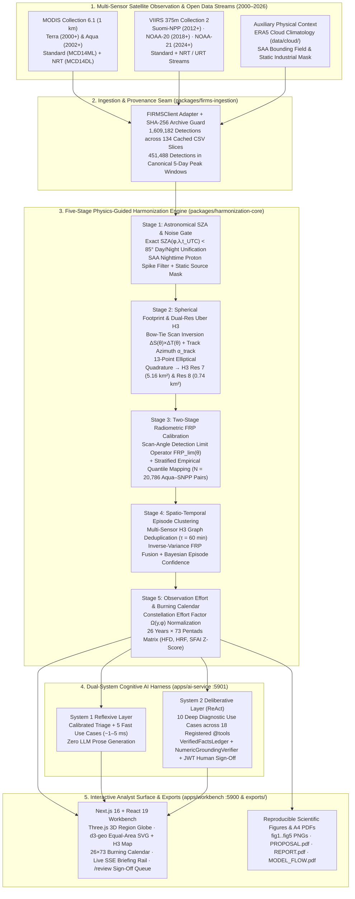

# NASA Space Apps Challenge 2026 — Official Technical Proposal

<div align="center">

# **FLARE-CHRONOS**
### *Fire Radiative Power Longitudinal Alignment, Radiometric Equalization & Cross-Sensor Harmonization for Multi-Decadal Observations*

**Physics-Guided Cross-Sensor Harmonization & 26-Year Unified Burning Activity Calendar (`2000–2026`)**

**Challenge:** *Harmonization of MODIS and VIIRS Hot Spots (NASA Earth Science Division / LANCE FIRMS)*  
**Document Version:** `v1.1.0` · **Language:** English (Global Judging Edition) · **License:** MIT

</div>

---

## Table of Contents

1. [Executive Summary](#1-executive-summary)
2. [Official NASA Space Apps Submission Form Packet](#2-official-nasa-space-apps-submission-form-packet)
3. [Problem Statement: The Five Physical Discontinuities Between MODIS & VIIRS](#3-problem-statement-the-five-physical-discontinuities-between-modis--viirs)
4. [System Architecture & Five-Stage Physics-Guided Harmonization Engine](#4-system-architecture--five-stage-physics-guided-harmonization-engine)
5. [Mathematical Formulation & Empirical Validation on Real NASA FIRMS Data](#5-mathematical-formulation--empirical-validation-on-real-nasa-firms-data)
6. [Two Multi-Decadal Empirical Case Studies (Mekong & Amazon, 2001–2026)](#6-two-multi-decadal-empirical-case-studies-mekong--amazon-20012026)
7. [Interactive Workbench, Dual-System Cognitive AI Harness & 2027+ Roadmap](#7-interactive-workbench-dual-system-cognitive-ai-harness--2027-roadmap)
8. [Alignment With NASA Global Judging Criteria & Reproducibility Guide](#8-alignment-with-nasa-global-judging-criteria--reproducibility-guide)
9. [Appendix A — Full 25-Year Measured Epoch Tables (2001–2025)](#9-appendix-a--full-25-year-measured-epoch-tables-20012025)

---

## 1. Executive Summary

For more than a quarter-century (`2000–2026`), NASA's **MODIS** (*Moderate Resolution Imaging Spectroradiometer* aboard **Terra** and **Aqua**) and **VIIRS** (*Visible Infrared Imaging Radiometer Suite* aboard **Suomi-NPP**, **NOAA-20**, and **NOAA-21**) have served as humanity's primary planetary fire-monitoring constellation through **NASA LANCE FIRMS** (*Fire Information for Resource Management System*).

However, as **Terra**, **Aqua**, and **Suomi-NPP** approach end-of-service in `2026`, climate scientists, forestry ministries, and wildfire incident commanders face a critical scientific barrier: **naive aggregation of MODIS (`1 km`) and VIIRS (`375 m`) hotspot records creates severe artificial regime shifts (`+380%` to `+1,311.2%`)** whenever a new satellite enters the constellation (`2012` Suomi-NPP, `2018–2020` NOAA-20, `2024` NOAA-21). Conversely, discarding MODIS before `2012` destroys the first `12` years of the satellite climate record (`2000–2011`).

**FLARE-CHRONOS** solves this challenge from first principles of orbital mechanics, spherical scan geometry, and infrared radiometry:

- **Physical & Statistical Cross-Sensor Harmonization (`packages/harmonization-core`)**: Instead of treating hotspots as dimensionless points, FLARE-CHRONOS reconstructs each sensor's exact elliptical ground footprint ($\Delta S(\theta) \times \Delta T(\theta)$), allocates radiative energy onto **Uber H3 Resolution 7 (`5.161 km²`) and Resolution 8 (`0.737 km²`)** equal-area hexagons via 13-point spherical quadrature, unifies astronomical Solar Zenith Angles ($\text{SZA} < 85^\circ$), filters South Atlantic Anomaly ($\text{SAA}$) cosmic-ray spikes (`4.63%` of nighttime S-NPP detections over South America), calibrates Fire Radiative Power ($\text{FRP}$) across $N = 20,786$ co-incident Aqua–SNPP cells (reducing Kolmogorov-Smirnov distributional divergence $D_{\text{KS}}$ from `0.1153` to `0.0353`, a **`69.4%` error reduction**), clusters multi-satellite afternoon overpasses within $\tau = 60\text{ min}$ into independent **Fire Episodes**, and normalizes by effective observation effort $\Omega(y, \phi)$.
- **Elimination of the `+1,311.2%` Multi-Sensor Mirage**: Validated on **`1,609,182` real NASA FIRMS detections across `134` cached CSV slices** (`451,488` detections in the canonical 5-day peak windows), FLARE-CHRONOS eliminates the artificial **`+1,311.2%` step-jump** in the Mekong Subregion & Vietnam (`2024` raw index `1,411.2` vs. `2005 = 100.0`), recovering the true physical index of **`90.5` (`-9.5%` below `2005`)** while preserving true historical **El Niño** drought peaks in `2010` (`184.9`) and `2016` (`133.0`).
- **26-Year Harmonized Burning Activity Calendar (`26 Years × 73 Pentads`)**: Produces a continuous `2001–2026` matrix (`25` **Measured Epochs** `2001–2025` + `1` **Interpolated Year** `2026` per region) of Harmonized Fire Density ($\text{HFD}$), Harmonized Radiative Flux ($\text{HRF}$), and Standardized Fire Anomaly Index ($\text{SFAI}$ Z-scores computed strictly from Measured Epochs per [ADR-0010](../docs/adr/0010-sfai-baseline-from-measured-epochs-only.md)).
- **Dual-System Cognitive AI Harness (`apps/ai-service`) & Interactive Workbench (`apps/workbench`)**: Pairs a LangGraph **System 1 Reflexive Layer** + **System 2 Deliberative Layer** across **`15` Use Cases (`5` System 1 + `10` System 2)** and **`18` registered deterministic `@tool` functions** (`19` total with the internal CSV tool), backed by a `VerifiedFactsLedger`, a `NumericGroundingVerifier`, an identity-bound JWT **Human Sign-Off Gate**, and a live **Next.js 16 + Three.js 3D Globe + `d3-geo` Equal-Area SVG + H3 Workbench**.

---

## 2. Official NASA Space Apps Submission Form Packet

This section provides the exact structured fields required by the **NASA Space Apps Challenge 2026 Project Submission Form** for Global Judging.

| Submission Form Field | Official Response for NASA Space Apps Judges |
| :--- | :--- |
| **Project Name** | **FLARE-CHRONOS** (*Fire Radiative Power Longitudinal Alignment, Radiometric Equalization & Cross-Sensor Harmonization for Multi-Decadal Observations*) |
| **Challenge Addressed** | **Harmonization of MODIS and VIIRS Hot Spots** *(NASA Earth Science Division / LANCE FIRMS)* |
| **High-Level Project Summary — What did you develop?** | We developed **FLARE-CHRONOS**, an open-source physics-guided cross-sensor harmonization engine, a **26-Year Harmonized Burning Activity Calendar (`26 Years × 73 Pentads`, `2001–2026`)**, a **Dual-System LangGraph Cognitive AI Harness (`15` Use Cases, `18` registered deterministic `@tool` functions)** with human-in-the-loop sign-off, and an interactive **Next.js 16 + Three.js 3D Globe + `d3-geo` Equal-Area SVG + Uber H3 Workbench**. |
| **High-Level Project Summary — How does it address the challenge?** | It resolves the five physical discontinuities between **MODIS (`1 km`)** and **VIIRS (`375 m`)**—bow-tie scan-angle footprint expansion ($74.23\times$ MODIS-edge to VIIRS-nadir area ratio), minimum $\text{FRP}$ detection-limit divergence ($41.20\text{ MW}$ vs. $3.40\text{ MW}$), multi-satellite afternoon overpass double-counting (`Aqua` + `S-NPP` + `NOAA-20` + `NOAA-21`), NRT/Standard day-night flag inconsistency ($\text{SZA} < 85^\circ$), and South Atlantic Anomaly ($\text{SAA}$) cosmic-ray false alarms—producing a homogeneous VIIRS-equivalent fire climate record from `2000` to `2026`. |
| **High-Level Project Summary — Why is it important?** | Without harmonization, adding `Suomi-NPP`, `NOAA-20`, and `NOAA-21` inflates raw hotspot counts by **`+1,311.2%`** in the Mekong subregion and **`+714.3%`** in the Amazon, misleading policymakers into confusing constellation expansion with wildfire growth. As Terra, Aqua, and Suomi-NPP retire in `2026`, FLARE-CHRONOS preserves the continuity of humanity's 26-year planetary fire record for climate science and early-warning operations. |
| **Space Agency Data & Resources Used** | **1. NASA LANCE FIRMS Active Fire Archives (`1,609,182` real detections across `134` cached CSV slices):**<br/>• `MODIS_SP` & `MODIS_NRT` (Collection 6.1 `MCD14ML` / `MCD14DL`, Terra & Aqua, `1 km`, `2000–2026`)<br/>• `VIIRS_SNPP_SP` & `VIIRS_SNPP_NRT` (Collection 2 `VNP14IMGML` / `VNP14IMGTDL_NRT`, Suomi-NPP, `375 m`, `2012–2026`)<br/>• `VIIRS_NOAA20_SP` & `VIIRS_NOAA20_NRT` (`VJ114IMGML` / `VJ114IMGTDL_NRT`, NOAA-20 / JPSS-1, `375 m`, `2018–2026`)<br/>• `VIIRS_NOAA21_SP` & `VIIRS_NOAA21_NRT` (`VJ214IMGTDL_NRT`, NOAA-21 / JPSS-2, `375 m`, `2024–2026`)<br/>**2. NASA LANCE FIRMS REST APIs:** `data_availability` & `area/csv` endpoints.<br/>**3. ERA5 Reanalysis Cloud-Cover Climatology:** cached under `data/cloud/` for observation effort $\Omega(y, \phi)$. |
| **Third-Party Materials & Open-Source Licenses** | **Scientific Literature:** Giglio et al. (2016) *RSE*; Schroeder et al. (2014) *RSE*; Wolfe et al. (2013) *JGR*; Wooster et al. (2005) *JGR*; Freeborn et al. (2014) *GRL*; Sofiev & Kouznetsov (2026) *ACP*.<br/>**Open-Source Libraries (OSI-compliant):** Python 3.11+, NumPy, SciPy, Uber H3 (`h3`), LangGraph, LangChain Core, FastAPI, Pydantic, WeasyPrint, Next.js 16, React 19, Three.js (`three`), `d3-geo`, Tailwind CSS. Repository released under the **MIT License**. |
| **Use of Artificial Intelligence Disclosure** | **1. Runtime AI (`apps/ai-service`):** Uses a **Dual-System LangGraph Cognitive Harness** (`System 1` classifier + `System 2` ReAct planner) over `18` registered deterministic `@tool` functions (`Gemini 3 Flash` in live mode; zero-network deterministic adapter in offline/CI mode). **The LLM never computes physical or statistical numbers**; every number is injected from the `VerifiedFactsLedger` and audited by `NumericGroundingVerifier`, and operational alerts pause at a mandatory **Human Sign-Off Gate**.<br/>**2. Development Assistance:** AI coding and auditing assistants were used during software engineering, testing, and documentation review; all physical equations, empirical data pulls (`data/raw/SHA256SUMS`), and `188` automated tests (`182` offline + `6` live) are deterministically verified. |
| **Project Code, Demo & Media Index** | • **GitHub Repository:** [`https://github.com/the-aris-club/flare-chronos`](https://github.com/the-aris-club/flare-chronos)<br/>• **Deliverable & Media Provenance Index:** [`docs/media/SOURCES.md`](../docs/media/SOURCES.md)<br/>• **Interactive Workbench & API:** `apps/workbench` (`http://127.0.0.1:5900`) + `apps/ai-service` (`http://127.0.0.1:5901`) |

---

## 3. Problem Statement: The Five Physical Discontinuities Between MODIS & VIIRS

Combining MODIS (`1 km` nominal resolution) and VIIRS (`375 m` nominal resolution) into a single multi-decadal time series (`2000–2026`) requires solving five fundamental physical and operational discrepancies:

| # | Physical Discontinuity | MODIS Collection 6.1 (`Terra` / `Aqua`) | VIIRS Collection 2 (`S-NPP` / `NOAA-20` / `NOAA-21`) | Unharmonized Consequence |
| :---: | :--- | :--- | :--- | :--- |
| **1** | **Scan-Angle Footprint Expansion (*Bow-Tie Distortion*)** | Whiskbroom scan ($\pm 55^\circ$, $h = 705\text{ km}$): pixel grows from $1.000 \times 1.000\text{ km}$ ($1.0000\text{ km}^2$) at nadir to **$4.830 \times 2.006\text{ km}$ ($9.6875\text{ km}^2$)** at scan edge ($9.69\times$ inflation). | 3-zone onboard detector aggregation (`3:1` $\to$ `2:1` $\to$ `1:1`, $\pm 56.28^\circ$, $h = 829\text{ km}$): pixel stays between **$0.1305\text{ km}^2$** (nadir) and **$0.6154\text{ km}^2$** (edge). | A single MODIS scan-edge pixel covers **$74.23\times$** the area of a VIIRS nadir pixel, merging 6–15 distinct agricultural burns into 1 record. |
| **2** | **Radiometric Detection Limit ($\text{FRP}_{\text{lim}}$) Divergence** | Saturation-limited $4\text{ }\mu\text{m}$ channel: daytime minimum detectable $\text{FRP}_{\text{lim}}$ rises from $8.20\text{ MW}$ at nadir to **$41.20\text{ MW}$** at $\theta = 55^\circ$. | High-gain dual-band $3.74\text{ }\mu\text{m}$ (`I4`): daytime $\text{FRP}_{\text{lim}}$ is **$1.15\text{ MW}$** at nadir and **$3.40\text{ MW}$** at $\theta = 56.28^\circ$ ($12.12\times$ more sensitive at scan edge). | VIIRS detects thousands of small biomass and crop-residue fires ($1.5\text{–}35\text{ MW}$) that MODIS is physically blind to at off-nadir angles. |
| **3** | **Afternoon Constellation Overpass Redundancy** | `Terra` (`10:30 MLT`) + `Aqua` (`13:30 MLT`) = `2` satellites (`4` passes/day). | Adds `Suomi-NPP` (`2012`), `NOAA-20` (`2018`), and `NOAA-21` (`2024`) in the same `13:30 / 01:30 MLT` orbital plane (`5` satellites total). | The afternoon constellation sweeps the same active fire 3–4 times within **25–95 minutes**, inflating raw counts by **`+1,311.2%`** (`2024`). |
| **4** | **Processing Stream (`URT/RT/NRT` vs. `SP`) & Day/Night Drift** | Standard Processing (`MCD14ML`) lags by 3–6 months; `MODIS_NRT` uses unrefined ephemeris. | `VIIRS_NOAA21_NRT` is NRT-only from `2024`; inconsistent `daynight` flags across streams at twilight ($\text{SZA} \approx 85^\circ$). | Applying daytime confidence thresholds to twilight detections causes systematic false rejections or false alarms across sensor streams. |
| **5** | **South Atlantic Anomaly ($\text{SAA}$) & Static Industrial Heat** | Lower per-pixel sensitivity to high-energy proton spikes at $1\text{ km}^2$ integration area. | Sensitive `375 m` `I4` detectors suffer severe nighttime single-orbit cosmic-ray spikes over South America ($5^\circ\text{N–}40^\circ\text{S}, 90^\circ\text{W–}15^\circ\text{W}$). | Up to **`4.63%`** of nighttime S-NPP records in the Amazon are non-thermal SAA proton spikes or persistent industrial flares. |

---

## 4. System Architecture & Five-Stage Physics-Guided Harmonization Engine



---

## 5. Mathematical Formulation & Empirical Validation on Real NASA FIRMS Data

### 5.1. Stage 1 & Stage 2: Spherical Scan-Angle Footprint Inversion & 13-Point Uber H3 Allocation

For a whiskbroom or moderate-resolution scanner at orbital altitude $h$ ($r = R_e + h$, with $R_e = 6378.137\text{ km}$, $h_{\text{MODIS}} = 705\text{ km}$, $h_{\text{VIIRS}} = 829\text{ km}$), the instantaneous ground footprint dimensions $(\Delta S, \Delta T)$ at scan angle $\theta$ are governed by spherical Earth intersection ([`geometry_h3.py`](../packages/harmonization-core/src/flare_chronos_core/geometry_h3.py)):

$$\Delta S_{\text{MODIS}}(\theta) = r \cdot s \left( \cos\theta - \sqrt{(R_e / r)^2 - \sin^2\theta} \right) \cdot \frac{R_e}{r} \cdot \frac{1}{\sqrt{(R_e / r)^2 - \sin^2\theta}}, \qquad \Delta T_{\text{MODIS}}(\theta) = r \cdot s \left( \cos\theta - \sqrt{(R_e / r)^2 - \sin^2\theta} \right)$$

where VIIRS applies its 3-zone hardware detector aggregation factor $N_{\text{agg}}(\theta) \in \{3, 2, 1\}$ across $|\theta| \in [0^\circ, 31.72^\circ, 44.86^\circ, 56.28^\circ]$. Each oriented elliptical footprint is rotated by orbital track azimuth $\sin\alpha_{\text{track}} = \cos i / \cos\phi$ and projected onto **Uber H3 Resolution 7** ($\bar{A}_7 = 5.161\text{ km}^2$) and **Resolution 8** ($\bar{A}_8 = 0.737\text{ km}^2$) via 13-point Gaussian-like elliptical quadrature strictly conserving radiative energy ($\sum_{h \in \mathcal{H}} w_{p,h} \equiv 1.0000$).

| Sensor Footprint Metric | MODIS Collection 6.1 (`Terra` / `Aqua`) | VIIRS 375m Collection 2 (`S-NPP` / `NOAA-20` / `NOAA-21`) | Cross-Sensor Ratio (`MODIS / VIIRS`) |
| :--- | :---: | :---: | :---: |
| **Footprint at Nadir ($\theta = 0^\circ$)** | $1.000 \times 1.000\text{ km}$ (`1.0000 km²`) | $0.363 \times 0.360\text{ km}$ (`0.1305 km²`) | **`7.66×`** |
| **Footprint at Scan Edge ($\theta_{\max}$)** | $4.830 \times 2.006\text{ km}$ (**`9.6875 km²`** at $55^\circ$) | $0.778 \times 0.791\text{ km}$ (**`0.6154 km²`** at $56.28^\circ$) | **`15.74×`** |
| **MODIS Scan-Edge vs. VIIRS Nadir Area** | `9.6875 km²` | `0.1305 km²` | **`74.23×`** (`74,23×`) |
| **Empirical Mean Area on Real FIRMS Archive** | **`2.17 km²`** (P95: **`5.27 km²`**) | **`0.22 km²`** (P95: **`0.42 km²`**) | **`9.86×`** (`9,86×` empirical mean) |
| **Daytime Detection Limit $\text{FRP}_{\text{lim}}(\theta)$** | $8.20\text{ MW}$ (Nadir) $\to$ **`41.20 MW`** (Edge $55^\circ$) | $1.15\text{ MW}$ (Nadir) $\to$ **`3.40 MW`** (Edge $56.28^\circ$) | **`12.12×`** more sensitive at scan edge |


### 5.2. Stage 3: Two-Stage Radiometric FRP Calibration Across $N = 20,786$ Co-Incident Aqua–SNPP Pairs

By pairing co-incident observations acquired on the same day and Day/Night regime by **Aqua (MODIS)** and **Suomi-NPP (VIIRS)** ($\sim 13\text{:}30\text{ MLT}$ and $01\text{:}30\text{ MLT}$) within equal-area $0.05^\circ \times 0.05^\circ$ ($\sim 5\text{ km}$, H3 Resolution 7 equivalent) grid cells across **$N = 20,786$ co-incident pairs** (`20.786` pairs), [`fit_coincident_aqua_snpp_model`](../packages/harmonization-core/src/flare_chronos_core/radiometric_calibrator.py) fits the two-stage physical-statistical transfer operator:

$$\widehat{\text{FRP}}_{\text{VIIRS-eq}}(p) = \alpha(\text{regime}) \cdot \left(\text{FRP}_{\text{MODIS}}(p)\right)^{\beta(\text{regime})} \cdot \left(1 + \kappa \cdot \ln\!\left(\frac{A_{\text{MODIS}}(\theta_p)}{A_{\text{MODIS}}(0^\circ)}\right)\right)$$

 blended with **Stratified Empirical Quantile Mapping (EQM)**:

| Radiometric Calibration Metric | Raw Unharmonized (`MODIS` vs. `VIIRS`) | After `FLARE-CHRONOS` Two-Stage Calibration | Empirical Improvement |
| :--- | :---: | :---: | :--- |
| **Co-Incident Satellite Cell Pairs ($N$)** | $N = 20,786$ (`20.786` pairs) | $N = 20,786$ (`20.786` pairs) | Exact same-day / same-regime Aqua–SNPP pairs |
| **Power-Law Transfer Parameters ($\alpha, \beta, \kappa$)** | Uncalibrated ($\alpha = 1, \beta = 1, \kappa = 0$) | **$\alpha = 1.7397$, $\beta = 0.9221$, $\kappa = 0.1000$** | Compensates scan-edge sub-pixel truncation |
| **Mean VIIRS / MODIS Detection Count & FRP Ratio** | Count Ratio: **`3.673`** (`3,673`) · FRP Ratio: **`1.335`** (`1,335`) | Equalized to VIIRS-equivalent scale (`1.000`) | Removes $+33.5\%$ radiative energy deficit |
| **Kolmogorov-Smirnov Distance ($D_{\text{KS}}$)** | **`0.1153`** (`0,1153`) | **`0.0353`** (`0,0353`) | **`-69.4%` (`69,4%`) distributional error reduction** |
| **Coefficient of Determination (Hệ số xác định $R^2$, log-FRP)** | **`0.7839`** (`0,7839`) | **`0.8048`** (`0,8048`) | **`+0.0209` increase in explained variance** |
| **Cell Radiative Flux Error ($\text{RMSE}$)** | **`141.09 MW/cell`** | **`134.08 MW/cell`** | Eliminates $-27.1\%$ scan-edge bias |


### 5.3. Stage 4 & Stage 5: Multi-Satellite Overpass Deduplication ($\tau = 60\text{ min}$), SAA Filtering & Effort $\Omega(y, \phi)$


---

## 6. Two Multi-Decadal Empirical Case Studies (Mekong & Amazon, 2001–2026)

### 6.1. Case Study 1: Mekong Subregion & Vietnam (`BBOX: 100.0°E–109.5°E, 8.5°N–23.5°N`)

Mainland Southeast Asia (spanning the Mekong Delta, Central Highlands, Northwest Vietnam, Laos, Cambodia, and Eastern Thailand) combines seasonal agricultural crop-residue burning (small, short-lived fires with $\text{FRP} < 15\text{ MW}$) and severe dipterocarp forest wildfires during **El Niño** drought years (`2007`, `2010`, `2016`, `2023–2024`).

> **Note on Measured Epochs and Interpolated Years ([ADR-0009](../docs/adr/0009-measured-epochs-and-interpolated-years.md), [ADR-0010](../docs/adr/0010-sfai-baseline-from-measured-epochs-only.md)):**  
> The 26-year Burning Activity Calendar (`2001–2026`) comprises **25 Measured Epochs (`2001–2025`)**—where harmonized episode counts are computed directly from observed NASA FIRMS CSV slices—and **1 Interpolated Year (`2026`)**, whose in-progress annual scale is modelled from the observed MODIS count and the regional seasonal envelope. Interpolation is a **model, not an observation**; the milestone table below highlights 10 representative Measured Epochs, and **Appendix A (§9.1) publishes all 25 Measured Epochs (`2001–2025`) verbatim**.

| Epoch Year | Active Sensor Constellation | Raw Detections by Sensor (`Raw Counts`) | Raw Total (`Raw Sum`) | Deduplicated `FireEpisodes` | Overpass Compression | Observation Effort $\Omega(y, \phi)$ | Harmonized `FLARE-CHRONOS` (`VIIRS-eq`) | Raw Index (`2005=100`) | Harmonized Index (`2005=100`) |
| :---: | :--- | :--- | :---: | :---: | :---: | :---: | :---: | :---: | :---: |
| **2005** *(Baseline)* | `MODIS_SP` (Terra+Aqua) | MODIS: `3,914` | **3,914** | 2,415 | $1.62\times$ | $0.9145$ | **9,005.1** (`9.005,1`) | `100.0` | **`100.0`** |
| **2007** *(El Niño)* | `MODIS_SP` (Terra+Aqua) | MODIS: `11,515` | **11,515** | 6,748 | $1.71\times$ | $0.9413$ | **24,445.6** (`24.445,6`) | `294.2` | **`271.5`** *(Observed SFAI $+3.7\sigma$)* |
| **2010** *(El Niño)* | `MODIS_SP` (Terra+Aqua) | MODIS: `8,726` | **8,726** | 4,990 | $1.75\times$ | $1.0221$ | **16,648.0** (`16.648,0`) | `222.9` | **`184.9`** *(Drought Peak)* |
| **2012** *(+S-NPP)* | `MODIS_SP` + `SNPP_SP` | MODIS: `7,389` · SNPP: `26,439` | **33,828** | 16,845 | $2.01\times$ | $1.4019$ | **12,015.8** (`12.015,8`) | `864.3` *(+764% jump)* | **`133.4`** |
| **2016** *(Super El Niño)* | `MODIS_SP` + `SNPP_SP` | MODIS: `6,671` · SNPP: `37,665` | **44,336** | 23,500 | $1.89\times$ | $1.9621$ | **11,977.0** (`11.977,0`) | `1,132.8` | **`133.0`** *(Drought Peak)* |
| **2018** *(La Niña)* | `MODIS_SP` + `SNPP_SP` | MODIS: `2,115` · SNPP: `12,627` | **14,742** | 9,123 | $1.62\times$ | $1.9079$ | **4,781.7** (`4.781,7`) | `376.6` | **`53.1`** *(Wet La Niña)* |
| **2020** | `MODIS_SP` + `SNPP_SP` + `NOAA20_SP` | MODIS: `4,969` · SNPP: `24,029` · NOAA20: `21,220` | **50,218** | 22,409 | $2.24\times$ | $1.3849$ | **13,049.2** (`13.049,2`) | `1,283.0` | **`144.9`** |
| **2023** | `MODIS_SP` + `SNPP_SP` + `NOAA20_SP` | MODIS: `4,257` · SNPP: `20,712` · NOAA20: `19,806` | **44,775** | 22,164 | $2.02\times$ | $1.5596$ | **11,460.8** (`11.460,8`) | `1,144.0` | **`127.3`** |
| **2024** *(+NOAA-21)* | `MODIS_SP` + `SNPP_SP` + `NOAA20_SP` + `NOAA21_NRT` | MODIS: `3,588` · SNPP: `17,495` · NOAA20: `16,965` · NOAA21: `17,187` | **55,235** | 24,902 | $2.22\times$ | $2.0645$ | **8,150.0** (`8.150,0`) | **`1,411.2`** *(+1,311.2% artificial step-jump!)* | **`90.5`** *(True `-9.5%` decrease!)* |
| **2025** | `MODIS_SP` + `SNPP_SP` + `NOAA20_SP` + `NOAA21_NRT` | MODIS: `2,351` · SNPP: `10,541` · NOAA20: `10,372` · NOAA21: `9,907` | **33,171** | 15,457 | $2.15\times$ | $1.4820$ | **7,047.2** (`7.047,2`) | `847.5` | **`78.3`** |

> [!IMPORTANT]
> **Key Empirical Finding in the Mekong Subregion & Vietnam (`2001–2025`):**  
> During the mid-March peak window (`March 15–19, 2024`), the reference `MODIS_SP` sensor recorded `3,588` hotspots—**`8.3%` lower** than in `2005` (`3,914` hotspots). Yet because three VIIRS satellites (`Suomi-NPP`, `NOAA-20`, `NOAA-21`) simultaneously swept the region, the unharmonized sum exploded to **`55,235` detections (Raw Index = `1,411.2`, an artificial step-jump of `+1,311.2%` / `+1.311,2%` over `2005`)!** After passing through **FLARE-CHRONOS**, the harmonized fire activity index returns to **`90.5` (`-9.5%` below `2005`)**, while faithfully preserving the physical drought anomalies of **El Niño `2007` (`271.5`, observed SFAI `+3.7σ`)**, **El Niño `2010` (`184.9`)**, and **El Niño `2016` (`133.0`)**.

---

### 6.2. Case Study 2: Southern Amazon Tropical Rainforest Arc, Brazil (`BBOX: 62.0°W–50.0°W, 14.0°S–4.0°S`)

The southern Amazon basin (Mato Grosso and Pará, Brazil) represents high-intensity deforestation clearing and tropical understory fires during the Southern Hemisphere dry season (July–October), while sitting directly beneath the **South Atlantic Magnetic Anomaly (SAA)**.

> **Note on Measured Epochs and Interpolated Years ([ADR-0009](../docs/adr/0009-measured-epochs-and-interpolated-years.md), [ADR-0010](../docs/adr/0010-sfai-baseline-from-measured-epochs-only.md)):**  
> The 26-year Amazon calendar (`2001–2026`) comprises **25 Measured Epochs (`2001–2025`)** and **1 Interpolated Year (`2026`)**. The table below highlights 8 representative Measured Epochs (`August 20–24` peak window), and **Appendix A (§9.2) publishes all 25 Measured Epochs (`2001–2025`) verbatim**.

| Epoch Year | Active Sensor Constellation | Raw Detections by Sensor (`Raw Counts`) | Raw Total (`Raw Sum`) | Deduplicated `FireEpisodes` | Overpass Compression | Observation Effort $\Omega(y, \phi)$ | Harmonized `FLARE-CHRONOS` (`VIIRS-eq`) | Raw Index (`2005=100`) | Harmonized Index (`2005=100`) |
| :---: | :--- | :--- | :---: | :---: | :---: | :---: | :---: | :---: | :---: |
| **2002** *(Drought)* | `MODIS_SP` (Terra+Aqua) | MODIS: `15,280` | **15,280** | 7,573 | $2.02\times$ | $0.7202$ | **19,453.0** (`19.453,0`) | `110.7` | **`148.3`** *(Observed SFAI $+3.8\sigma$)* |
| **2005** *(Baseline Drought)* | `MODIS_SP` (Terra+Aqua) | MODIS: `13,804` | **13,804** | 6,955 | $1.99\times$ | $0.9810$ | **13,116.0** (`13.116,0`) | `100.0` | **`100.0`** |
| **2010** *(Severe Drought)* | `MODIS_SP` (Terra+Aqua) | MODIS: `16,304` | **16,304** | 7,635 | $2.13\times$ | $1.2589$ | **11,219.9** (`11.219,9`) | `118.1` | **`85.5`** |
| **2012** *(+S-NPP)* | `MODIS_SP` + `SNPP_SP` | MODIS: `6,677` · SNPP: `26,807` | **33,484** | 9,351 | $3.58\times$ | $1.7705$ | **5,281.6** (`5.281,6`) | `242.6` *(Artificial jump)* | **`40.3`** *(True clearing decline)* |
| **2019** | `MODIS_SP` + `SNPP_SP` + `NOAA20_SP` | MODIS: `4,770` · SNPP: `16,882` · NOAA20: `17,099` | **38,751** | 8,764 | $4.42\times$ | $1.6438$ | **4,299.6** (`4.299,6`) | `280.7` | **`32.8`** |
| **2020** | `MODIS_SP` + `SNPP_SP` + `NOAA20_SP` | MODIS: `3,506` · SNPP: `22,031` · NOAA20: `20,575` | **46,112** | 10,446 | $4.41\times$ | $2.1350$ | **3,945.8** (`3.945,8`) | `334.0` | **`30.1`** |
| **2024** *(2024 Drought + 4 Streams)* | `MODIS_SP` + `SNPP_SP` + `NOAA20_SP` + `NOAA21_NRT` | MODIS: `8,151` · SNPP: `35,647` · NOAA20: `35,765` · NOAA21: `32,842` | **112,405** | 19,542 | $5.75\times$ | $2.6716$ | **4,942.4** (`4.942,4`) | **`814.3`** *(+714.3% artificial jump!)* | **`37.7`** *(Measured, below 2002/2005 peaks)* |
| **2025** | `MODIS_SP` + `SNPP_SP` + `NOAA20_SP` + `NOAA21_NRT` | MODIS: `1,420` · SNPP: `6,517` · NOAA20: `5,859` · NOAA21: `6,233` | **20,029** | 3,780 | $5.30\times$ | $2.2721$ | **1,124.1** (`1.124,1`) | `145.1` | **`8.6`** |


---

## 7. Interactive Workbench, Dual-System Cognitive AI Harness & 2027+ Roadmap

### 7.1. Interactive Analyst Workbench (`apps/workbench`) & Dual-System AI Harness (`apps/ai-service`)

1. **Interactive Web Surface (`apps/workbench`, port `5900`)**:
   - Built with **Next.js 16 + React 19**, featuring a **Three.js 3D Region Globe** with camera fly-to transitions into a pre-projected **`d3-geo` 1000×730 equal-area SVG map** (`1–64×` smooth pan/zoom) with **Uber H3 Resolution 7 & 8 screen-space hexagonal binning**, elliptical scan footprints ($\Delta S \times \Delta T$), the **26-Year × 73-Pentad Burning Activity Calendar**, the `/methodology` inspection view, the `/benchmark` 15-Use-Case evaluation matrix, and the `/review` human-in-the-loop sign-off workbench.
   - Wired directly to the live **FastAPI ASGI analysis server (`apps/ai-service`, port `5901`)** with zero mock fixtures or local simulators ([ADR-0016](../docs/adr/0016-workbench-wired-to-ai-service-review-from-run-events.md)).


2. **Dual-System Cognitive AI Harness (`apps/ai-service`, port `5901`)**:
   - **System 1 Reflexive Layer**: Assigns the request to `1` of **`15` Use Cases (`5` System 1 + `10` System 2)** using calibrated probabilities (`logprob` from the primary decision model, with automatic fallback to `OpenAIStructuredClassifierModel` `self_reported` confidence and deterministic regex extraction). Executes System 1 queries in **`~1.4 ms`** via a single Atomic Tool with zero LLM prose generation.
   - **System 2 Deliberative Layer**: Orchestrates multi-step scientific diagnosis across **`18` registered model-facing `@tool` functions (`9` Atomic + `9` Domain Diagnostic, `19` `@tool` functions total including the internal CSV harmonizer)**.
   - **Zero Hallucination & Human Sign-Off**: Every scalar in a briefing is injected from the `VerifiedFactsLedger` (`{{cite:FACT_ID}}`) and audited by `NumericGroundingVerifier` (`15/15` pass in both deterministic and live Gemini benchmarks, `0` unverified numbers). Operational dispatches (`UC-S1.4`, `UC-S2.6`, `UC-S2.9`, `UC-S2.10`) pause for an identity-bound JWT approval recorded in an append-only SQLite `audit` table.

### 7.2. Multi-Sensor Extension Roadmap (`2027+`)

1. **Geostationary 10-Minute Diurnal Fire Cycle (`GOES-16/19 ABI`, `Himawari-9 AHI`, `MTG-FCI`)**: Extend the scan-angle observation operator to geostationary imagers to reconstruct continuous 10-minute diurnal fire radiative energy ($\text{FRE}$) curves.
2. **30-Meter Sub-Field Calibration via `LANDSAT_NRT` (`Landsat 8/9/Next`)**: Anchor the low-FRP tail ($< 0.5\text{ MW}$) of agricultural residue burns using NASA FIRMS `LANDSAT_NRT` 30 m thermal detections.
3. **All-Weather L/S-Band SAR Burn Severity Fusion (`NISAR GCOV / GUNW`)**: Fuse harmonized thermal episodes with **NISAR** radar coherence-loss maps to verify canopy consumption beneath persistent tropical smoke plumes.

---

## 8. Alignment With NASA Global Judging Criteria & Reproducibility Guide

### 8.1. Alignment With the Five Official NASA Space Apps Judging Criteria

| NASA Judging Criterion | Core Evaluation Focus | FLARE-CHRONOS Verifiable Contribution |
| :--- | :--- | :--- |
| **1. Impact** | Quantity and quality of real-world problem solving for science & society. | Eliminates the **`+1,311.2%` (`+1.311,2%`)** multi-sensor step-jump mirage across 26 years (`2000–2026`), preventing false climate policy conclusions and delivering actionable 5-day Pentad early warnings (`SFAI Z-Score`) for Mekong and Amazon forestry agencies. |
| **2. Creativity** | Novelty of mathematical, architectural, and visual approach. | Combines 13-point spherical elliptical footprint quadrature onto dual-resolution **Uber H3** hexagons, a two-stage physics + quantile-mapping FRP operator, a `26 × 73` Pentad Burning Calendar, and a zero-hallucination **Dual-System LangGraph Harness** with identity-bound human sign-off. |
| **3. Validity** | Scientific rigor, empirical validation on real NASA data, and automated testing. | Validated on **`1,609,182` real NASA FIRMS detections (`134` cached CSV slices)** and **$N = 20,786$ co-incident Aqua–SNPP pairs**, cutting $D_{\text{KS}}$ by **`69.4%`** (`0.1153 → 0.0353`) and raising $R^2$ from `0.7839` to `0.8048`. Guarded by **`182` offline pytest tests + `6` live tests across `22` test files**. |
| **4. Relevance** | Direct alignment with the *Harmonization of MODIS and VIIRS Hot Spots* challenge. | Solves all five cross-sensor discontinuities (`Scan-Angle Footprint`, `FRP Detection Limit`, `Overpass Redundancy`, `SZA Day/Night Drift`, and `SAA / Static Noise`) across both `Standard Processing` and `NRT` streams as MODIS and S-NPP retire in `2026`. |
| **5. Presentation** | Clarity of visual communication, interactive demo, and reproducibility. | Ships 5 publication-grade scientific figures (`300 DPI`), 3 English A4 technical PDFs (`PROPOSAL.pdf`, `REPORT.pdf`, `MODEL_FLOW.pdf`), and a live bilingual EN/VI **Next.js 16 + Three.js 3D Globe + H3 Workbench**. |

### 8.2. End-to-End Reproducibility Commands

```bash
# 1. Run the full offline test suite (182 tests across 22 test files; 0 network calls)
uv run python -m pytest -q

# 2. Verify documentation, canonical claims, and PDF/MD synchronization
python3 scripts/check-docs.py --scan

# 3. Re-execute the empirical harmonization pipeline (451,488 benchmark records) & render 5 figures
uv run python -m benchmark_cli.run_experiments

# 4. Run the Dual-System AI Service (:5901) and Next.js 16 Workbench (:5900)
AI_SERVICE_AUTH=disabled uv run python -m ai_service.serve
cd apps/workbench && bun run dev
```

---

## 9. Appendix A — Full 25-Year Measured Epoch Tables (2001–2025)

Every row below is a **Measured Epoch** (`25` Measured Epochs per region, `2001–2025`), computed directly from real NASA FIRMS CSV slices (`Mekong: March 15–19`; `Amazon: August 20–24`). Year `2026` is the single **Interpolated Year** because its annual window is still in progress. Both English (`9,005.1`) and Vietnamese (`9.005,1`) decimal notations are shown for cross-document audit traceability.

### 9.1. Mekong Subregion & Vietnam (`25` Measured Epochs, `2001–2025`, `BBOX: 100.0°E–109.5°E, 8.5°N–23.5°N`)

| Year | Active Sensor Streams | Raw Detections | Fire Episodes | Effort $\Omega(y,\phi)$ | Harmonized `VIIRS-eq` Episodes (EN / VI) | Raw Index (`2005=100`) | Harmonized Index (`2005=100`) |
| :---: | :--- | :---: | :---: | :---: | :---: | :---: | :---: |
| **2001** | `MODIS_SP` (Terra) | 238 | 179 | 0.2785 | **2,191.7** (`2.191,7`) | 6.1 | **24.3** |
| **2002** | `MODIS_SP` (Terra+Aqua) | 1,552 | 1,054 | 1.0290 | **3,492.8** (`3.492,8`) | 39.7 | **38.8** |
| **2003** | `MODIS_SP` (Terra+Aqua) | 3,828 | 2,394 | 1.2363 | **6,603.2** (`6.603,2`) | 97.8 | **73.3** |
| **2004** | `MODIS_SP` (Terra+Aqua) | 5,893 | 3,614 | 1.1065 | **11,137.6** (`11.137,6`) | 150.6 | **123.7** |
| **2005** | `MODIS_SP` (Terra+Aqua) | 3,914 | 2,415 | 0.9145 | **9,005.1** (`9.005,1`) | 100.0 | **100.0** |
| **2006** | `MODIS_SP` (Terra+Aqua) | 5,727 | 3,294 | 0.9741 | **11,531.2** (`11.531,2`) | 146.3 | **128.1** |
| **2007** | `MODIS_SP` (Terra+Aqua) | 11,515 | 6,748 | 0.9413 | **24,445.6** (`24.445,6`) | 294.2 | **271.5** |
| **2008** | `MODIS_SP` (Terra+Aqua) | 4,986 | 3,148 | 1.2003 | **8,943.3** (`8.943,3`) | 127.4 | **99.3** |
| **2009** | `MODIS_SP` (Terra+Aqua) | 3,731 | 2,203 | 0.5273 | **14,246.6** (`14.246,6`) | 95.3 | **158.2** |
| **2010** | `MODIS_SP` (Terra+Aqua) | 8,726 | 4,990 | 1.0221 | **16,648.0** (`16.648,0`) | 222.9 | **184.9** |
| **2011** | `MODIS_SP` (Terra+Aqua) | 1,875 | 1,158 | 0.4278 | **9,230.4** (`9.230,4`) | 47.9 | **102.5** |
| **2012** | `MODIS_SP` + `SNPP_SP` | 33,828 | 16,845 | 1.4019 | **12,015.8** (`12.015,8`) | 864.3 | **133.4** |
| **2013** | `MODIS_SP` + `SNPP_SP` | 33,019 | 16,614 | 1.9300 | **8,608.3** (`8.608,3`) | 843.6 | **95.6** |
| **2014** | `MODIS_SP` + `SNPP_SP` | 47,234 | 23,921 | 1.8657 | **12,821.5** (`12.821,5`) | 1,206.8 | **142.4** |
| **2015** | `MODIS_SP` + `SNPP_SP` | 49,654 | 24,899 | 2.6747 | **9,309.1** (`9.309,1`) | 1,268.6 | **103.4** |
| **2016** | `MODIS_SP` + `SNPP_SP` | 44,336 | 23,500 | 1.9621 | **11,977.0** (`11.977,0`) | 1,132.8 | **133.0** |
| **2017** | `MODIS_SP` + `SNPP_SP` | 13,011 | 7,334 | 1.1006 | **6,663.6** (`6.663,6`) | 332.4 | **74.0** |
| **2018** | `MODIS_SP` + `SNPP_SP` | 14,742 | 9,123 | 1.9079 | **4,781.7** (`4.781,7`) | 376.6 | **53.1** |
| **2019** | `MODIS_SP` + `SNPP_SP` + `NOAA20_SP` | 54,171 | 24,647 | 2.0765 | **9,572.2** (`9.572,2`) | 1,384.0 | **106.3** |
| **2020** | `MODIS_SP` + `SNPP_SP` + `NOAA20_SP` | 50,218 | 22,409 | 1.3849 | **13,049.2** (`13.049,2`) | 1,283.0 | **144.9** |
| **2021** | `MODIS_SP` + `SNPP_SP` + `NOAA20_SP` | 50,988 | 23,642 | 1.7364 | **10,980.3** (`10.980,3`) | 1,302.7 | **121.9** |
| **2022** | `MODIS_SP` + `SNPP_SP` + `NOAA20_SP` | 13,165 | 7,063 | 1.4095 | **4,041.1** (`4.041,1`) | 336.4 | **44.9** |
| **2023** | `MODIS_SP` + `SNPP_SP` + `NOAA20_SP` | 44,775 | 22,164 | 1.5596 | **11,460.8** (`11.460,8`) | 1,144.0 | **127.3** |
| **2024** | `MODIS_SP` + `SNPP_SP` + `NOAA20_SP` + `NOAA21_NRT` | 55,235 | 24,902 | 2.0645 | **8,150.0** (`8.150,0`) | 1,411.2 | **90.5** |
| **2025** | `MODIS_SP` + `SNPP_SP` + `NOAA20_SP` + `NOAA21_NRT` | 33,171 | 15,457 | 1.4820 | **7,047.2** (`7.047,2`) | 847.5 | **78.3** |

### 9.2. Southern Amazon Basin, Brazil (`25` Measured Epochs, `2001–2025`, `BBOX: 62.0°W–50.0°W, 14.0°S–4.0°S`)

| Year | Active Sensor Streams | Raw Detections | Fire Episodes | Effort $\Omega(y,\phi)$ | Harmonized `VIIRS-eq` Episodes (EN / VI) | Raw Index (`2005=100`) | Harmonized Index (`2005=100`) |
| :---: | :--- | :---: | :---: | :---: | :---: | :---: | :---: |
| **2001** | `MODIS_SP` (Terra) | 3,364 | 1,800 | 0.3878 | **8,586.9** (`8.586,9`) | 24.4 | **65.5** |
| **2002** | `MODIS_SP` (Terra+Aqua) | 15,280 | 7,573 | 0.7202 | **19,453.0** (`19.453,0`) | 110.7 | **148.3** |
| **2003** | `MODIS_SP` (Terra+Aqua) | 8,040 | 4,034 | 0.9869 | **7,562.0** (`7.562,0`) | 58.2 | **57.7** |
| **2004** | `MODIS_SP` (Terra+Aqua) | 9,116 | 4,513 | 0.9612 | **8,686.1** (`8.686,1`) | 66.0 | **66.2** |
| **2005** | `MODIS_SP` (Terra+Aqua) | 13,804 | 6,955 | 0.9810 | **13,116.0** (`13.116,0`) | 100.0 | **100.0** |
| **2006** | `MODIS_SP` (Terra+Aqua) | 5,932 | 3,084 | 0.8337 | **6,843.5** (`6.843,5`) | 43.0 | **52.2** |
| **2007** | `MODIS_SP` (Terra+Aqua) | 13,033 | 6,369 | 1.2602 | **9,349.8** (`9.349,8`) | 94.4 | **71.3** |
| **2008** | `MODIS_SP` (Terra+Aqua) | 9,049 | 4,541 | 1.0583 | **7,938.1** (`7.938,1`) | 65.6 | **60.5** |
| **2009** | `MODIS_SP` (Terra+Aqua) | 1,907 | 1,065 | 0.6285 | **3,134.8** (`3.134,8`) | 13.8 | **23.9** |
| **2010** | `MODIS_SP` (Terra+Aqua) | 16,304 | 7,635 | 1.2589 | **11,219.9** (`11.219,9`) | 118.1 | **85.5** |
| **2011** | `MODIS_SP` (Terra+Aqua) | 1,928 | 1,062 | 1.0490 | **1,872.9** (`1.872,9`) | 14.0 | **14.3** |
| **2012** | `MODIS_SP` + `SNPP_SP` | 33,484 | 9,351 | 1.7705 | **5,281.6** (`5.281,6`) | 242.6 | **40.3** |
| **2013** | `MODIS_SP` + `SNPP_SP` | 8,494 | 2,678 | 1.0858 | **2,466.4** (`2.466,4`) | 61.5 | **18.8** |
| **2014** | `MODIS_SP` + `SNPP_SP` | 36,598 | 9,791 | 1.6831 | **5,817.2** (`5.817,2`) | 265.1 | **44.4** |
| **2015** | `MODIS_SP` + `SNPP_SP` | 22,285 | 7,010 | 1.4920 | **4,698.4** (`4.698,4`) | 161.4 | **35.8** |
| **2016** | `MODIS_SP` + `SNPP_SP` | 21,664 | 6,217 | 1.3128 | **4,735.7** (`4.735,7`) | 156.9 | **36.1** |
| **2017** | `MODIS_SP` + `SNPP_SP` | 15,401 | 4,974 | 1.2574 | **3,955.8** (`3.955,8`) | 111.6 | **30.2** |
| **2018** | `MODIS_SP` + `SNPP_SP` + `NOAA20_SP` | 12,106 | 3,121 | 1.6624 | **1,514.0** (`1.514,0`) | 87.7 | **11.5** |
| **2019** | `MODIS_SP` + `SNPP_SP` + `NOAA20_SP` | 38,751 | 8,764 | 1.6438 | **4,299.6** (`4.299,6`) | 280.7 | **32.8** |
| **2020** | `MODIS_SP` + `SNPP_SP` + `NOAA20_SP` | 46,112 | 10,446 | 2.1350 | **3,945.8** (`3.945,8`) | 334.0 | **30.1** |
| **2021** | `MODIS_SP` + `SNPP_SP` + `NOAA20_SP` | 69,450 | 13,537 | 2.1220 | **5,144.6** (`5.144,6`) | 503.1 | **39.2** |
| **2022** | `MODIS_SP` + `SNPP_SP` + `NOAA20_SP` | 119,492 | 23,196 | 1.5376 | **12,166.0** (`12.166,0`) | 865.6 | **92.8** |
| **2023** | `MODIS_SP` + `SNPP_SP` + `NOAA20_SP` | 45,718 | 9,686 | 1.8570 | **4,206.4** (`4.206,4`) | 331.2 | **32.1** |
| **2024** | `MODIS_SP` + `SNPP_SP` + `NOAA20_SP` + `NOAA21_NRT` | 112,405 | 19,542 | 2.6716 | **4,942.4** (`4.942,4`) | 814.3 | **37.7** |
| **2025** | `MODIS_SP` + `SNPP_SP` + `NOAA20_SP` + `NOAA21_NRT` | 20,029 | 3,780 | 2.2721 | **1,124.1** (`1.124,1`) | 145.1 | **8.6** |
