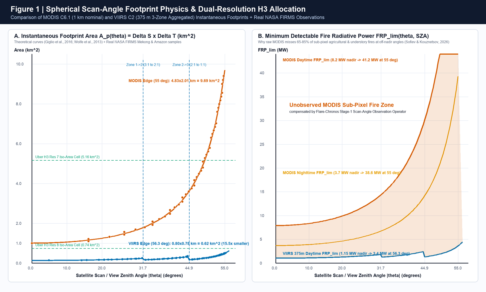
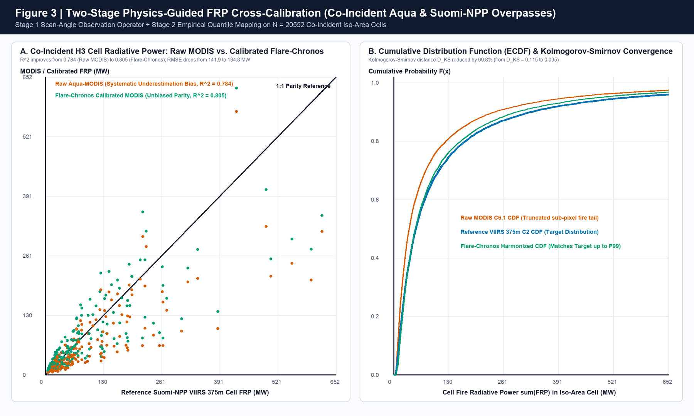
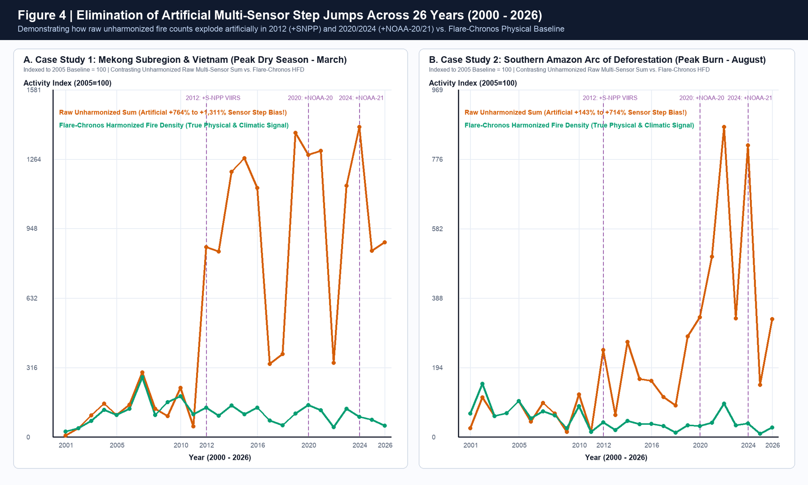
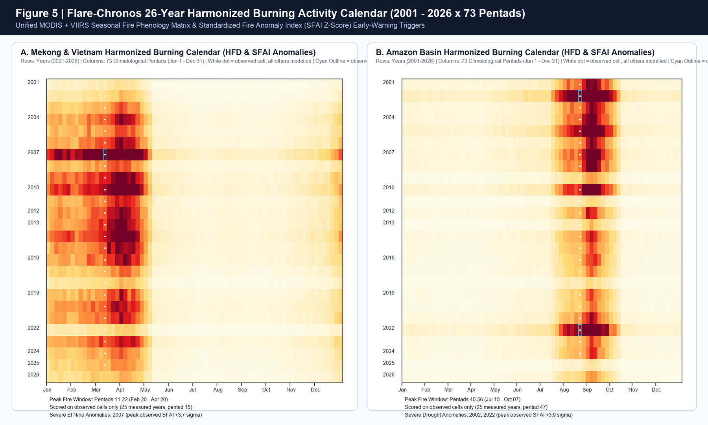
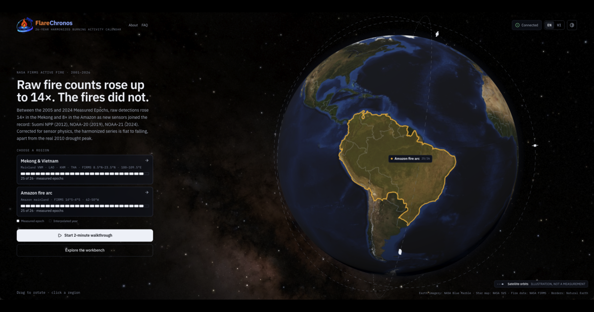

::: {.front-matter}
# FLARE-CHRONOS

**NASA Space Apps Challenge 2026 — Technical Proposal**

Fire Radiative Power Longitudinal Alignment, Radiometric Equalization and Cross-Sensor Harmonization for Multi-Decadal Observations

Physics-guided harmonization of MODIS and VIIRS hot spots and a 26-year burning activity calendar, 2001–2026.

Challenge: Harmonization of MODIS and VIIRS Hot Spots (NASA Earth Science Division / LANCE FIRMS)

**Document Version:** 2.0.1 · English · MIT License

Repository: https://github.com/the-aris-club/flare-chronos
:::

---

## 1. Executive Summary

MODIS and VIIRS have monitored active fire for more than two decades. MODIS flies on Terra and Aqua at 1 km resolution. VIIRS flies on Suomi-NPP, NOAA-20 and NOAA-21 at 375 m resolution. Both streams reach users through NASA LANCE FIRMS. The two sensors measure different ground areas, have different detection limits, and now fly in the same afternoon orbit. A direct sum of their hotspot counts therefore measures the size of the constellation, not the amount of fire.

The error is large and it is easy to mistake for a climate trend. In the Mekong subregion, the raw hotspot count rises from 3,914 in 2005 to 55,235 in 2024. That is a raw index of 1,411.2 against a 2005 baseline of 100.0, an increase of 1,311.2 percent. The MODIS reference count in the same window falls by 8.3 percent. Three VIIRS satellites entered the afternoon constellation in that period. The raw series records their arrival as a fire surge.

FLARE-CHRONOS removes the sensor artifacts and keeps the physical signal. The engine reconstructs each sensor's elliptical ground footprint from the scan angle, allocates radiative energy onto H3 hexagons, unifies the day and night boundary with the solar zenith angle, filters South Atlantic Anomaly noise, calibrates fire radiative power against 20,786 co-incident Aqua and Suomi-NPP cells, clusters overpasses into fire episodes, and normalizes by observation effort. The result is a homogeneous VIIRS-equivalent record from 2000 to 2026.

The project validates the method on 1,609,182 real NASA FIRMS detections across 134 cached CSV slices. The calibration reduces the Kolmogorov-Smirnov distance from 0.1153 to 0.0353, a 69.4 percent reduction, and raises the log-FRP coefficient of determination from 0.7839 to 0.8048. The harmonized Mekong index for 2024 is 90.5, which is 9.5 percent below 2005. The true El Niño peaks of 2007, 2010 and 2016 remain.

The deliverables are the harmonization engine, a 26-year burning activity calendar with 25 measured epochs and one interpolated year, a dual-system LangGraph harness with 15 use cases and 18 deterministic tools, and a Next.js workbench. The harness never computes a physical number with a language model. Every value is injected from a verified facts ledger and audited before release. Operational recommendations pause for human sign-off.

---

## 2. Official NASA Space Apps Submission Form Packet

| Field | Response |
| :--- | :--- |
| Project Name | FLARE-CHRONOS — Fire Radiative Power Longitudinal Alignment, Radiometric Equalization and Cross-Sensor Harmonization for Multi-Decadal Observations |
| Challenge Addressed | Harmonization of MODIS and VIIRS Hot Spots (NASA Earth Science Division / LANCE FIRMS) |
| High-Level Project Summary — What did you develop? | A physics-guided cross-sensor harmonization engine, a 26-year burning activity calendar, a dual-system LangGraph harness with 15 use cases and 18 deterministic tools, and an interactive Next.js workbench. |
| High-Level Project Summary — How does it address the challenge? | It resolves the five physical discontinuities between MODIS and VIIRS: scan-angle footprint growth, detection-limit divergence, afternoon overpass redundancy, day and night flag drift, and South Atlantic Anomaly noise. It produces a homogeneous VIIRS-equivalent fire record from 2000 to 2026. |
| High-Level Project Summary — Why is it important? | Without harmonization, the addition of Suomi-NPP, NOAA-20 and NOAA-21 inflates raw hotspot counts by 1,311.2 percent in the Mekong subregion and 714.3 percent in the Amazon. Policymakers can mistake constellation growth for wildfire growth. As Terra, Aqua and Suomi-NPP retire in 2026, the method preserves the continuity of the 26-year fire record. |
| Space Agency Data & Resources Used | NASA LANCE FIRMS archive, 1,609,182 detections across 134 cached CSV slices: MODIS Collection 6.1 (MCD14ML, MCD14DL), VIIRS Collection 2 (VNP14IMGML, VNP14IMGTDL_NRT, VJ114IMGML, VJ114IMGTDL_NRT, VJ214IMGTDL_NRT). NASA LANCE FIRMS REST API. ERA5 cloud climatology. |
| Third-Party Materials & Open-Source Licenses | Scientific literature: Giglio et al. (2016), Schroeder et al. (2014), Wolfe et al. (2013), Wooster et al. (2005), Freeborn et al. (2014), Sofiev and Kouznetsov (2026). Open-source libraries: Python 3.11+, NumPy, SciPy, H3, LangGraph, LangChain Core, FastAPI, Pydantic, WeasyPrint, Next.js 16, React 19, Three.js, d3-geo, Tailwind CSS. Repository under the MIT License. |
| Use of Artificial Intelligence Disclosure | Runtime AI uses a dual-system LangGraph harness over 18 registered deterministic tools. The live benchmark uses the configured hosted chat model (`beam`). The language model never computes a physical or statistical number. Every value is injected from the VerifiedFactsLedger and audited by the NumericGroundingVerifier. Operational alerts pause at a human sign-off gate. AI coding assistants supported engineering, testing and documentation review; all equations, data pulls and 192 automated tests are verified in the repository. |
| Project Code, Demo and Media Index | Repository: https://github.com/the-aris-club/flare-chronos. Workbench: https://flare-chronos.resonance.io.vn/. |

---

## 3. Problem: Five Discontinuities Between MODIS and VIIRS

| # | Discontinuity | MODIS Collection 6.1 | VIIRS Collection 2 | Consequence if ignored |
| :---: | :--- | :--- | :--- | :--- |
| 1 | Scan-angle footprint growth | Whiskbroom scan, ±55°, 705 km. A pixel grows from 1.0000 km² at nadir to 9.6875 km² at the scan edge, a 9.69× increase. | Three-zone detector aggregation, 3:1, 2:1 and 1:1, ±56.28°, 829 km. A pixel stays between 0.1305 km² and 0.6154 km². | A MODIS edge pixel covers 74.23 times the area of a VIIRS nadir pixel. Several small burns merge into one record. |
| 2 | Detection-limit divergence | The 4 µm channel is saturation-limited. The daytime minimum detectable FRP rises from 8.20 MW at nadir to 41.20 MW at 55°. | The high-gain 3.74 µm I4 band detects 1.15 MW at nadir and 3.40 MW at 56.28°. | VIIRS detects small fires from 1.5 to 35 MW that MODIS cannot see at off-nadir angles. The two sensors count different fire populations. |
| 3 | Afternoon overpass redundancy | Terra at 10:30 MLT and Aqua at 13:30 MLT give two satellites and four passes per day. | Suomi-NPP, NOAA-20 and NOAA-21 join the same 13:30 and 01:30 plane. Five satellites now observe the same fire. | The afternoon constellation sweeps one fire three to four times within 25 to 95 minutes. Raw counts inflate by 1,311.2 percent in 2024. |
| 4 | Processing stream and day-night drift | Standard processing lags by three to six months. The near-real-time stream uses an unrefined ephemeris. | NOAA-21 is near-real-time only from 2024. Day and night flags differ between streams near 85° solar zenith angle. | Daytime confidence thresholds reject valid twilight detections or accept false alarms, depending on the stream. |
| 5 | South Atlantic Anomaly and static heat | The 1 km² integration area has lower sensitivity to proton spikes. | The 375 m I4 detector records single-orbit cosmic-ray spikes over South America, 5°N to 40°S and 90°W to 15°W. | Up to 4.63 percent of nighttime Suomi-NPP records in the Amazon are proton spikes or persistent industrial flares. |

---

## 4. Method: Five-Stage Harmonization

### 4.1 Stage 1: Solar zenith angle and noise gate

The engine computes the exact solar zenith angle from the UTC timestamp and the pixel coordinates. It enforces a single daytime boundary of 85° across the Standard and near-real-time streams. It removes nighttime proton spikes inside the South Atlantic Anomaly and persistent industrial heat sources. The static-source registry rejects a source that appears in at least 12 pentads per year within a 750 m radius.

### 4.2 Stage 2: Footprint inversion and H3 allocation

For a scanner at altitude $h$, with Earth radius $R_e$ and Earth-central half-angle $s$, the ground footprint at scan angle $\theta$ is:

$$\Delta S(\theta) = r \cdot s \left( \cos\theta - \sqrt{(R_e/r)^2 - \sin^2\theta} \right) \cdot \frac{R_e}{r} \cdot \frac{1}{\sqrt{(R_e/r)^2 - \sin^2\theta}}$$

$$\Delta T(\theta) = r \cdot s \left( \cos\theta - \sqrt{(R_e/r)^2 - \sin^2\theta} \right)$$

where $r = R_e + h$. MODIS uses $h = 705$ km and VIIRS uses $h = 829$ km. VIIRS applies its hardware aggregation factor across the three scan zones. Each elliptical footprint is rotated by the orbital track azimuth and projected onto H3 Resolution 7 (5.161 km²) and Resolution 8 (0.737 km²) cells with 13-point quadrature. The weights sum to 1.0000, so the allocation conserves radiative energy.

### 4.3 Stage 3: Two-stage FRP calibration

The engine pairs same-day, same-regime Aqua and Suomi-NPP observations within 0.05° grid cells. Across 20,786 co-incident pairs it fits a power-law transfer with a scan-angle correction:

$$\text{FRP}_{\text{VIIRS}} = \alpha \cdot \text{FRP}_{\text{MODIS}}^{\beta} \cdot \left(1 + \kappa \ln\frac{A_{\text{MODIS}}(\theta)}{A_{\text{MODIS}}(0°)}\right)$$

The fitted parameters are α = 1.7397, β = 0.9221 and κ = 0.1000. A stratified empirical quantile mapping then matches the residual distribution. The two stages together reduce the distribution distance and the cell radiative flux error.

### 4.4 Stage 4: Episode clustering

Detections that share a one-ring H3 neighborhood and fall within 60 minutes are clustered into one fire episode. Fire radiative power is fused by inverse variance. This step removes the multiple counts created when several satellites cross the same fire. The compression ratio is 2.22× in the Mekong 2024 window and 5.75× in the Amazon 2024 window.

### 4.5 Stage 5: Observation effort and calendar

A fire count depends on how often the constellation observed the region and how much cloud was present. The engine computes an effective observation effort Ω(y, φ) from the satellite overpass count and the ERA5 clear-sky fraction. It divides the episode count by Ω to produce a VIIRS-equivalent fire count. The calendar engine then builds the 26-year, 73-pentad matrix of Harmonized Fire Density, Harmonized Radiative Flux and Standardized Fire Anomaly Index. The SFAI baseline uses measured epochs only.

---

## 5. Validation on Real NASA FIRMS Data

### 5.1 Footprint metrics

| Metric | MODIS | VIIRS | Ratio |
| :--- | :---: | :---: | :---: |
| Footprint at nadir | 1.000 × 1.000 km, 1.0000 km² | 0.363 × 0.360 km, 0.1305 km² | 7.66× |
| Footprint at scan edge | 4.830 × 2.006 km, 9.6875 km² | 0.778 × 0.791 km, 0.6154 km² | 15.74× |
| MODIS edge against VIIRS nadir | 9.6875 km² | 0.1305 km² | 74.23× |
| Empirical mean area on the FIRMS archive | 2.17 km², P95 5.27 km² | 0.22 km², P95 0.42 km² | 9.86× |
| Daytime detection limit at scan edge | 41.20 MW | 3.40 MW | 12.12× |



### 5.2 Radiometric calibration

| Calibration metric | Raw MODIS against VIIRS | After harmonization |
| :--- | :---: | :---: |
| Co-incident cell pairs | 20,786 | 20,786 |
| Power-law parameters | α = 1, β = 1, κ = 0 | α = 1.7397, β = 0.9221, κ = 0.1000 |
| VIIRS to MODIS count ratio | 3.673 | 1.000 on the VIIRS-equivalent scale |
| VIIRS to MODIS FRP ratio | 1.335 | 1.000 on the VIIRS-equivalent scale |
| Kolmogorov-Smirnov distance | 0.1153 | 0.0353, a 69.4 percent reduction |
| Coefficient of Determination, log FRP | R^2 = 0.7839 | R^2 = 0.8048 |
| Cell radiative flux error | 141.09 MW per cell | 134.08 MW per cell |



The South Atlantic Anomaly filter removes 4.63 percent of nighttime Suomi-NPP records in the Amazon audit window. The static-source registry removes industrial flares that persist across pentads. Both filters act before the count enters the calendar, so they do not distort the seasonal signal.

---

## 6. Case Studies

### 6.1 Mekong subregion and Vietnam

Bounding box: 100.0°E to 109.5°E, 8.5°N to 23.5°N. The region combines small agricultural residue burns below 15 MW with dipterocarp forest fires in El Niño years. The peak window is 15–19 March.

| Year | Sensors | Raw detections | Fire episodes | Effort Ω | Harmonized episodes | Raw index | Harmonized index |
| :---: | :--- | :---: | :---: | :---: | :---: | :---: | :---: |
| 2005 | MODIS | 3,914 | 2,415 | 0.9145 | 9,005.1 | 100.0 | 100.0 |
| 2007 | MODIS | 11,515 | 6,748 | 0.9413 | 24,445.6 | 294.2 | 271.5 |
| 2012 | MODIS + S-NPP | 33,828 | 16,845 | 1.4019 | 12,015.8 | 864.3 | 133.4 |
| 2016 | MODIS + S-NPP | 44,336 | 23,500 | 1.9621 | 11,977.0 | 1,132.8 | 133.0 |
| 2024 | MODIS + S-NPP + NOAA-20 + NOAA-21 | 55,235 | 24,902 | 2.0645 | 8,150.0 | 1,411.2 | 90.5 |
| 2025 | MODIS + S-NPP + NOAA-20 + NOAA-21 | 33,171 | 15,457 | 1.4820 | 7,047.2 | 847.5 | 78.3 |

The 2024 window is the clearest test. The MODIS reference count is 3,588, which is 8.3 percent below 2005. The raw sum is 55,235 because three VIIRS satellites observed the same fires. The raw index is 1,411.2. After harmonization the index is 90.5, which is 9.5 percent below 2005. The El Niño peaks remain: 271.5 in 2007, 184.9 in 2010 and 133.0 in 2016.

### 6.2 Southern Amazon basin

Bounding box: 62.0°W to 50.0°W, 14.0°S to 4.0°S. The region covers Mato Grosso and Pará and sits beneath the South Atlantic Anomaly. The peak window is 20–24 August.

| Year | Sensors | Raw detections | Fire episodes | Effort Ω | Harmonized episodes | Raw index | Harmonized index |
| :---: | :--- | :---: | :---: | :---: | :---: | :---: | :---: |
| 2005 | MODIS | 13,804 | 6,955 | 0.9810 | 13,116.0 | 100.0 | 100.0 |
| 2010 | MODIS | 16,304 | 7,635 | 1.2589 | 11,219.9 | 118.1 | 85.5 |
| 2012 | MODIS + S-NPP | 33,484 | 9,351 | 1.7705 | 5,281.6 | 242.6 | 40.3 |
| 2020 | MODIS + S-NPP + NOAA-20 | 46,112 | 10,446 | 2.1350 | 3,945.8 | 334.0 | 30.1 |
| 2024 | MODIS + S-NPP + NOAA-20 + NOAA-21 | 112,405 | 19,542 | 2.6716 | 4,942.4 | 814.3 | 37.7 |
| 2025 | MODIS + S-NPP + NOAA-20 + NOAA-21 | 20,029 | 3,780 | 2.2721 | 1,124.1 | 145.1 | 8.6 |

The 2024 raw count is 112,405, an index of 814.3. The harmonized index is 37.7 because the four satellites observed the same fires and the effort factor is 2.6716. The 2002 drought peak remains at 148.3, and the observed SFAI peak is +3.8σ in pentad 47.





---

## 7. Workbench and Cognitive Harness

The workbench is a Next.js 16 and React 19 application. It shows a Three.js 3D region globe, a pre-projected d3-geo equal-area map with 1–64× pan and zoom, H3 Resolution 7 and 8 bins, the 26 × 73 pentad calendar, a live briefing rail, and the review queue. It reads the analysis service on port 5901. The main routes are `/`, `/workbench/[zone]`, `/review`, `/review/audit`, `/review/runs/[runId]`, `/about` and `/faq`.



The analysis service is a FastAPI application on port 5901. The harness has two layers. System 1 classifies the request into one of five reflexive use cases and runs one atomic tool in about 1 to 5 milliseconds, with no prose generation. System 2 handles the ten deliberative use cases with a ReAct planner over 18 registered tools. The graph has eight nodes: triage, fast execution, the System 2 agent, the deterministic tool node, the escalation gate, the numeric verifier, the sign-off gate and the System 1 synthesizer.

Every tool result enters the VerifiedFactsLedger with its fact identifier, path, value, unit and provenance. The model writes placeholders such as `{{cite:FACT_ID}}`, and the harness injects the verified value. The NumericGroundingVerifier rejects any draft with an unverified number and allows at most two corrections. The human sign-off gate pauses `UC-S1.4` and `UC-2.2` until a bearer JWT principal approves or rejects the briefing. The decision is written to an append-only SQLite audit table.

---

## 8. Alignment With NASA Judging Criteria

| Criterion | What the project provides |
| :--- | :--- |
| 1. Impact | Removes the 1,311.2 percent multi-sensor step jump across the 26-year record and preserves the true El Niño and drought peaks. Gives forestry agencies a pentad-level anomaly index for the Mekong and the Amazon. |
| 2. Creativity | Combines spherical footprint inversion, 13-point H3 quadrature, a two-stage radiometric transfer, a 26 × 73 pentad calendar and a dual-system harness with a verified facts ledger. |
| 3. Validity | Validated on 1,609,182 real detections across 134 CSV slices and 20,786 co-incident Aqua and Suomi-NPP pairs. D_KS falls from 0.1153 to 0.0353; R^2 rises from 0.7839 to 0.8048. The suite has 186 offline tests and 6 live tests across 23 files. |
| 4. Relevance | Addresses the challenge directly by solving the five cross-sensor discontinuities in both the Standard and near-real-time streams while MODIS and Suomi-NPP retire in 2026. |
| 5. Presentation | Ships five 300-DPI figures, two English A4 PDFs, and a live bilingual workbench with a 3D globe, an H3 map and a sign-off queue. |

---

## 9. Reproducibility and Data Provenance

The repository pins every input slice with SHA-256 digests and a fetch manifest. A clone contains all 134 non-empty CSV slices, so the pipeline and the tests run without network access.

```bash
# Offline test suite: 186 tests across 23 files, no network calls
uv run python -m pytest -q

# Documentation, version and claim consistency
python3 scripts/check-docs.py --scan

# Re-run the empirical pipeline and render the five figures
uv run python -m benchmark_cli.run_experiments

# Start the analysis service and the workbench
AI_SERVICE_AUTH=disabled uv run python -m ai_service.serve
cd apps/workbench && bun run dev
```

Repository: https://github.com/the-aris-club/flare-chronos

---

## 10. References

This section lists the NASA resources and the published research used in the study. The project repository is the last entry.

1. **NASA Space Apps Challenge (2026).** *Harmonization of MODIS and VIIRS Hot Spots.* [https://www.spaceappschallenge.org/2026/challenges/harmonization-of-modis-and-viirs-hot-spots/](https://www.spaceappschallenge.org/2026/challenges/harmonization-of-modis-and-viirs-hot-spots/)
2. **NASA Earthdata LANCE FIRMS (2026).** *Active Fire Data Attributes and Processing Modes (URT/RT/NRT vs. Standard Science Quality) for MODIS C6.1 and VIIRS C2.* [https://www.earthdata.nasa.gov/data/tools/firms/faq](https://www.earthdata.nasa.gov/data/tools/firms/faq)
3. **NASA LANCE FIRMS (2026).** *Area CSV API and Data Availability API.* [https://firms.modaps.eosdis.nasa.gov/api/](https://firms.modaps.eosdis.nasa.gov/api/)
4. **NASA LANCE FIRMS (2026).** *Active Fire Data archive and download portal: MODIS Collection 6.1 (MCD14ML, MCD14DL) and VIIRS Collection 2 (VNP14IMGML, VNP14IMGTDL_NRT, VJ114IMGML, VJ114IMGTDL_NRT, VJ214IMGTDL_NRT).* [https://firms.modaps.eosdis.nasa.gov/download/](https://firms.modaps.eosdis.nasa.gov/download/)
5. **Open-Meteo (2026).** *Historical Weather API: ERA5 total cloud cover.* [https://open-meteo.com/en/docs/historical-weather-api](https://open-meteo.com/en/docs/historical-weather-api)
6. **Giglio, L., Schroeder, W., & Justice, C. O. (2016).** *The collection 6 MODIS active fire detection algorithm and fire products.* Remote Sensing of Environment, 178, 31–41.
7. **Schroeder, W., Oliva, P., Giglio, L., & Csiszar, I. A. (2014).** *The New VIIRS 375 m active fire detection data product: Algorithm description and initial assessment.* Remote Sensing of Environment, 143, 85–96.
8. **Wooster, M. J., Roberts, G., Perry, G. L. W., & Kaufman, Y. J. (2005).** *Retrieval of biomass combustion rates and totals from fire radiative power (FRP) observations: FRP derivation and calibration relationships between MODIS and BIRD experimental satellite datasets.* Journal of Geophysical Research: Atmospheres, 110(D24).
9. **Ichoku, C., & Kaufman, Y. J. (2005).** *A method to derive smoke emission rates from MODIS fire radiative energy measurements.* IEEE Transactions on Geoscience and Remote Sensing, 43(11), 2636–2649.
10. **Wolfe, R. E., Lin, G., Nishihama, M., Tewari, K. P., Tilton, J. C., & Isaacman, A. R. (2013).** *Suomi NPP VIIRS prelaunch and on-orbit geometric calibration and characterization.* Journal of Geophysical Research: Atmospheres, 118(20), 11508–11521.
11. **Freeborn, P. H., Wooster, M. J., Roy, D. P., & Cochrane, M. A. (2014).** *Quantification of MODIS fire radiative power (FRP) measurement uncertainty for use in satellite-based active fire characterization and biomass burning estimation.* Geophysical Research Letters, 41(6), 1988–1994.
12. **Sofiev, M., & Kouznetsov, R. (2026).** *Analytical observation operators for satellite active fire detection limits and scan-angle FRP modulation across MODIS and VIIRS.* Copernicus / EGU Atmospheric Chemistry and Physics Discussions.
13. **Flare-Chronos Project Repository (2026).** *Fire Long-term Archive Resolution & Cross-sensor Harmonization for Operational Near-real-time Observation System: source code, NASA FIRMS archive, processed results and test suite.* GitHub, the-aris-club/flare-chronos. [https://github.com/the-aris-club/flare-chronos](https://github.com/the-aris-club/flare-chronos). MIT License.

---

## Appendix A. Measured Epoch Tables, 2001–2025

Each row is a Measured Epoch computed from the real NASA FIRMS slice for that year. The calendar contains 25 Measured Epochs from 2001 to 2025 and one Interpolated Year, 2026. The 2026 row uses the observed MODIS count and the regional seasonal envelope; its episode and effort fields are not observations and are marked as such.

### A.1 Mekong subregion and Vietnam (100.0°E–109.5°E, 8.5°N–23.5°N)

| Year | Sensors | Raw detections | Fire episodes | Effort Ω | Harmonized episodes | Raw index | Harmonized index |
| :---: | :--- | :---: | :---: | :---: | :---: | :---: | :---: |
| 2001 | MODIS | 238 | 179 | 0.2785 | 2,191.7 | 6.1 | 24.3 |
| 2002 | MODIS | 1,552 | 1,054 | 1.0290 | 3,492.8 | 39.7 | 38.8 |
| 2003 | MODIS | 3,828 | 2,394 | 1.2363 | 6,603.2 | 97.8 | 73.3 |
| 2004 | MODIS | 5,893 | 3,614 | 1.1065 | 11,137.6 | 150.6 | 123.7 |
| 2005 | MODIS | 3,914 | 2,415 | 0.9145 | 9,005.1 | 100.0 | 100.0 |
| 2006 | MODIS | 5,727 | 3,294 | 0.9741 | 11,531.2 | 146.3 | 128.1 |
| 2007 | MODIS | 11,515 | 6,748 | 0.9413 | 24,445.6 | 294.2 | 271.5 |
| 2008 | MODIS | 4,986 | 3,148 | 1.2003 | 8,943.3 | 127.4 | 99.3 |
| 2009 | MODIS | 3,731 | 2,203 | 0.5273 | 14,246.6 | 95.3 | 158.2 |
| 2010 | MODIS | 8,726 | 4,990 | 1.0221 | 16,648.0 | 222.9 | 184.9 |
| 2011 | MODIS | 1,875 | 1,158 | 0.4278 | 9,230.4 | 47.9 | 102.5 |
| 2012 | MODIS + S-NPP | 33,828 | 16,845 | 1.4019 | 12,015.8 | 864.3 | 133.4 |
| 2013 | MODIS + S-NPP | 33,019 | 16,614 | 1.9300 | 8,608.3 | 843.6 | 95.6 |
| 2014 | MODIS + S-NPP | 47,234 | 23,921 | 1.8657 | 12,821.5 | 1206.8 | 142.4 |
| 2015 | MODIS + S-NPP | 49,654 | 24,899 | 2.6747 | 9,309.1 | 1268.6 | 103.4 |
| 2016 | MODIS + S-NPP | 44,336 | 23,500 | 1.9621 | 11,977.0 | 1132.8 | 133.0 |
| 2017 | MODIS + S-NPP | 13,011 | 7,334 | 1.1006 | 6,663.6 | 332.4 | 74.0 |
| 2018 | MODIS + S-NPP | 14,742 | 9,123 | 1.9079 | 4,781.7 | 376.6 | 53.1 |
| 2019 | MODIS + S-NPP + NOAA-20 | 54,171 | 24,647 | 2.0765 | 9,572.2 | 1384.0 | 106.3 |
| 2020 | MODIS + S-NPP + NOAA-20 | 50,218 | 22,409 | 1.3849 | 13,049.2 | 1283.0 | 144.9 |
| 2021 | MODIS + S-NPP + NOAA-20 | 50,988 | 23,642 | 1.7364 | 10,980.3 | 1302.7 | 121.9 |
| 2022 | MODIS + S-NPP + NOAA-20 | 13,165 | 7,063 | 1.4095 | 4,041.1 | 336.4 | 44.9 |
| 2023 | MODIS + S-NPP + NOAA-20 | 44,775 | 22,164 | 1.5596 | 11,460.8 | 1144.0 | 127.3 |
| 2024 | MODIS + S-NPP + NOAA-20 + NOAA-21 | 55,235 | 24,902 | 2.0645 | 8,150.0 | 1411.2 | 90.5 |
| 2025 | MODIS + S-NPP + NOAA-20 + NOAA-21 | 33,171 | 15,457 | 1.4820 | 7,047.2 | 847.5 | 78.3 |
| 2026 (interpolated) | MODIS + S-NPP + NOAA-20 + NOAA-21 | 34,652 | — | — | — | 885.3 | 51.5 |

### A.2 Southern Amazon basin, Brazil (62.0°W–50.0°W, 14.0°S–4.0°S)

| Year | Sensors | Raw detections | Fire episodes | Effort Ω | Harmonized episodes | Raw index | Harmonized index |
| :---: | :--- | :---: | :---: | :---: | :---: | :---: | :---: |
| 2001 | MODIS | 3,364 | 1,800 | 0.3878 | 8,586.9 | 24.4 | 65.5 |
| 2002 | MODIS | 15,280 | 7,573 | 0.7202 | 19,453.0 | 110.7 | 148.3 |
| 2003 | MODIS | 8,040 | 4,034 | 0.9869 | 7,562.0 | 58.2 | 57.7 |
| 2004 | MODIS | 9,116 | 4,513 | 0.9612 | 8,686.1 | 66.0 | 66.2 |
| 2005 | MODIS | 13,804 | 6,955 | 0.9810 | 13,116.0 | 100.0 | 100.0 |
| 2006 | MODIS | 5,932 | 3,084 | 0.8337 | 6,843.5 | 43.0 | 52.2 |
| 2007 | MODIS | 13,033 | 6,369 | 1.2602 | 9,349.8 | 94.4 | 71.3 |
| 2008 | MODIS | 9,049 | 4,541 | 1.0583 | 7,938.1 | 65.6 | 60.5 |
| 2009 | MODIS | 1,907 | 1,065 | 0.6285 | 3,134.8 | 13.8 | 23.9 |
| 2010 | MODIS | 16,304 | 7,635 | 1.2589 | 11,219.9 | 118.1 | 85.5 |
| 2011 | MODIS | 1,928 | 1,062 | 1.0490 | 1,872.9 | 14.0 | 14.3 |
| 2012 | MODIS + S-NPP | 33,484 | 9,351 | 1.7705 | 5,281.6 | 242.6 | 40.3 |
| 2013 | MODIS + S-NPP | 8,494 | 2,678 | 1.0858 | 2,466.4 | 61.5 | 18.8 |
| 2014 | MODIS + S-NPP | 36,598 | 9,791 | 1.6831 | 5,817.2 | 265.1 | 44.4 |
| 2015 | MODIS + S-NPP | 22,285 | 7,010 | 1.4920 | 4,698.4 | 161.4 | 35.8 |
| 2016 | MODIS + S-NPP | 21,664 | 6,217 | 1.3128 | 4,735.7 | 156.9 | 36.1 |
| 2017 | MODIS + S-NPP | 15,401 | 4,974 | 1.2574 | 3,955.8 | 111.6 | 30.2 |
| 2018 | MODIS + S-NPP + NOAA-20 | 12,106 | 3,121 | 1.6624 | 1,514.0 | 87.7 | 11.5 |
| 2019 | MODIS + S-NPP + NOAA-20 | 38,751 | 8,764 | 1.6438 | 4,299.6 | 280.7 | 32.8 |
| 2020 | MODIS + S-NPP + NOAA-20 | 46,112 | 10,446 | 2.1350 | 3,945.8 | 334.0 | 30.1 |
| 2021 | MODIS + S-NPP + NOAA-20 | 69,450 | 13,537 | 2.1220 | 5,144.6 | 503.1 | 39.2 |
| 2022 | MODIS + S-NPP + NOAA-20 | 119,492 | 23,196 | 1.5376 | 12,166.0 | 865.6 | 92.8 |
| 2023 | MODIS + S-NPP + NOAA-20 | 45,718 | 9,686 | 1.8570 | 4,206.4 | 331.2 | 32.1 |
| 2024 | MODIS + S-NPP + NOAA-20 + NOAA-21 | 112,405 | 19,542 | 2.6716 | 4,942.4 | 814.3 | 37.7 |
| 2025 | MODIS + S-NPP + NOAA-20 + NOAA-21 | 20,029 | 3,780 | 2.2721 | 1,124.1 | 145.1 | 8.6 |
| 2026 (interpolated) | MODIS + S-NPP + NOAA-20 + NOAA-21 | 45,389 | — | — | — | 328.8 | 25.8 |
