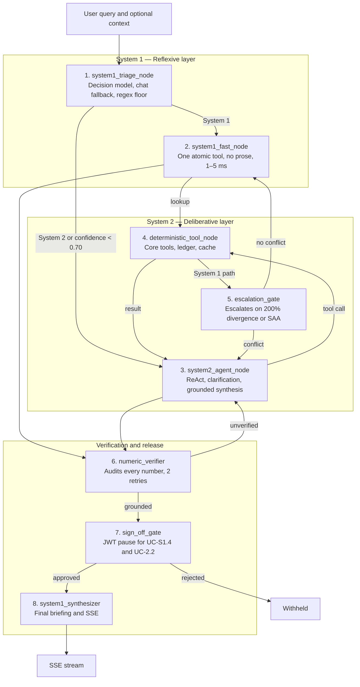

::: {.front-matter}
# FLARE-CHRONOS

**NASA Space Apps Challenge 2026 — Engineering and Model Report**

Codebase architecture, harmonization physics, empirical validation and the dual-system cognitive harness.

Challenge: Harmonization of MODIS and VIIRS Hot Spots

**Document Version:** 2.0.0 · English · 186 offline tests + 6 live tests across 23 files
:::

---

## 1. Summary

FLARE-CHRONOS is a Python and TypeScript monorepo. A pure physics core computes all harmonization steps without network or disk access. An ingestion adapter reads NASA FIRMS CSV slices. A benchmark application runs the empirical pipeline and renders the figures. A FastAPI service hosts the dual-system cognitive harness. A Next.js workbench presents the results.

The repository commits 134 non-empty NASA FIRMS CSV slices with 1,609,182 detections, pinned by SHA-256 digests and a fetch manifest. The five-day peak windows used for the case studies contain 451,488 detections. The full pipeline and the test suite run offline after a clone.

The empirical result is stable. The calibration reduces the Kolmogorov-Smirnov distance from 0.1153 to 0.0353, a 69.4 percent reduction, and raises the log-FRP coefficient of determination from 0.7839 to 0.8048. The harmonized Mekong index for 2024 is 90.5 against a 2005 baseline of 100.0, so the artificial 1,311.2 percent step jump is removed while the El Niño peaks remain.

---

## 2. Five Discontinuities and Their Modules

| # | Discontinuity | Physical mechanism | Module and function |
| :---: | :--- | :--- | :--- |
| 1 | Bow-tie footprint growth | A MODIS pixel grows 9.69× from 1.0000 km² at nadir to 9.6875 km² at 55°. It is 74.23 times larger than a VIIRS nadir pixel at 0.1305 km². The empirical FIRMS mean is 2.17 km² for MODIS and 0.22 km² for VIIRS, a 9.86× ratio. | `geometry_h3.py`: `invert_modis_scan_angle`, `viirs_dimensions_from_scan_angle`, `allocate_footprint_to_h3` |
| 2 | Radiometric detection-limit blindness | The MODIS daytime limit reaches 41.20 MW at the scan edge. The VIIRS limit is 3.40 MW, a 12.12× gap. | `radiometric_calibrator.py`: `compute_frp_detection_limit`, `fit_coincident_aqua_snpp_model` |
| 3 | Afternoon overpass double-counting | Aqua, Suomi-NPP, NOAA-20 and NOAA-21 cross the same fire within 25 to 95 minutes at 13:30 and 01:30 MLT. | `deduplication.py`: `cluster_fire_episodes`, `compute_effective_observation_effort` |
| 4 | Day and night flag drift | Twilight detections near 85° solar zenith angle carry inconsistent flags between the near-real-time and Standard streams. | `solar_sza.py`: `compute_solar_zenith_angle`, `harmonize_daynight_flag` |
| 5 | South Atlantic Anomaly and static heat | Cosmic-ray proton strikes contaminate 4.63 percent of nighttime Suomi-NPP detections over South America. | `confidence_filter.py`: `is_in_south_atlantic_anomaly`, `compute_unified_detection_probability` |

---

## 3. Architecture

The monorepo has five parts. The dependency rule is one way: applications depend on packages, packages do not depend on applications, and the physics core depends on neither network nor disk.

| Component | Responsibility | Evidence |
| :--- | :--- | :--- |
| `packages/harmonization-core` | Pure physics and statistics: schemas, solar angle, confidence, geometry, radiometry, deduplication, calendar. | Zero network and disk imports; 58 core tests. |
| `packages/firms-ingestion` | Rate-limited NASA LANCE FIRMS client and schema-normalizing CSV loader. | SHA-256 archive guard; 134 slices verified. |
| `apps/benchmark-cli` | Empirical runner, sensitivity analysis and 300-DPI figure renderer. | Produces `empirical_results.json`, `burning_calendar.json` and figures 1 to 5. |
| `apps/ai-service` | FastAPI service, 8-node LangGraph harness, verified facts ledger, review store. | 15 use cases, 18 registered tools, JWT sign-off. |
| `apps/workbench` | Next.js 16 analyst surface: globe, equal-area map, H3 bins, calendar, review queue. | Routes `/`, `/workbench/[zone]`, `/review`, `/review/audit`, `/about`, `/faq`. |

---

## 4. Physics Core

The core has seven modules. `domain.py` holds immutable dataclasses for detections, footprints, episodes and calendar cells. `solar_sza.py` computes the solar zenith angle and the unified day-night flag. `confidence_filter.py` maps MODIS numeric confidence and VIIRS categorical confidence onto one probability, and removes static sources and South Atlantic Anomaly spikes. `geometry_h3.py` inverts the scan angle, models the VIIRS three-zone aggregation, rotates the footprint by the orbital track azimuth and allocates it to H3 Resolution 7 and 8 cells. `radiometric_calibrator.py` fits and applies the two-stage transfer. `deduplication.py` clusters episodes and computes observation effort. `calendar_engine.py` builds the 26-year, 73-pentad matrix and the SFAI tiers.

The footprint allocation uses 13 quadrature points per ellipse. The weights sum to 1.0000, so no radiative energy is created or lost. The scan inversion uses bisection to a tolerance below 10⁻⁹ radians. The H3 resolutions are 5.161 km² at Resolution 7 and 0.737 km² at Resolution 8.

The solar angle is computed from the UTC timestamp and the pixel coordinates, not from a lookup table. The 85° boundary is applied to both streams, so a twilight detection cannot be daytime in one stream and nighttime in the other. The South Atlantic Anomaly filter uses a geographic mask and the nighttime flag; the static-source registry uses a 12-pentad, 750 m rule.

The calibration is stratified by day-night regime. It first applies the power law with the scan-angle correction, then matches the residual distribution with empirical quantile mapping. The parameters are α = 1.7397, β = 0.9221 and κ = 0.1000. The fit uses 20,786 co-incident Aqua and Suomi-NPP cells.

---

## 5. Empirical Validation

| Study | Result |
| :--- | :--- |
| Mekong subregion, 2001–2026 | Raw counts rise from 3,914 in 2005 to 55,235 in 2024, an index of 1,411.2 and a 1,311.2 percent jump. Harmonization gives 8,150.0 VIIRS-equivalent episodes and an index of 90.5, which is 9.5 percent below 2005. The 2007 peak is 271.5, the 2010 peak is 184.9, and the 2016 peak is 133.0. |
| Southern Amazon basin, 2001–2026 | The 2024 window has 112,405 raw detections and 19,542 episodes, a 5.75× compression. The effort factor is 2.6716 and the harmonized index is 37.7 against a raw index of 814.3. The 2002 drought peak is 148.3, with an observed SFAI of +3.8σ in pentad 47. |
| Co-incident Aqua and Suomi-NPP calibration | 20,786 pairs. The Kolmogorov-Smirnov distance falls from 0.1153 to 0.0353, a 69.4 percent reduction. The coefficient of determination rises from 0.7839 to 0.8048. The cell error falls from 141.09 to 134.08 MW per cell. |

The 26-year calendar has 25 Measured Epochs from 2001 to 2025 and one Interpolated Year, 2026. Only Measured Epochs feed the SFAI baseline. A 2026 cell is marked as an Interpolated Year and receives no anomaly tier.


---

## 6. Dual-System Cognitive Harness

### 6.1 Six invariants

1. The language model never computes a physical, geometric, radiometric or statistical number. Every value comes from a deterministic tool.
2. System 1 classifies the request into one of five reflexive use cases and executes one atomic tool without prose generation.
3. System 2 uses a ReAct planner over the full 18-tool surface for the ten deliberative use cases, or when System 1 confidence is below 0.70.
4. Every scalar enters the VerifiedFactsLedger with a fact identifier, tool name, path, value, unit and provenance tag. The model writes `{{cite:FACT_ID}}` placeholders.
5. The NumericGroundingVerifier rejects any draft with an unverified number and permits at most two corrections before the deterministic fallback.
6. Any use case that authorizes an operational action pauses at the sign-off gate. Only a bearer JWT principal can approve or reject the briefing, and the decision is written to an append-only SQLite audit table.

### 6.2 The 8-node graph



The graph has eight nodes because the code registers eight nodes. Clarification and grounded synthesis run inside the System 2 agent. The numeric verifier, the sign-off gate and the System 1 synthesizer are separate nodes.

### 6.3 Fifteen use cases

System 1 use cases:

| ID | Analysis | Primary tool | Sign-off |
| :--- | :--- | :--- | :---: |
| `UC-S1.1` | Intent triage and single-epoch lookup | `tool_lookup_single_epoch_metrics` | No |
| `UC-S1.2` | Spatio-temporal entity extraction | `tool_lookup_single_epoch_metrics` | No |
| `UC-S1.3` | Single-hop historical epoch lookup | `tool_lookup_single_epoch_metrics` | No |
| `UC-S1.4` | Flash near-real-time crisis alert | `tool_emit_flash_nrt_alert` | Yes |
| `UC-S1.5` | Stakeholder briefing card | `tool_assemble_stakeholder_briefing_card` | No |

System 2 use cases:

| ID | Analysis | Primary tool | Sign-off |
| :--- | :--- | :--- | :---: |
| `UC-1.1` | 2024 multi-sensor regime-shift attribution | `tool_uc1_1_regime_shift_attribution` | No |
| `UC-1.2` | Cross-sensor scan-angle discrepancy forensics | `tool_uc1_2_cross_sensor_discrepancy_forensics` | No |
| `UC-1.3` | Thermal source origin and SAA noise classification | `tool_uc1_3_thermal_source_origin_classification` | No |
| `UC-2.1` | Phenological phase shift and SFAI detection | `tool_uc2_1_phenological_phase_shift_detection` | No |
| `UC-2.2` | Uncertainty-aware tactical field dispatch | `tool_uc2_2_uncertainty_aware_tactical_dispatch` | Yes |
| `UC-2.3` | Verified multi-stakeholder policy briefing | `tool_assemble_stakeholder_briefing_card` | No |
| `UC-3.1` | 2026+ constellation retirement simulation | `tool_uc3_1_constellation_retirement_simulation` | No |
| `UC-3.3` | Biome-specific radiometric recalibration | `tool_uc3_3_autonomous_biome_recalibration` | No |
| `UC-4.1` | Orbital drift and solar zenith angle audit | `tool_uc4_1_orbital_drift_and_sza_audit` | No |
| `UC-4.2` | Near-real-time against Standard fidelity audit | `tool_uc4_2_nrt_vs_sp_fidelity_audit` | No |

The harness config sets sign-off for `UC-S1.4` and `UC-2.2`. `UC-2.3` is a read-only briefing and does not pause.

### 6.4 Eighteen registered tools

The registry has 18 model-facing tools: 9 atomic and 9 domain diagnostic. The atomic tier contains the footprint, solar angle, probability, calibration, deduplication, epoch lookup, phenology, flash alert and briefing card tools. The diagnostic tier contains the ten use-case analyzers listed above, minus the briefing card, which is atomic. A nineteenth tool, `tool_harmonize_real_firms_csv_slice`, stays outside the model registry so the model never reads raw CSV rows.

### 6.5 Benchmark

Both artifacts are committed under `data/processed/` and verified by `tests/test_ai_service_harness.py`.

| Metric | Deterministic | Live hosted model |
| :--- | :---: | :---: |
| Use cases completed | 15 / 15 | 15 / 15 |
| Schema and invariant pass rate | 15 / 15 | 15 / 15 |
| Unverified numeric claims released | 0 | 0 |
| Unresolved citation placeholders | 0 | 0 |
| System 1 mean duration | 2.00 ms | 1,178.0 ms |
| System 2 mean duration | below 5 ms | 8,398.0 ms |
| Triage confidence source | calibrated | self-reported via hosted fallback |
| Classifier fallbacks | 0 | 15 / 15 from the unreachable local endpoint |
| Total tokens | 0 | 67,970, of which 57,761 prompt and 10,209 completion |

The live run used the configured hosted chat model (`beam`). The local decision endpoint at `127.0.0.1:11434` was unreachable and returned a connection refusal. Every run recorded the fallback and marked the confidence as self-reported.

### 6.6 Reproduction

```bash
# Offline suite: 186 tests, no network
uv run python -m pytest -q

# Live vertical slices: 6 tests
uv run python -m pytest -m live -q

# Analysis service on 5901
AI_SERVICE_AUTH=disabled uv run python -m ai_service.serve

# Workbench on 5900
cd apps/workbench && bun run dev
```

---

## 7. Workbench

The workbench is a Next.js 16 and React 19 application. The main route is `/`, with the globe, the equal-area map, the H3 bins, the 26 × 73 pentad calendar and the live briefing rail. `/workbench/[zone]` opens the regional analysis for Mekong or Amazon. `/review` lists the runs that await sign-off, `/review/audit` shows the append-only history, and `/review/runs/[runId]` shows one run. `/about` documents the method and the evidence, and `/faq` answers data questions.


The workbench reads the analysis service at port 5901. It never shows replayed or placeholder results. The review queue reads persisted runs and submits an identity-bound decision to the resume endpoint.

---

## 8. Test Suite

| Category | Files | Tests | Scope |
| :--- | :---: | :---: | :--- |
| Physics and harmonization core | 12 | 58 | Scan geometry, H3 energy conservation, solar angle, SAA filter, calibration, clustering, SFAI |
| Archive, calendar and claims | 5 | 38 | SHA-256 of 134 slices, measured epoch provenance, figure parity, document claims |
| AI harness and classifiers | 3 | 50 | 8-node routing, 15 use cases, 18 tools, ledger, verifier, fallback chain |
| API, JWT and review store | 2 | 40 | Bearer auth, sign-off, audit triggers, SSE framing, review projection |
| Live vertical slices | 1 | 6 | Live classification, multi-tool deliberation, escalation, CSV harmonization |
| Total | 23 | 192 | 186 offline and 6 live tests |

---

## 9. Data and Reproducibility

The archive is pinned by `data/raw/SHA256SUMS` and `data/raw/fetch_manifest.json`. `tests/test_raw_data_integrity.py` verifies every digest on every run. The empirical runner writes `data/processed/empirical_results.json` and `data/processed/burning_calendar.json`; the figure renderer reads only those two files.

Repository: https://github.com/the-aris-club/flare-chronos
