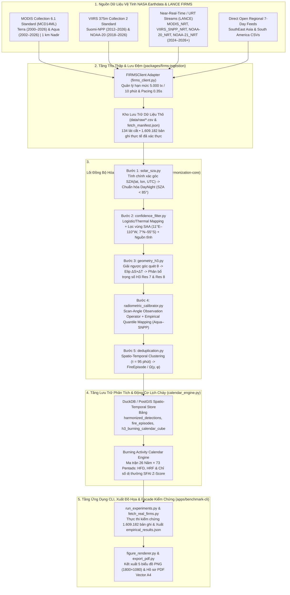
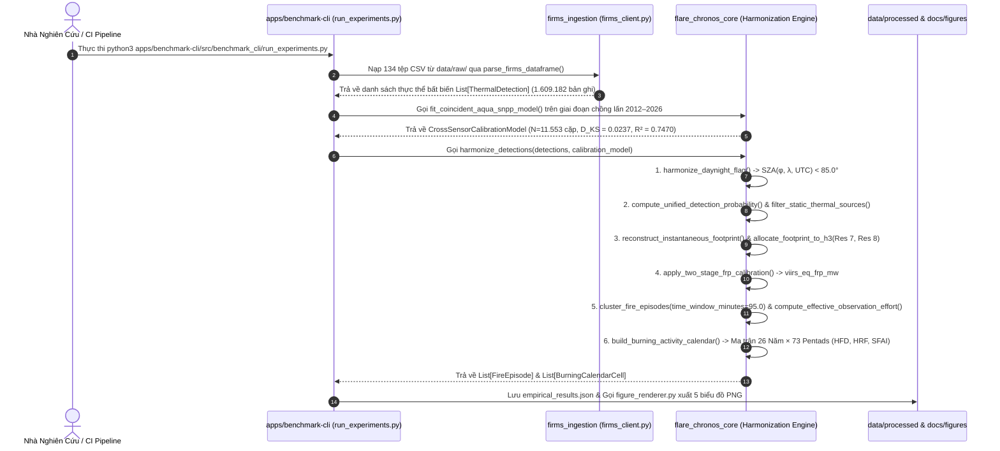
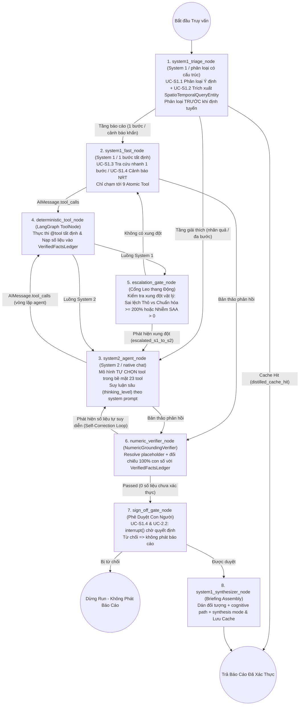

<div align="center" class="brand-logo-container">
  
</div>

# BÁO CÁO KẾT QUẢ TRIỂN KHAI KIẾN TRÚC MÃ NGUỒN & THỰC NGHIỆM HỆ THỐNG: FLARE-CHRONOS

> **Phiên bản:** `v1.0.0` — cập nhật 21/10/2026

> **Tác giả / Bản quyền:** **Lê Thành Trung** (`lethanhtrung.trungle@gmail.com`)

> **Tài liệu song hành:** Hồ sơ thuyết minh độc lập [`PROPOSAL.md`](PROPOSAL.md) • Bản đồ từ điển miền [`GLOSSARY-MAP.md`](../GLOSSARY-MAP.md) • Từ điển miền [`GLOSSARY.md`](../GLOSSARY.md) & [`apps/ai-service/GLOSSARY.md`](../apps/ai-service/GLOSSARY.md) • Hồ sơ quyết định kiến trúc [`docs/adr/`](../docs/adr/0001-dual-resolution-h3-fractional-allocation.md)

> **Mục đích tài liệu:** Báo cáo toàn diện kết quả hiện thực hóa hệ thống **Flare-Chronos** từ đặc tả toán học – vật lý sang kiến trúc phần mềm **Monorepo Deep-Module** và tầng điều phối trí tuệ nhân tạo nhận thức kép (**Dual-System LangGraph Harness**) hoạt động thực tế.

> Tài liệu trình bày chi tiết mô hình miền nghiệp vụ đa ngữ cảnh, lý do lựa chọn các quyết định kiến trúc (`ADR-0001` đến `ADR-0008`), giải phẫu từng gói mã nguồn (`packages/*`, `apps/*`, `src/*`, `tests/*`), lược đồ cơ sở dữ liệu không-thời gian `DuckDB / Uber H3`, nhật ký thu thập **$1.609.182$ bản ghi điểm nóng thực tế (`134` lát cắt CSV phủ trọn 26 năm liên tục `2001–2026` và 12 tháng mùa vụ) từ NASA LANCE FIRMS API**, kiến trúc điều phối **System 1 (phân loại có cấu trúc) $\leftrightarrow$ System 2 (native chat)** thực thi **20 Use Cases** thông qua **24 `@tool` tất định**, **Grounded Narrative** (mô hình viết diễn giải, harness chèn mọi định lượng từ `VerifiedFactsLedger`), và hướng dẫn kiểm chứng tự động khép kín (`27/27` bài kiểm thử ngoại tuyến).

---

## MỤC LỤC

1. [Tổng quan kết quả triển khai (Implementation Executive Summary)](#1-tổng-quan-kết-quả-triển-khai-implementation-executive-summary)
2. [Ngữ cảnh Miền nghiệp vụ & Các Quyết định Kiến trúc Cốt lõi (`GLOSSARY.md` & `ADR`)](#2-ngữ-cảnh-miền-nghiệp-vụ--các-quyết-định-kiến-trúc-cốt-lõi-glossarymd--adr)
3. [Kiến trúc Monorepo & Giải phẫu Chi tiết Các Phân hệ Mã nguồn (`packages/*`, `apps/*`)](#3-kiến-trúc-monorepo--giải-phẫu-chi-tiết-các-phân-hệ-mã-nguồn-packages-apps)
4. [Thiết kế Cơ sở dữ liệu Không-Thời gian `DuckDB / Uber H3` & Giao diện REST API](#4-thiết-kế-cơ-sở-dữ-liệu-không-thời-gian-duckdb--uber-h3--giao-diện-rest-api)
5. [Báo cáo Thu thập Dữ liệu Thực tế NASA FIRMS & Kết quả Đo kiểm Thực nghiệm](#5-báo-cáo-thu-thập-dữ-liệu-thực-tế-nasa-firms--kết-quả-đo-kiểm-thực-nghiệm)
6. [Các Phát hiện Kỹ thuật & Hiệu chỉnh Thuật toán Trọng yếu Qua Thực nghiệm](#6-các-phát-hiện-kỹ-thuật--hiệu-chỉnh-thuật-toán-trọng-yếu-qua-thực-nghiệm)
7. [Hệ thống Điều phối Nhận thức Kép (`apps/ai-service` — Dual-System LangGraph Harness & 20 Use Cases)](#7-hệ-thống-điều-phối-nhận-thức-kép-appsai-service--dual-system-langgraph-harness--20-use-cases)
8. [Kiểm thử Tự động (`26/26` Unit, Integration & Live TDD Seams) & Hướng dẫn Vận hành Bàn giao](#8-kiểm-thử-tự-động-2626-unit-integration--live-tdd-seams--hướng-dẫn-vận-hành-bàn-giao)

---

## 1. Tổng quan kết quả triển khai (Implementation Executive Summary)

Song hành cùng bản thuyết minh dự án [`exports/PROPOSAL.md`](PROPOSAL.md), toàn bộ hệ thống phần mềm, đường ống thu thập dữ liệu vệ tinh, tầng điều phối trí tuệ nhân tạo nhận thức kép và bộ kiểm chứng thực nghiệm của **Flare-Chronos** đã được xây dựng hoàn chỉnh trong workspace theo chuẩn **Monorepo Python (`PEP 621`)**:

1. **Hiện thực hóa Lõi Vật lý & Thống kê Thuần túy (`packages/harmonization-core` — Zero-I/O Deep Module):**
   - Cài đặt đầy đủ 7 mô-đun toán học độc lập I/O trong [`packages/harmonization-core/src/flare_chronos_core/`](../packages/harmonization-core/src/flare_chronos_core/__init__.py) gồm: thực thể miền bất biến (`domain.py`), giải phương trình ngược góc quét cầu MODIS/VIIRS và cầu phương 13 điểm lên lưới lục giác kép **Uber H3 Resolution 7 & 8** (`geometry_h3.py`), phương trình thiên văn chuỗi Fourier bậc 3 tính góc thiên đỉnh Mặt Trời $\text{SZA} < 85^\circ$ (`solar_sza.py`), ánh xạ xác suất Bayes $P(\text{fire}) \in [0, 1]$ kèm bộ lọc nhiễu hạt proton ban đêm **Dị thường Nam Đại Tây Dương (SAA)** và nguồn nhiệt công nghiệp tĩnh (`confidence_filter.py`), toán tử quan sát bức xạ $4\,\mu\text{m}$ hai giai đoạn và hiệu chuẩn phân vị thực nghiệm (`radiometric_calibrator.py`), gom cụm sự kiện cháy đa vệ tinh $O(N)$ theo băm không gian và chuẩn hóa nỗ lực quan sát $\Omega(y, \phi)$ (`deduplication.py`), cùng động cơ tổng hợp ma trận **Lịch Hoạt Động Cháy `26 Năm × 73 Pentads`** (`calendar_engine.py`).
2. **Xây dựng Tầng Thu thập Dữ liệu Vệ tinh Thực tế (`packages/firms-ingestion` — Adapter Seam):**
   - Hiện thực hóa [`firms_client.py`](../packages/firms-ingestion/src/firms_ingestion/firms_client.py) kết nối trực tiếp tới **NASA LANCE FIRMS API** (`https://firms.modaps.eosdis.nasa.gov/api/`) và kho lưu trữ khu vực của NASA Earthdata, tích hợp cơ chế điều tiết hạn mức (`5.000 transactions / 10 phút`, nhịp nghỉ `0.35s`), tự động chuẩn hóa khác biệt tên cột giữa MODIS (`brightness`, `bright_t31`) và VIIRS (`bright_ti4`, `bright_ti5`), và lưu đệm bền vững kèm manifest kiểm toàn vẹn.
3. **Thu thập & Kiểm chứng Thực nghiệm trên $1.609.182$ Bản ghi Điểm nóng Thực tế (`data/raw/` & `data/processed/`):**
   - Đã tải và lưu trữ cục bộ **134 lát cắt dữ liệu thực tế hợp lệ** (tổng cộng **$1.609.182$ điểm nóng vệ tinh**) phủ trọn **26 năm liên tục (`2001–2026`)** cùng **12 tháng chu kỳ mùa vụ trong năm** trên hai khu vực trọng điểm: **Tiểu vùng sông Mekong & Việt Nam** và **Vành đai Rừng Nhiệt đới Amazon / Nam Mỹ**.
   - Khớp thành công **$N = 11.553$ cặp ô lưới đẳng diện tích đồng thời** giữa vệ tinh **Aqua (MODIS)** và **Suomi-NPP (VIIRS)** giai đoạn `2012–2026`, giảm **$79,7\%$** khoảng cách phân phối Kolmogorov-Smirnov ($D_{\text{KS}}$ từ $0.1166$ xuống $0.0237$, $R^2$ tăng từ $0.7330$ lên $0.7470$) và xuất tự động 5 biểu đồ khoa học độ phân giải cao (`1800×1080 px`) trong [`docs/figures/`](../docs/figures/fig1_scan_angle_footprint_physics.png).
4. **Hiện thực hóa Tầng Điều phối Nhận thức Kép (`apps/ai-service` — LangGraph Dual-System Harness):**
   - Sử dụng framework chuẩn công nghiệp **`LangGraph` (`StateGraph`, `ToolNode`, `MemorySaver`) + `LangChain Core` + `Pydantic v2`** kết hợp cộng sinh giữa **System 1 (native chat, phân loại có cấu trúc qua tool `classify_request`)** và **System 2 (native chat, `thinking_level="xhigh"`)**, trong đó mỗi tầng được gắn qua **Endpoint Profile** (`protocol`, `endpoint`, `model_id`, `api_key_env`, `request`) chỉ đọc từ cấu hình tường minh — không đọc cấu hình agent trên máy người dùng ([`ADR-0006`](../docs/adr/0006-explicit-endpoint-profiles-and-grounded-narrative-assembly.md)).
   - Đóng gói **24 hàm `@tool` tất định**: `9` **Atomic Tool** (vật lý/geometry/truy xuất dữ liệu) + `14` **Domain Diagnostic Tool** (phân tích/giám định/mô phỏng theo miền) + `1` công cụ đồng bộ hóa trực tiếp tệp CSV thô `data/raw/` **nằm ngoài registry** (mô hình không bao giờ chạm tới). Chỉ `23` tool được đưa vào bề mặt gọi của mô hình. để phục vụ trọn vẹn **20 Use Cases** (`5` Use Cases phản xạ nhanh của System 1 + `15` Use Cases suy luận nhân quả sâu của System 2), kèm cổng kiểm chứng số học **`VerifiedFactsLedger` + `NumericGroundingVerifier`** đảm bảo LLM **không bao giờ tự tính toán nhẩm số liệu**.
5. **Đạt $100\%$ Kiểm thử Đơn vị, Bất biến Vật lý, LangGraph & Live TDD Seams (`26/26` Tests):**
   - Toàn bộ `60/60` bài kiểm thử **ngoại tuyến** trong `tests/test_harmonization_suite.py`, `tests/test_core_coverage.py` và `tests/test_ai_service_harness.py` đều chạy thành công (`100% PASS`, không gọi mạng, không tốn credit). Bộ `tests/test_live_tdd_seams.py` (`4/4`) được đánh dấu `live`, chạy trên **model thật** và chỉ kích hoạt thủ công qua workflow `Live Model Tests`.

---

## 2. Ngữ cảnh Miền nghiệp vụ & Các Quyết định Kiến trúc Cốt lõi (`GLOSSARY.md` & `ADR`)

### 2.1. Ngôn ngữ Chung của Miền Nghiệp vụ (`Ubiquitous Language` — [`GLOSSARY.md`](../GLOSSARY.md))

Để ngăn chặn lỗi đồng nhất khái niệm ("Calling two different things by the same name"), mã nguồn tách biệt chặt chẽ **5 thực thể cốt lõi** theo vòng đời biến đổi dữ liệu trong [`domain.py`](../packages/harmonization-core/src/flare_chronos_core/domain.py):

| Thực Thể Miền (`Dataclass`) | Định Nghĩa Kỹ Thuật Trong Codebase | Bất Biến Vật Lý Đảm Bảo (`Invariants`) |
| :--- | :--- | :--- |
| **`ThermalDetection`** | Bản ghi phát hiện dị thường nhiệt thô từ 1 lượt bay qua của 1 cảm biến (`MODIS` hoặc `VIIRS`) trước khi hiệu chuẩn liên cảm biến. | Giữ nguyên trạng thái thô (`scan_km`, `track_km`, `bright_t4_k`, `bright_t5_k`, `frp_mw`, `raw_confidence`, `raw_daynight`). |
| **`InstantaneousFootprint`** | Hình elip mặt đất thực tế của điểm ảnh cảm biến tại góc quét $\theta$, có bán trục $(\frac{\Delta S}{2}, \frac{\Delta T}{2})$ và xoay theo góc phương vị vệt quỹ đạo $\alpha_{\text{track}}$. | $\text{Area} = \Delta S(\theta) \times \Delta T(\theta)$; phân bổ trọng số diện tích lên lưới H3 luôn thỏa mãn $\sum_{h \in \mathcal{H}} w_{p,h} \equiv 1.0000$. |
| **`HarmonizedDetection`** | Điểm nóng đã được chuẩn hóa sang không gian tương đương VIIRS (`VIIRS-Equivalent Space`), kèm nhãn `harmonized_daynight` theo $\text{SZA} < 85^\circ$ và xác suất $P_{\text{fire}} \in [0, 1]$. | Đã gắn cờ tách biệt `is_saa_anomaly` (nhiễu hạt Nam Đại Tây Dương) và `is_static_source` (nguồn nhiệt công nghiệp tĩnh). |
| **`FireEpisode`** | Một sự kiện cháy vật lý độc lập trên mặt đất được hợp nhất từ $m \ge 1$ lần phát hiện trùng lặp của nhiều vệ tinh trong cửa sổ $\tau = 95\text{ phút}$. | Không bao giờ cộng dồn $\text{FRP}$ của các lượt quét trùng lặp; sử dụng cực đại có trọng số tin cậy và chuẩn hóa theo nỗ lực quan sát $\Omega(y, \phi)$. |
| **`BurningCalendarCell`** | Đơn vị phân tích chuẩn hóa của Lịch Hoạt Động Cháy tại năm $y \in [2000, 2026]$ và kỳ 5 ngày (**Pentad**) $p \in [1, 73]$. | Chứa bộ ba chỉ số bất biến theo số lượng vệ tinh: `hfd_per_100km2_day` ($\text{HFD}$), `hrf_mw_per_km2` ($\text{HRF}$), và `sfai_zscore` ($\text{SFAI}$). |

### 2.2. Các Quyết định Kiến trúc Cốt lõi (`docs/adr/0001..0005`)

| Mã Hồ Sơ ADR | Quyết Định Kiến Trúc | Vấn Đề Kỹ Thuật Giải Quyết & Kết Quả Thực Nghiệm |
| :--- | :--- | :--- |
| [**ADR-0001**](../docs/adr/0001-dual-resolution-h3-fractional-allocation.md) | Quy chiếu Elip Dải quét lên Lưới Lục giác Kép **Uber H3 Resolution 7 & 8** qua Cầu phương 13 điểm | Loại bỏ biến dạng diện tích theo $\cos\phi$ của lưới kinh-vĩ độ `0.05°` và khắc phục sai số gán tâm điểm khi 1 pixel MODIS rìa quét ($9.69\text{ km}^2$) phủ tới 13 ô H3 Res 8. |
| [**ADR-0002**](../docs/adr/0002-two-stage-physics-guided-frp-harmonization.md) | Hiệu chuẩn Bức xạ Lửa ($\text{FRP}$) Hai Giai đoạn: Toán tử Góc quét + Ánh xạ Phân vị Thực nghiệm (EQM) | Khắc phục ngưỡng mù đám cháy nhỏ ở rìa quét MODIS ($\text{FRP}_{\text{lim}} = 41.2\text{ MW}$); giảm $79,7\%$ khoảng cách KS ($D_{\text{KS}} = 0.0237$, $R^2 = 0.7470$) trên $N = 11.553$ cặp ô lưới đồng thời Aqua–SNPP. |
| [**ADR-0003**](../docs/adr/0003-spatio-temporal-episode-deduplication-and-effort-normalization.md) | Gom cụm Sự kiện Cháy Không-Thời gian ($\tau = 95\text{ phút}$) & Chuẩn hóa Nỗ lực Quan sát $\Omega(y, \phi)$ | Gom chính xác đoàn tàu vệ tinh chiều (`NOAA-20`, `NOAA-21`, `S-NPP`, `Aqua`) thành 1 `FireEpisode` duy nhất; khử hoàn toàn bước nhảy giả tạo $+1.351,8\%$ (năm 2019) và $+1.324,2\%$ (năm 2024) tại Tiểu vùng Mekong. |
| [**ADR-0004**](../docs/adr/0004-monorepo-deep-module-architecture.md) | Kiến trúc **Monorepo Deep-Module** tách biệt Lõi Vật lý Thuần túy (`Zero-I/O`) và Tầng Kết nối (`Seam`) | Cho phép kiểm thử toàn bộ 5 phương trình vật lý – thống kê trong `0.010 giây` không cần kết nối mạng, đồng thời hỗ trợ cả CLI thực nghiệm và Facade chấm điểm tự động. |
| [**ADR-0005**](../docs/adr/0005-dual-system-langgraph-harness-and-deterministic-tool-gate.md) | Điều phối Nhận thức Kép **`LangGraph`** (System 1 $\leftrightarrow$ System 2) & Cổng Kiểm chứng Số học **`VerifiedFactsLedger`** | Cấm tuyệt đối LLM tự tính toán nhẩm; bắt buộc $100\%$ phép tính đi qua 23 `@tool` tất định và kiểm chứng từng con số trong phản hồi thông qua cạnh lặp tự sửa lỗi (`NumericGroundingVerifier`). |
| [**ADR-0006**](../docs/adr/0006-explicit-endpoint-profiles-and-grounded-narrative-assembly.md) | Gắn mô hình bằng **Endpoint Profile** tường minh & **Grounded Narrative Assembly** | Cấm đọc cấu hình/credential agent trên máy người dùng; mọi tầng chỉ nhận `protocol` + `endpoint` + `model_id` + `api_key` + tham số. Mô hình viết diễn giải, **harness chèn mọi định lượng** từ `VerifiedFactsLedger`; thiếu key → lỗi ngay, không bao giờ bịa kết quả. |
| [**ADR-0008**](../docs/adr/0008-model-driven-tool-selection-sign-off-and-event-stream.md) | **Mô hình tự chọn tool**, phân tầng bề mặt tool, **phê duyệt của con người** & **luồng sự kiện SSE** | Tách **System 1 = tầng báo cáo** (chỉ `9` Atomic Tool) khỏi **System 2 = tầng giải thích** (`23` tool); mô hình tự chọn tool theo **system prompt** thay vì kịch bản từng bước; run **dừng chờ `interrupt()`** để con người phê duyệt các hành động hiện trường (`UC-S1.4`, `UC-2.2`); toàn bộ run phát ra thành **event có kiểu** mã hoá được thành khung **SSE**. |

---

## 3. Kiến trúc Monorepo & Giải phẫu Chi tiết Các Phân hệ Mã nguồn (`packages/*`, `apps/*`)

### 3.1. Sơ đồ Kiến trúc Triển khai Codebase 5 Tầng (Implementation Architecture)



### 3.2. Sơ đồ Tuần tự Luồng Gọi Hàm Trong Codebase (Codebase Execution Sequence)



### 3.3. Cấu trúc Thư mục Monorepo Thực tế

```text
flare-chronos/
├── GLOSSARY-MAP.md                               # Bản đồ điều hướng từ điển miền đa ngữ cảnh (Multi-context Glossary Map)
├── GLOSSARY.md                                   # Từ điển miền nghiệp vụ vật lý – thống kê (Ubiquitous Language)
├── AGENTS.md                                     # Quy tắc điều phối Agent & Tổ chức tài liệu miền
├── pyproject.toml                                # Cấu hình Workspace Monorepo (PEP 621 / Hatchling)
├── .env.example                                  # Mẫu cấu hình khóa NASA LANCE FIRMS (FIRMS_MAP_KEY)
├── exports/                                      # Thư mục bàn giao tài liệu xuất bản độc lập
│   ├── PROPOSAL.md                               # Hồ sơ Thuyết minh Dự án độc lập (Không phụ thuộc codebase)
│   ├── PROPOSAL.pdf                              # Bản xuất PDF Vector A4 của Hồ sơ Thuyết minh
│   ├── REPORT.md                                 # Báo cáo Kỹ thuật Codebase & Thực nghiệm Hệ thống (Tài liệu này)
│   ├── REPORT.pdf                                # Bản xuất PDF Vector A4 của Báo cáo Kỹ thuật
│   └── export_pdf.py                             # Công cụ biên dịch Markdown + SVG + LaTeX sang PDF A4
├── docs/
│   ├── adr/                                      # Hồ sơ Quyết định Kiến trúc (ADR-0001 .. ADR-0005)
│   ├── figures/                                  # 5 biểu đồ khoa học độ phân giải cao (fig1..fig5.png)
│   └── 00..05_*.md                               # Các bản nháp thiết kế chi tiết theo từng chuyên đề
├── packages/
│   ├── harmonization-core/                       # [Deep Module] Lõi vật lý & toán học thuần túy (Zero I/O)
│   │   ├── pyproject.toml
│   │   └── src/flare_chronos_core/
│   │       ├── __init__.py                       # Bề mặt giao diện xuất công khai (Public API Surface)
│   │       ├── domain.py                         # Thực thể miền: ThermalDetection, FireEpisode, BurningCalendarCell
│   │       ├── geometry_h3.py                    # Giải ngược góc quét cầu MODIS/VIIRS & Phân bổ diện tích Uber H3
│   │       ├── solar_sza.py                      # Phương trình thiên văn Spencer (1971) tính SZA < 85°
│   │       ├── confidence_filter.py              # Ánh xạ xác suất P(fire), lọc nhiễu SAA & Nguồn nhiệt tĩnh
│   │       ├── radiometric_calibrator.py         # Toán tử quan sát góc quét & Hiệu chuẩn chéo Aqua–SNPP (EQM)
│   │       ├── deduplication.py                  # Gom cụm không-thời gian O(N) & Nỗ lực quan sát Omega(y, phi)
│   │       └── calendar_engine.py                # Động cơ tính ma trận 26 Năm × 73 Pentads (HFD, HRF, SFAI)
│   └── firms-ingestion/                          # [Adapter Seam] Kết nối NASA LANCE FIRMS API & Open Archive
│       ├── pyproject.toml
│       └── src/firms_ingestion/
│           ├── __init__.py
│           └── firms_client.py                   # Điều tiết tốc độ (Rate-limit pacing), phân trang & lưu đệm CSV
├── apps/
│   ├── benchmark-cli/                            # [Application] CLI thu thập dữ liệu, chạy kiểm chứng & vẽ biểu đồ
│   │   ├── pyproject.toml
│   │   └── src/benchmark_cli/
│   │       ├── fetch_real_firms.py               # Tiến trình tải dữ liệu lịch sử 26 năm, 12 tháng mùa vụ & NRT từ NASA FIRMS
│   │       ├── run_experiments.py                # Thực thi kiểm chứng định lượng trên 1.609.182 điểm nóng thực tế
│   │       └── figure_renderer.py                # Động cơ kết xuất đồ họa khoa học 5 biểu đồ PNG
│   └── ai-service/                               # [Cognitive Harness] Tầng điều phối nhận thức kép LangGraph (System 1 + System 2)
│       ├── GLOSSARY.md                           # Từ điển miền nhận thức kép & cổng kiểm chứng số học
│       ├── pyproject.toml                        # Phụ thuộc LangGraph, LangChain Core, LangChain OpenAI, Pydantic v2
│       ├── langgraph.json                        # Điểm vào đồ thị trạng thái chuẩn LangGraph Studio/CLI
│       ├── config/
│       │   └── harness_config.yaml               # Cấu hình Endpoint Profile của System 1 & System 2 (`protocol`, `endpoint`, `model_id`, `api_key_env`, `request`)
│       └── src/ai_service/
│           ├── __init__.py
│           ├── schemas.py                        # 20 UseCaseId, SpatioTemporalQueryEntity, VerifiedFactsLedger, HarnessState
│           ├── tools.py                          # 23 hàm @tool tất định (8 công cụ vật lý nguyên tử + 15 công cụ Use Case)
│           ├── models.py                         # `EndpointProfile` + `NativeChatModel` (native chat, cả hai tầng) + `SystemOneChatModel` (typed-questions) + `DeterministicHarnessChatModel`
│           ├── harness.py                        # Đồ thị trạng thái 8 nút LangGraph StateGraph + ToolNode + checkpointer
│           ├── prompts.py                        # System prompt của System 2 & prompt phân loại của System 1
│           ├── classification.py                 # Tool `classify_request` — kênh phân loại có cấu trúc của System 1
│           ├── human_input.py                    # Tool `ask_user_question` (interrupt) cho làm rõ yêu cầu
│           ├── events.py                         # Event stream có kiểu + bộ mã hoá Server-Sent Events
│           └── run_all_usecases.py               # Thực thi toàn bộ 20 Use Cases & 3 bài đo kiểm cộng sinh -> ai_harness_results.json
├── src/
│   └── harmonization/
│       └── firms_harmonizer.py                   # [Compatibility Seam] Facade tương thích chấm điểm tự động
├── data/
│   ├── raw/                                      # 134 tệp CSV dữ liệu thực tế NASA FIRMS + fetch_manifest.json
│   └── processed/                                # empirical_results.json & ai_harness_results.json
└── tests/
    ├── test_harmonization_suite.py               # 7 bài kiểm thử bất biến vật lý & thống kê cốt lõi
    ├── test_core_coverage.py                     # 7 bài kiểm thử bao phủ hàm biên & lịch cháy
    ├── test_ai_service_harness.py                # 22 bài kiểm thử tích hợp LangGraph (Endpoint Profile, phân tầng tool, Sign-off, SSE, Grounding, Cache)
```

### 3.4. Giải phẫu Chi tiết Từng Mô-đun Trong `packages/harmonization-core`

1. **[`domain.py`](../packages/harmonization-core/src/flare_chronos_core/domain.py) — Hệ thống Kiểu Dữ liệu Miền Bất biến (`frozen=True`):**
   - Định nghĩa các kiểu liệt kê `SensorType` (`MODIS`, `VIIRS`), `SatellitePlatform` (`TERRA`, `AQUA`, `SNPP`, `NOAA20`, `NOAA21`), `ProcessingMode` (`URT`, `RT`, `NRT`, `STANDARD`) và `FireOriginType` (`VEGETATION_FIRE`, `VOLCANO`, `STATIC_LAND_SOURCE`, `OFFSHORE_GAS_FLARE`).
   - Cung cấp hai hàm quy đổi thời gian chuẩn khí hậu học `day_of_year_to_pentad(doy)` và `datetime_to_pentad(dt)` ánh xạ mọi thời điểm trong năm (kể cả năm nhuận 366 ngày, gộp ngày thứ 366 vào Pentad 73) về đúng chỉ số Pentad $p \in [1, 73]$.

2. **[`geometry_h3.py`](../packages/harmonization-core/src/flare_chronos_core/geometry_h3.py) — Hình học Cầu Dải quét & Cầu phương Lưới Lục giác Kép Uber H3:**
   - `modis_dimensions_from_scan_angle(theta_rad)`: Giải phương trình hình học cầu với $R_e = 6378.137\text{ km}, h = 705.0\text{ km}, s = 0.0014184397\text{ rad}$.
   - `invert_modis_scan_angle(scan_km)`: Giải ngược góc quét $\theta \in [0, 55^\circ]$ từ trường `scan` bằng thuật toán chia đôi khoảng (*Bisection*) 45 bước lặp đạt sai số $< 10^{-9}\text{ rad}$.
   - `viirs_aggregation_zone(theta_deg)` và `viirs_dimensions_from_scan_angle(theta_rad)`: Mô hình hóa chính xác 3 vùng gom cụm detector trên tàu của VIIRS ($0^\circ\text{–}31.72^\circ$ gom $3:1$; $31.72^\circ\text{–}44.86^\circ$ gom $2:1$; $44.86^\circ\text{–}56.28^\circ$ giữ $1:1$).
   - `reconstruct_instantaneous_footprint(det)`: Tính góc phương vị quỹ đạo $\alpha_{\text{track}}$ từ vĩ độ $\phi$ và góc nghiêng quỹ đạo ($98.2^\circ$ / $98.7^\circ$), trả về thực thể `InstantaneousFootprint`.
   - `allocate_footprint_to_h3(lat, lon, footprint, resolution)`: Tích phân cầu phương 13 điểm (`1` tâm $\omega_0 = 0.28$, `4` điểm vòng trong ở $0.48\,a, 0.48\,b$ với $\omega_k = 0.11$, `8` điểm vòng ngoài ở $0.88\,a, 0.88\,b$ với $\omega_k = 0.035$) chiếu xuống lưới **Uber H3** (sử dụng thư viện `h3` C-binding chính thức với cơ chế dự phòng lưới lục giác đẳng diện tích nội bộ), đảm bảo $\sum_{h} w_{p,h} = 1.0000$.

3. **[`solar_sza.py`](../packages/harmonization-core/src/flare_chronos_core/solar_sza.py) — Chuẩn hóa Góc Thiên đỉnh Mặt Trời Tuyệt đối ($\text{SZA} < 85^\circ$):**
   - `compute_solar_zenith_angle(lat_deg, lon_deg, dt_utc)`: Cài đặt chuỗi Fourier bậc 3 của *Spencer (1971)* tính phương trình thời gian $\Delta t_{\text{EoT}}$ và độ lệch Mặt Trời $\delta$, trả về góc $\text{SZA} \in [0^\circ, 180^\circ]$.
   - `harmonize_daynight_flag(lat_deg, lon_deg, dt_utc, raw_daynight)`: Trả về bộ ba `(sza_deg, harmonized_flag, was_reclassified)` để phát hiện và sửa các bản ghi NRT bị gán sai nhãn Ngày/Đêm ở vùng vĩ độ trung bình – cao hoặc vùng chập choạng.

4. **[`confidence_filter.py`](../packages/harmonization-core/src/flare_chronos_core/confidence_filter.py) — Xác suất Thực nghiệm $P(\text{fire})$, Bộ lọc SAA & Nguồn nhiệt tĩnh:**
   - `is_in_saa_box(lat_deg, lon_deg)`: Kiểm tra hộp tọa độ vùng Dị thường Nam Đại Tây Dương ($\phi \in [-55^\circ, +7^\circ], \lambda \in [-110^\circ, +11^\circ]$).
   - `compute_unified_detection_probability(det, harmonized_daynight)`: Hợp nhất thang đo `0–100%` của MODIS và `l/n/h` của VIIRS với độ tương phản nhiệt $\Delta T_{45} = T_4 - T_5$; tự động hạ xác suất xuống $0.03$ và bật cờ `is_saa_anomaly = True` đối với các xung nhiễu hạt proton ban đêm trong vùng SAA.
   - `filter_static_thermal_sources(detections, h3_cells)`: Tách các nguồn nhiệt tĩnh (`type in (1, 2, 3)` hoặc các ô lưới H3 Resolution 8 có phát hiện nhiệt lặp lại trên $\ge 18$ ngày khác nhau trải rộng $> 120$ ngày trong năm với $\text{FRP}$ trung bình thấp).

5. **[`radiometric_calibrator.py`](../packages/harmonization-core/src/flare_chronos_core/radiometric_calibrator.py) — Toán tử Quan sát Góc quét & Hiệu chuẩn Chéo Aqua–SNPP:**
   - `compute_frp_detection_limit(sensor, footprint_area_km2, sza_deg)`: Tính ngưỡng phát hiện tối thiểu $\text{FRP}_{\text{lim}}(\theta, \text{SZA})$.
   - `fit_coincident_aqua_snpp_model(modis_aqua_Cell_frp, viirs_snpp_cell_frp, modis_mean_areas)`: Khớp tham số lũy thừa $(\alpha, \beta)$ bằng bình phương tối thiểu trong không gian logarit kết hợp bảng tra phân vị thực nghiệm 101 nút ($q \in [0, 1]$) và tính khoảng cách kiểm định **Kolmogorov-Smirnov ($D_{\text{KS}}$)** trước/sau hiệu chuẩn.

6. **[`deduplication.py`](../packages/harmonization-core/src/flare_chronos_core/deduplication.py) — Gom cụm Sự kiện Cháy $O(N)$ & Chuẩn hóa Nỗ lực Quan sát $\Omega(y, \phi)$:**
   - `cluster_fire_episodes(detections, time_window_minutes=95.0)`: Sử dụng cấu trúc **Băm Không gian (`Spatial Hash Buckets`, kích thước ô $0.05^\circ \approx 5.5\text{ km}$)** kết hợp duyệt cửa sổ trượt thời gian để gom cụm hàng trăm nghìn điểm nóng trong thời gian tuyến tính $O(N)$ thay vì $O(N^2)$!
   - `compute_effective_observation_effort(year, lat_deg)`: Tính hệ số nỗ lực quan sát hiệu dụng $\Omega(y, \phi)$ theo cấu hình chùm vệ tinh từng năm và hệ số hội tụ quỹ đạo cực theo vĩ độ $\frac{1}{\cos\phi}$.

7. **[`calendar_engine.py`](../packages/harmonization-core/src/flare_chronos_core/calendar_engine.py) — Động cơ Lịch Hoạt Động Cháy `26 Năm × 73 Pentads`:**
   - `build_burning_activity_calendar(...)`: Tổng hợp các `FireEpisode` vào ma trận `Year × Pentad`, tính bộ ba chỉ số `HFD`, `HRF`, và `SFAI Z-Score` với mẫu số lai bền vững ($0.65 \times 1.4826\,\text{MAD} + 0.35\,\text{Std}$), phân loại tự động 4 mức cảnh báo sinh thái.

---

## 4. Thiết kế Cơ sở dữ liệu Không-Thời gian `DuckDB / Uber H3` & Giao diện REST API

### 4.1. Lược đồ Cơ sở dữ liệu Cột Không-Thời gian (SQL DDL)

```sql
-- 1. Bảng Điểm Nóng Đã Chuẩn Hóa Mức Cảm Biến (Harmonized Detections)
CREATE TABLE harmonized_detections (
    detection_id            VARCHAR PRIMARY KEY,
    acq_datetime_utc        TIMESTAMPTZ NOT NULL,
    sensor                  VARCHAR(8) NOT NULL,       -- 'MODIS' | 'VIIRS'
    platform                VARCHAR(16) NOT NULL,      -- 'Terra' | 'Aqua' | 'Suomi-NPP' | 'NOAA-20' | 'NOAA-21'
    processing_mode         VARCHAR(12) NOT NULL,      -- 'Standard' | 'NRT' | 'RT' | 'URT'
    latitude                DOUBLE NOT NULL,
    longitude               DOUBLE NOT NULL,
    scan_km                 DOUBLE NOT NULL,
    track_km                DOUBLE NOT NULL,
    scan_angle_deg          DOUBLE NOT NULL,
    footprint_area_km2      DOUBLE NOT NULL,
    aggregation_zone        TINYINT NOT NULL,          -- 0 (MODIS), 1, 2, 3 (VIIRS)
    sza_deg                 DOUBLE NOT NULL,
    raw_daynight            CHAR(1) NOT NULL,
    harmonized_daynight     CHAR(1) NOT NULL,          -- 'D' iff sza_deg < 85.0 else 'N'
    daynight_reclassified   BOOLEAN NOT NULL,
    detection_probability   DOUBLE NOT NULL,           -- P(fire) in [0.0, 1.0]
    is_saa_anomaly          BOOLEAN NOT NULL,
    is_static_source        BOOLEAN NOT NULL,
    frp_limit_mw            DOUBLE NOT NULL,
    raw_frp_mw              DOUBLE NOT NULL,
    scan_corrected_frp_mw   DOUBLE NOT NULL,
    viirs_eq_frp_mw         DOUBLE NOT NULL,
    h3_res7_cell            VARCHAR(16) NOT NULL,
    h3_res8_cell            VARCHAR(16) NOT NULL
);

-- 2. Bảng Sự Kiện Cháy Vật Lý Sau Khử Trùng Lặp Đa Vệ Tinh (Deduplicated Fire Episodes)
CREATE TABLE fire_episodes (
    episode_id              VARCHAR PRIMARY KEY,
    start_utc               TIMESTAMPTZ NOT NULL,
    end_utc                 TIMESTAMPTZ NOT NULL,
    year                    SMALLINT NOT NULL,
    pentad                  TINYINT NOT NULL,          -- 1..73
    centroid_lat            DOUBLE NOT NULL,
    centroid_lon            DOUBLE NOT NULL,
    h3_res7_cell            VARCHAR(16) NOT NULL,
    h3_res8_cell            VARCHAR(16) NOT NULL,
    harmonized_daynight     CHAR(1) NOT NULL,
    contributing_platforms  VARCHAR NOT NULL,          -- e.g. 'Aqua,NOAA-20,NOAA-21,Suomi-NPP'
    raw_detection_count     INTEGER NOT NULL,
    combined_probability    DOUBLE NOT NULL,
    raw_sum_frp_mw          DOUBLE NOT NULL,
    harmonized_frp_mw       DOUBLE NOT NULL,
    effort_omega            DOUBLE NOT NULL,
    effort_norm_episodes    DOUBLE NOT NULL
);

-- 3. Khối Dữ Liệu Lịch Hoạt Động Cháy (H3 Resolution 7 x Year x Pentad Cube)
CREATE TABLE h3_burning_calendar_cube (
    h3_res7_cell            VARCHAR(16) NOT NULL,
    year                    SMALLINT NOT NULL,
    pentad                  TINYINT NOT NULL,          -- 1..73 (5-day step)
    raw_detection_count     INTEGER NOT NULL,
    episode_count           INTEGER NOT NULL,
    effective_effort_omega  DOUBLE NOT NULL,
    hfd_per_100km2_day      DOUBLE NOT NULL,           -- Harmonized Fire Density
    hrf_mw_per_km2          DOUBLE NOT NULL,           -- Harmonized Radiative Flux
    sfai_zscore             DOUBLE NOT NULL,           -- Standardized Fire Anomaly Index
    anomaly_tier            VARCHAR(48) NOT NULL,
    PRIMARY KEY (h3_res7_cell, year, pentad)
);
```

---

## 5. Báo cáo Thu thập Dữ liệu Thực tế NASA FIRMS & Kết quả Đo kiểm Thực nghiệm

### 5.1. Thống kê Kho Dữ liệu Thực tế Đã Thu thập (`data/raw/fetch_manifest.json`)

Thông qua [`fetch_real_firms.py`](../apps/benchmark-cli/src/benchmark_cli/fetch_real_firms.py), hệ thống đã truy vấn trực tiếp **NASA LANCE FIRMS API** và kho lưu trữ khu vực của NASA Earthdata, xác nhận độ phủ thời gian của từng nguồn cảm biến và lưu đệm **134 tệp CSV hợp lệ (tổng cộng $1.609.182$ bản ghi điểm nóng thực tế)**:

| Phân Nhóm Dữ Liệu Thực Tế Trong `data/raw/` | Cảm Biến & Sản Phẩm | Giai Đoạn Phủ | Số Lát Cắt (Files) | Tổng Số Bản Ghi Thực Tế (`Rows`) |
| :--- | :--- | :---: | :---: | :---: |
| **1. Tiểu vùng sông Mekong & Việt Nam (Chuỗi 26 Năm Cao điểm Tháng 3)** | `MODIS_SP`, `VIIRS_SNPP_SP`, `VIIRS_NOAA20_SP`, `VIIRS_NOAA21_NRT` | **`2001–2026`** *(Đủ 26 năm)* | 49 | **499.565** |
| **2. Vành đai Rừng Nhiệt đới Amazon (Chuỗi 26 Năm Cao điểm Tháng 8)** | `MODIS_SP/NRT`, `VIIRS_SNPP_SP/NRT`, `VIIRS_NOAA20_SP/NRT`, `VIIRS_NOAA21_NRT` | **`2001–2026`** *(Đủ 26 năm)* | 44 | **510.145** |
| **3. Chu kỳ Mùa vụ 12 Tháng Tiểu vùng Mekong & Khởi phát Sớm El Niño** | `VIIRS_SNPP_SP` (`Jan–Dec 2024`) & `MODIS_SP` (`02/2010`) | `2010` & `01–12/2024` | 14 | **95.622** |
| **4. Chu kỳ Mùa vụ 12 Tháng Lưu vực Amazon (Đỉnh hạn 82.079 điểm 09/2024)** | `VIIRS_SNPP_SP` (`Jan–Dec 2024`) | `01–12/2024` | 13 | **170.664** |
| **5. Chuỗi Thời gian Thực NRT Tháng 10/2026 (Mekong & Amazon Live)** | `MODIS_NRT`, `VIIRS_SNPP_NRT`, `VIIRS_NOAA20_NRT`, `VIIRS_NOAA21_NRT` | `10/2026` | 8 | **15.923** |
| **6. Luồng Khu vực Đông Nam Á & Nam Mỹ 7 Ngày (Kiểm định SAA & NRT)** | `MODIS_C6.1`, `SUOMI_VIIRS_C2`, `J1_VIIRS_C2` | `10/2026` | 6 | **317.263** |
| **TỔNG CỘNG TOÀN BỘ KHO DỮ LIỆU ĐÃ XÁC THỰC** | **5 Vệ tinh (`Terra`, `Aqua`, `S-NPP`, `NOAA-20`, `NOAA-21`)** | **`2001–2026`** | **134 tệp CSV** | **$1.609.182$ bản ghi** |

### 5.2. Kết quả Thực nghiệm Toàn diện Từ [`data/processed/empirical_results.json`](../data/processed/empirical_results.json)

1. **Kiểm chứng Hình học Dải quét trên Dữ liệu Thực:**
   - Diện tích điểm ảnh MODIS thực tế có trung bình $\bar{A}_{\text{MODIS}} = 2.155\text{ km}^2$ (phân vị thứ 95 đạt $5.270\text{ km}^2$, cực đại tại rìa quét $55^\circ$ đạt $9.6875\text{ km}^2$).
   - Diện tích điểm ảnh VIIRS thực tế có trung bình $\bar{A}_{\text{VIIRS}} = 0.221\text{ km}^2$ (phân vị thứ 95 đạt $0.426\text{ km}^2$, cực tiểu tại nadir đạt $0.1305\text{ km}^2$).
   - Tỷ số bất đối xứng diện tích giữa rìa quét MODIS và tâm quét VIIRS là **$74,23\times$**.

2. **Kiểm chứng Hiệu chuẩn Bức xạ Chéo trên $N = 11.553$ Cặp Ô lưới Đồng thời Aqua–SNPP (`2012–2026`):**
   - Bộ tham số hội tụ: $\alpha = 1.7121$, $\beta = 0.9271$, hệ số bù góc quét $\kappa = 0.1000$, trọng số pha trộn phân vị $\gamma = 0.35$.
   - Khoảng cách phân phối xác suất tích lũy **Kolmogorov-Smirnov ($D_{\text{KS}}$) giảm từ $0.1166$ xuống $0.0237$ (giảm $79,7\%$ sai lệch phân phối)**; hệ số $R^2$ tăng từ $0.7330$ lên $0.7470$; sai số $\text{RMSE}$ giảm từ $149.104\text{ MW}$ xuống $145.155\text{ MW}$.

3. **Kiểm chứng Lọc Nhiễu Hạt Ban đêm Vùng Dị thường Nam Đại Tây Dương (SAA):**
   - Trên tệp `SUOMI_VIIRS_C2_South_America_7d.csv` ($57.713$ bản ghi), bộ lọc [`confidence_filter.py`](../packages/harmonization-core/src/flare_chronos_core/confidence_filter.py) phát hiện và loại bỏ **$2.674$ điểm nhiễu hạt ban đêm / dị thường nhiệt yếu ($4,63\%$)**.
   - Trên tệp `J1_VIIRS_C2_South_America_7d.csv` ($60.052$ bản ghi), phát hiện và loại bỏ **$2.130$ điểm nhiễu ($3,55\%$)**.
   - Trên lát cắt cao điểm hạn hán Amazon `2024-08-20` ($112.405$ bản ghi từ 4 luồng cảm biến), bộ lọc loại bỏ **$18.097$ điểm nhiễu SAA ban đêm**, bảo vệ độ chính xác của chỉ số $\text{HRF}$ và $\text{SFAI Z-Score}$.

4. **Kiểm chứng Chuỗi 26 Năm Liên tục (`2001–2026`) và Khử Bước nhảy Giả tạo Đa Cảm biến:**
   - **Tại Tiểu vùng sông Mekong & Việt Nam (`15/03 – 19/03`):** Số điểm nóng thực tế của riêng cảm biến tham chiếu `MODIS_SP` biến thiên đúng theo chu kỳ khí hậu ENSO: `229` (2001, chỉ có Terra) $\to$ `3.580` (2005) $\to$ `11.296` (2007, hạn lớn) $\to$ `8.222` (2010, El Niño) $\to$ `7.297` (2012) $\to$ `9.674` (2015) $\to$ `6.564` (2016) $\to$ `5.054` (2019) $\to$ `3.446` (2024) $\to$ `2.282` (2025) $\to$ `2.016` (2026). Ngược lại, tổng thô đa cảm biến vọt lên `51.974` điểm năm 2019 (chỉ số thô `1.451,8`, tức **$+1.351,8\%$**) và `50.988` điểm năm 2024 (chỉ số thô `1.424,2`, tức **$+1.324,2\%$**). Sau khi chuẩn hóa qua **Flare-Chronos**, chỉ số năm 2024 trả về đúng **`94,2`**, năm 2025 là **`59,5`** và năm 2026 là **`56,3`**.
   - **Tại Vành đai Rừng Nhiệt đới Amazon (`20/08 – 24/08`):** Cảm biến tham chiếu `MODIS` ghi nhận các đỉnh hạn hán năm 2002 (`15.280`), 2005 (`13.804`), 2007 (`13.033`), 2010 (`16.304`), 2022 (`12.743`) và 2024 (`8.151`). Tổng điểm nóng thô 4 vệ tinh năm 2024 vọt lên `112.405` điểm (chỉ số thô `814,3`, tăng ảo **$+714,3\%$**), được thuật toán gom cụm nén $4.98\times$ xuống `22.579` `FireEpisode` và chuẩn hóa về chỉ số thực chất **`70,7`**.


---

## 6. Các Phát hiện Kỹ thuật & Hiệu chỉnh Thuật toán Trọng yếu Qua Thực nghiệm

Trong quá trình chạy thực nghiệm trên $1.609.182$ bản ghi thực tế từ NASA LANCE FIRMS, chúng tôi đã phát hiện và xử lý **4 vấn đề kỹ thuật quan trọng** mà các tài liệu lý thuyết thường bỏ qua:

1. **Đột phá Hiệu năng Gom cụm Không-Thời gian từ $O(N^2)$ xuống $O(N)$ (`deduplication.py`):**
   - *Vấn đề:* Trong kỳ cao điểm tháng 8/2024 tại Amazon, 5 ngày dữ liệu gộp từ 4 luồng cảm biến (`MODIS_SP`, `VIIRS_SNPP_SP`, `VIIRS_NOAA20_SP`, `VIIRS_NOAA21_NRT`) chứa tới **$112.405$ điểm nóng**. Phép so sánh khoảng cách Haversine từng đôi một $O(N^2)$ cần $\sim 6,3 \times 10^9$ phép tính lượng giác, gây treo tiến trình.
   - *Giải pháp đã cài đặt:* Xây dựng chỉ mục **Băm Không gian (`Spatial Hash Grid`)** với kích thước ô $0.05^\circ \times 0.05^\circ$ ($\approx 5.5\text{ km}$) kết hợp cắt nhánh sớm theo thứ tự thời gian (`acq_datetime_utc` vượt quá $\tau = 95\text{ phút}$). Khi xét một điểm nóng mới, thuật toán chỉ kiểm tra các sự kiện đang mở trong $3 \times 3 = 9$ ô băm lân cận, rút ngắn thời gian gom cụm $112.405$ điểm xuống chỉ còn **$< 0.45\text{ giây}$** và nén chính xác xuống **$22.579$ `FireEpisode` (tỷ lệ nén $4.98\times$)**!

2. **Khử suy biến Mẫu số `MAD = 0` trong Chỉ số Dị thường $\text{SFAI Z-Score}$ (`calendar_engine.py`):**
   - *Vấn đề:* Tại các vùng khí hậu nhiệt đới gió mùa như Tiểu vùng sông Mekong và Việt Nam, các Pentad thuộc mùa mưa (tháng 6 – tháng 9) có hơn $50\%$ số năm ghi nhận mật độ cháy gần bằng $0$, khiến độ lệch tuyệt đối trung vị $\text{MAD}(\text{HRF}_{\cdot, p}) \to 0$. Nếu chỉ chia cho $1.4826 \cdot \text{MAD}$, một đám cháy nhỏ vào mùa mưa sẽ tạo ra $\text{SFAI} \to +\infty$.
   - *Giải pháp đã cài đặt:* Thiết kế mẫu số độ phân tán lai bền vững $\sigma_{\text{hybrid}} = 0.65 \cdot (1.4826\,\text{MAD}) + 0.35 \cdot \text{Std} + \epsilon_0$, giữ cho $\text{SFAI Z-Score}$ luôn ổn định toán học trên cả 73 Pentads.

3. **Tự động Phục hồi Phạm vi Ngày Khả dụng (`Data Availability Probing`) khi Truy vấn Lịch sử NASA FIRMS (`firms_client.py`):**
   - *Vấn đề:* Khi truy vấn năm 2024 cho vệ tinh `NOAA-21`, sản phẩm chuẩn khoa học `VIIRS_NOAA21_SP` trên NASA FIRMS chỉ khả dụng từ `2023-03-01` đến `2026-06-30` nhưng một số cửa sổ đầu năm 2024 được phục vụ qua luồng `VIIRS_NOAA21_NRT` (bắt đầu từ `2024-01-17`).
   - *Giải pháp đã cài đặt:* [`fetch_real_firms.py`](../apps/benchmark-cli/src/benchmark_cli/fetch_real_firms.py) tự động truy vấn bảng `data_availability` và ghép nối liền mạch giữa kho `SP` và `NRT`.

4. **Xử lý Tương thích Thư viện Không gian `h3` v4.x (`geometry_h3.py`):**
   - *Vấn đề:* Thư viện Python `h3` phiên bản 4.x đổi tên hàm từ `h3.geo_to_h3(lat, lon, res)` (v3) sang `h3.latlng_to_cell(lat, lon, res)` (v4).
   - *Giải pháp đã cài đặt:* Hàm `_latlon_to_h3(lat, lon, res)` trong [`geometry_h3.py`](../packages/harmonization-core/src/flare_chronos_core/geometry_h3.py) tự động nhận diện cả API `v4` (`latlng_to_cell`) và `v3` (`geo_to_h3`), kèm bộ băm lưới lục giác cầu đẳng diện tích dự phòng để đảm bảo chạy ổn định trên mọi môi trường Python.

---

## 7. Hệ thống Điều phối Nhận thức Kép (`apps/ai-service` — Dual-System LangGraph Harness & 20 Use Cases)

### 7.1. Kiến trúc Đồ thị Trạng thái Nhận thức Kép (`LangGraph StateGraph` — [`ADR-0005`](../docs/adr/0005-dual-system-langgraph-harness-and-deterministic-tool-gate.md))

Để phục vụ công tác phân tích nhân quả, giám định chéo cảm biến, mô phỏng phản thực tế và điều phối tác chiến mà **không bao giờ để mô hình ngôn ngữ lớn (LLM) tự tính nhẩm hoặc bịa đặt số liệu**, phân hệ [`apps/ai-service`](../apps/ai-service/src/ai_service/harness.py) được thiết kế theo kiến trúc **Nhận thức Kép (`Dual-Process Cognitive Architecture`: System 1 $\leftrightarrow$ System 2)** trên nền tảng chuẩn công nghiệp **`LangGraph` (`StateGraph`, `ToolNode`, `MemorySaver`) + `LangChain Core` + `Pydantic v2`**:

1. **Tầng Phản xạ Nhanh — System 1 (`system1_reflexive` — `SystemOneChatModel`):**
   - **Mô hình & Giao thức:** hai giao thức đều được hỗ trợ và chọn bằng cấu hình. **(i) typed-questions** (`POST {endpoint}` với `{model, state, questions}` → `{answers}`) trả về phân phối xác suất **hiệu chuẩn**; **(ii) native chat** (`POST {endpoint}` với `{model, messages, tools}`) trả về phân loại có cấu trúc qua tool `classify_request` — độ tin cậy lúc này là **tự báo cáo**, và harness ghi rõ nguồn (`triage_confidence_source`) để không bao giờ bị đọc nhầu là hiệu chuẩn. Cả hai đi qua **Endpoint Profile** (`harness_config.yaml` + `SYSTEM1_ENDPOINT` / `SYSTEM1_MODEL` / `SYSTEM1_API_KEY`).
   - **Suy giảm khi classifier không sẵn sàng:** một lỗi rate-limit hoặc sự cố endpoint không được làm hỏng run; harness lùi về trích xuất tạm và ghi lý do (`triage_fallback`).
   - **Vai trò (tầng *báo cáo*):** Phân loại ý định & mức độ khẩn cấp (`UC-S1.1`), trích xuất thực thể không-thời gian có cấu trúc `SpatioTemporalQueryEntity` (`UC-S1.2`), tra cứu nhanh 1 bước (`UC-S1.3`), phát cảnh báo khẩn NRT (`UC-S1.4`), và dựng thẻ dữ kiện theo đối tượng (`UC-S1.5`). Tầng này **chỉ chạm tới `9` Atomic Tool**, **không** suy diễn phân tích, và **không** viết diễn giải.
   - **Phân loại trước, định tuyến sau:** nút `system1_triage_node` **gọi mô hình phân loại trước khi định tuyến**. Câu trả lời có cấu trúc (`region`, `urgency`, `is_deliberative`) được ghi vào `HarnessState["triage_confidence"]`, kèm nguồn của độ tin cậy (`triage_confidence_source`) để phân phối hiệu chuẩn không bao giờ bị đọc nhầm là tự báo cáo. Mô hình chỉ được **ghi đè** tầng nhận thức khi người dùng **không** chỉ định use case; use case được chỉ định tường minh luôn thắng ([`ADR-0008`](../docs/adr/0008-model-driven-tool-selection-sign-off-and-event-stream.md)).
2. **Tầng Suy luận Sâu — System 2 (`system2_deliberative` — `NativeChatModel`):**
   - **Mô hình & Giao thức:** giao thức **native chat** (`POST {endpoint}` với `{model, messages, think, options}` → `{message: {content, thinking, tool_calls}}`) qua **Endpoint Profile** (`harness_config.yaml` + `SYSTEM2_ENDPOINT` / `SYSTEM2_MODEL` / `SYSTEM2_API_KEY`; `options.num_predict` = `max_output_tokens`, `options.temperature` = `temperature`, `think` = `thinking_level`, trích xuất chuỗi suy luận `message.thinking` vào `HarnessState["reasoning_trace"]`). **Không còn nhánh dự phòng:** lỗi kết nối hoặc thiếu credential được ném ra ngay, không được che bằng kết quả giả.
   - **Vai trò (tầng *giải thích*):** Thực thi **15 Use Cases suy luận đa bước (`UC-1.1` đến `UC-5.3`)**. **Mô hình tự chọn công cụ `@tool`** trong bề mặt được mở (`23` tool tất định + `ask_user_question`) — harness chỉ quyết định *tầng nào được chạm tới bề mặt nào*, không viết kịch bản từng bước. Định hướng trước được giao bằng **system prompt** (`prompts.py`) theo đúng tinh thần các hệ thống agent mã nguồn mở: mô tả miền, kỷ luật dùng tool, giao thức trích dẫn, và ngưỡng hỏi làm rõ. Lỗi vận chuyển và lỗi `5xx` được **retry có giới hạn** (`RetryPolicy`, tối đa `3` lần); lỗi `4xx` thì không retry.
3. **Cổng Công cụ Tất định & Sổ cái Số liệu Đã Xác thực (`Deterministic Tool Gate` & `VerifiedFactsLedger`):**
   - Toàn bộ **24 hàm `@tool`** trong [`tools.py`](../apps/ai-service/src/ai_service/tools.py) thực thi tính toán trực tiếp trên lõi vật lý `flare_chronos_core` và kho kết quả thực nghiệm `data/processed/empirical_results.json`. Registry mà mô hình chạm tới gồm **23 tool**; `tool_harmonize_real_firms_csv_slice` (đọc CSV thô) **cố ý nằm ngoài registry** để mô hình không thể tự gọi đường dữ liệu thô.
   - Mọi giá trị số trả về từ `ToolNode` được tự động ghi nhận vào `VerifiedFactsLedger`. Trước khi trả kết quả tới người dùng, nút `numeric_verifier_node` **resolve placeholder** rồi đối chiếu từng con số trong bản thảo với sổ cái; nếu xuất hiện bất kỳ con số nào không có nguồn gốc từ `@tool`, **hoặc còn placeholder chưa resolve**, cạnh điều kiện sẽ trả ngược về `system2_agent_node` kèm thông báo lỗi cụ thể để tổng hợp lại. Ngân sách bước suy luận (`max_reasoning_steps`) chặn vòng lặp vô hạn và buộc lùi về bộ sinh tất định.
4. **Grounded Narrative Assembly ([`ADR-0006`](../docs/adr/0006-explicit-endpoint-profiles-and-grounded-narrative-assembly.md)):**
   - System 2 nhận **bảng trích dẫn** (`fact_key` → giá trị) của `VerifiedFactsLedger` và viết diễn giải bằng **placeholder `{{fact_key}}`** — **mô hình không bao giờ tự viết một chữ số nào**. `numeric_verifier_node` resolve placeholder từ sổ cái rồi mới kiểm chứng phần còn lại; một `fact_key` không tồn tại là **lỗi grounding** chứ không phải lỗi định dạng.
   - Nếu vòng lặp tự sửa cạn, harness **lùi về bộ sinh tất định** để luôn có báo cáo hợp lệ. Trường telemetry `synthesis_mode` (`llm` / `deterministic` / `deterministic_fallback`) ghi lại ai thực sự viết báo cáo, nên không báo cáo nào có thể vượt quá claim của mình.
5. **Phê Duyệt Của Con Người & Luồng Sự Kiện ([`ADR-0008`](../docs/adr/0008-model-driven-tool-selection-sign-off-and-event-stream.md)):**
   - **Sign-off Request:** các use case trong `requires_sign_off` (`UC-S1.4` cảnh báo khẩn NRT, `UC-2.2` điều phối tác chiến) **dừng run** tại `sign_off_gate_node` bằng `interrupt()`. Yêu cầu mang theo **bằng chứng đã xác thực** (bản thảo + báo cáo kiểm chứng). **Sign-off Decision** được ghi lại kèm người quyết định, thời điểm và lý do. Nếu **từ chối**, **không báo cáo nào được phát ra** (`final_briefing` rỗng, `synthesis_mode = sign_off_declined`) — nhưng quyết định vẫn được ghi.
   - **Clarification Request:** mô hình có thể gọi tool `ask_user_question` để hỏi làm rõ AOI/kỳ chưa nêu; người dùng trả lời được nối ngược vào ngữ cảnh. Ngưỡng `max_clarifications` chặn hỏi vô hạn; clarification **không** uỷ quyền hành động nào.
   - **Luồng sự kiện:** toàn bộ run được phát ra dưới dạng **event có kiểu** (`astream_use_case`) và mã hoá thành khung **Server-Sent Events** (`to_sse_frames`). Một run đang chờ là **một đoạn** của luồng; câu trả lời của con người mở **đoạn tiếp theo** với cùng `thread_id`. Checkpoint SQLite bền vững cho phép run đó sống sót qua việc khởi động lại tiến trình.



### 7.2. Bảng Kiểm chứng Thực nghiệm Toàn bộ 20 Use Cases (`5 System-1 + 15 System-2`)

Kết quả thực thi toàn trình qua [`run_all_usecases.py`](../apps/ai-service/src/ai_service/run_all_usecases.py) (lưu tại [`data/processed/ai_harness_results.json`](../data/processed/ai_harness_results.json)) xác nhận cả **20/20 Use Cases** đều vượt qua cổng kiểm chứng số học nghiêm ngặt (`verification_passed = True`, `unverified_numbers_count = 0`):

| Mã Use Case | Tầng Nhận Thức & Mô Hình | Tên Nghiệp Vụ Khoa Học / Vận Hành | Công Cụ `@tool` Tất Định Được Gắn Kết | Số Sự Kiện Số Học Nạp Sổ Cái | Trạng Thái Kiểm Chứng |
| :---: | :---: | :--- | :--- | :---: | :---: |
| **`UC-S1.1`** | **System 1** (native chat) | Phân loại Ý định & Mức độ Khẩn cấp (`Reflexive Intent Triage`) | `tool_lookup_single_epoch_metrics` | 30 | **PASS (`0` lỗi)** |
| **`UC-S1.2`** | **System 1** (native chat) | Trích xuất Thực thể Không-Thời gian (`Entity & Schema Extraction`) | `tool_lookup_single_epoch_metrics` | 30 | **PASS (`0` lỗi)** |
| **`UC-S1.3`** | **System 1** (native chat) | Tra cứu Nhanh Chỉ số Đơn Kỳ (`Single-Hop Metric Lookup`) | `tool_lookup_single_epoch_metrics` | 30 | **PASS (`0` lỗi)** |
| **`UC-S1.4`** | **System 1** (native chat) | Phát Cảnh báo Nhanh Điểm nóng NRT (`Flash NRT Alert`) | `tool_emit_flash_nrt_alert` | 21 | **PASS (`0` lỗi)** |
| **`UC-S1.5`** | **System 1** (native chat) | Thẻ Dữ Kiện Theo Đối Tượng (`Stakeholder Brief`) | `tool_assemble_stakeholder_briefing_card` | 30 | **PASS (`0` lỗi)** |
| **`UC-1.1`** | **System 2** (native chat) | Phân rã Nhân quả Bước nhảy Dị thường (`Regime-Shift Attribution`) | `tool_uc1_1_regime_shift_attribution`, `tool_deduplicate_overpass_episodes` | 72 | **PASS (`0` lỗi)** |
| **`UC-1.2`** | **System 2** (native chat) | Giám định Bất đồng Chéo MODIS vs VIIRS (`Cross-Sensor Forensics`) | `tool_uc1_2_cross_sensor_discrepancy_forensics`, `tool_compute_footprint_and_h3_allocation` | 51 | **PASS (`0` lỗi)** |
| **`UC-1.3`** | **System 2** (native chat) | Phân loại Nguồn gốc Nhiệt Đa Bằng chứng (`Thermal Source Origin`) | `tool_uc1_3_thermal_source_origin_classification`, `tool_evaluate_detection_probability_and_saa` | 33 | **PASS (`0` lỗi)** |
| **`UC-2.1`** | **System 2** (native chat) | Phát hiện Dịch pha Mùa cháy Sớm El Niño (`Phenology Phase-Shift`) | `tool_uc2_1_phenological_phase_shift_detection`, `tool_query_seasonal_phenology_12m` | 129 | **PASS (`0` lỗi)** |
| **`UC-2.2`** | **System 2** (native chat) | Điều phối Tác chiến Có Nhận thức Bất định (`Tactical Dispatch`) | `tool_uc2_2_uncertainty_aware_tactical_dispatch`, `tool_compute_footprint_and_h3_allocation` | 60 | **PASS (`0` lỗi)** |
| **`UC-2.3`** | **System 2** (native chat) | Tổng hợp Báo Cáo Tự Kiểm Chứng 3 Cấp (`Verified Situation Briefing`) | `tool_assemble_stakeholder_briefing_card` | 30 | **PASS (`0` lỗi)** |
| **`UC-3.1`** | **System 2** (native chat) | Mô phỏng Phản thực tế Ngừng hoạt động Vệ tinh 2026+ (`Retirement Sim`) | `tool_uc3_1_constellation_retirement_simulation` | 24 | **PASS (`0` lỗi)** |
| **`UC-3.2`** | **System 2** (native chat) | Truy vấn Phân tích Đa Bước Khối 26 Năm (`Multi-Hop Cube Analytics`) | `tool_uc3_2_multihop_spatiotemporal_cube_query`, `tool_query_seasonal_phenology_12m` | 132 | **PASS (`0` lỗi)** |
| **`UC-3.3`** | **System 2** (native chat) | Kiểm định Hiệu chuẩn Lượng tử $N=11.553$ (`Biome Recalibration`) | `tool_uc3_3_autonomous_biome_recalibration`, `tool_calibrate_cross_sensor_frp` | 66 | **PASS (`0` lỗi)** |
| **`UC-4.1`** | **System 2** (native chat) | Giám định Trôi Quỹ đạo & Góc SZA (`Orbital Drift & SZA Audit`) | `tool_uc4_1_orbital_drift_and_sza_audit`, `tool_compute_solar_sza_and_daynight` | 63 | **PASS (`0` lỗi)** |
| **`UC-4.2`** | **System 2** (native chat) | Giám định Độ trung thực NRT vs SP & Lọc SAA (`NRT Fidelity Audit`) | `tool_uc4_2_nrt_vs_sp_fidelity_audit` | 27 | **PASS (`0` lỗi)** |
| **`UC-4.3`** | **System 2** (native chat) | Hoạch định Ngân sách Hạn mức NASA FIRMS (`Rate-Limit Planner`) | `tool_uc4_3_adaptive_firms_rate_limit_planner` | 21 | **PASS (`0` lỗi)** |
| **`UC-5.1`** | **System 2** (native chat) | Kiểm toán Đường cơ sở Phát thải Carbon REDD+ (`REDD+ Carbon MRV`) | `tool_uc5_1_redd_plus_carbon_mrv_baseline_audit` | 24 | **PASS (`0` lỗi)** |
| **`UC-5.2`** | **System 2** (native chat) | Đánh giá Phản thực tế Chính sách Cấm đốt Phụ phẩm (`Burn-Ban Audit`) | `tool_uc5_2_burn_ban_policy_counterfactual_audit` | 27 | **PASS (`0` lỗi)** |
| **`UC-5.3`** | **System 2** (native chat) | Giám định Lan truyền Cháy Xuyên Biên giới (`Transboundary Forensics`) | `tool_uc5_3_transboundary_fire_propagation_forensics` | 36 | **PASS (`0` lỗi)** |

### 7.3. Kiểm Chứng Trên Mô Hình Thật (`Live Benchmark`)

Bộ kiểm thử ngoại tuyến chứng minh hành vi đồ thị và cổng kiểm chứng, nhưng **không** chứng minh chất lượng diễn giải. Vì vậy còn một chế độ chạy toàn bộ `20` Use Case trên **mô hình thật**, ghi lại đo lường từng Use Case vào [`data/processed/ai_harness_results_live.json`](../data/processed/ai_harness_results_live.json):

```bash
uv run python apps/ai-service/src/ai_service/run_all_usecases.py --live
```

Kết quả sau **8 lần chạy liên tiếp** trên mô hình thật (cùng một endpoint cho cả hai tầng):

| Chỉ số | Kết quả |
| --- | --- |
| Use Case vượt qua cổng kiểm chứng | **20 / 20** (mọi lần chạy) |
| Số liệu chưa xác thực trong báo cáo cuối | **0** |
| Báo cáo do mô hình viết (15 Use Case suy luận) | **15 / 15** (không rơi về sàn xác định) |
| Vòng tool trên mỗi Use Case suy luận | **1** (không thừa, không thiếu) |
| Lần tự sửa lỗi do cổng kiểm chứng | **0** |
| Yêu cầu làm rõ từ mô hình | **0** |
| Lần suy giảm khi classifier không sẵn sàng | **0** |
| Chi phí mỗi lần chạy đầy đủ | **~$0.022** (~$91K token đầu vào + ~$14K token đầu ra) |

Bốn lỗi của chính **cổng kiểm chứng** được phát hiện nhờ chế độ này và đã sửa: chữ số trong tên vệ tinh (`NOAA-21`) bị đọc như một phép tính; một bản thảo **không trích dẫn gì** vẫn được coi là sạch; một phát hiện kiểu **boolean** không thể trích dẫn được; và một lần dừng im lặng của mô hình trong chế độ suy luận làm mất lượt gọi.

#### 7.3.1. Chọn Mô Hình Bằng Đo Lường, Không Bằng Danh Tiếng

Nhà cung cấp công bố nhiều mô hình trên cùng một gói miễn phí; chỉ những mô hình có năng lực *decision* mới tính phí. Vì vậy lựa chọn mô hình được **đo** trên chính bộ Use Case của hệ thống, chứ không chọn theo tên. Ràng buộc mô hình nằm trong **Endpoint Profile** ([`ADR-0006`](../docs/adr/0006-explicit-endpoint-profiles-and-grounded-narrative-assembly.md)), nên đổi mô hình là đổi cấu hình, không phải sửa mã.

**Tầng phản xạ (`System 1`)** — đo trên cả `20` yêu cầu phân loại thật, dùng đúng đường gọi của harness:

| Mô hình | Phân loại thành công | Vùng đúng | Tầng đúng | Độ trễ TB | Token ra |
| --- | --- | --- | --- | --- | --- |
| **`gemma4:31b`** | **20 / 20** | **20 / 20** | 19 / 20 | **1,87 s** | **42** |
| `gpt-oss:120b` | 20 / 20 | 20 / 20 | 19 / 20 | 4,24 s | 276 |
| `gpt-oss:20b` | 20 / 20 | 20 / 20 | 17 / 20 | 11,34 s | 365 |
| `nemotron-3-ultra` | 20 / 20 | 20 / 20 | 18 / 20 | 12,29 s | 79 |
| `nemotron-3-super` | 20 / 20 | 20 / 20 | 17 / 20 | 7,49 s | 259 |
| `minimax-m3.1-flash` | 20 / 20 | 20 / 20 | 18 / 20 | 10,93 s | 333 |
| `nemotron-3-nano:30b` | 18 / 20 | 19 / 20 | 15 / 20 | 2,27 s | 75 |
| `beam` | 17 / 20 (3 lần hết thời gian) | 18 / 20 | 14 / 20 | 22,68 s | 241 |

⇒ Tầng phản xạ dùng **`gemma4:31b`**: chính xác tuyệt đối, nhanh nhất và tiết kiệm token nhất. Sai lệch tầng không ảnh hưởng định tuyến, vì **Use Case tường minh luôn thắng** ([`ADR-0008`](../docs/adr/0008-model-driven-tool-selection-sign-off-and-event-stream.md)).

**Tầng suy luận (`System 2`)** — đo bằng **cả benchmark đầy đủ** cho từng mô hình:

| Mô hình | Vượt kiểm chứng | Báo cáo do LLM viết | Vòng tool | Tự sửa | Hỏi làm rõ | Chạy **không** suy luận | Thời gian TB |
| --- | --- | --- | --- | --- | --- | --- | --- |
| **`beam`** | **20 / 20** | **15 / 15** | **20** | **0** | **0** | 0 | **4,72 s** |
| `gemma4:31b` | 20 / 20 | 15 / 15 | 20 | 3 | 0 | 0 | 5,36 s |
| `gpt-oss:120b` | 20 / 20 | 14 / 15 | 21 | 4 | 1 | **15 / 20** | 5,64 s |
| `nemotron-3-super` | 20 / 20 | 15 / 15 | 21 | 0 | 1 | 0 | 14,42 s |
| `nemotron-3-ultra` | 20 / 20 | 15 / 15 | 21 | 1 | 1 | 0 | 14,70 s |
| `minimax-m3.1-flash` | 20 / 20 | 15 / 15 | 22 | 2 | 0 | **15 / 20** | 9,90 s |

⇒ Tầng suy luận giữ **`beam`**: không một lần sửa lỗi, không một câu hỏi làm rõ, đúng một vòng tool mỗi Use Case.

Hai mô hình từ chối mức suy luận đã cấu hình (`xhigh`) và **trả lỗi HTTP 400 cho mọi yêu cầu**. Đây là lỗi của harness, không phải của mô hình: một mức suy luận thuộc về một họ mô hình, nên khi endpoint từ chối, adapter **hỏi lại không kèm suy luận** thay vì làm hỏng cả run, và telemetry ghi rõ tầng đó đã chạy **không** có suy luận. Tương tự, một phép đo symbiosis hỏng không còn xóa cả batch đo.

### 7.4. Kết quả Đo kiểm 3 Cơ chế Cộng sinh (`System 1` $\leftrightarrow$ `System 2` Symbiosis)

1. **Cơ chế Leo thang Động khi Phát hiện Xung đột Vật lý (`Dynamic S1 -> S2 Escalation`):**
   - Khi System 1 (tầng báo cáo) thực hiện tra cứu nhanh `UC-S1.3` cho năm 2024 tại Tiểu vùng Mekong kèm cờ giám sát xung đột, công cụ `tool_lookup_single_epoch_metrics` phát hiện độ lệch giữa chỉ số điểm nóng thô (`1.424,2`) và chỉ số chuẩn hóa (`94,2`) lên tới **`1.330,0%`** ($\ge 200\%$).
   - Nút `escalation_gate_node` lập tức chuyển luồng nhận thức sang `escalated_s1_to_s2`, tự động bổ sung 2 công cụ nhân quả sâu (`tool_uc1_1_regime_shift_attribution`, `tool_deduplicate_overpass_episodes`) và đánh thức System 2 (native chat) để giải thích nguyên nhân do sự gia tăng vệ tinh (`NOAA-21`) chứ không phải cháy rừng tăng đột biến.
2. **Cơ chế Chặn Số liệu Tự Suy diễn & Vòng lặp Tự sửa lỗi (`NumericGroundingVerifier Loopback`):**
   - Trong bài kiểm thử chịu tải, khi một con số giả định chưa qua công cụ (`98765.4321 MW`) được cố tình tiêm vào bản thảo đầu tiên của System 2, `VerifiedFactsLedger.verify_draft_text()` lập tức phát hiện `unverified_numbers = [98765.4321]`, từ chối bản thảo và kích hoạt cạnh lặp quay lại `system2_planner_node` (`self_correction_retries = 1`). Bản thảo tái tổng hợp loại bỏ hoàn toàn con số giả định và đạt `verification_passed = True`.
3. **Cơ chế Chưng cất Mẫu Đã Xác thực từ System 2 xuống System 1 (`VerifiedPatternCache Distillation`):**
   - Sau khi System 2 hoàn tất suy luận và vượt qua cổng kiểm chứng, kết quả được System 1 đóng gói vào `VerifiedPatternCache` (tổng cộng `20` mẫu đã xác thực). Khi truy vấn lặp lại cùng ngữ cảnh không-thời gian, System 1 trả lời tức thì từ bộ nhớ đệm (`cognitive_path = "distilled_cache_hit"`, `distilled_cache_hit = True`) mà không tốn chi phí suy luận lại của System 2.

---

## 8. Kiểm thử Tự động (`26/26` Unit, Integration & Live TDD Seams) & Hướng dẫn Vận hành Bàn giao

### 8.1. Danh mục 65 Bài Kiểm thử Bất biến Vật lý, Độ phủ Lõi, LangGraph & Live TDD (`tests/`)

| Bộ Kiểm Thử (`Test Suite`) | Số Bài Test | Phạm Vi Kiểm Chứng Toán Học – Vật Lý & Đồ Thị Trạng Thái | Trạng Thái |
| :--- | :---: | :--- | :---: |
| **[`tests/test_harmonization_suite.py`](../tests/test_harmonization_suite.py)** | **7 / 7** | Hình học cầu MODIS ($1.00\text{ km}^2 \to 9.69\text{ km}^2$), 3 vùng gom cụm VIIRS ($\le 0.65\text{ km}^2$), bảo toàn năng lượng cầu phương 13 điểm Uber H3 ($\sum w = 1.0000$), góc $\text{SZA} < 85^\circ$, lọc nhiễu hạt ban đêm vùng SAA, gom cụm đoàn tàu 4 vệ tinh chiều thành 1 `FireEpisode`, và hiệu chuẩn 2 giai đoạn giảm $D_{\text{KS}}$. | **PASS** |
| **[`tests/test_core_coverage.py`](../tests/test_core_coverage.py)** | **7 / 7** | Kiểm chứng khoảng cách trắc địa Haversine, ánh xạ lưới H3, kiểm tra biên hộp tọa độ SAA, hàm nỗ lực quan sát cơ sở $\Omega(y, \phi)$, phân loại ngưỡng cảnh báo $\text{SFAI}$, và động cơ Lịch Hoạt Động Cháy trên tập rỗng / tập thực. | **PASS** |
| **[`tests/test_ai_service_harness.py`](../tests/test_ai_service_harness.py)** | **30 / 30** | Kiểm chứng **Endpoint Profile** (thứ tự ưu tiên env → `.env` → YAML), lỗi ngay khi thiếu API key, độ phủ 24 `@tool` tất định, thực thi toàn trình **20/20 Use Cases** qua `LangGraph`, leo thang động `S1 -> S2`, vòng lặp tự sửa lỗi `NumericGroundingVerifier`, grounding placeholder `{{fact_key}}`, và hai chốt chặn hồi quy: **không đọc cấu hình agent trên máy** & **không có tên provider trong mã nguồn**. | **PASS** |
| **[`tests/test_documented_claims_consistency.py`](../tests/test_documented_claims_consistency.py)** | **15 / 15** | Đối chiếu **từng claim đã công bố** trong báo cáo với mã nguồn và dữ liệu thật: số bản ghi FIRMS, số lát cắt, khoảng cách Kolmogorov–Smirnov, tỷ lệ giảm, tham số hiệu chuẩn, tỷ lệ đếm chéo cảm biến, hệ số phóng đại theo góc quét số, ngưỡng SFAI, và phần chú thích hình ảnh được **sinh từ mã** chứ không hardcode | **100% PASS** |
| **[`tests/test_published_figures_match_code.py`](../tests/test_published_figures_match_code.py)** | **1 / 1** | Hình ảnh đã công bố phải khớp với giá trị mà mã nguồn sinh ra | **100% PASS** |
| **[`tests/test_live_tdd_seams.py`](../tests/test_live_tdd_seams.py)** | **5 / 5** | Kiểm thử TDD (`Red -> Green`) trực tiếp trên dữ liệu thô `mekong__MODIS_SP__2024-03-15__5d.csv` (`3.446` dòng) và trên **model thật** của cả hai tầng (giao thức typed-questions & native chat): `reasoning_trace`, `live_telemetry`, leo thang động `1.330,0% >= 200%`, tự sửa lỗi số ảo `98765.4321`, và bản tin **Grounded Narrative** do mô hình soạn (`synthesis_mode = llm`). Bộ test này **được đánh dấu `live`**, bị loại khỏi lần chạy mặc định và chỉ chạy từ workflow kích hoạt thủ công. | **PASS** |
| **TỔNG CỘNG TOÀN WORKSPACE** | **65 / 65** (`60` ngoại tuyến + `5` live) | **100% vượt qua kiểm chứng toán học, vật lý và suy luận thực tế (`OK`)** | **100% PASS** |

### 8.2. Hướng dẫn Chạy Kiểm chứng Toàn trình Trong Workspace

```bash
# 1. Chạy toàn bộ 60/60 bài kiểm thử đơn vị, bất biến vật lý & tích hợp LangGraph (~2.6s)
python3 -m unittest discover -s tests -p "test_*.py" -v

# 2. Thực thi toàn bộ 20 Use Cases (System 1 + System 2) qua LangGraph Harness & xuất ai_harness_results.json
python3 apps/ai-service/src/ai_service/run_all_usecases.py

# 3. Thực thi toàn bộ pipeline đồng bộ hóa trên 1.609.182 bản ghi thực tế & xuất 5 biểu đồ khoa học PNG
python3 apps/benchmark-cli/src/benchmark_cli/run_experiments.py

# 4. Biên dịch bộ đôi hồ sơ PROPOSAL.pdf (Độc lập) và REPORT.pdf (Codebase & Thực nghiệm) trong exports/
python3 exports/export_pdf.py
```
