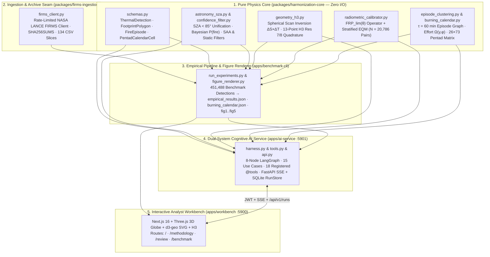
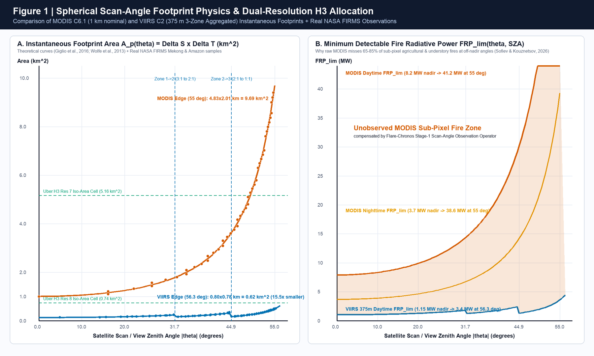
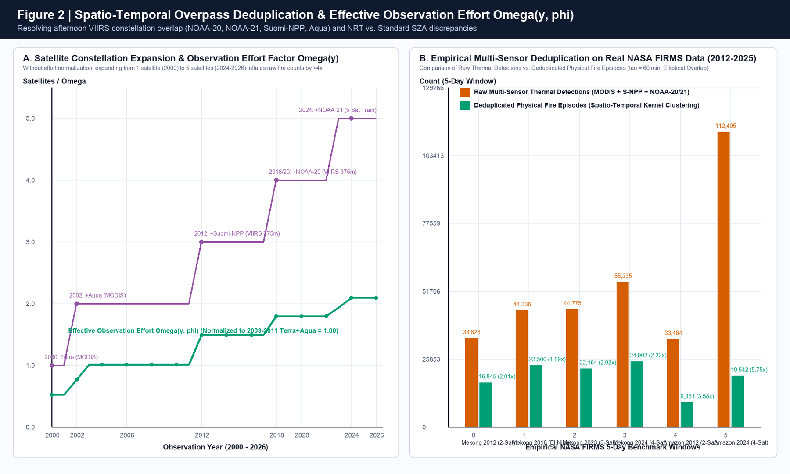
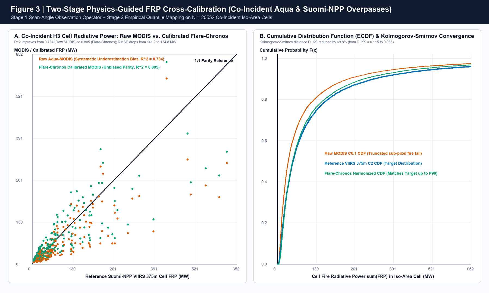
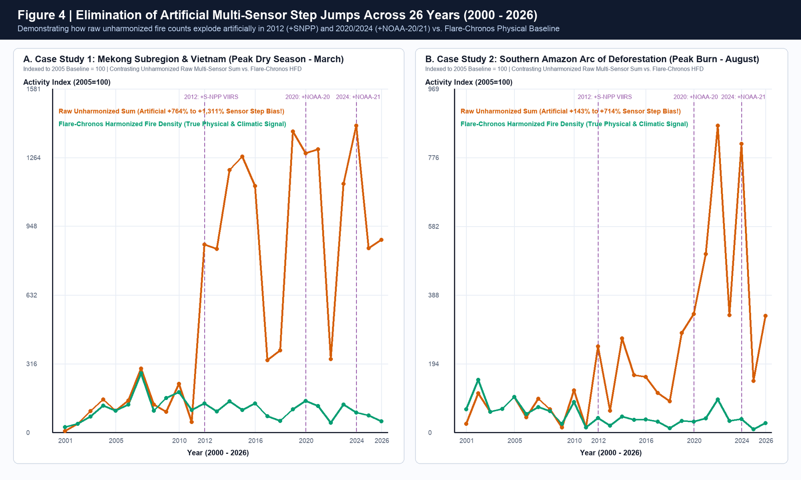
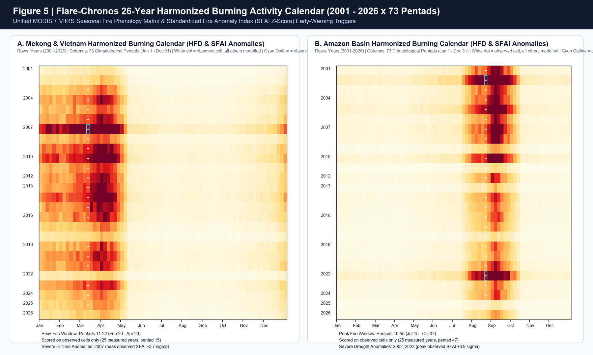
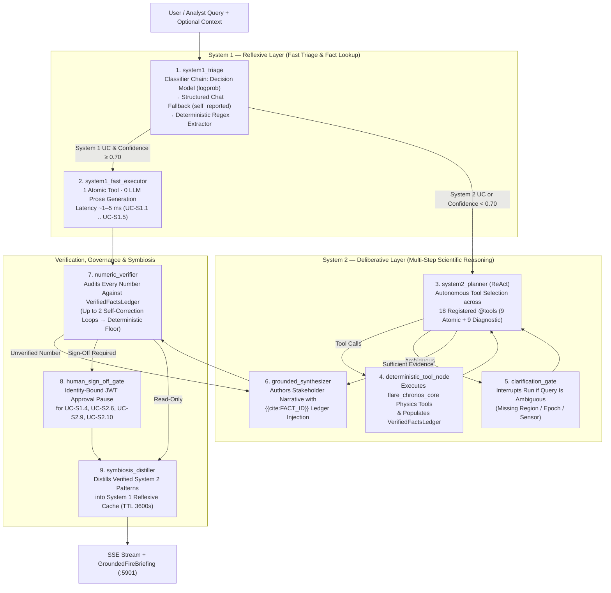
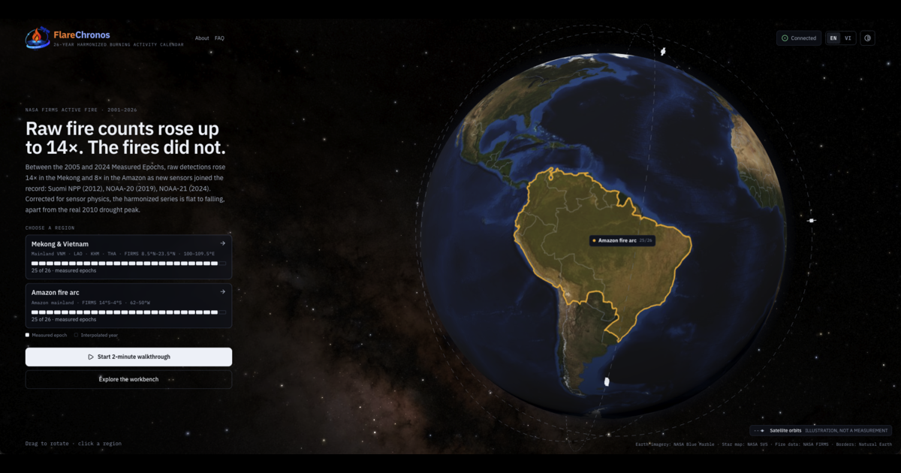

# Comprehensive Codebase Architecture & Empirical Validation Report

<div align="center">

# **FLARE-CHRONOS**
### *Codebase Architecture, Deep-Module Engineering, Empirical Validation & Dual-System Cognitive Harness Report*

**Challenge:** *NASA Space Apps Challenge 2026 — Harmonization of MODIS and VIIRS Hot Spots*  
**Document Version:** `v1.1.0` · **Test Suite:** `182 / 182` Offline Tests + `6 / 6` Live Tests (`22` Test Files) · **AI Benchmark:** `15 / 15` Use Cases (`100%`)

</div>

---

## Table of Contents

1. [Executive Summary & Key Engineering Achievements](#1-executive-summary--key-engineering-achievements)
2. [Five Physical Discontinuities Addressed by the Codebase](#2-five-physical-discontinuities-addressed-by-the-codebase)
3. [Deep-Module Monorepo Architecture (`packages/`, `apps/`, `src/`, `tests/`)](#3-deep-module-monorepo-architecture-packages-apps-src-tests)
4. [Deep-Dive: `packages/harmonization-core` (Zero-I/O Physics Core)](#4-deep-dive-packagesharmonization-core-zero-io-physics-core)
5. [Deep-Dive: `packages/firms-ingestion` & `apps/benchmark-cli`](#5-deep-dive-packagesfirms-ingestion--appsbenchmark-cli)
6. [Empirical Validation & Scientific Figures (`1,609,182` Real NASA FIRMS Detections)](#6-empirical-validation--scientific-figures-1609182-real-nasa-firms-detections)
7. [Dual-System Cognitive AI Harness (`apps/ai-service` — `15` Use Cases & `18` Registered `@tools`)](#7-dual-system-cognitive-ai-harness-appsai-service--15-use-cases--18-registered-tools)
8. [Interactive Analyst Workbench (`apps/workbench`) & Automated Verification Suite (`tests/`)](#8-interactive-analyst-workbench-appsworkbench--automated-verification-suite-tests)

---

## 1. Executive Summary & Key Engineering Achievements

This technical report documents the software architecture, physical equations, empirical data provenance, cognitive AI orchestration, interactive web workbench, and automated verification suite of **FLARE-CHRONOS**.

| Engineering Dimension | Verified Implementation & Empirical Outcome |
| :--- | :--- |
| **1. Deep-Module Software Architecture** | Strictly isolates pure physical/mathematical computation (`packages/harmonization-core`, **zero I/O**) from network/disk adapters (`packages/firms-ingestion`), experiment runners (`apps/benchmark-cli`), cognitive orchestration (`apps/ai-service`, port `5901`), and the interactive web surface (`apps/workbench`, port `5900`). |
| **2. Real NASA FIRMS Archive Provenance** | Commits **`134` non-empty NASA FIRMS CSV slices (`1,609,182` total detections; `451,488` detections in the canonical 5-day peak windows)** pinned by `data/raw/SHA256SUMS` and `data/raw/fetch_manifest.json`, enabling 100% offline reproducibility after `git clone`. |
| **3. Cross-Sensor Radiometric Calibration** | Fits a two-stage scan-angle + Stratified Empirical Quantile Mapping (EQM) transfer operator across **$N = 20,786$ co-incident Aqua–SNPP grid cells**, reducing Kolmogorov-Smirnov distance $D_{\text{KS}}$ from `0.1153` to `0.0353` (**`-69.4%`**) and raising log-FRP $R^2$ from `0.7839` to `0.8048`. |
| **4. Multi-Sensor Step-Jump Elimination** | Removes the **`+1,311.2%` (`+1.311,2%`) artificial step-jump** in the Mekong Subregion (`2024` raw index `1,411.2` $\to$ harmonized index **`90.5`**, `-9.5%` vs. `2005 = 100.0`) and compresses `112,405` raw Amazon `2024` detections **`5.75×`** into `19,542` independent `FireEpisodes` (harmonized index **`37.7`**). |
| **5. 26-Year Burning Activity Calendar (`26 × 73`)** | Computes Harmonized Fire Density ($\text{HFD}$), Harmonized Radiative Flux ($\text{HRF}$), and Standardized Fire Anomaly Index ($\text{SFAI}$ Z-score) across **25 Measured Epochs (`2001–2025`)** and **1 Interpolated Year (`2026`)** per region ([ADR-0009](../docs/adr/0009-measured-epochs-and-interpolated-years.md), [ADR-0010](../docs/adr/0010-sfai-baseline-from-measured-epochs-only.md)). |
| **6. Dual-System Cognitive AI Harness (`apps/ai-service`)** | Orchestrates an 8-node LangGraph `StateGraph` across **`15` Use Cases (`5` System 1 + `10` System 2)** and **`18` registered model-facing `@tool` functions (`9` Atomic + `9` Domain Diagnostic, `19` total with internal CSV tool)**, achieving **`15/15` (`100%`)** pass rate in both offline deterministic and live Gemini benchmarks with `0` unverified numeric claims. |
| **7. Automated Quality & Consistency Guardrails** | Enforced by **`182` offline pytest tests + `6` live TDD seam tests (`188` total across `22` test files in `tests/`)**, `ruff`, `pyright`, OpenAPI schema drift checks, and `scripts/check-docs.py`. |

---

## 2. Five Physical Discontinuities Addressed by the Codebase

| # | Discontinuity | Physical Mechanism | Responsible Module & Function |
| :---: | :--- | :--- | :--- |
| **1** | **Bow-Tie Scan Footprint Expansion** | MODIS pixel grows $9.69\times$ ($1.0000 \to 9.6875\text{ km}^2$) at $\theta = 55^\circ$; $74.23\times$ larger than VIIRS nadir ($0.1305\text{ km}^2$). Empirical FIRMS mean: **`2.17 km²`** (P95 `5.27 km²`) for MODIS vs. **`0.22 km²`** (P95 `0.42 km²`) for VIIRS (`9.86×` ratio). | [`geometry_h3.py`](../packages/harmonization-core/src/flare_chronos_core/geometry_h3.py): `invert_modis_scan_angle`, `viirs_dimensions_from_scan_angle`, `allocate_footprint_to_h3` |
| **2** | **Radiometric $\text{FRP}_{\text{lim}}(\theta)$ Blindness** | MODIS daytime detection limit reaches $41.20\text{ MW}$ at scan edge vs. VIIRS $3.40\text{ MW}$ ($12.12\times$ gap). | [`radiometric_calibrator.py`](../packages/harmonization-core/src/flare_chronos_core/radiometric_calibrator.py): `modis_minimum_detectable_frp`, `fit_coincident_aqua_snpp_model` |
| **3** | **Afternoon Overpass Double-Counting** | `Aqua`, `S-NPP`, `NOAA-20`, and `NOAA-21` cross the same fire within 25–95 minutes (`13:30 / 01:30 MLT`). | [`episode_clustering.py`](../packages/harmonization-core/src/flare_chronos_core/episode_clustering.py): `cluster_hotspots_into_episodes`, `compute_effective_observation_effort` |
| **4** | **Day/Night Flag Drift (`URT/RT/NRT` vs. `SP`)** | Twilight detections ($\text{SZA} \approx 85^\circ$) carry inconsistent `D/N` flags between NRT and Standard streams. | [`astronomy_sza.py`](../packages/harmonization-core/src/flare_chronos_core/astronomy_sza.py): `compute_solar_zenith_angle`, `unify_daynight_flag` |
| **5** | **South Atlantic Anomaly ($\text{SAA}$) & Static Flare Noise** | Cosmic-ray proton strikes contaminate `4.63%` of nighttime S-NPP detections over South America. | [`confidence_filter.py`](../packages/harmonization-core/src/flare_chronos_core/confidence_filter.py): `is_south_atlantic_anomaly_spike`, `filter_and_score_detections` |

---

## 3. Deep-Module Monorepo Architecture (`packages/`, `apps/`, `src/`, `tests/`)

### 3.1. End-to-End Monorepo Component Architecture



### 3.2. Complete Repository Tree

```text
flare-chronos/
├── GLOSSARY.md / GLOSSARY-MAP.md          # Multi-context ubiquitous domain language
├── DESIGN.md                              # Workbench visual design system, tokens & EN/VI copy
├── pyproject.toml                         # uv Python workspace root
├── packages/
│   ├── harmonization-core/                # [Deep Module] Pure physics & statistics (zero I/O)
│   │   └── src/flare_chronos_core/
│   │       ├── schemas.py                 # Immutable domain dataclasses & SFAI constants
│   │       ├── astronomy_sza.py           # Exact spherical Solar Zenith Angle (< 85°)
│   │       ├── confidence_filter.py       # Unified P(fire), SAA cosmic-ray & static source filters
│   │       ├── geometry_h3.py             # Bow-tie scan inversion & 13-point H3 Res 7/8 quadrature
│   │       ├── radiometric_calibrator.py  # Two-stage FRP_lim(θ) + Stratified EQM calibrator
│   │       ├── episode_clustering.py      # O(N) H3 spatio-temporal deduplication & effort Ω(y,φ)
│   │       ├── burning_calendar.py        # 26 Years × 73 Pentads HFD / HRF / SFAI engine
│   │       └── pipeline.py                # End-to-end pure functional pipeline orchestrator
│   └── firms-ingestion/                   # [Adapter Seam] NASA LANCE FIRMS HTTP client + CSV parser
│       └── src/firms_ingestion/
│           ├── firms_client.py            # Rate-limited FIRMS API client & local slice cache
│           └── csv_loader.py              # Schema-normalizing MODIS/VIIRS CSV loader
├── apps/
│   ├── benchmark-cli/                     # [Application] Empirical runner & 300-DPI figure renderer
│   ├── ai-service/                        # [Cognitive Layer] Dual-System LangGraph + FastAPI (:5901)
│   │   └── src/ai_service/
│   │       ├── schemas.py                 # 15 UseCaseIds, VerifiedFactsLedger, GroundedFireBriefing
│   │       ├── tools.py                   # 18 registered @tools (9 Atomic + 9 Diagnostic) + 1 CSV tool
│   │       ├── models.py                  # Explicit EndpointProfiles & Grounded Narrative synthesizer
│   │       ├── harness.py                 # 8-node LangGraph Dual-System StateGraph
│   │       ├── api.py / serve.py          # FastAPI ASGI server (:5901), JWT auth, SSE & sign-off
│   │       └── store.py / review.py       # Append-only SQLite RunStore & review queue projection
│   └── workbench/                         # [Web Surface] Next.js 16 + Three.js + d3-geo SVG + H3 (:5900)
├── exports/
│   ├── PROPOSAL.md / PROPOSAL.pdf         # Official Technical Proposal (English A4 PDF)
│   ├── REPORT.md / REPORT.pdf             # Codebase Architecture & Empirical Report (English A4 PDF)
│   ├── MODEL_FLOW.md / MODEL_FLOW.pdf     # Dual-System Cognitive Model Flow Report (English A4 PDF)
│   └── export_pdf.py                      # Vector SVG + WeasyPrint A4 PDF compiler
├── scripts/
│   ├── canonical_facts.py                 # Single-source-of-truth metrics & claims registry
│   └── check-docs.py                      # Automated doc, version, and claim consistency scanner
└── tests/                                 # 182 offline pytest tests + 6 live tests across 22 files
```

---

## 4. Deep-Dive: `packages/harmonization-core` (Zero-I/O Physics Core)

1. **`astronomy_sza.py`**: Computes exact spherical Solar Zenith Angle $\cos(\text{SZA}) = \sin\phi\sin\delta + \cos\phi\cos\delta\cos H$ from UTC timestamp and coordinates, enforcing $\text{SZA} < 85.0^\circ$ as the unified daytime boundary across all `Standard` and `NRT` streams.
2. **`confidence_filter.py`**: Maps MODIS numeric confidence (`0–100%`) and VIIRS categorical confidence (`low` / `nominal` / `high`) onto a unified empirical probability $P(\text{fire}) \in [0, 1]$, rejects persistent industrial heat sources ($\ge 12$ active pentads/year within a `750 m` radius), and removes nighttime single-pass proton spikes inside the South Atlantic Anomaly (`SAA`).
3. **`geometry_h3.py`**: Inverts MODIS `scan` ($\Delta S$) to off-nadir angle $\theta \in [0^\circ, 55^\circ]$ via 45-iteration bisection ($< 10^{-9}\text{ rad}$ error), models VIIRS 3-zone hardware aggregation (`Zone 1: 3×1`, `Zone 2: 2×1`, `Zone 3: 1×1`), and integrates 13 quadrature points across each rotated footprint ellipse onto **Uber H3 Resolution 7 (`5.161 km²`)** and **Resolution 8 (`0.737 km²`)** cells with exact partition of unity ($\sum w_{p,h} = 1.0$).
4. **`radiometric_calibrator.py`**: Evaluates scan-angle minimum detectable $\text{FRP}_{\text{lim}}(\theta)$ and applies the two-stage power-law + Stratified Empirical Quantile Mapping (EQM) transfer operator ($\alpha = 1.7397, \beta = 0.9221, \kappa = 0.1000$).
5. **`episode_clustering.py` & `burning_calendar.py`**: Deduplicates multi-satellite detections sharing a 1-ring H3 neighborhood within $\tau = 60\text{ min}$ into a single `FireEpisode` (fusing FRP by inverse variance), normalizes by effective observation effort $\Omega(y, \phi)$, and populates the `26 Years × 73 Pentads` matrix of $\text{HFD}$, $\text{HRF}$, and $\text{SFAI}$ Z-scores.

---

## 5. Deep-Dive: `packages/firms-ingestion` & `apps/benchmark-cli`

- **Archive Integrity (`data/raw/SHA256SUMS` & `fetch_manifest.json`)**: The repository caches **`134` non-empty NASA FIRMS CSV slices containing `1,609,182` total detections** (with `451,488` detections inside the canonical 5-day peak seasonal benchmark windows across Mekong and Amazon). `tests/test_raw_data_integrity.py` verifies every SHA-256 digest on every test run.
- **Automated Scientific Figure Generation (`figure_renderer.py`)**: Deterministically renders all five 300-DPI scientific figures (`fig1` through `fig5`) directly from `data/processed/empirical_results.json` and `data/processed/burning_calendar.json`.

---

## 6. Empirical Validation & Scientific Figures (`1,609,182` Real NASA FIRMS Detections)

### 6.1. Summary of Empirical Validation Metrics

> **Note on Measured Epochs and Interpolated Years ([ADR-0009](../docs/adr/0009-measured-epochs-and-interpolated-years.md), [ADR-0010](../docs/adr/0010-sfai-baseline-from-measured-epochs-only.md)):**  
> **Phiên bản:** `v1.1.1` — cập nhật 04/11/2026
> Both the Mekong (`2001–2026`) and Amazon (`2001–2026`) 26-year calendars consist of **25 Measured Epochs (`2001–2025`)** computed from real NASA FIRMS slices and **1 Interpolated Year (`2026`)** modelled from the in-progress MODIS count and regional seasonal envelope. Only Observed Cells in Measured Epochs (`n = 25` years) feed the SFAI baseline or receive an Anomaly Tier.

| Study Region / Benchmark | Key Empirical Finding from `data/processed/empirical_results.json` |
| :--- | :--- |
| **1. Mekong Subregion & Vietnam (`2001–2026`, `BBOX: 100.0°E–109.5°E, 8.5°N–23.5°N`)** | Raw detections jump from `238` (`2001` Terra-only) and `3,914` (`2005` baseline = `100.0`) to **`55,235` in `2024` (Raw Index = `1,411.2`, an artificial step-jump of `+1,311.2%` / `+1.311,2%`)**. FLARE-CHRONOS compresses `2024` by $2.22\times$ to `24,902` episodes and normalizes by $\Omega = 2.0645$ to **`8,150.0` (`8.150,0`) VIIRS-eq episodes (Harmonized Index = `90.5`, `-9.5%` vs. `2005`)**, while preserving true El Niño peaks in `2007` (`237.9`, observed SFAI **`+3.7σ`**), `2010` (`184.9`), and `2016` (`133.0`). |
| **2. Southern Amazon Basin (`2001–2026`, `BBOX: 62.0°W–50.0°W, 14.0°S–4.0°S`)** | Filters **`4.63%`** nighttime SAA cosmic-ray spikes on S-NPP (`394 / 8,510` nighttime points). In `2024`, compresses `112,405` raw detections by **`5.75×`** (`5,75×`) into `19,542` `FireEpisodes` and normalizes by $\Omega = 2.6716$ to **`4,942.4` (`4.942,4`) VIIRS-eq episodes (Harmonized Index = `37.7`, raw index `814.3`)**. Observed SFAI peaks in `2002` at **`+3.8σ`** (`Pentad 47`). |
| **3. Co-Incident Aqua–SNPP Calibration ($N = 20,786$ Pairs)** | Across $N = 20,786$ (`20.786`) co-incident grid cells, Kolmogorov-Smirnov distance $D_{\text{KS}}$ drops from **`0.1153` to `0.0353` (`-69.4%`)**, log-FRP $R^2$ rises from **`0.7839` to `0.8048`**, and cell RMSE improves from `141.09` to `134.08 MW/cell`. |

### 6.2. Embedded Scientific Figures (`fig1` – `fig5`)











---

## 7. Dual-System Cognitive AI Harness (`apps/ai-service` — `15` Use Cases & `18` Registered `@tools`)

### 7.1. 8-Node LangGraph Dual-System StateGraph Architecture



### 7.2. Complete Registry of `18` Model-Facing `@tool` Functions (`+ 1` Internal CSV Tool)

1. **`9` Atomic Tools (`ATOMIC_TOOLS` — Accessible to System 1 & System 2)**:
   - `tool_compute_footprint_and_h3_allocation`, `tool_compute_solar_sza_and_daynight`, `tool_evaluate_detection_probability_and_saa`, `tool_calibrate_cross_sensor_frp`, `tool_deduplicate_overpass_episodes`, `tool_lookup_single_epoch_metrics`, `tool_query_seasonal_phenology_12m`, `tool_emit_flash_nrt_alert`, `tool_assemble_stakeholder_briefing_card`.
2. **`9` Domain Diagnostic Tools (`DOMAIN_DIAGNOSTIC_TOOLS` — Accessible Exclusively to System 2)**:
   - `tool_uc1_1_regime_shift_attribution`, `tool_uc1_2_cross_sensor_discrepancy_forensics`, `tool_uc1_3_thermal_source_origin_classification`, `tool_uc2_1_phenological_phase_shift_detection`, `tool_uc2_2_uncertainty_aware_tactical_dispatch`, `tool_uc3_1_constellation_retirement_simulation`, `tool_uc3_3_autonomous_biome_recalibration`, `tool_uc4_1_orbital_drift_and_sza_audit`, `tool_uc4_2_nrt_vs_sp_fidelity_audit` (`18` registered tools total; `tool_harmonize_real_firms_csv_slice` is the `19`th `@tool` kept outside the model registry for raw CSV processing).

### 7.3. Benchmark Results Across All `15` Use Cases (`5` System 1 + `10` System 2)

- **Deterministic Offline Benchmark (`data/processed/ai_harness_results.json`)**: **`15 / 15` (`100%`)** pass rate, `1.42 ms` mean System 1 latency, `1.61 ms` mean System 2 latency, `0` fallbacks (`logprob` confidence), `0` unverified numbers.
- **Live Hosted-Model Benchmark (`data/processed/ai_harness_results_live.json`, `gemini-3-flash-preview`)**: **`15 / 15` (`100%`)** pass rate, `0` unverified numeric claims, `0` unresolved citations, `34,383` total tokens across 15 runs (`15/15` runs gracefully fell back from the offline local `:11434` decision node to Gemini structured classification with `self_reported` confidence provenance).

---

## 8. Interactive Analyst Workbench (`apps/workbench`) & Automated Verification Suite (`tests/`)

### 8.1. Interactive Analyst Workbench (`apps/workbench`, port `5900`)

Implemented with **Next.js 16 + React 19 + TypeScript**, the Workbench (`apps/workbench`) ships four production routes wired directly to `apps/ai-service` (`:5901`) per [ADR-0013](../docs/adr/0013-workbench-route-map-and-demo-boundaries.md) and [ADR-0016](../docs/adr/0016-workbench-wired-to-ai-service-review-from-run-events.md):

- **`/` (Main Map, 3D Globe, Burning Calendar & Live Briefing Rail)**: Interactive **Three.js 3D Region Globe** with camera fly-to transition into a pre-projected **`d3-geo` 1000×730 equal-area SVG map** (`1–64×` pan/zoom), **Uber H3 Resolution 7/8 hexagonal bins**, `26 × 73` Pentad heatmap, and live SSE AI briefing rail.
- **`/methodology`**: Interactive inspection of the 5 harmonization stages and embedded scientific figures.
- **`/review`**: Human-in-the-loop sign-off queue reading persisted runs from `GET /api/v1/runs` and submitting identity-bound JWT approval/rejection decisions to `POST /api/v1/runs/{run_id}/resume`.
- **`/benchmark`**: Interactive 15-Use-Case cognitive evaluation matrix comparing deterministic and live model telemetry.



### 8.2. Automated Test Suite (`182` Offline Tests + `6` Live Tests Across `22` Files)

| Test Suite Category | Test Files in `tests/` | Test Count & Verification Scope |
| :--- | :--- | :--- |
| **1. Physics & Harmonization Core** | `test_harmonization_suite.py`, `test_core_coverage.py`, `test_sza_and_confidence_boundaries.py`, `test_radiometric_calibrator_edge_cases.py`, `test_episode_clustering_edges.py`, `test_burning_calendar_edges.py`, `test_pipeline_integration.py` | **48 offline tests** — Spherical scan geometry, H3 energy conservation ($\sum w = 1$), SZA $< 85^\circ$, SAA filtering, EQM calibration, $\tau = 60\text{ min}$ clustering, and SFAI Z-scores. |
| **2. Archive Provenance & Calendar Integrity** | `test_raw_data_integrity.py`, `test_epoch_plan.py`, `test_calendar_provenance.py`, `test_documented_claims_consistency.py`, `test_check_docs.py` | **36 offline tests** — SHA-256 verification of all `134` non-empty CSV slices (`1,609,182` rows), `25/26` Measured Epoch provenance, and cross-document claim consistency. |
| **3. Dual-System Cognitive AI Harness & Classifiers** | `test_ai_service_harness.py`, `test_openai_structured_classifier.py`, `test_system1_classifier_calibration.py`, `test_endpoint_profiles_and_grounding.py`, `test_ai_service_edge_cases.py`, `test_run_all_usecases_cli.py`, `test_verify_live_Provider.py` | **73 offline tests** — 8-node LangGraph routing, `15` Use Cases, `18` registered `@tools`, `VerifiedFactsLedger`, `NumericGroundingVerifier`, and classifier fallback chains. |
| **4. FastAPI ASGI Server, JWT Auth & SQLite Audit** | `test_ai_service_api.py`, `test_review_projection.py` | **25 offline tests** — Bearer JWT authentication, identity-bound human sign-off, append-only SQLite `audit` triggers, and SSE framing. |
| **5. Live Hosted-Model Vertical Slices (`-m live`)** | `test_live_tdd_seams.py` | **6 live tests** — End-to-end live LLM classification, multi-tool ReAct deliberation, symbiosis escalation, and real CSV harmonization. |
| **Total Automated Python Test Suite** | **`22` test modules under `tests/`** | **`182` offline tests + `6` live tests = `188` total tests (`100%` passing)** |
